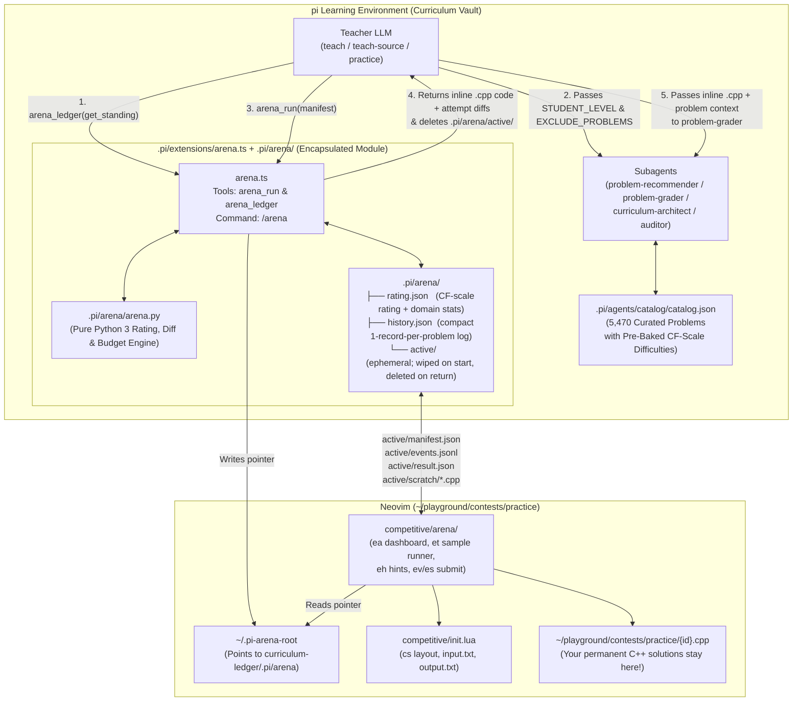

# Competitive Programming Arena — Final MVP Design Blueprint (`v7`)

> [!IMPORTANT]
> **What Changed in `v7`:**
> - **Teacher Sovereignty Over Cookie-Cutter Recipes (`Section 3 [D4]/[D8]` & `Section 6`):**
>   - Removed all prescribed problem counts (`1`, `1–2`, `2–3`) from the skills and design. The Teacher chooses how many problems to request and stage based on the live classroom context.
>   - Replaced rigid `if/then` recipes in `teach/SKILL.md`, `teach-source/SKILL.md`, and `practice/SKILL.md` with clear **tool mechanics and state semantics**: explaining what `arena_run`'s modes/flags control and what an OJ verdict vs. `SUBMITTED` means in the Arena ledger, while leaving all pedagogical decisions to the Teacher.

---

## 1. Core Architectural Principles

1. **Zero Coupling to `theme-ac`:**
   - `nvim/lua/competitive/theme_ac/` and `~/playground/.theme-ac/` remain 100% untouched.
   - `arena` lives in its own namespaces: `nvim/lua/competitive/arena/` (Neovim plugin) and `.pi/arena/` + `.pi/extensions/arena.ts` (`pi` backend & extension).
   - It layers cleanly on top of your core Neovim competitive session (`<leader>cs` in `~/playground/contests/practice/`), reusing your `layout.lua`, `scaffold.lua`, and `<leader>cr` / `<leader>cd` / `<leader>cb` compile-and-run workflow.

2. **Strict Module Encapsulation (Black-Box `.pi/arena/`):**
   - `.pi/arena/*` (`rating.json`, `history.json`, and ephemeral `active/*`) is strictly internal to the `arena` extension (`arena.ts` + `arena.py`).
   - All interaction between the Teacher and the Arena happens through two deterministic tools registered by `.pi/extensions/arena.ts`:
     - **`arena_ledger`**: Queries the student's current CF-equivalent standing, domain stats, and solved/attempted problem IDs (`action: "get_standing"`), or settles a pending verdict in the ledger (`action: "record_verdict"`).
     - **`arena_run`**: Launches an interactive Neovim Arena session and returns a self-contained structured packet—including the student's **full final `.cpp` source code and multi-attempt unified diffs inline**—while automatically cleaning up `.pi/arena/active/`.

3. **The Blackboard & The Arena (Two Halves of One Classroom, Run by the Teacher):**
   - **The Blackboard (in `pi`)** is where intuition, small 3–4 element traces, visual diagrams (`visualize`), and quick diagnostic checks (`quiz`) happen in conversation.
   - **The Arena (`arena_run`)** is the deterministic bridge to the student's Neovim C++ workspace whenever it is time to write code or work under a clock.
   - **Teacher Sovereignty:** The skills describe *how the tools work and what their states mean*—never prescribing problem counts or rigid classroom scripts. The Teacher decides when to teach at the board, when to open the Arena, how many problems to stage, which clock/hint policy to set, and how to handle the returned code.

---

## 2. System Topology & File Layout (Ubuntu Target)



### 2.1 Private `.pi/arena/` State (Lifecycle & Cleanup)

```text
.pi/arena/
├── arena.py                  # Pure Python 3 engine: CF-Elo math, unified diffs, time budgets
├── rating.json               # Persistent: Global CF-equivalent rating + 8-domain solve counters
├── history.json              # Persistent: Compact 1-entry-per-problem ledger (no source code bloat)
└── active/                   # EPHEMERAL: Created when arena_run starts; DELETED when arena_run returns
    ├── manifest.json         # Current session problem cards, samples, hints, & timer rules
    ├── events.jsonl          # Live heartbeat/status events from Neovim -> pi TUI
    ├── result.json           # Final session summary written by Neovim on close
    └── scratch/              # Temporary code copies captured by Neovim on each attempt
        ├── <id>_attempt_1_WA.cpp
        └── <id>_final.cpp
```

### 2.2 Cross-Directory Discovery on Ubuntu (`~/.pi-arena-root`)
- You run `pi` inside your `curriculum-ledger` repository and run Neovim inside `~/playground/contests/practice/`.
- Whenever `arena.ts` loads (and before every `arena_run`), it writes the absolute POSIX path of `<vault>/.pi/arena` to `~/.pi-arena-root`.
- When you press `<leader>ea` (`:Arena`) inside Neovim in `~/playground/contests/practice/`, `nvim/lua/competitive/arena/config.lua` reads `~/.pi-arena-root` (or `$PI_ARENA_DIR` if set) and immediately connects to `<vault>/.pi/arena/active/manifest.json`.
- Your `.cpp` files are always created and edited directly in `~/playground/contests/practice/{id}.cpp`. When you log an attempt (`<leader>ev`) or submit to the Teacher (`<leader>es`), Neovim copies `{id}.cpp` into `<arena_root>/active/scratch/` so `arena.ts` can read the code, compute diffs, embed them inline for the Teacher, and delete `active/`.

---

## 3. Core Design Decisions (`[D1]`–`[D11]`)

### `[D1]` Strict Encapsulation via `arena_ledger` & `arena_run`
- **Tool 1: `arena_ledger`**
  - `action: "get_standing"`: Returns the student's current CF-equivalent rating (`rating`, `tier`, `rated_solved`, `streak`), per-domain objective stats (`solved`, `attempted`, `avg_solved_difficulty`, `recent_failures`), and the list of solved/attempted problem IDs.
  - `action: "record_verdict"`: Settles a pending verdict in `rating.json` and `history.json` (`sessionId`, `problemId`, `verdict: "AC" | "WA" | "TLE" | "MLE" | "RE"`).
- **Tool 2: `arena_run`**
  - Launches the Neovim Arena session, displays a live status card in `pi`, and on completion returns the full session result (including inline `.cpp` code and unified diffs across attempts) directly in the tool output.

### `[D2]` Zero Snapshot Bloat & Inline Code Delivery
- `history.json` stores **one compact JSON record per problem** (`session_id`, `course_slug`, `purpose`, `problem_id`, `title`, `url`, `difficulty`, `domain`, `verdict`, `duration_seconds`, `budget_seconds`, `overtime_seconds`, `wrong_attempts`, `hints_used`, `rated`, `rating_before`, `rating_after`, `rating_delta`, `reflection`, `timestamp`).
- If you re-attempt or upsolve a problem later, `arena.py` updates that problem's entry in `history.json` and appends a compact item to its `past_attempts` array (`{ timestamp, verdict, duration_seconds, purpose }`).
- When `arena_run` finishes, `arena.ts` reads `active/scratch/*.cpp`, computes unified diffs (`diff -u` via `arena.py`) between earlier failed attempts and `<id>_final.cpp`, embeds the final `.cpp` and diffs inline in the tool response, and deletes `.pi/arena/active/`.

### `[D3]` Opening the Arena: Existing Neovim First + Optional `herdr` Key
- **Primary Flow (Zero Vendor Lock-in):** In your already-open Neovim session in `~/playground/contests/practice`, press `<leader>ea` (or `:Arena`).
- **Optional `pi` TUI Convenience Key (`[l]`):** While `pi` displays the live waiting card, pressing `l` runs a configurable command (`HERDR_LAUNCH_CMD`, defaulting to `process.env.PI_ARENA_LAUNCH_CMD ?? "herdr new-tab --cwd ~/playground/contests/practice --cmd 'nvim -c CompetitiveSession -c Arena'"`).

### `[D4]` Arena Mode Semantics (Controlled by the Teacher)

The Teacher can pass any number of problems to `arena_run` and configure the room's behavior via `purpose` (with sensible defaults for `timerMode`, `gradingPolicy`, and `blindMetadata` that the Teacher can always override):

| `purpose` | Default `timerMode` | Default `gradingPolicy` | Default `blindMetadata` | Hints (`<leader>eh`) | Rated? |
| :--- | :--- | :--- | :--- | :--- | :--- |
| **`guided`** | `"stopwatch"` (counts up) | `"practice"` | `false` | Unlocked (free) | **No** ($\Delta R = 0$) |
| **`drill`** | `"per_problem"` or `"pooled"` | `"study"` | `false` | Unlocked (caps Elo $S$) | **Yes** ($K = 16$) |
| **`checkpoint`** | `"pooled"` or `"per_problem"` | `"contest"` | **`true`** (tags & diff masked) | Locked | **Yes** ($K = 24$) |
| **`upsolve`** / **`volume`** | `"per_problem"` or `"pooled"` | `"study"` or `"contest"` | Configurable | Unlocked in `study` | **Yes** ($K = 16$) |

- Whenever a `"guided"` session has a single problem in the queue, pressing `<leader>ea` skips the queue modal and immediately scaffolds `{id}.cpp`, loads Sample 1 into `input.txt`, starts the count-up stopwatch, and puts your cursor in the code buffer.

### `[D5]` Teacher-Aligned Overtime (No Forced-DNF Lockout)
- When a countdown timer reaches `00:00`, Neovim flashes a non-blocking warning (`[Arena] Time budget reached — now in OVERTIME (+00:01)`) and switches the timer highlight to `@ArenaOvertime`, counting **up** (`+MM:SS`).
- You can finish your thought and submit normally (`<leader>ev` or `<leader>es`), recording both the true technical verdict (`AC`, `WA`, `TLE`, `RE`, `ABANDON`, `SUBMITTED`) and `overtime_seconds`.

### `[D6]` Progressive In-Arena Hints (`<leader>eh` / `:ArenaHint`)
- The Teacher stages a progressive `hints` array per problem in `arena_run` (taken from `problem-recommender`'s `Progressive Hint Ladder`).
- Pressing `<leader>eh` in Neovim reveals Hint 1, then Hint 2, then Hint 3, increments `hints_used`, and logs a live `hint_used` event to `pi`.

### `[D7]` Automated Sample Population & Instant Local Sample Runner (`<leader>et`)
- Accepting a problem writes **Sample 1's input** into `~/playground/contests/practice/input.txt` and prints **Sample 1's expected output** in a comment block at the bottom of `{id}.cpp` (`#ifdef LOCAL_SAMPLES ... #endif`).
- Pressing **`<leader>et`** (`:ArenaTest`) compiles `{id}.cpp` into `./bin/{id}` using your standard flags (`g++ -O2 -std=c++20 -Wall -Wextra`) and runs it against **all** sample pairs in the manifest in `< 1s`, popping up a `✓ Sample 1 (12ms)` / `✗ Sample 2 (Expected vs Actual)` window.

### `[D8]` Verdict Semantics (`<leader>ev` OJ Verdicts vs. `<leader>es` `SUBMITTED`)
- **Logging an Online Judge Verdict (`<leader>ev` / `:ArenaVerdict`):**
  - The student tested on an external judge (or self-declared abandonment) and logged:
    1. `AC` — Accepted (snapshots `<id>_final.cpp`, prompts for optional 1-line reflection note, marks problem complete)
    2. `WA — Keep Solving` (snapshots `<id>_attempt_N_WA.cpp`, increments `wrong_attempts`, keeps clock running!)
    3. `WA — Stop & Move On` (snapshots `<id>_final.cpp`, records final `WA`)
    4. `TLE — Time Limit Exceeded`
    5. `MLE — Memory Limit Exceeded`
    6. `RE — Runtime Error`
    7. `ABANDON — Give Up / Need Blackboard Help`
  - Because the verdict is already known at close, `arena.py` settles the rating and history entry immediately when the Arena closes.
- **Handing Code Directly to the Teacher (`<leader>es` / `:ArenaSubmit`):**
  - Snapshots `<id>_final.cpp`, prompts for an optional 1-line reflection/complexity note, and records verdict `SUBMITTED`.
  - `SUBMITTED` means the student does **not** claim the code is OJ-verified—they are handing the raw `.cpp` code to the Teacher. In the Arena ledger (`history.json` / `rating.json`), that problem's verdict and rating update remain **pending (`SUBMITTED`)** until the Teacher evaluates the code and updates the ledger via `arena_ledger(action="record_verdict", ...)`.

### `[D9]` High-Signal Pedagogical Telemetry
No keystroke or compile-count surveillance (`nvim/lua/competitive/dispatcher.lua` is untouched). Every problem result returned by `arena_run` carries 6 high-signal pedagogical fields:
1. **Duration vs. Budget:** `duration_seconds`, `budget_seconds`, `overtime_seconds`
2. **Attempt Timeline:** `wrong_attempts` and `attempts[]` (`{ attempt, verdict, elapsed_seconds }`)
3. **Inline Final Code & Attempt Diffs:** `final_code` (full `.cpp` string) and `attempt_diffs[]` (unified diffs showing exactly what changed between failed attempts and final code)
4. **Hints Used:** `hints_used` (`0..3`) and which hint rungs were viewed
5. **Student Reflection Note:** `reflection` (1-line note entered on submit/close)
6. **Rating Update:** `rated`, `rating_before`, `rating_after`, `rating_delta` (or `pending_verdict: true` when `verdict == "SUBMITTED"`)

### `[D10]` Honest CF-Equivalent Rating System
- **Scale:** Codeforces `800`–`3000`, seeded at **`1200`** (`~883` AtCoder via $\text{CF} = \text{round}(0.85 \times \text{AC} + 450)$).
- **Pre-Baked Deterministic Catalog Difficulties (`.pi/agents/catalog/build_catalog.py`):**
  - `2,667` Codeforces problems $\to$ `"cf_official"` (exact official CF rating `800`–`3500`)
  - `1,138` AtCoder problems $\to$ `"ac_converted"` (converted via $\text{round}((0.85 \times \max(100, \text{AC}) + 450)/50)\times 50$, plus `typical90` $\star 2 \dots \star 7 \to 800 \dots 2200$)
  - Remaining problems (CSES, USACO, SPOJ, UVa, Kattis) $\to$ `"catalog_tier"` (derived deterministically from UTL's `difficulty: 1..5` + `solve_count` in `sources/utl/topicListFullData.js` and Progvar's track/position in `sources/progvar/sets.csv` & `problems_unique.csv`)
- **Anti-Inflation Elo Math (`.pi/arena/arena.py`):**
  - Expected score: $E = \frac{1}{1 + 10^{(D - R) / 400}}$
  - Actual score $S \in [0, 1]$:
    - Clean in-time `AC` (`0` hints, $\text{overtime} = 0$): $S = \max(0.60,\; 1.0 - 0.10 \times \text{wrong\_attempts})$
    - Overtime `AC` (`0` hints, $\text{overtime} > 0$): $S = 0.45 \times \exp(-\text{overtime} / \text{budget}) \le 0.45$
    - Hinted `AC` ($1$ hint): $S = 0.25$ ($0.15$ if also overtime)
    - Hinted `AC` ($2+$ hints): $S = 0.10$
    - Failed / Unsolved (`WA`, `TLE`, `MLE`, `RE`, `ABANDON`): $S = 0.0$
  - Rating delta: $\Delta R = \text{round}(K \times (S - E))$ where $K = 24$ (`checkpoint`), $K = 16$ (`drill`/`upsolve`/`volume`), $K = 0$ (`guided`).
- **Default Time Budgets (when Teacher omits `timeBudgetSeconds`):**
  $$\text{budget}_{\text{sec}} = \text{clamp}_{[10\text{m},\; 90\text{m}]}\!\left(60 \times \text{round}\!\left(25 \times 2^{(D - R)/400}\right)\right)$$

### `[D11]` Guarded `<leader>e*` Keybindings in Neovim
- All `<leader>e*` bindings and `:Arena*` commands check:
  1. `require("competitive.init").is_active == true` (else warns: `[Competitive] Start a session first (<leader>cs)`).
  2. For `<leader>ea` / `<leader>eq`: checks that `.pi/arena/active/manifest.json` exists (or opens the read-only Stats tab if you explicitly run `:ArenaStats`).
  3. For `<leader>ec`, `<leader>et`, `<leader>eh`, `<leader>es`, `<leader>ev`, `<leader>eo`, `<leader>ex`: checks that an Arena problem is currently accepted/active.

---

## 4. Tool Contracts (`arena_ledger` & `arena_run`)

### 4.1 `arena_ledger`
```ts
{
  action: "get_standing" | "record_verdict",
  // Only for action === "record_verdict":
  sessionId?: string,
  problemId?: string,
  verdict?: "AC" | "WA" | "TLE" | "MLE" | "RE"
}
```
**Returns (`get_standing`):**
```json
{
  "global": {
    "rating": 1248,
    "tier": "Pupil (CF 1200-1399)",
    "max_rating": 1260,
    "rated_solved": 14,
    "rated_attempted": 17,
    "streak": 4
  },
  "domains": {
    "Dynamic Programming": { "solved": 5, "attempted": 6, "avg_solved_difficulty": 1320, "recent_failures": ["cf_455A"] },
    "Graphs": { "solved": 3, "attempted": 4, "avg_solved_difficulty": 1250, "recent_failures": [] }
  },
  "solved_problem_ids": ["cses_1633", "cf_189A", "dp_a", "dp_b"],
  "recent_history": [
    { "problem_id": "dp_b", "title": "Frog 2", "difficulty": 900, "purpose": "guided", "verdict": "AC", "duration_seconds": 380, "rating_delta": 0 }
  ]
}
```

### 4.2 `arena_run`
```ts
{
  title: string,
  purpose: "guided" | "drill" | "checkpoint" | "upsolve" | "volume",
  gradingPolicy?: "practice" | "study" | "contest",
  timerMode?: "stopwatch" | "per_problem" | "pooled",
  totalTimeBudgetSeconds?: number,
  blindMetadata?: boolean,
  coachNote?: string,
  problems: Array<{
    id: string,                    // C++ filename stem in ~/playground/contests/practice/{id}.cpp
    catalogId?: string,
    title: string,
    url: string,
    platform?: string,
    difficulty: number,            // Deterministic CF-scale difficulty from catalog.py (800..3000)
    domain?: string,
    timeBudgetSeconds?: number,
    statementSummary: string,
    constraints?: string,
    samples?: Array<{ input: string; output: string }>,
    hints?: string[],              // Progressive Socratic hints for <leader>eh
    targetConcept?: string
  }>
}
```

---

## 5. Neovim Arena UX (`nvim/lua/competitive/arena/`)

### 5.1 Keymaps (`<leader>e` — "Exercise / Arena")

| Keymap | Command | Guard | Action |
| :--- | :--- | :--- | :--- |
| `<leader>ea` | `:Arena` | `<leader>cs` + staged manifest | **Open / Toggle Arena** (auto-accepts immediately if `purpose == "guided"` with 1 problem; otherwise opens the 3-tab Arena Dashboard) |
| `<leader>eq` | `:ArenaQueue` | `<leader>cs` + active session | Jump directly to the **Arena Queue** tab |
| `<leader>ec` | `:ArenaCard` | `<leader>cs` + active problem | Popup current problem's **Statement, Constraints, & Samples** |
| `<leader>et` | `:ArenaTest` | `<leader>cs` + active problem | **Compile & Run All Manifest Samples** (`✓`/`✗` diff popup in `< 1s`) |
| `<leader>eh` | `:ArenaHint` | `<leader>cs` + active problem | **Request Next Socratic Hint** (1 $\to$ 2 $\to$ 3; disabled in `contest` policy) |
| `<leader>es` | `:ArenaSubmit` | `<leader>cs` + active problem | **Submit C++ Code for Teacher Review** (logs `SUBMITTED`, snapshots code) |
| `<leader>ev` | `:ArenaVerdict` | `<leader>cs` + active problem | **Log Online Judge Verdict** (`AC`, `WA — Keep Solving`, `WA — Stop`, `TLE`, `MLE`, `RE`, `ABANDON`) |
| `<leader>eo` | `:ArenaOpen` | `<leader>cs` + active problem | Open problem URL in browser (`wslview` / `xdg-open`) |
| `<leader>ex` | `:ArenaClose` | `<leader>cs` + active session | **Finish & Return to Teacher** (writes `active/result.json`) |

---

## 6. Seamless Day-0 Skill & Subagent Integration (Exact Peek)

> [!TIP]
> **Guiding Philosophy for Skill Updates:**
> 1. **Sovereignty Over Recipes:** We do not prescribe problem counts or hand the Teacher rigid `if/then` classroom scripts. We explain the **capabilities and state semantics** of `arena_run` and `arena_ledger` (e.g., what `purpose`/`blindMetadata` control, and why a `SUBMITTED` verdict remains pending in the ledger until settled), and trust the Teacher's judgment.
> 2. **Zero Negations or Stitches:** Written in the exact Feynman-esque voice of the existing skills, as if `arena_run` and `arena_ledger` were there from Day 0 alongside `quiz`, `visualize`, and `subagent`.

### 6.1 `teach/SKILL.md` & `teach-source/SKILL.md` — Exact Changes

1. **In Section 2 (`Stepping Up to the Board — Resuming vs. Starting Fresh`):**
   - **Resuming:** Check `arena_ledger(action="get_standing")` alongside `curriculum.md`, `course.md`, and the transcript tail so the student's live rating, domain stats, and recent Arena history are fresh in mind.
   - **Starting Fresh:** Call `arena_ledger(action="get_standing")` backstage before Stage 1 and pass `STUDENT_STANDING` into `curriculum-architect` and `auditor`.

2. **In Section 3 (`Working Through Concepts & Problems`):**

````carousel
```markdown
### BEFORE (teach/SKILL.md — Section 3)
## 3. Working Through Concepts & Problems (Guided Discovery)

- **Move at the student's rhythm:** Take one puzzle or idea at a time, keeping upcoming topics and problems unspoiled backstage until the student chooses to open the next one.
- **Pick calibrated problems when needed (`problem-recommender`):** Whenever you reach a practice step or want a problem targeting a specific idea or boundary slip, call `problem-recommender`:
  ```
  subagent(agent="problem-recommender", task="
  CONCEPT_OR_INVARIANT: <target idea>
  STUDENT_LEVEL: <from Where the student stands in course.md>
  WHAT_TO_TARGET: <e.g. clean first workout, disguised reduction, or test for a specific boundary slip>
  TIME_BUDGET: 15-30 min
  EXCLUDE_PROBLEMS: [<all ✓ solved and planned problems from course.md>]
  COUNT: 1
  ")
  ```
- **Let the student take the first swing (Pure Cold Launch):** Open each problem with just the clickable **judge URL, the faithful problem statement in its natural wording, the constraints, and the samples**, and invite their first thoughts.
- **Coach the code & test thoroughly (`problem-grader`):** Whenever the student sketches a reduction or writes C++ in `courses/<slug>/solution.cpp`, run `problem-grader` backstage and wait for its verdict before replying:
  ```
  subagent(agent="problem-grader", task="
  PROBLEM: <Problem Name, verified URL, and key constraints>
  STUDENT_SUBMISSION: courses/<slug>/solution.cpp
  ")
  ```
  Turn any failing case from the grader into a small 3–4 element trace on the board next to the relevant lines of their code so they spot the discrepancy themselves.
- **Close in proportion to what remains unsaid:** When a solution passes, tick `✓` in `course.md`, confirm the verdict, say only what the finished code reveals that wasn't already unpacked on the climb, and ask what they'd like to do next.
```
<!-- slide -->
```markdown
### AFTER (teach/SKILL.md — Section 3, Sovereign Day-0 Integration)
## 3. Working Through Concepts & Problems (Blackboard & Arena)

- **Move at the student's rhythm:** Take one puzzle or idea at a time, keeping upcoming topics and problems unspoiled backstage until the student chooses to open the next one.
- **Pick calibrated problems when needed (`problem-recommender`):** Whenever you want problem(s) targeting a specific idea, variation, or boundary slip, call `problem-recommender`:
  ```
  subagent(agent="problem-recommender", task="
  CONCEPT_OR_INVARIANT: <target idea>
  STUDENT_LEVEL: <from Where the student stands in course.md and arena_ledger>
  WHAT_TO_TARGET: <e.g. clean first workout, disguised reduction, or test for a specific boundary slip>
  TIME_BUDGET: <target budget>
  EXCLUDE_PROBLEMS: [<all ✓ solved and planned problems from course.md and arena_ledger>]
  COUNT: <number of problems>
  ")
  ```
- **Let the student take the first swing (Pure Cold Launch):** At the blackboard, open a problem with just the clickable **judge URL, the faithful problem statement in its natural wording, the constraints, and the samples**, and invite their first thoughts.
- **Open the Neovim Arena when it is time to write C++ or work under a clock (`arena_run` & `arena_ledger`):**
  `arena_run` stages problem(s), sample tests, progressive hints, and a timer directly into the student's Neovim competitive workspace, and returns their final `.cpp` code, unified diffs across attempts, elapsed/overtime seconds, hints viewed, and reflection note when they close the session:
  - **Session modes (`purpose`):** `"guided"` runs an unrated count-up stopwatch (`gradingPolicy: "practice"`) for turning a blackboard derivation into working C++; `"drill"`, `"upsolve"`, and `"volume"` run rated timed practice (`gradingPolicy: "study"`, hints unlocked); `"checkpoint"` runs a rated contest check (`gradingPolicy: "contest"`, `blindMetadata: true` to mask topic/difficulty tags, hints locked) when testing cold recognition. You can override `timerMode`, `gradingPolicy`, `blindMetadata`, and time budgets freely.
  - **Verdict semantics in the ledger:** An online judge verdict (`AC`, `WA`, `TLE`, `MLE`, `RE`, `ABANDON`) means the student logged a judge result directly in Neovim and the Arena ledger has already settled any rating update. A verdict of `SUBMITTED` means the student does not claim OJ verification and handed the code directly to you—its status and rating impact in the Arena ledger remain pending until settled via `arena_ledger(action="record_verdict", sessionId=..., problemId=..., verdict="AC"|"WA"|"TLE"|"MLE"|"RE")`.
- **Coach the code & test thoroughly (`problem-grader`):** Whenever the student sketches a reduction on the board or returns C++ code from `arena_run`, run `problem-grader` backstage to verify correctness and constraints:
  ```
  subagent(agent="problem-grader", task="
  PROBLEM: <Problem Name, verified URL, and key constraints>
  STUDENT_SUBMISSION:
  <inline C++ code from arena_run, or pre-code reduction>
  ")
  ```
  Turn any failing counterexample from the grader—or any telling shift across their Arena attempt diffs—into a small 3–4 element trace on the board next to the relevant lines of their code so they spot the discrepancy themselves.
- **Close in proportion to what remains unsaid:** When a solution passes, tick `✓` in `course.md`, confirm the verdict, say only what the finished code reveals that wasn't already unpacked on the climb, and ask what they'd like to do next.
```
````

*(Note: `teach-source/SKILL.md` receives the identical Section 2 and Section 3 update, preserving its source-specific note that `courses/<slug>/sources/` problems are the primary workout and `problem-recommender` is available whenever an extra bridge or drill is needed.)*

---

### 6.2 `practice/SKILL.md` — Complete Day-0 Skill

```markdown
---
name: practice
description: "Standalone competitive programming practice coach at a shared blackboard and Neovim Arena. Picks calibrated problems via problem-recommender, runs guided or timed sessions in Neovim via arena_run, offers step-by-step nudges, and tests reductions or C++ code via problem-grader."
---

# Deliberate Problem Practice at the Blackboard & Arena

You are a 1-on-1 competitive programming practice coach working alongside a student at a shared blackboard and their Neovim Arena for standalone problem workouts. Embody the way **Richard Feynman** and **Grant Sanderson (3Blue1Brown)** work through a problem: warm, plain-spoken, curious about how the moving parts interact on small concrete inputs, and focused on speaking to be understood rather than to impress.

In this room, there is only you, the student, the blackboard, and the Arena. Coordinate your backstage helpers (`arena_ledger`, `problem-recommender`, `arena_run`, `problem-grader`, `resource-recommender`) silently so the conversation stays completely human.

---

## How the Practice Loop Works

1. **Orient & pick calibrated problem(s) (`arena_ledger` & `problem-recommender`):**
   Check `arena_ledger(action="get_standing")` backstage for the student's current CF-equivalent rating, domain stats, and solved/attempted history. Listen to what they want to practice—the idea, their comfort level, what they want to target (a clean first workout, a disguised reduction, a timed set, or an upsolve), and how much time they have:
   ```
   subagent(agent="problem-recommender", task="
   CONCEPT_OR_INVARIANT: <target idea>
   STUDENT_LEVEL: <from arena_ledger and student preference>
   WHAT_TO_TARGET: <what they want to practice or just slipped on>
   TIME_BUDGET: <e.g. 15–30 min>
   EXCLUDE_PROBLEMS: [<solved_problem_ids from arena_ledger>]
   COUNT: <number of problems>
   ")
   ```
2. **Open at the blackboard or launch into the Neovim Arena (`arena_run`):**
   - **At the blackboard (Pure Cold Launch):** Share **only** the clickable judge URL, problem title, faithful statement summary, key constraints, and samples from the `Cold Problem Card`, and invite the student to share how they are thinking about it—keeping the `Backstage Teacher Notes` and progressive hint ladder in reserve.
   - **In the Neovim Arena (`arena_run`):** Whenever the student is ready to code—or wants a timed drill, volume set, upsolve, or blind checkpoint directly in Neovim—launch `arena_run` with the problem card(s), samples, and hint ladder. `arena_run` returns their final `.cpp` code, attempt diffs, elapsed/overtime seconds, hints viewed, and reflection note when they finish.
3. **Coach, test, and reflect (`problem-grader` & `arena_ledger`):**
   - **When they ask for a nudge at the board:** Share one step of the hint ladder at a time, grounded in a small 3–4 element asymmetric trace on the board.
   - **When they return C++ code from `arena_run` or share a reduction in chat:** Delegate verification to `problem-grader`:
     ```
     subagent(agent="problem-grader", task="
     PROBLEM: <Problem Name, verified URL, and key constraints>
     STUDENT_SUBMISSION:
     <inline C++ code from arena_run, or pre-code recurrence>
     ")
     ```
     *(In `arena_run` results, an OJ verdict like `AC`/`WA` means the student logged an external judge result in Neovim and the ledger is already updated; `SUBMITTED` means they handed the unverified code to you, leaving its ledger verdict pending until you settle it via `arena_ledger(action="record_verdict", ...)`.)*
   - **On a failing case:** Put the 3–5 relevant lines of their code or recurrence on the board next to the small failing input from the grader so they can trace where the numbers diverge.
   - **When they solve it (AC):** Briefly name the practical contest clue that gave away the approach and what change to the problem breaks it, then ask if they'd like another problem, a variation, or to wrap up.
```

---

### 6.3 Subagent Contracts (`problem-recommender`, `problem-grader`, `curriculum-architect`, `auditor`)

1. **[`.pi/agents/problem-recommender.md`](file:///c:/Users/tssha/OneDrive/Desktop/curriculum-ledger/.pi/agents/problem-recommender.md):**
   - Documents `--min-diff <N>` and `--max-diff <N>` on `catalog.py bucket` and `catalog.py find`.
   - Includes deterministic `Catalog ID` and `Difficulty` (CF-scale `800`–`3000`) on the `Cold Problem Card` output contract so the Teacher has the exact metadata needed for `arena_run`.
2. **[`.pi/agents/problem-grader.md`](file:///c:/Users/tssha/OneDrive/Desktop/curriculum-ledger/.pi/agents/problem-grader.md):**
   - Accepts inline C++ code (from `arena_run`), a file path, or a pre-code reduction in `STUDENT_SUBMISSION`, compiling inline C++ via a temporary scratch file in `/tmp`.
3. **[`.pi/agents/curriculum-architect.md`](file:///c:/Users/tssha/OneDrive/Desktop/curriculum-ledger/.pi/agents/curriculum-architect.md):**
   - Accepts optional `STUDENT_STANDING` in Stage 1 and Stage 2 so the diagnostic ladder and topic guide take the student's verified CF-equivalent standing and domain history into account.
4. **[`.pi/agents/auditor.md`](file:///c:/Users/tssha/OneDrive/Desktop/curriculum-ledger/.pi/agents/auditor.md):**
   - Accepts optional `STUDENT_STANDING` alongside `GOAL` and `PROPOSED_FRONTIER` when verifying Pillar 1 (`True Frontier Bracketing`).
5. **[`.pi/extensions/learn.ts`](file:///c:/Users/tssha/OneDrive/Desktop/curriculum-ledger/.pi/extensions/learn.ts):**
   - `/course new <slug>` scaffolds `courses/<slug>/course.md`, `courses/<slug>/sessions/<today>.md`, and `courses/<slug>/sources/` cleanly without creating an empty `solution.cpp`.

---

## 7. Complete File Implementation Checklist

| # | File Path | Action | Responsibility |
| :- | :--- | :--- | :--- |
| 1 | `.pi/agents/catalog/build_catalog.py` | **Modify** | Pre-bake deterministic CF-scale `difficulty` (`800`–`3000`) & `difficulty_source` for all 5,470 problems in `catalog.json` |
| 2 | `.pi/agents/catalog/catalog.py` | **Modify** | Expose `difficulty` in CLI outputs and add `--min-diff <N>` / `--max-diff <N>` flags to `bucket` and `find` |
| 3 | `.pi/arena/rating.json` | **Create** | Initial global CF-equivalent rating (`1200`) + 8 domain solve/attempt counters |
| 4 | `.pi/arena/history.json` | **Create** | Compact 1-entry-per-problem ledger (`[]`) |
| 5 | `.pi/arena/arena.py` | **Create** | Pure Python 3 engine: CF-Elo updates, time-budget calculator, unified attempt diffs (`diff -u`), stats & history CLI |
| 6 | `.pi/extensions/arena.ts` | **Create** | Registers `arena_ledger` & `arena_run` tools and `/arena` command; writes `~/.pi-arena-root`; renders live `pi` TUI card; returns inline `.cpp` + diffs; logs `> [!arena]` to `md-log`; deletes `.pi/arena/active/` |
| 7 | `nvim/lua/competitive/arena/config.lua` | **Create** | Resolves `~/.pi-arena-root`, `~/playground/contests/practice/`, highlight groups, and timer/budget helpers |
| 8 | `nvim/lua/competitive/arena/init.lua` | **Create** | Core Neovim Arena engine: two-layer `<leader>cs` + session guards, problem accept, Sample 1 staging into `input.txt`, `<leader>et` multi-sample runner, `<leader>eh` hints, `<leader>es` / `<leader>ev` submission & attempt snapshots, overtime timer, `<leader>ex` finish |
| 9 | `nvim/lua/competitive/arena/dashboard.lua` | **Create** | 3-tab floating UI (`Queue` with blind mode masking, `Workspace` with live timer & sample status, `Stats & Graph` with CF rating chart & domain breakdown) |
| 10 | `nvim/lua/competitive/arena/commands.lua` | **Create** | Registers `:Arena*` commands and `<leader>e` `which-key` bindings |
| 11 | `nvim/init.lua` | **Modify** | Add `require("competitive.arena.commands").setup()` right after `theme_ac` |
| 12 | `.pi/skills/teach/SKILL.md` | **Modify** | Sovereign Day-0 integration of `arena_ledger` and `arena_run` + inline `problem-grader` flow |
| 13 | `.pi/skills/teach-source/SKILL.md` | **Modify** | Sovereign Day-0 integration of `arena_ledger` and `arena_run` + inline `problem-grader` flow |
| 14 | `.pi/skills/practice/SKILL.md` | **Modify** | Sovereign Day-0 integration of `arena_ledger` and `arena_run` |
| 15 | `.pi/agents/problem-recommender.md` | **Modify** | Document `--min-diff` / `--max-diff` flags and include `Catalog ID` + `Difficulty` on `Cold Problem Card` |
| 16 | `.pi/agents/problem-grader.md` | **Modify** | Accept inline C++ code in `STUDENT_SUBMISSION` and compile/stress-test via `/tmp` scratch file |
| 17 | `.pi/agents/curriculum-architect.md` | **Modify** | Accept optional `STUDENT_STANDING` in Stage 1 & Stage 2 |
| 18 | `.pi/agents/auditor.md` | **Modify** | Accept optional `STUDENT_STANDING` when verifying frontier bracketing |
| 19 | `.pi/extensions/learn.ts` | **Modify** | Stop creating `courses/<slug>/solution.cpp` on `/course new` |
| 20 | `.pi/README.md` | **Modify** | Document `extensions/arena.ts` in the system overview |
