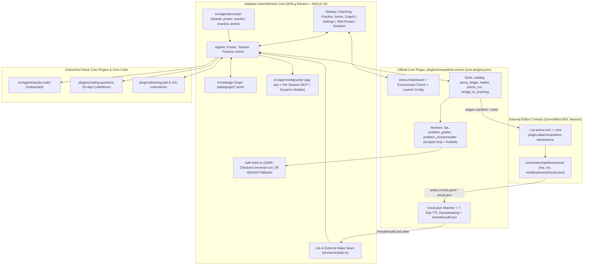

# Brain × LearnHarness Architecture & Implementation Blueprint (`brain-marry-learnharness.md`)

> **Target Execution Workspace:**
> - **Windows Root:** [C:\Users\tssha\OneDrive\Desktop\brain\learn](file:///C:/Users/tssha/OneDrive/Desktop/brain/learn) $\to$ WSL Symlink: `/home/dexter/playground/learn`
> - **Workbench Target:** [brain/learn/learnharness/](file:///C:/Users/tssha/OneDrive/Desktop/brain/learn/learnharness) (`WSLg Electron + Next.js 16`)
> - **Legacy Sources Ported From:** [brain/learn/.pi/](file:///C:/Users/tssha/OneDrive/Desktop/brain/learn/.pi) *(including `.pi/extensions/pi-agy-bridge/`, `.pi/arena/`, `.pi/ladder/`, `.pi/catalog/`, `.pi/browser/browser_fetch.py`)*
> - **Unmodified External Editor (`~/.config/nvim` / `nvim/` clone):** [curriculum-ledger/nvim/](file:///c:/Users/tssha/OneDrive/Desktop/curriculum-ledger/nvim) *(zero changes required to Neovim config or Lua modules)*

---

## 1. North Star, Ground-Truth Diagnosis & Core Architectural Thesis

### 1.1 The Marriage Goal
Preserve **every irreplaceable capability** of Brain—Antigravity ACP frontier models, Competitive Programming catalog/ladder intelligence, `lab` hidden test + custom checker synthesis, `problem_grader` oracle stress-testing, `problem_recommender` ThemeCP neutralization, and the External Editor Contract fulfilled by your 3-pane WSL Neovim Competitive Arena—while **dissolving** every ad-hoc shell/Markdown/TUI subsystem that `learnharness` already solves natively (`Prober → Teacher` isolation, interactive `PlanTree` DAGs, `QuestionDock` + `ConfidenceRail`, `SideThread`, append-only Knowledge Graph `data/graph/*.jsonl`, native `data/chats/*.json` compaction, `visual-maker` / `demo-builder` / `pdf-reader` / `researcher`, and Deepgram Nova-3 dictation).

### 1.2 Three Codebase Realities That Shape the Architecture

1. **ThemeCP / Contest Coaching Is a 3rd Native `ChatKind` (`"arena"`), Gated Cleanly on Plugin Enablement:**
   - Upstream [src/agent/prompts/practice/10-doctrine.md](file:///C:/Users/tssha/OneDrive/Desktop/brain/learn/learnharness/src/agent/prompts/practice/10-doctrine.md#L19-L25) explicitly defines `Practice` as non-contest retrieval drills (*"Not search training. Long competition-shaped problems with concealed paths... a different product"*), and [src/agent/tools/practice.ts](file:///C:/Users/tssha/OneDrive/Desktop/brain/learn/learnharness/src/agent/tools/practice.ts#L123-L132) hard-locks one problem at a time with mandatory composer pauses.
   - ThemeCP and CP upsolving require **4 problems staged together in one pooled-clock `manifest.json` (`P1`–`P4`)**, blind metadata, non-blocking external editor coding while chat stays live for hints/clarifications, **Three I's** (`Inception`, `Intuition`, `Implementation` via monotonic `thinking_seconds`), and **Upsolve Gate** enforcement.
   - **Design:** Keep `+ Teaching` (`teach`: `Prober → PlanTree → Teacher`, with zero separate `cp-teach` `ChatKind`) and `+ Practice` (`practice`: Knowledge Graph retrieval drills), and add a 3rd native mode **`ChatKind = "arena"`** (`Sidebar: Teaching | Practice | Arena | All`). When `plugins/competitive-arena` is disabled, Sidebar hides `+ Arena` creation and opens historical `arena` sessions in read-only view with a one-line banner directing you to `Settings → Core plugins`.
   - Meanwhile, **`Teacher`** (`+ Teaching`) learns about CP tools dynamically **only** when `plugins/competitive-arena` is enabled via `ctx.registerTools({ agents: ["teacher", "arena"], ... })` and `ctx.registerInstructions({ agents: ["teacher"], text })` ([teacher-agent.ts](file:///C:/Users/tssha/OneDrive/Desktop/brain/learn/learnharness/src/agent/teacher-agent.ts#L228-L238))—identical to stock `plugins/coding-questions/`! When the plugin is disabled, `Teacher` receives zero CP tools and zero CP prompt instructions.

2. **All CP & Arena Domain Capabilities Live Inside One Unified Official Core Plugin (`plugins/competitive-arena/`):**
   - `catalog`, `ladder`, `arena_ledger`, `arena_run`, `bridge_to_teaching`, `lab`, `problem_recommender`, and `problem_grader` form one tightly coupled domain dependency graph. Packaging them together in **`plugins/competitive-arena/`** (registered in `core-plugins.json`, modeled after [plugins/flashcards/](file:///C:/Users/tssha/OneDrive/Desktop/brain/learn/learnharness/plugins/flashcards)) keeps core `learnharness` clean (zero custom `BuiltinJobKind` blast radius across 15+ core files), guarantees atomic availability, and exposes a cohesive **`Arena` Dashboard** + **`Settings → Competitive Arena`** page.
   - Upstream `plugins/coding-questions/` remains **100% untouched** as a complementary lightweight in-app code widget inside `+ Teaching` / `+ Practice`.

3. **External Editor Contract + Environment Independence + Optional Standalone Fallback:**
   - `learnharness` never bundles a Neovim binary or hardcodes terminal vendor spawners (`wezterm`, `wt.exe`, `putty`). Instead, `plugins/competitive-arena/` owns an **explicit, editor-agnostic External Editor Contract** (`~/.pi-arena-root` + `active/manifest.json` + `events.jsonl` + `result.json` + `arena.py` + `lab/tests/<id>/`) that **any** compliant editor fulfills (your WSL Neovim config fulfills it today with zero modifications).
   - **Self-Aware Standalone Design:** **`Settings → Competitive Arena`** includes:
     1. Live **Environment Readiness Check** reporting status of `python3`, `g++`, `nvim`, and `~/.pi-arena-root`.
     2. An **optional user-configured Launch Command** (empty / manual `Alt-Tab` by default — user supplies e.g. `wt.exe ...` or `wezterm ...` only if desired).
     3. Optional **Phase 3 `In-App Judge`** editor mode inside `plugins/competitive-arena/` (CodeMirror + `arena.py` + `lab` tests) so `learnharness` can also run 100% self-contained without any external editor installed.

---

## 2. Complete Feature Disposition Ledger (Every Brain File Accounted For)

| Source Module / Feature | Disposition | Target Location & Concrete Design |
| :--- | :---: | :--- |
| **`pi-agy-bridge/` (Antigravity ACP)** | **PORT (Core Infrastructure)** | `src/agent/antigravity/` + 9-file provider catalog wiring (`models.ts`, `model-catalog.ts`, `keys.ts`, `pricing.ts`, `settings.ts`, `chat-handler.ts`, `native-messages.ts`, `side-context-budget.ts`, `model-menu.tsx`). Retain `src/agent/claude-code/` **100% untouched** as sibling reference. |
| **`.pi/browser/browser_fetch.py`** | **PORT (Thin Core Seam)** | Harden `browser_fetch.py` (`http`/`https` schemes only, drop `file://` `urllib` fallback, disable auto-redirects and validate `socket.getaddrinfo` + `ipaddress.is_global` across up to 5 hops). Invoked by [src/agent/tools/safe-fetch.ts](file:///C:/Users/tssha/OneDrive/Desktop/brain/learn/learnharness/src/agent/tools/safe-fetch.ts) on HTTP `403`/`429` as a **universal public-web TLS-impersonation fallback** (`--format html` wrapped in standard `Response`). |
| **3rd Session Track (`ChatKind = "arena"`)** | **PORT (Thin Core Seam)** | Extend `ChatKind = "teach" | "practice" | "arena"` across chat contracts, agent composer, sidebar/new-session UI, and `src/agent/prompts/arena/{00-base,10-themecp-doctrine}.md`; hide `+ Arena` creation UI unless `plugins/competitive-arena` is enabled. |
| **External Async Wake + Teaching Escalation** | **PORT (Thin Core Seam)** | Expose `ctx.createExternalJob` / `ctx.deliverExternalJobResult` (routing directly into [src/server/jobs.ts](file:///C:/Users/tssha/OneDrive/Desktop/brain/learn/learnharness/src/server/jobs.ts#L7-L53) `deliverJobResult()` / `settleSteers()`) + `ctx.createTeachingSession` on `PluginBackendContext`. |
| **`.pi/extensions/arena.ts` + `.pi/arena/{arena.py,rating.json,history.json}`** | **PORT (Unified Core Plugin)** | `plugins/competitive-arena/`: `arena_run`, `arena_ledger`, crash-safe `result.json` watcher, `ArenaResultCard` tool renderer (`ctx.registerToolRenderer`), External Editor Contract (`~/.pi-arena-root`), plus non-destructive seeding preserving existing `rating.json` & `history.json`. |
| **`.pi/extensions/ladder.ts` + `.pi/ladder/{ladder.py,ladder.json,rounds.json}`** | **PORT (Unified Core Plugin)** | `plugins/competitive-arena/`: `ladder` tool + Upsolve Gate enforcement + interactive **`Arena`** Dashboard view (`ctx.registerView` + `ctx.placeAction`). |
| **`.pi/extensions/catalog.ts` + `.pi/catalog/{catalog.py,catalog.json,*.csv,sources/,sets/}`** | **PORT (Unified Core Plugin)** | `plugins/competitive-arena/`: `catalog` tool + `catalog/sets/<stage>.json` staged set handoff (`problemsFile`). |
| **`.pi/extensions/course.ts` (`course create`)** | **PORT (Unified Core Plugin)** | `bridge_to_teaching` tool using `ctx.createTeachingSession` to spawn a pre-seeded `+ Teaching` session from a diagnosed Arena gap without altering active ladder state. |
| **`.pi/agents/lab.md`** | **PORT (Unified Core Plugin Worker)** | `ctx.workers.register` + `ctx.createBackgroundTool("lab")`: scoped `/tmp/lh-lab-<taskId>/` tools (`exec_scratch`, `write_scratch_file`), atomic `publish_test_suite` (`lab/tests/<id>/`), plus SSRF-safe `web_fetch`. |
| **`.pi/agents/problem-grader.md`** | **PORT (Unified Core Plugin Worker)** | `ctx.workers.register` + `ctx.createBackgroundTool("problem_grader")`: scoped `/tmp/lh-grader-<taskId>/` tools (`g++ -std=c++17 -O2` and `-fsanitize=address,undefined` against oracle + minimal counterexample shrinker). |
| **`.pi/agents/problem-recommender.md`** | **PORT (Unified Core Plugin Worker)** | `ctx.workers.register` + `ctx.createBackgroundTool("problem_recommender")`: `catalog` queries, `web_fetch` verification, ThemeCP neutrality vetting, `stage_problem_set` writing `catalog/sets/<stage>.json`. |
| **`.pi/extensions/housekeeping.ts`** | **PORT (Unified Core Plugin Lifecycle)** | Sweeps `catalog/sets/*.json` and `lab/tests/*` older than `ARTIFACT_TTL_DAYS = 7` on backend activation (skipping anything referenced by `active/manifest.json`). |
| **`nvim/lua/competitive/arena/*`** | **KEEP 100% UNMODIFIED** | Works natively in WSL via `~/.pi-arena-root` ([config.lua](file:///c:/Users/tssha/OneDrive/Desktop/curriculum-ledger/nvim/lua/competitive/arena/config.lua#L9-L53)). |
| **`plugins/coding-questions/`** | **KEEP UNMODIFIED** | Stock in-app CodeMirror snippet editor in `+ Teaching` & `+ Practice`. |
| **`.pi/extensions/{quiz,ask-user-question,md-log,learn,teacher,rbac}.ts`, `.pi/rbac/`, `visual-tools/`, `.pi/agents/{auditor,researcher,resource-recommender,svg-maker,mermaid-maker}.md`** | **DISSOLVED / SUPERSEDED** | Replaced natively by `QuestionDock` + `ConfidenceRail`, `data/chats/*.json` + `PlanTree` + `Graph`, per-turn `composeInstructions()`, scoped `/tmp` worker tools, `Prober`, `researcher`, `visual-maker`, `demo-builder`, and `pdf-reader`. |
| **`.pi/agents/{curriculum-architect,curriculum-extractor}.md`, `.pi/curriculum/`** | **DROP (Phase 1)** | Revisit only if multi-week syllabus tracking outgrows `PlanTree` + `problem_recommender`. |

---

## 3. Enriching `src/agent/antigravity/` (Inspired by `claude-code`, Keeping `claude-code` Untouched)

[src/agent/claude-code/](file:///C:/Users/tssha/OneDrive/Desktop/brain/learn/learnharness/src/agent/claude-code) stays completely unmodified. `src/agent/antigravity/` is built as a parallel sibling combining `claude-code`'s proven `learnharness` seams with `agy acp`'s native stdio JSON-RPC protocol:

| Concern | Implementation in `src/agent/antigravity/` |
| :--- | :--- |
| **ACP Transport (`acp-connection.ts`)** | Spawns `agy acp` (`/home/dexter/.local/bin/agy`, v1.5.10) over stdio JSON-RPC (`initialize`, `session/new`, `session/set_config_option`, `session/prompt`, `session/update`, `session/request_permission`, `session/cancel`, `session/close`). |
| **Held HTTP MCP Bridge (`mcp-bridge.ts`)** | Uses `@modelcontextprotocol/sdk` `StreamableHTTPServerTransport` on `127.0.0.1` (`x-bridge-token` + `clampProtocolVersionHeader()` for ACP compatibility), registering **dynamic `getCurrentTools(messages)` per ACP session route (`/mcp/<routeId>`)** and holding `CallTool` directly up to `30` minutes (like [claude-code/tool-bridge.ts](file:///C:/Users/tssha/OneDrive/Desktop/brain/learn/learnharness/src/agent/claude-code/tool-bridge.ts#L17-L90))—eliminating `bridge_poll_result` completely. |
| **Turn Concurrency & Isolation (`stream.ts`)** | Replaces `pi-agy-bridge`'s singleton `#activeDeltaHandler` / `#activeTurn` with `Map<acpSessionId, ActiveTurn>` so `session/update` notifications route strictly by `params.sessionId`. Phase 0 verifies 2 simultaneous `antigravity` streams (e.g. `Teacher` + `SideThread`); if single-process `agy acp` serializes/drops concurrent prompts, we plug in a bounded `agy acp` worker pool (`maxProcesses`). |
| **Warm vs. Cold Replay (`transcript.ts`)** | Computes SHA-256 `(cwd, systemPrompt, toolNames)` hash per session. Warm matching sessions resolve parked `CallTool` directly; cold/restarted/rotated/compacted sessions open a fresh `session/new` and replay `[Compaction + PlanTree + Recent Turns]` using the same `[user]`/`[assistant]`/`[tool call]`/`[tool result]` framing as [claude-code/transcript.ts](file:///C:/Users/tssha/OneDrive/Desktop/brain/learn/learnharness/src/agent/claude-code/transcript.ts). |
| **Non-Cancelling Permission Gate (`permissions.ts`)** | Native `session/request_permission` allows read-only workspace inspection where permitted and returns `outcome: { outcome: "selected", optionId: denyId }` **without** calling `session/cancel` (`markPermissionCancelled()`), preventing `agy acp` from going silent while guiding the model to use bridged `learnharness` / plugin tools. |
| **Live Dynamic Model Catalog (`provider.ts` + 9 Catalog Files)** | Reads live `res.models?.availableModels` from `agy acp` `session/new` on startup warmup / `refreshConnectionCatalog("antigravity")` (caching + normalizing `contextWindow`, `maxTokens`, `reasoning`, `thinkingLevelMap`, with `DEFAULT_MODELS` only as initial pre-probe fallback). Registers in `models.ts` right alongside `createClaudeCodeProvider` (**not** `configureProviderSource`, which `custom-provider.ts` owns) and wires into `model-catalog.ts`, `keys.ts`, `pricing.ts`, `settings.ts`, `chat-handler.ts`, `native-messages.ts`, `side-context-budget.ts`, and `model-menu.tsx`. |

---

## 4. Curated Lifecycles for Every Added Journey

Every added journey is designed end-to-end across **Invocation $\to$ Running $\to$ Conclusion $\to$ History $\to$ Resumability**:

1. **`+ Teaching` (`teach`) With Optional CP Checkpoints:**
   - **Invocation:** `+ Teaching` button in Sidebar or `bridge_to_teaching` handoff.
   - **Running:** `Prober` (`list_sessions`, `list_propositions`, `probe`, `probe_done`) $\to$ `Teacher` (`plan_init` + `quiz` / `visual` / `demo`). When `competitive-arena` is ON and an algorithmic checkpoint calls for coding: quick snippet $\to$ stock `coding_question`; full C++ problem $\to$ background **`lab`** (`publish_test_suite`) + **`arena_run`** (`purpose: "guided"`, `timerMode: "stopwatch"`) while chat stays live.
   - **Conclusion:** `Arena` watcher settles `arena.py`, delivers `ArenaResultCard` steer via `deliverExternalJobResult()`, `Teacher` debriefs & marks `PlanTree` node done; post-turn extraction appends `data/graph/*.jsonl`.
   - **History / Resumability:** Chat + `PlanTree` in `data/chats/<id>.json`; concepts in `data/graph/*.jsonl`; guided solve in `competitive-arena/arena/history.json`; startup recovery delivers any unconsumed `result.json` steer to the linked chat.

2. **`+ Arena` (`arena`) ThemeCP Contest & Escalation:**
   - **Invocation:** `+ Arena` in Sidebar (`/chat/new?mode=arena`, visible only when `competitive-arena` is ON) or **`Arena` Dashboard** launcher.
   - **Running:** Checks `ladder status` (**Upsolve Gate**) $\to$ `ladder slots` $\to$ **`problem_recommender`** (`MODE: round`, writes `catalog/sets/<stage>.json`) + parallel **`lab`** test synthesis (`lab/tests/<id>/`) $\to$ **`arena_run`** (`purpose: "checkpoint"`, `timerMode: "pooled"`, `blindMetadata: true`, `approachNote: "required"`, `strictOrder: true`, `problemsFile`). User solves in any compliant External Editor (WSL Neovim `<leader>ma`..`<leader>mx`) with monotonic `thinking_seconds` & live chat available. Background **`problem_grader`** verifies unjudged submissions when hidden tests did not run.
   - **Conclusion:** Watcher runs `arena.py settle` $\to$ wakes Arena agent with `ArenaResultCard` $\to$ calls `ladder close_round` (updates rating, streak, level, upsolve gate) + delivers **Three I's** debrief $\to$ optionally invokes **`bridge_to_teaching`** to spawn a pre-seeded `+ Teaching` chat on a diagnosed gap.
   - **History / Resumability:** `arena/{rating,history}.json`, `ladder/{ladder,rounds}.json`, `data/chats/<id>.json`; Neovim `events.jsonl` restores open contest timers, while backend startup/poll recovery ensures closed `result.json` packets never strand across Electron restarts.

3. **Ad-Hoc Problem URLs (`+ Arena` vs. `+ Practice`):**
   - **Invocation:** Paste URL in `+ Arena`, `+ Practice`, or `Arena` Dashboard URL box.
   - **Running:** Fetches via `research` / `web_fetch` (`safe-fetch.ts` universal `curl_cffi` 403/429 fallback). `+ Arena` dispatches `lab` + `arena_run` for full OJ solve + `problem_grader`; `+ Practice` skips probing per `practice/00-base.md` and runs short `problem` / `coding_problem` retrieval (`R0`–`R5` hints $\to$ `conclude` + `modelSolution` reveal).
   - **History / Resumability:** Persisted in `arena/history.json` (`+ Arena`) or `data/chats/<id>.json` (`+ Practice`).

4. **Background Workers (`lab`, `problem_grader`, `problem_recommender`):**
   - **Invocation:** `ctx.createBackgroundTool` in `plugins/competitive-arena/`.
   - **Running:** Managed by host `PluginWorkerService` (persisted under plugin `tasks/`, FIFO-pooled under `agent.workerRequestConcurrency`, visible in Sidebar **Background Agents** activity list). Scoped strictly to `/tmp/lh-<worker>-<taskId>/` + validated publish/stage tools.
   - **Conclusion / Resumability:** `submit_result` persists outcome and delivers steer via native `deliverJobResult()`; `setPluginJobRecovery` guarantees post-crash steer delivery without replaying side effects.

5. **Antigravity ACP Lifecycle (`src/agent/antigravity/`):**
   - Selected via `Ctrl+K`, `Shift+Tab`, or Settings slots; warms/discovers models dynamically; runs concurrently per `acpSessionId` + `/mcp/<routeId>`; falls back seamlessly to `transcript.ts` full replay across restarts or compactions.

---

## 5. System Architecture Diagram

---

## 6. Risk Ledger

| Risk | Likelihood | Mitigation |
| :--- | :---: | :--- |
| **Single `agy acp` process serializes/mixes 2 concurrent prompts** | Medium | Key turns by `acpSessionId` + `/mcp/<routeId>` first, then verify via Phase 0 2-stream concurrency test; add a bounded `agy acp` process pool only if that test shows multiplexing issues. |
| **WSL/DrvFs misses `fs.watch` events on `result.json`** | Medium | Pair `fs.watch` on `active/` with a `750ms` `fs.stat` mtime/size poller active solely while `manifest.json` exists, plus startup scan in `activate()`. |
| **Clobbering live `.pi/arena/{rating,history}.json` or `.pi/ladder/*.json`** | High if careless | Auto-seeding writes code/static catalog (`arena.py`, `ladder.py`, `catalog/`) idempotently, and copies mutable ledgers **only if missing** in `<LH_DATA_DIR>/core-plugin-data/competitive-arena/`. |
| **`browser_fetch.py` SSRF bypass on redirect or `file://`** | High if unpatched | Reject non-`http(s)` schemes, remove `urllib` fallback, set `allow_redirects=False`, validate every redirect target's resolved IPs with `ipaddress.ip_address(ip).is_global`. |
| **User enables `arena` chat then disables `competitive-arena` plugin** | Medium | Hide `+ Arena` button & redirect `/chat/new?mode=arena` when disabled; render historical `arena` chats read-only with a clear Settings prompt. |

---

## 7. File-by-File Implementation & WSL Verification Plan

> **Verified Execution Environment (`~/playground/learn` $\to$ `C:\Users\tssha\OneDrive\Desktop\brain\learn`):**
> - **Node / npm (WSL):** `/home/dexter/.nvm/versions/node/v24.14.0/bin` (`Node v24.14.0`, `npm 11.9.0` — export `PATH="/home/dexter/.nvm/versions/node/v24.14.0/bin:$PATH"` before running all WSL npm/tsx checks)
> - **Toolchain:** `/usr/bin/python3` (`curl_cffi OK`), `/usr/bin/g++`, `/usr/local/bin/nvim`, `/home/dexter/.local/bin/agy` (`1.5.10`)
> - **Pre-Flight Dependency Bootstrap:** `learnharness/node_modules` does not exist yet in `brain\learn\learnharness` and will be installed in WSL via `npm ci && npm run plugins:setup`.

### Phase 0 — Antigravity ACP Core Provider (`src/agent/antigravity/`)
- **Create:** `learnharness/src/agent/antigravity/{constants,provider,acp-connection,mcp-bridge,transcript,permissions,stream,model-cache}.ts` (ported & upgraded from `.pi/extensions/pi-agy-bridge/` + modeled on `src/agent/claude-code/`).
- **Amend (Provider & 9-File Catalog Wiring):**
  - `src/agent/models.ts` (register `createAntigravityProvider` alongside `createClaudeCodeProvider`)
  - `src/server/{model-catalog,keys,pricing,chat-handler,side-context-budget}.ts`
  - `src/core/{settings,native-messages,contracts/antigravity}.ts`
  - `components/settings/model-menu.tsx`
- **Tests & WSL Verification:**
  1. `cd ~/playground/learn/learnharness && npm ci && npm run plugins:setup`
  2. Add unit tests `tests/antigravity-{mcp-bridge,transcript,permissions,models}.test.ts` covering dynamic `availableModels` normalization, non-cancelling permission denial, cold replay, and multi-session routing.
  3. Run `npm run typecheck && npm test` inside WSL.
  4. Run a headless live `agy acp` smoke script in WSL verifying: dynamic model discovery, a single-turn + held MCP tool call, a simulated restart + cold replay continuation, and **two simultaneous `antigravity` streams** (confirming zero token cross-talk or deciding whether a process pool is needed).

### Phase 1 — Core Platform Seams (`ChatKind = "arena"`, Universal `safe-fetch`, Plugin Wake/Handoff)
- **Create:** `learnharness/src/agent/prompts/arena/{00-base,10-themecp-doctrine}.md`, `learnharness/scripts/browser_fetch.py` (hardened copy of `.pi/browser/browser_fetch.py` with hop-by-hop redirect IP validation).
- **Amend:**
  - `src/core/contracts/chat.ts`, `src/core/prompt-segments.ts`, `src/agent/teacher-agent.ts` (`AgentKind` + `createArenaAgent` + prompt composition), `src/store/chats.ts`, `src/server/chat-handler.ts`, `components/{sidebar,new-session,chat}.tsx` (`+ Arena` button, filter tab, read-only disabled-plugin banner).
  - `src/agent/tools/safe-fetch.ts` (universal HTTP `403`/`429` `browser_fetch.py --format html` fallback).
  - `src/core/plugins.ts`, `src/core/contracts/jobs.ts`, `src/server/plugins.ts`, `src/server/jobs.ts` (add `createExternalJob` / `deliverExternalJobResult` & `createTeachingSession` on `PluginBackendContext`).
- **Tests & WSL Verification:**
  1. Add `tests/{arena-chat-kind,safe-fetch-fallback,plugin-external-job}.test.ts` (verifying `browser_fetch.py` blocks `127.0.0.1` / redirect-to-loopback SSRF, `+ Arena` UI hiding when plugin disabled, and external job steer delivery into idle & live chats).
  2. Run `npm run typecheck && npm test` in WSL.

### Phase 2 — Unified Official Core Plugin (`learnharness/plugins/competitive-arena/`)
- **Create Plugin Package:**
  - `plugins/competitive-arena/{manifest.json,package.json,tsconfig.json,scripts/build.mjs}`
  - `plugins/competitive-arena/seed/` (bundled `arena.py`, `ladder.py`, `catalog.py`, `catalog.json`, CSVs/sources)
  - `plugins/competitive-arena/src/seed.ts` (versioned static seed + **missing-only** non-destructive import of `~/playground/learn/.pi/arena/{rating,history}.json` & `.pi/ladder/{ladder,rounds}.json`)
  - `plugins/competitive-arena/src/{catalog-tool,ladder-tool,ledger-tool,arena-run-tool,bridge-tool,external-contract,watcher,housekeeping}.ts`
  - `plugins/competitive-arena/src/workers/{scratch-tools,lab,problem-grader,problem-recommender}.ts` (exact behavioral contracts of `.pi/agents/{lab,problem-grader,problem-recommender}.md` adapted cleanly onto `PluginWorkerService` + scoped `/tmp` execution)
  - `plugins/competitive-arena/src/{backend,main,dashboard-view,result-card,settings-view,styles.css}` (registering tools, workers, conditional `Teacher` instructions, `ArenaResultCard`, Sidebar **`Arena`** view, **`Settings → Competitive Arena`** with live `python3`/`g++`/`nvim`/`~/.pi-arena-root` health check + optional launch command).
- **Amend:** `learnharness/core-plugins.json` (add `"competitive-arena"`).
- **Tests & WSL Verification:**
  1. Plugin unit/integration suite: run `node --test` on `plugins/competitive-arena/tests/*.test.ts` (manifest staging, `arena.py` / `ladder.py` / `catalog.py` bridges, scoped `/tmp` scratch guard blocking `..`, `lab` `publish_test_suite`, `watcher` + `result.json` crash recovery, `bridge_to_teaching`).
  2. Build core plugins + typecheck + full test suite in WSL: `npm run plugins:build-core && npm run typecheck && npm test`.
  3. **Live WSL Neovim + Electron/Next Integration Check:** Start app in WSL, stage a test problem via `arena_run`, verify `~/.pi-arena-root` resolves inside unmodified `nvim --headless` / live Neovim (`<leader>ma`), execute sample/hidden test runner, write `result.json` (`<leader>mx`), and confirm automatic chat wake + `ArenaResultCard` rendering + `history.json`/`rating.json` continuity.

### Phase 3 — Optional Quality-of-Life (Post Phase 2)
- In-app `In-App Judge` C++ CodeMirror fallback inside `plugins/competitive-arena/` (for sessions without Neovim, sharing `arena.py` + `lab` tests).
- Optional offline CLI STT script (`app/api/stt/transcribe/route.ts`) if needed beyond Deepgram WSS.
- Optional persona tone calibration in `Settings → Agent → System prompts` (`10-voice.md`) after evaluating stock voice across live sittings.

### Phase 4 — Post-Verification Trim
- Remove `plugins/ui-showcase/` (and optionally unused web-cookie auth scrapers `src/agent/chatgpt-*.ts`, `src/agent/subscription-*.ts`, `electron/chatgpt*.cjs`, `electron/subscription*.cjs`, `electron/web-subscription-browser.cjs` + `plugins/flashcards/` if undesired) only after Phases 0–2 run cleanly in daily WSL use.
