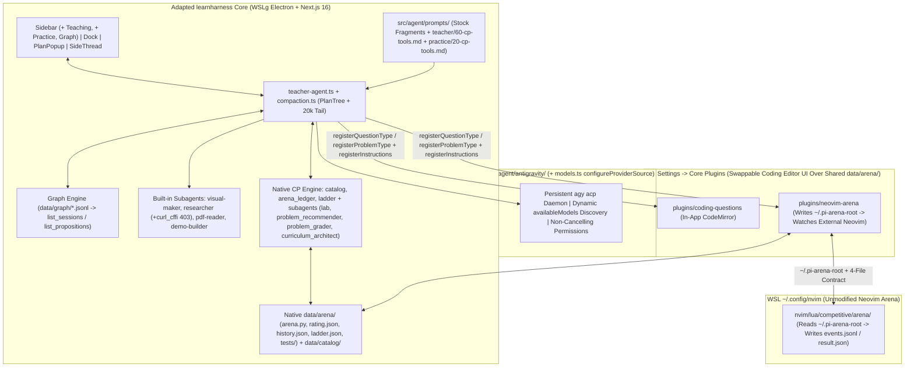

# Brain Revamp Plan: Socratic Competitive Programming Workbench (`learn-harness-adapted-brain` & `nvim`)

> **Target Staged Artifacts:**
> - **Workbench:** [brain-revamp/learn-harness-adapted-brain/](file:///c:/Users/tssha/OneDrive/Desktop/curriculum-ledger/brain-revamp/learn-harness-adapted-brain) *(adapted from [learnharness/](file:///c:/Users/tssha/OneDrive/Desktop/curriculum-ledger/learnharness) and [pi-agy-bridge/](file:///c:/Users/tssha/OneDrive/Desktop/curriculum-ledger/pi-agy-bridge))*
> - **Neovim Mirror (WSL `~/.config/nvim`):** [brain-revamp/nvim/](file:///c:/Users/tssha/OneDrive/Desktop/curriculum-ledger/brain-revamp/nvim) *(mirrored from [nvim/](file:///c:/Users/tssha/OneDrive/Desktop/curriculum-ledger/nvim))*

---

## 1. Vision, Objective & Core Agenda

### 1.1 Vision & Objective
Build a cohesive, keyboard-first desktop AI workbench inside WSL2 (`WSLg Electron + Next.js 16`) for mastering Computer Science algorithms and Competitive Programming through Socratic inquiry, structured dependency planning, and automated hidden-test verification—preserving your native Neovim Competitive Arena workflow alongside an in-app CodeMirror coding option, powered by your existing Antigravity ACP subscription and optional BYOK models.

### 1.2 Core Agenda & Technical Realization

| Agenda Pillar | Concrete Design Realization |
| :--- | :--- |
| **1. Socratic Pedagogy Before Reveal** | Use `learnharness`'s native `Prober → Teacher` two-agent teaching loop, interactive `PlanTree` DAG checkpoints (`plan_init`), confidence calibration (`ConfidenceRail`), and dedicated `Practice` mode (`problem` → iterative feedback → `conclude`) where hidden solutions stay sealed until conclusion. |
| **2. First-Class Competitive Programming Intelligence** | Build CP domain capabilities **natively** inside `learnharness` (`data/catalog/`, `data/arena/`, synchronous tools `catalog` / `arena_ledger` / `ladder`, background subagents `lab` / `problem_recommender` / `problem_grader` / `curriculum_architect`, and numeric prompt fragments in `src/agent/prompts/`). Toggleable per tool in **`Settings → Agent → Tools`**. |
| **3. Flexible Coding Delivery (In-App or External Neovim)** | Separate coding UI delivery into two swappable Core Plugins in **`Settings → Core plugins`** sharing one native `data/arena/` and `lab` foundation: built-in **`Coding Questions`** (in-app CodeMirror editor) and **`Neovim Arena`** (writes `~/.pi-arena-root` so your external WSL Neovim runs unmodified at full screen width). |
| **4. Antigravity ACP First-Class Integration** | Implement `src/agent/antigravity/` (adapted from [pi-agy-bridge/](file:///c:/Users/tssha/OneDrive/Desktop/curriculum-ledger/pi-agy-bridge)) as a first-class provider in [src/agent/models.ts](file:///c:/Users/tssha/OneDrive/Desktop/curriculum-ledger/learnharness/src/agent/models.ts) with dynamic model discovery from `agy acp`, non-cancelling permission denials, per-session turn isolation, and clean resume across pauses/restarts. |
| **5. Incremental Capability Delivery Before Trimming** | Phase 0 proves Antigravity ACP reliability; Phase 1 introduces the native CP engine, prompt fragments, and `plugins/neovim-arena/`; Phase 2 adds optional offline STT if needed; Phase 3 trims unused demo/auth code only after end-to-end verification passes. |

---

## 2. System Architecture & Primitive Taxonomy

### 2.1 Primitive Taxonomy in `learnharness`
Every extension lands in the exact architectural seam upstream expects:

1. **Synchronous Tools (`src/agent/tools/*.ts`):** Fast server actions called inline by `Prober`, `Teacher`, or `Practice` during a turn (`quiz`, `plan_init`, `problem`, `conclude`, `list_sessions`, `list_propositions`, **`catalog`**, **`arena_ledger`**, **`ladder`**).
2. **Background Subagents (`src/agent/subagents/*.ts` via [src/agent/tools/jobs.ts](file:///c:/Users/tssha/OneDrive/Desktop/curriculum-ledger/learnharness/src/agent/tools/jobs.ts)):** Fire-and-forget multi-turn workers that wake the conversation with a brief upon completion (`research`, `demo`, `visual`, `pdf`, plus **`lab`**, **`problem_recommender`**, **`problem_grader`**, **`curriculum_architect`**). Controlled individually via `TOGGLEABLE_TOOLS` ([src/core/pending.ts](file:///c:/Users/tssha/OneDrive/Desktop/curriculum-ledger/learnharness/src/core/pending.ts#L87)) and **`Settings → Agent → Tools`** ([agent-section.tsx](file:///c:/Users/tssha/OneDrive/Desktop/curriculum-ledger/learnharness/components/settings/agent-section.tsx#L95)).
3. **System Prompt Composition (`src/agent/prompts/` & Plugins):** [listSourceSegments](file:///c:/Users/tssha/OneDrive/Desktop/curriculum-ledger/learnharness/src/agent/prompt-segments.ts#L67-L97) automatically loads all numeric-prefix `*.md` files from `src/agent/prompts/teacher/` and `src/agent/prompts/practice/` on every session, while active coding plugins dynamically inject their editor tool instructions via `ctx.registerInstructions` ([plugins/coding-questions/src/backend.ts](file:///c:/Users/tssha/OneDrive/Desktop/curriculum-ledger/learnharness/plugins/coding-questions/src/backend.ts#L32-L33)).
   - Because stock `learnharness` prompts only document `research`, `pdf`, `demo`, and `visual`, we add **`src/agent/prompts/teacher/60-cp-tools.md`** and **`src/agent/prompts/practice/20-cp-tools.md`** so `Teacher` and `Practice` know exactly when to call `lab`, `catalog`, `arena_ledger`, `ladder`, `problem_recommender`, `problem_grader`, and `curriculum_architect`.
4. **Core Plugins (`plugins/*` in [core-plugins.json](file:///c:/Users/tssha/OneDrive/Desktop/curriculum-ledger/learnharness/core-plugins.json)):** Swappable UI/editor surfaces toggled in **`Settings → Core plugins`**:
   - **`plugins/coding-questions/`**: Existing in-app CodeMirror editor implementing `ctx.registerQuestionType` (`coding_question`) and `ctx.registerProblemType` (`coding_problem`).
   - **`plugins/neovim-arena/`**: External Neovim bridge plugin implementing the same `ctx.registerQuestionType` (`arena_question`) and `ctx.registerProblemType` (`arena_problem`) contract over `~/.pi-arena-root` and `data/arena/`.

### 2.2 Storage, Knowledge Graph & Antigravity Provider
- **Session Persistence (`data/chats/<id>.json`):** Stores `@earendil-works/pi-ai` native message envelopes (`thinking` signatures, tool call/result metadata, `tree: PlanTree`, `sideChats`, token telemetry), enabling instant course resume with `[Active Compaction Summary + Verbatim PlanTree] + [Last ~20,000 Tokens]` ([src/core/compaction.ts](file:///c:/Users/tssha/OneDrive/Desktop/curriculum-ledger/learnharness/src/core/compaction.ts)).
- **Knowledge Graph (`data/graph/*.jsonl`):** Append-only `nodes.jsonl`, `chains.jsonl`, `sessions.jsonl`, and `coverage.jsonl` queried mid-session by `list_sessions()` / `list_propositions()` ([src/agent/tools/graph.ts](file:///c:/Users/tssha/OneDrive/Desktop/curriculum-ledger/learnharness/src/agent/tools/graph.ts)) and visually browsed via `ChainTableOverlay` ([components/chain-table.tsx](file:///c:/Users/tssha/OneDrive/Desktop/curriculum-ledger/learnharness/components/chain-table.tsx)) for `Practice → Pick nodes`.
- **Dynamic AGY ACP Provider (`src/agent/antigravity/`):** Connects to persistent `agy acp`, reads live `res.models?.availableModels` from JSON-RPC `session/new` ([acp-connection.ts](file:///c:/Users/tssha/OneDrive/Desktop/curriculum-ledger/pi-agy-bridge/src/acp-connection.ts#L165-L172)), and populates [src/agent/models.ts](file:///c:/Users/tssha/OneDrive/Desktop/curriculum-ledger/learnharness/src/agent/models.ts#L57-L98) dynamically via `configureProviderSource` (`MutableModels`)—keeping `DEFAULT_MODELS` ([pi-agy-bridge/index.ts](file:///c:/Users/tssha/OneDrive/Desktop/curriculum-ledger/pi-agy-bridge/index.ts#L13-L125)) solely as a pre-handshake fallback.

### 2.3 Architecture Diagram

---

## 3. End-to-End Runtime Workflows

### 3.1 `+ Teaching` Flow
1. User enters a CS/CP topic or course goal.
2. `Prober` calls `list_sessions()` / `list_propositions()` on `data/graph/` to check held prerequisites and asks concise calibration questions (`quiz`) before calling `probe_done`.
3. `Teacher` builds a structured prerequisite DAG via `plan_init` (`PlanTree`) and teaches step-by-step using `quiz`, `visual`, `demo`, and interactive dialogue.
4. When a concept node requires implementation:
   - Guided by `src/agent/prompts/teacher/60-cp-tools.md`, `Teacher` dispatches **`lab`** if hidden stress tests / checkers are needed (`data/arena/tests/<id>/`), then calls `coding_question` (if `Coding Questions` is active) or `arena_question` (if `Neovim Arena` is active) with a committed `modelSolution`.
   - On submission, `arena_ledger` logs the outcome into `data/arena/`, and settled prose updates `data/graph/*.jsonl` in the background.

### 3.2 `+ Practice` Flow — Picked Nodes or Ad-Hoc Problem URL
1. **No Probing:** Per [src/agent/prompts/practice/00-base.md](file:///c:/Users/tssha/OneDrive/Desktop/curriculum-ledger/learnharness/src/agent/prompts/practice/00-base.md#L5-L13), once problem material exists (from `Practice → Pick nodes` OR a pasted Codeforces/AtCoder URL), `Practice` skips probing and moves straight to problem setup.
2. **Fetch & Test Synthesis (`practice/20-cp-tools.md`):**
   - For external URLs, `Practice` fetches the problem via `research` (using `safe-fetch.ts`'s `curl_cffi` fallback on HTTP 403) or queries `catalog`.
   - When edge/stress tests are needed beyond samples, `Practice` dispatches native **`lab`** to synthesize `.in`/`.out` tests and optional `checker.cpp` into `data/arena/tests/<id>/`.
3. **Pose & Iterate:** `Practice` poses via `coding_problem` (`Coding Questions`) or `arena_problem` (`Neovim Arena`), commits a hidden `modelSolution`, gives tiered hints / failure analysis across submissions (using `problem_grader` when deeper code review is helpful), calls `conclude` to close and reveal `modelSolution`, and logs the final solve + rating update via `arena_ledger` into `data/arena/`.

### 3.3 `+ Practice` Flow — ThemeCP Ladder & 4-Problem Rounds
1. User asks for a ThemeCP duel or selects next ladder step; `Practice` invokes **`ladder`** + **`problem_recommender`** + **`catalog`** (and **`curriculum_architect`** for multi-week topic arcs).
2. **`lab`** ensures hidden tests exist under `data/arena/tests/<id>/`.
3. Problems pose sequentially via whichever coding plugin is active (`coding_problem` or `arena_problem`); verdicts and Elo deltas persist natively in `data/arena/` (`rating.json`, `history.json`, `ladder.json`).

### 3.4 Coding Editor Parity & `Neovim Arena` 4-File Contract
- **`Coding Questions` (`plugins/coding-questions/`):** Keeps existing in-app CodeMirror experience; `practice/20-cp-tools.md` instructs `Practice` to record final verdicts/attempts via `arena_ledger`.
- **`Neovim Arena` (`plugins/neovim-arena/`):**
  1. Stages `active/manifest.json` + hidden tests into `data/arena/` and writes the `data/arena` path to **`~/.pi-arena-root`**, matching [nvim/lua/competitive/arena/config.lua](file:///c:/Users/tssha/OneDrive/Desktop/curriculum-ledger/nvim/lua/competitive/arena/config.lua#L9-L36) so existing WSL Neovim requires zero mandatory edits.
  2. Dock card captures typed or `Ctrl+D` dictated approach notes (`"Your thinking"`) and watches Neovim's `events.jsonl` and `result.json` (`<leader>mx`).
  3. On `result.json` arrival, runs `arena.py settle` / updates `arena_ledger`, satisfies `props.onChange` on the host dock, and renders `ArenaResultCard` (verdict, solve duration, final code, attempt diffs, judge output) inline in the transcript.

---

## 4. Exhaustive Change Manifest (`AMEND` / `CREATE` / `KEEP` / `PHASE-3 TRIM`)

### 4.1 `AMEND` — Exact Edits to Upstream `learnharness` Files

| File | Action | Exact Change & Responsibility |
| :--- | :--- | :--- |
| [src/agent/models.ts](file:///c:/Users/tssha/OneDrive/Desktop/curriculum-ledger/learnharness/src/agent/models.ts) | **AMEND** | Register `createAntigravityProvider` + `configureProviderSource` (`MutableModels`) inside `piModels()` so every live model and thinking/effort level returned by `agy acp` `session/new` (`res.models.availableModels`) syncs dynamically into `Ctrl+K`, `Shift+Tab`, and `Settings → Agent`. |
| [src/agent/tools/safe-fetch.ts](file:///c:/Users/tssha/OneDrive/Desktop/curriculum-ledger/learnharness/src/agent/tools/safe-fetch.ts) | **AMEND** | Add ~10-line fallback calling `browser_fetch.py` (`curl_cffi` TLS impersonation) on HTTP 403/Cloudflare block so `research` fetches Codeforces/AtCoder natively. |
| [src/core/pending.ts](file:///c:/Users/tssha/OneDrive/Desktop/curriculum-ledger/learnharness/src/core/pending.ts), [src/agent/teacher-agent.ts](file:///c:/Users/tssha/OneDrive/Desktop/curriculum-ledger/learnharness/src/agent/teacher-agent.ts), [src/agent/tools/practice.ts](file:///c:/Users/tssha/OneDrive/Desktop/curriculum-ledger/learnharness/src/agent/tools/practice.ts), [src/agent/tools/jobs.ts](file:///c:/Users/tssha/OneDrive/Desktop/curriculum-ledger/learnharness/src/agent/tools/jobs.ts), [components/settings/agent-section.tsx](file:///c:/Users/tssha/OneDrive/Desktop/curriculum-ledger/learnharness/components/settings/agent-section.tsx) | **AMEND** | Wire native CP tools (`catalog`, `arena_ledger`, `ladder`) and native CP background subagents (`lab`, `problem_recommender`, `problem_grader`, `curriculum_architect`) into `CONVERSATION_TOOL_NAMES`, `TOGGLEABLE_TOOLS`, `TOGGLE_TOOLS`, `JobToolContext`, and teacher/practice tool factories. |
| [core-plugins.json](file:///c:/Users/tssha/OneDrive/Desktop/curriculum-ledger/learnharness/core-plugins.json) | **AMEND** | Add `"neovim-arena"` to the core plugins array so `npm run plugins:build-core` builds it alongside `"coding-questions"` inside **`Settings → Core plugins`**. |
| `app/api/stt/transcribe/route.ts` + [components/dictation.tsx](file:///c:/Users/tssha/OneDrive/Desktop/curriculum-ledger/learnharness/components/dictation.tsx) | **OPTIONAL AMEND** | Phase 2 only, if offline CLI-script STT is desired alongside built-in Deepgram Nova-3 WSS. |

### 4.2 `CREATE` — Clean Additive Modules & Prompt Fragments

| Path to Create | Origin | Exact Contents & Responsibility |
| :--- | :--- | :--- |
| `src/agent/antigravity/` | Adapted from [pi-agy-bridge/](file:///c:/Users/tssha/OneDrive/Desktop/curriculum-ledger/pi-agy-bridge) | `provider.ts`, `stream.ts`, `acp-connection.ts`, `acp-driver.ts`, `mcp-server.ts`, `sessions.ts`, `permissions.ts`. Key upgrades: **(1)** Dynamic model roster from `session/new` (`res.models.availableModels`); **(2)** Read `context.tools` dynamically without `ExtensionAPI`; **(3)** Scope active turns & pending tool calls by `sessionId`; **(4)** Resume cleanly from serialized non-continuation transcripts; **(5)** Return `denyId` on disallowed native tools **without** calling `markPermissionCancelled()` / `session/cancel`. |
| `src/agent/tools/{catalog,arena-ledger,ladder}.ts` | Adapted from `.pi/{catalog,arena,ladder}` | Synchronous CP state tools operating on `data/catalog/` and `data/arena/` (`rating.json`, `history.json`, `ladder.json`). |
| `src/agent/subagents/{lab,problem-recommender,problem-grader,curriculum-architect}.ts` | Adapted from `.pi/agents/` | Isolated background LLM workers dispatched via `jobs.ts`: hidden test/checker synthesis into `data/arena/tests/<id>/`, ThemeCP problem recommendation, deep solution review, and study-arc planning. |
| `data/catalog/` & `data/arena/` | Seeded from `.pi/` | Problem catalog indexes, `arena.py` judge/settle script, `rating.json`, `history.json`, `ladder.json`, and `tests/<id>/`. |
| `src/agent/prompts/teacher/60-cp-tools.md` & `src/agent/prompts/practice/20-cp-tools.md` | New numeric prompt fragments | Teach `Teacher` and `Practice` when and how to invoke `lab`, `catalog`, `arena_ledger`, `ladder`, `problem_recommender`, `problem_grader`, and `curriculum_architect` alongside `research` and the active coding editor plugin. |
| `plugins/neovim-arena/` | Bridges to [nvim/](file:///c:/Users/tssha/OneDrive/Desktop/curriculum-ledger/nvim) | Sibling Core Plugin to `plugins/coding-questions/` (`src/{main,backend,contract,editor,result-view}.ts`): registers `arena_question`, `arena_problem`, `ctx.registerInstructions`, manages `~/.pi-arena-root` & `result.json` watching, settles `data/arena/`, and renders `ArenaResultCard`. |

### 4.3 `KEEP` Unchanged & `PHASE-3 TRIM`
- **`KEEP` Unchanged:** `composeInstructions` & prompt composition machinery in `teacher-agent.ts` / `prompt-segments.ts`, `compaction.ts`, all existing stock `src/agent/prompts/` fragments, `src/server/{chat-handler,turn-service}.ts`, `src/store/{chats,graph}.ts`, `src/agent/subagents/{extraction,visual-maker,researcher,pdf-reader,demo-builder}.ts`, `plugins/coding-questions/`, `plugins/drawing-pad/`, `plugins/rich-code-blocks/`, `electron/main.cjs`, all UI `components/*`, and existing WSL `~/.config/nvim` ([nvim/](file:///c:/Users/tssha/OneDrive/Desktop/curriculum-ledger/nvim)).
- **`PHASE-3 TRIM` (*Only* After Phase 1 End-to-End Verification Passes):** Remove `plugins/ui-showcase/` and `plugins/flashcards/`, and optionally remove unused web-cookie auth scrapers (`src/agent/chatgpt-*.ts`, `src/agent/subscription-*.ts`, `electron/chatgpt*.cjs`, `electron/subscription*.cjs`, `electron/web-subscription-browser.cjs`).

---

## 5. Phased Build & Verification Plan

| Phase | Build Scope | Verification Exit Criteria |
| :--- | :--- | :--- |
| **Phase 0: Dynamic AGY ACP Spike** | Initialize [brain-revamp/learn-harness-adapted-brain/](file:///c:/Users/tssha/OneDrive/Desktop/curriculum-ledger/brain-revamp/learn-harness-adapted-brain) from `learnharness` + mirror [nvim/](file:///c:/Users/tssha/OneDrive/Desktop/curriculum-ledger/nvim) into [brain-revamp/nvim/](file:///c:/Users/tssha/OneDrive/Desktop/curriculum-ledger/brain-revamp/nvim). Implement `src/agent/antigravity/` + `src/agent/models.ts` dynamic provider sync. | All live models and effort levels returned by `agy acp` appear in `Ctrl+K` & `Settings → Agent`; complete a `probe` → pause → answer → `plan_init` → `quiz` cycle in WSLg `npm run desktop:dev` with zero ACP hangs on permission denials and working session resume. |
| **Phase 1: Native CP Engine, Prompts & `neovim-arena`** | 1. Amend `safe-fetch.ts` (`curl_cffi` 403 fallback). 2. Add `data/catalog/`, `data/arena/`, native tools (`catalog`, `arena_ledger`, `ladder`), native subagents (`lab`, `problem_recommender`, `problem_grader`, `curriculum_architect`) with Settings toggles. 3. Add `src/agent/prompts/teacher/60-cp-tools.md` and `src/agent/prompts/practice/20-cp-tools.md`. 4. Build Core Plugin `plugins/neovim-arena/` in `core-plugins.json`. | **In-App (`Coding Questions` ON):** Paste a Codeforces URL into `+ Practice` → skips probing, fetches via `research`, synthesizes hidden tests via `lab`, poses in CodeMirror, concludes & updates `data/arena/`. **Neovim (`Neovim Arena` ON):** Stage a Teaching or ThemeCP round → solve in WSL Neovim (`<leader>ma` → `<leader>mj` → `<leader>mx`) → watch `data/arena/` settle & `ArenaResultCard` render inline in transcript. |
| **Phase 2: Optional Offline STT** | Add `POST /api/stt/transcribe` + deterministic CLI script toggle if needed beyond Deepgram WSS. | Record voice into `"Your thinking"` (`Ctrl+D`) offline via local transcription script. |
| **Phase 3: Post-Verification Trim** | Remove `plugins/ui-showcase`, `plugins/flashcards`, and unused web-cookie auth modules. | Clean production/dev build in WSL2 with zero broken tests or UI regressions. |
