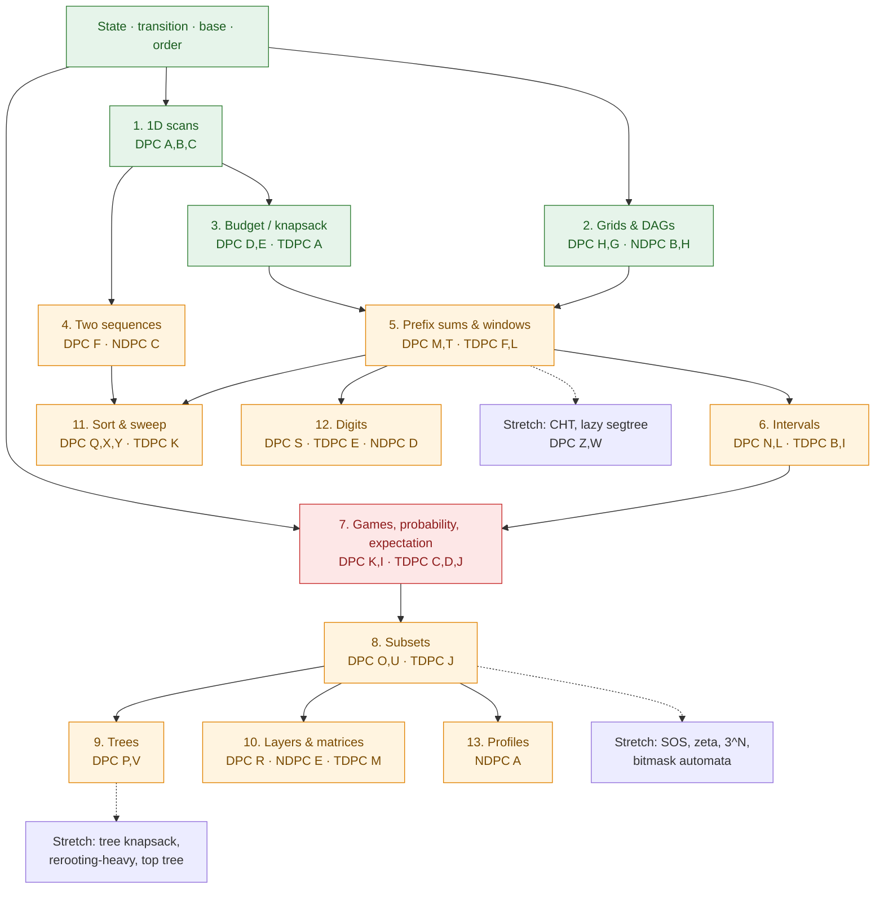

# Lesson Guide: Dynamic Programming from the Ground Up

stage: 2
source: courses/dp/sources/ (`article.md` = TopCoder treatise Parts 1–3; `problems/` = 66 cards; `solutions/` = 57 verified C++ files)
scope: AtCoder DPC A–Z, TDPC A–T, NDPC A–T. **Done = cold-solving CF ≤ 2000 DP problems.** Tiers below: **CORE** (≤ ~2000), **EDGE** (2000–2200, kept because the idea transfers downward), **STRETCH** (> 2200, optional vault). Ratings are my ordering hints, not copied from the judge.
probed: 2026-10-24 · 9 graded probes (7 mechanisms confirmed, 2 expectation probes returned "don't know") + one auditor pass. Traces in `courses/dp/sessions/2026-10-24.md`.

---

## Where the Student Stands

### Solid on (verified — lean on these directly, do not re-lecture)

- **State sufficiency: "what must the future remember."** Non-adjacent-sum table correct (`0, 5, 5, 9, 14`), and explained unprompted that `dp[i]` does *not* record whether house `i` was robbed — the **transition** buys back correctness. On the walk probe ("4 steps of ±1, never the same step three in a row") answered `10` of `16`, **invented** `(steps, +1-run, −1-run)` without prompting, and said the `(position, steps)` state "makes no sense for this problem." This is the rarest of the skills on the list: they invent sufficient states, not just execute given ones.
- **Dependency order.** Diagnosed that row-major filling of an interval table reads an unfilled row of zeros, and produced **two** valid orders independently (decreasing `i` + increasing `j`; increasing interval length). Also volunteered that recursion enforces order for free and that iteration must be checked by hand.
- **Summarising a window / expiry.** Explained that "max so far" cannot represent that its maximum *left* the window — in their words, the summary handles "domination" but has no representation of "natural death" — and concluded that range **sums** collapse to prefix differences while range **maxima** need expiry tracking.
- **Sentinel & budget discipline.** On a rotated knapsack table (`minW[16] = 11`, `W = 9`) required `minW[v] <= W` in the final scan, not merely `minW[v] != INF`, and recognised that the rotation moves the capacity constraint into the read-out test.
- **Win/lose impartial games.** Correct `L/W` table for moves `{1,3,4}` and correct verdict that `n = 7` is losing. *(The teacher's answer key was wrong on this probe and was corrected on the board; the student was right. Never treat this as a student error.)*
- **Set-as-state, execution.** Traced a 3-worker/3-job `dp[mask]` table layer by layer over `popcount`, got `8`, and recovered the optimal assignment. Execution is solid; **invention** of a mask is untested (see Ch. 8).
- **Counting discipline (multiset vs ordered).** Counted multisets of `{1,2,5}` summing to `9` correctly (8), volunteered the recurrence (coins outer, change ascending, in place), and explained that **the loop order** is what makes it a multiset count rather than a sequence count.

### Build from the ground up

- **Expectation and self-referential probability: zero footing.** Two probes. The first (expected flips to see `HH`) returned "I don't know". The second was fully specified on the board — 3-node chain, every transition given, `E_k` defined, `E_3 = 0` supplied — and *still* returned "I don't know" with "I am very rusty with expected-values". So the break is not "self-loops are confusing"; it is at **step zero: writing `E[state] = 1 + Σ p_i · E[next_i]` at all**, and then handling a state that can return to itself. The article does not cover this (probability appears in one sentence, as a "combinatoric" flavour), so Ch. 7 is 100% board-built. Nothing downstream needs it except TDPC J in Ch. 8 — so Ch. 7 may take as long as it needs.
- **Implementation: zero code written at intake.** Every mechanism above was verified in prose. Writing, compiling, debugging and submitting in the Arena is a skill the probing never exercised, and the student explicitly says implementation matters. Ch. 1 therefore opens with the AC ritual in the Arena (`arena_run`), not with a lecture, and from Ch. 1 onward no recurrence is allowed to live only in prose.
- **Invention vs execution.** Mask *execution* is verified, mask *invention* is not. The same is true of tree boundary states, digit states, profile states, interval splits, exchange arguments, and `3^N` partition enumeration. Chapters 6 and 8–13 must be run as **discovery**, never as confirmation. Expect the first attempt on each to be incomplete — that is the intended state, not a failure.
- **Small-system algebra.** Feasibility/sentinel arithmetic is verified; solving a linear system, or recognising "the recurrence references its own state, so move that term to the left", has never been tested and is the single hardest new manipulation in the course.

### Habits to watch in problem solving

- **Compressing a trace step into an arrow.** `f(5) → f(2)` with the target's value left implicit is exactly the ambiguity that produced the wrong game key. Live fix: every board trace must name the target value explicitly, and from Ch. 1 on ask for the **printed table** rather than the summary. This bites hardest in Ch. 7 (chains of expectations) and Ch. 6 (split transitions).
- **"I don't know" is an honest signal, not a stall.** Never re-ask the same stem louder or add options. Shrink the step until it is answerable. Two "don't know"s on one stem means the ladder is missing a rung — add one below.
- **Invariant-first reasoning** ("what does the future ask for") is the strongest asset. Phrase every new domain the same way: *what crosses this boundary?* — a cell edge (Ch. 2), an interval split (Ch. 6), a tree edge (Ch. 9), a column frontier (Ch. 13). The vocabulary already exists; reuse it instead of introducing new jargon.
- **Prose code with small slips** (`++c` for `++ch`). Harmless in conversation, fatal in an editor. Type it, compile it, run the sample — and add one hand-built edge case (`N = 2`, `K = 0`, blocked start, `D` not divisible).
- **Wants "where it breaks" and "what it transfers to" for every problem, and does not want to rush.** The *Sharp edges* and *Transfers to* bullets below are the answer sheet for that request; an AC is the middle of a problem, not the end. Budget sessions generously and let a chapter run long.

### Implementation track (untested — the ladder, one first per chapter — and **Ch. 1 must end in a real AC**, not prose: compile → run → submit. No recurrence in this course is allowed to live only in a message.)

| Chapter | First contact with the compiler |
|---|---|
| 1 | compile → run → submit; `long long` vs `int` from the constraint line; INF sentinel; `N = 2` |
| 2 | modulo addition; rolling rows; recursion depth at `N = 1e5` (iterative, or the judge's stack dies); clearing per test case |
| 3 | in-place descending loop; `bitset` shift-reachability (TDPC A); INF = `4e18` so `INF + w` cannot overflow |
| 4 | backtracking reconstruction; a `3000 × 3000 int` table is 36 MB (fine) — say the number out loud before allocating |
| 5 | negative mod `((a-b)%MOD+MOD)%MOD`; prefix arrays sized `K+2`; `deque` under a 1e6 input |
| 6 | half-open vs closed interval indexing — pick one and write it in the comment; `long double` accumulation |
| 7 | floating point in and out (`setprecision(15)`); solve a 2×2 system on paper before coding it |
| 8–9 | a `2^21` table (8 MB of `int`); iterative postorder + explicit order array at `N = 1e5`; `long long` scores that can be negative |
| 10–13 | matrix multiply mod (identity for `A^0`); binary-lifting tables; reading `K` as a `string`; a 64-bit answer **with no modulus** |

---

## Concept Dependency Map

Green = mechanism verified in probing (chapters become short **confirmation-in-code**, not lectures). Amber = at or beyond the frontier (**full depth**, discovery run). Red = the confirmed break.

---

## How the Article Is Woven In

The treatise is a **reference and confirmation text**, never a reading assignment ahead of the problems. Rule: attempt the problem that creates the need, then read the matching section to hear the idea in a second voice and check vocabulary. Reading first destroys the chapter.

| Article section | Fed into | Use it for |
|---|---|---|
| Part 1 — general aspects (coins, LCS, forward vs backward, reconstruction, combinatoric DP, optimal substructure / TSP counterexample) | Ch. 1–4 (coins → Ch. 3; LCS + reconstruction → Ch. 4) | Vocabulary: state/transition/order, neutral values, reconstruction. The TSP counterexample is the clearest "the state is insufficient" story in the source — read it in Ch. 8, right after the mask state has been invented. |
| Part 2 — equivalent states, pruning, two layers, rotation, matrix power, data structures | Ch. 5 (precalculate), Ch. 8 (equivalence → subset merge), Ch. 10 (matrix power, and the TourCounting accumulator), Ch. 14 (rotation) | The optimisation mindset: **change the storage, not the recurrence.** For this student, "equivalent states" is the one Part 2 idea not yet tested by any probe. |
| Part 3 — state domains (linear, subsets, substrings, subtrees, layer + profile) | Ch. 1, 8, 6, 9, 13 | The state-domain taxonomy, once the student has met one instance of each. |

**What the article does *not* contain — these chapters are entirely board-built:**

- **Expectation, probability systems, games** (Ch. 7). Probability gets one sentence ("or the probability that the event happens"); `E[s] = 1 + Σ p E[next]`, self-loop cancellation and impartial games appear nowhere. This is the student's confirmed break and there is no page to fall back on.
- **Sliding-window maxima / monotone deques** (Ch. 5). Prefix sums are covered (the RoadOrFlight example); the *expiry* structure is not.
- **Sorting and exchange arguments** (Ch. 11). Rotation is covered; "fix an order by a pairwise swap" is not.
- **Digit DP** (Ch. 12). Absent entirely.
- **Profile DP** (Ch. 13). Part 3 has a profile section, but the state enumeration is assumed and the complexity asserted.

Article-level gaps to fill at the board: the accumulator-variable trick in matrix exponentiation appears only inside the TourCounting example (Ch. 10); the "5th constraint" in GameWithGraphAndTree refers to a constraint list missing from the excerpt; the profile complexity is asserted, not derived; Knuth's conditions are asserted, not stated. Details in the private notes.

---

## Practice Tracks (deliberate practice, not topic decomposition)

**Why this exists.** The scope line says *Done = cold-solving CF ≤ 2000 DP problems*. The 41 chapter problems install about twenty tools. They do not buy recognition at 2000, and the student's own diagnosis from probing — *"what my brain assumes automatically… reasoning through an already visited forest"* — puts the bottleneck on recognition, not derivation. Chapters are deliberately **blocked** practice: install one mechanic, then the next. 

**Rule zero — no pre-committed problem list.** The *checkpoints and rules* are fixed here; every individual problem is chosen **just-in-time** by `problem-recommender` at the checkpoint. A problem picked at planning time is calibrated to that day's ceiling; by the day it is used the ceiling has moved, so it arrives either too easy or too hard.

**Tier 1 — Chapters (blocked, the 41).** As specified chapter by chapter below. Purpose: install one mechanic per chapter, exit test per chapter. Of the 41, 30 are CORE and 11 are EDGE; the EDGE ones are droppable when a chapter is going badly, because the mechanic is carried by the CORE problems.

**Tier 2 — Interleaved reps (unlabeled, chunky).** A checkpoint after **every chapter from 4 onward**:

| checkpoint | Ch 4 | Ch 5 | Ch 6 | Ch 7 | Ch 8 | Ch 9 | Ch 10 | Ch 11 | Ch 12 | Ch 13 |
| ---------- | ---- | ---- | ---- | ---- | ---- | ---- | ----- | ----- | ----- | ----- |
| reps       | 2    | 3    | 3    | 4    | 4    | 5    | 5     | 6     | 6     | 6     |

Reps ascend because there is little to confuse early and a great deal late. That is 44, plus a closing all-mechanics block of ~25 drawn from all thirteen chapters: **≈ 70 interleaved — floor 60, no upper target.** The count is an outcome of the checkpoints, not a number to hit.

**Band.** Tracks the frontier, not a fixed range: Ch 3–6 → CF 1300–1600; Ch 7–10 → CF 1500–1800; Ch 11–13 → CF 1700–2000; the closing block → 1600–2000, wide on purpose, because a contest set is wide.

**Two hard rules.**
- The mechanic is **not named**. The teacher neither confirms nor denies a proposed state until the student has committed to one.
- A rep does not count unless the student **names the state axis before writing code** — once they commit to a state axis, launch the rep into the Arena (`arena_run` with `purpose: "checkpoint"`, `blindMetadata: true`).

Purpose: selection. Blocked practice produces a student who is fast at a named tool and slow at naming it.

**Exit gate for tier 2.** Three fresh CF-1800 DP problems, no hints, no editorial until all three have been attempted. **2 of 3 AC** → the tools and the selection are real; the student's own volume grind is safe to run. **0–1 of 3** → tier 2 is not finished; add reps, do not proceed.

**Constructing a checkpoint request (JIT).** Every request states four things: the chapter boundary; the band from the schedule above; `EXCLUDE_PROBLEMS` = every ✓ in `course.md`, every already-assigned problem, and the Arena solve ledger (`arena_ledger`); and a **confusion constraint** — the problem must be one whose second-most-plausible mechanic is a named alternative, drawn from whichever mechanics the failure log says are currently least settled. Which chapters a checkpoint may draw from is simply *all chapters so far*. Nothing is stored; the request is built when the checkpoint arrives.

The **failure log** therefore starts at the first rep, not at the end of the course: one line per rep — the state the student chose, the state that was needed, and whether the gap was recognition or execution. It is the only input to the confusion constraint, and it is what makes the request live rather than pre-computed.

**Re-check the counts** at Ch 7 (the expectation break) and Ch 13. They are an estimate, not a contract.

---

## Topic-by-Topic Guide

### 1. A state is a promise about the future (1D scans)

- **Problems:** [Frog 1 — DPC A](https://atcoder.jp/contests/dp/tasks/dp_a) [CORE, ~800] · [Frog 2 — DPC B](https://atcoder.jp/contests/dp/tasks/dp_b) [CORE, ~900] · [Vacation — DPC C](https://atcoder.jp/contests/dp/tasks/dp_c) [CORE, ~900].
- **Frontier note:** The mechanism is **verified** — no lecture, and no probing either. This is the **code session**: A is the AC ritual (read input, loop, print, submit); B adds a `for k in 1..K` predecessor loop (`K ≤ 100`, `O(NK) = 10^7`, no window structure needed — that temptation belongs to Ch. 5); C is the only concept beat, and it should take under two minutes: *what does the future need that one number per position cannot answer?* ~1 session. **Exit test:** A, B, C all AC; C's answer is a max over three final states, not `dp[N][0]`.
- **Why the naive way breaks & the core idea:** a route is a sequence of jumps — `2^{N-2}` of them. But two routes that both end on stone `i` have identical futures: the remaining cost depends only on `i`, so the history collapses to one number. In C the future depends on *which activity was yesterday*, so the collapse is one number per possible last activity. The whole of DP in one sentence: **keep exactly what the future will ask for, throw away the rest.** The student already says this; ask them to say it about C before writing code.
- **Sharp edges & optional variations:** A's max total is `(N-1)·10^4 ≈ 10^9` — `int` fits but the sentinel arithmetic is the risk, so use `long long` and `1e18`. B's `K ≤ 100`: the honest loop is `O(NK)`. C: three final states, and the transition must read *yesterday's other two* states, not the same one (a self-transition here is the classic bug). **Variations, and one trap:** (i) charging `|h_i − h_j| + c` per jump changes the **answer** (fewer jumps preferred) but not the **state** — useful to show that a changed answer does not imply a changed state; (ii) allowing *one backward jump* changes the legal path set yet **not** the optimum (delete the excursion; triangle inequality), so it is a **bad** test of whether the student really added a used-flag — do not use it to check the state.
- **Transfers to:** house robber, decode ways, minimum jumps, stock trading with cooldown, and the reflex question *"does the future need the whole route, or only the endpoint?"*
- **Private source notes:** DPC A's card writes the two-stone jump as `dp[i+2] = min_{0 ≤ i+j < N}(...)`, a spurious `min` over a bound with no `j` inside; the intended line is `dp[i+2] = min(dp[i+2], dp[i] + |A[i] − A[i+2]|)`. DPC B repeats the same artifact.

### 2. Overlapping work on grids and DAGs (the order *is* the algorithm)

- **Problems:** [Grid 1 — DPC H](https://atcoder.jp/contests/dp/tasks/dp_h) [CORE, ~1200] · [Longest Path — DPC G](https://atcoder.jp/contests/dp/tasks/dp_g) [CORE, ~1500] · [DAG — NDPC B](https://atcoder.jp/contests/ndpc/tasks/ndpc2026_b) [CORE, ~1200] · [Coin — NDPC H](https://atcoder.jp/contests/ndpc/tasks/ndpc2026_h) [EDGE, ~2000].
- **Frontier note:** Order is **verified** (two fills produced, stale read diagnosed), so compress the concept to one minute — *for this cell, which neighbours must already be final?* — and spend the chapter on **implementation** and on NDPC H's new idea. H: mod `1e9+7`, `1000 × 1000`. G: `N = 10^5`, so iterative topological order (or a memo DFS you trust); this is the chapter's real code lesson. NDPC B: Kahn's algorithm and `T ≤ 10^5` with `ΣN ≤ 2·10^5` — a full `memset` per test is `O(T·N)` and will TLE; clear only what you touched. NDPC H is the only genuinely new idea (per cell, the set of attainable coin counts is a **full interval**) — **full depth**, and it must be discovered by tracing `2×2` then `3×3` grids, not stated. 1–2 sessions. **Exit test:** NDPC H's interval claim derived by the student with a reason the gaps cannot occur; NDPC B ACs with per-test clearing.
- **Why the naive way breaks & the core idea:** paths are exponentially many, but the number of ways to reach a cell depends only on its top and left neighbours, and in a DAG a vertex's answer depends only on its predecessors. The order is a **promise**: when you arrive at a state, everything it reads is already final. Break the promise (cycles, or row-major over diagonal dependencies) and you read zeros and get a *plausible* wrong number. Make that visceral now — it returns in Ch. 6, 9 and 13.
- **Sharp edges & optional variations:** G's `if (dp[x]) return dp[x]` uses `0` as "uncomputed"; legal here **only** because a node with `dp = 0` has no outgoing edges (any out-edge forces `dp ≥ 1`), so re-exploring is `O(1)`. Make the student prove that before copying it — the same idiom is a bug in general DPs. NDPC B: `T` up to `1e5`, sum of `N` bounded; adjacency clearing matters. NDPC H: `N ≤ 4000`, so two `int` tables are 128 MB — use `uint16_t` (counts are `≤ 2N−2`) with rolling rows plus a global difference array over `x`, giving `O(N²)` time and `O(N)` memory. **Variations:** a left move in DPC H destroys acyclicity and the count becomes ill-defined (qualitative change, good demonstration that acyclicity is load-bearing); giving NDPC H's coins arbitrary weights breaks the min/max-interval **representation** (attainable counts `{0,2,4}` instead of `0..4`) while the question remains well-posed — this isolates that the interval claim is about *unit* coins, not about grids.
- **Transfers to:** topological DP, DAG path counting, reachability with obstacles, and every later chapter whose only real work is choosing an order in which reads are final (interval length, subset popcount, tree postorder).
- **Private source notes:** NDPC B has no editorial — plain topological DP, needs none. NDPC H's editorial gives `O(N²)` memory for two tables; the rolling-row + difference-array version is strictly better and should be the default. The intermediate-value claim was brute-force verified on random grids.

### 3. Carrying a budget: knapsack and its rotations

- **Problems:** [Knapsack 1 — DPC D](https://atcoder.jp/contests/dp/tasks/dp_d) [CORE, ~1300] · [Knapsack 2 — DPC E](https://atcoder.jp/contests/dp/tasks/dp_e) [CORE, ~1500] · [Contest — TDPC A](https://atcoder.jp/contests/tdpc/tasks/tdpc_contest) [CORE, ~1100].
- **Frontier note:** The rotation *idea* and the `<= W` read-out test are **verified** (they demanded it unprompted), so do not teach them again. Spend the board time on (a) **exactly-j vs at-most-j** — two consistent tables, same answer, and the student must write both for D and say which single line differs; (b) making the rotated table actually **run** (INF = `4e18`, descending scan, capacity test in the scan); (c) TDPC A as the first `bitset` and the first *read-the-question-twice* trap: it counts **distinct scores**, not subsets. ~1 session. **Exit test:** D ACs under both conventions; E ACs with the capacity test inside the scan; TDPC A's answer counts `0` (sample 1 → 7).
- **Why the naive way breaks & the core idea:** `2^N` subsets. After deciding items `1..i`, the future only cares how much capacity is spent — not which items spent it — so the state is `(i, j)`, the index a layer, the weight the state. When weight is huge but total value is small, swap the coordinates: store **least weight for each exact value**. Nothing about the problem changed; only which axis is bounded. The tell is always in the constraint line.
- **Sharp edges & optional variations:** D: with the 1D in-place array, iterate `j` **descending** (0/1 item); with a 2D table any order works — the two shapes are not interchangeable, and the student should produce both and diff. Answer is `max_j dp[N][j]`, not `dp[N][W]` (under at-most semantics they coincide; under exactly semantics they do not). E: `Σv ≤ 10^5` ⇒ the value-indexed array is `1e5+1`; INF must survive `INF + w` (use `4e18`, not `LLONG_MAX`). TDPC A: `bitset<10001>`, `can |= can << p`, answer `can.count()` — and it counts `0` as a score. **Variations that genuinely change answers:** at most one item per colour (extra loop over groups); exactly `k` items (extra dimension); a two-sided capacity (lower *and* upper bound) — all three change which subsets are feasible, not just the code.
- **Transfers to:** subset-sum via bitsets, multi-resource budgets, `exactly` vs `at most` conventions, and coordinate rotation whenever one axis is bounded and the other is not.
- **Private source notes:** D's editorial says "because `v_i ≤ 10^9`, it is not feasible to store `v_i`" — garbled; the point is that `W ≤ 10^5` is the bounded coordinate. E's "instead of a high value of `v_i`, there is a high value of `w_i`" is likewise garbled (`W ≤ 10^9`, `v_i ≤ 10^3`). TDPC A's transitions are correct as printed; the subtlety is that reachable sums are `O(Σp)` not `O(N·M)`, and a bitset is the intended speed-up.

### 4. Two sequences at once: alignment and automata

- **Problems:** [LCS — DPC F](https://atcoder.jp/contests/dp/tasks/dp_f) [CORE, ~1700] · [String — NDPC C](https://atcoder.jp/contests/ndpc/tasks/ndpc2026_c) [CORE, ~1700].
- **Frontier note:** Table-fill order is **verified** — one minute, no derivation. Full depth on the two genuinely new things: **reconstruction** (the first time the answer is not one cell but a path through the table) and **NDPC C's automaton** (the "position" becomes how much of each forbidden pattern has been matched as a subsequence — an invention, so run it as discovery). ~1 session. **Exit test:** F ACs *and* its printed string passes an independent checker (length equals the DP value, and it is a subsequence of both) — eyeballing sample strings is not a test; NDPC C's state is proposed by the student before confirmation.
- **Why the naive way breaks & the core idea:** common subsequences are exponentially many, but the decision at the *ends* of the two prefixes is local: drop a character from one side, or match both. So the state is the pair of prefix lengths. In NDPC C we are not matching a second string; we are tracking how much of each forbidden pattern is already matched. Same state philosophy, different "position". Note the English word **subsequence** is doing real work here — see the variation below.
- **Sharp edges & optional variations:** F: 1-indexed `dp`, `dp[0][*] = dp[*][0] = 0`; during reconstruction, prefer the match branch when `s[i-1] == t[j-1]` **and** `dp[i][j] == dp[i-1][j-1] + 1` — the card's "move to the larger neighbour" is not a correct rule in ties. `3000 × 3000 int` = 36 MB. NDPC C: `|S_i| ≤ 10` ⇒ at most `11^3` states; on appending a letter, advance each matched-prefix length to its new value (a `while` is fine at this size); sum over all states after `N` steps; mod `998244353`. **Variations:** longest common **substring** (state gains "ends here", answer is a max over all cells, not the corner) — genuinely different table; avoiding `S` as a **substring** (KMP failure links) versus as a **subsequence** (next-occurrence automaton, the NDPC C state) — same English word, different state, different count. Both are non-vacuous.
- **Transfers to:** edit distance, shortest common supersequence, wildcard matching, every two-index alignment table, and the automaton view that returns in Ch. 12.
- **Private source notes:** DPC F's samples admit several correct LCS strings; the stored solution prints `ayb` for sample 1 where the card shows `axb` — not a bug. Replace the reconstruction paragraph rather than patching it.

### 5. Killing an inner loop: prefix sums, windows, ranks

- **Problems:** [Candies — DPC M](https://atcoder.jp/contests/dp/tasks/dp_m) [CORE, ~1700] · [Permutation — DPC T](https://atcoder.jp/contests/dp/tasks/dp_t) [CORE, ~2000] · [Semi Express — TDPC F](https://atcoder.jp/contests/tdpc/tasks/tdpc_semiexp) [CORE, ~1900] · [Cat — TDPC L](https://atcoder.jp/contests/tdpc/tasks/tdpc_cat) [EDGE, ~2200].
- **Frontier note:** The *concept* of expiry is **verified** ("domination vs natural death"), so skip the deque lecture and spend all board time on turning it into code **inside a DP row**. That leaves DPC T as the chapter's real problem (rank state, sign-dependent prefix/suffix, index shift) and TDPC F as the first genuine deque under a 1e6 input. This is the first **optimisation** chapter: the question is always *what changes between consecutive states?* ~2 sessions. **Exit test:** M and T both AC; T still ACs after swapping one `<` for `≤` (the sign swap is the real test of whether the rank picture is understood); the student can name, for TDPC F, which cell the deque drops and why.
- **Why the naive way breaks & the core idea:** the transition sums or maxes over a contiguous block of previous states, the block shifts by one element per state, so storing the block's **summary** costs `O(1)` per state. Prefix sums for sums; a monotone deque for maxima; a running prefix max for monotone bounds. The tell in the statement is a small bound in the state (`a_i ≤ K`) or a sum over `j` in a range buried inside a max.
- **Sharp edges & optional variations:** M: `pre[j] - pre[j-a_i-1]` needs the lower index clamped at 0; mod subtraction goes negative without `+MOD`; `dp[0][0] = 1`, answer `dp[N][K]`; `O(NK) = 10^7`, but the naive `O(N K a_i)` is `10^{10}`. T: the state is the **rank** of the last element, not its value; `<` reads a prefix sum, `>` a suffix sum, and the rank **shifts by one** when the new element is inserted — that shift is where most wrong answers live. TDPC F: the transition inserts the sum at the front and drops the tail, so the window is `K+1` long and the DP's `j` is a **run length**, not a position; `N ≤ 10^6` forbids recursion. TDPC L: state `j` = smallest index within distance 1 of the last placed cat; adding cat `i+1` creates pairs with every cat from `j` to `i`, hence a suffix sum and a factor `2`; prefix maxima over `k ≤ j` suffice. **Variations:** candies with both a lower and an upper bound per child (some `K` become unreachable — a different answer, not just a different loop); `≤` instead of `<` in T (changes the count); a window whose length depends on the state (needs a predicate-driven deque).
- **Transfers to:** LIS with a BIT (Ch. 11), prefix-sum optimisation of any range-sum transition, monotone-deque windows, and later divide-and-conquer or CHT optimisation — all the same "summarise the window" move.
- **Private source notes:** M's `pre[j-a_i-1]` is written without the clamp. T's editorial is correct but its indexing lags the prose by one (`dp[i][j]` after `i` signs describes permutations of `1..i+1`). TDPC F's "insert the sum at the front and delete the last element" hides *which* element is dropped (the one that would exceed `K` consecutive stations); write the window explicitly.

### 6. Intervals: the last split is the decision

- **Problems:** [Slimes — DPC N](https://atcoder.jp/contests/dp/tasks/dp_n) [CORE, ~1900] · [Deque — DPC L](https://atcoder.jp/contests/dp/tasks/dp_l) [CORE, ~1800] · [Game — TDPC B](https://atcoder.jp/contests/tdpc/tasks/tdpc_game) [CORE, ~1800] · [Iwi — TDPC I](https://atcoder.jp/contests/tdpc/tasks/tdpc_iwi) [EDGE, ~2200].
- **Frontier note:** Length order is **verified** (they produced it and explained why), so one minute. Full depth on the **split transition** (N), the **difference state** (L, B), and TDPC I's erasability test, which is the chapter's discovery. Do N and TDPC B back to back: same `(L,R)` shape, one minimises over splits, the other maximises over ends — the contrast is the lesson. ~2 sessions. **Exit test:** N ACs; the student answers "why branch on the **last** operation rather than the first?"; TDPC I's criterion is derived, with a counterexample found for the naive criterion.
- **Why the naive way breaks & the core idea:** any interval's last operation splits it into two independent intervals; enumerating bracketings is Catalan, but `(L,R)` absorbs all of them because the halves never interact again. State = interval, transition = split point, order = increasing length.
- **Sharp edges & optional variations:** base cases: length 1 free; length 2 sometimes needs its own line (N's stored solution sets it explicitly). L: the state is the **difference** (current player minus opponent), the transition flips sign, answer `dp[0][N-1]`; "total minus opponent" is a second formulation with a different base — pick one and stay consistent. TDPC B: same difference idea over two piles, answer `(DP[A][B] + total)/2`; the card's base transitions have the wrong second index. TDPC I: use half-open intervals; an interval is fully erasable iff `len % 3 == 0` and `dp[L][R] == len/3`; the split rule must be present or `iiwiiwiwi` is missed. **Variations:** merge cost `max` instead of `sum` changes the answer *and* kills the Knuth-style monotonicity (a check on knowing which property was load-bearing); restricting the split to a subset of positions changes the optimum; odd/even-length game variants change who moves last.
- **Transfers to:** matrix-chain multiplication, polygon triangulation, burst balloons, optimal BST, and two-player games on a line where the state is who owns which interval.
- **Private source notes:** N's editorial mentions Knuth optimisation but the stored code is `O(N³)` — fine at `N = 400`; do not let the mention derail the chapter. TDPC B's transitions as written use `j` where the untouched coordinate must be `0`. TDPC I's "fully erasable" criterion is the whole punchline; hold it back.

### 7. Adversaries and dice: games, probability, expectation  ← **the confirmed break**

- **Problems:** [Stones — DPC K](https://atcoder.jp/contests/dp/tasks/dp_k) [CORE, ~1500] · [Coins — DPC I](https://atcoder.jp/contests/dp/tasks/dp_i) [CORE, ~1600] · [Tournament — TDPC C](https://atcoder.jp/contests/tdpc/tasks/tdpc_tournament) [CORE, ~1900] · [Dice — TDPC D](https://atcoder.jp/contests/tdpc/tasks/tdpc_dice) [CORE, ~1900] · [Sushi — DPC J](https://atcoder.jp/contests/dp/tasks/dp_j) [EDGE, ~2100].
- **Frontier note:** This chapter holds the one verified break and the article has nothing on it, so it is **built rung by rung, and it may take as long as it takes.** Nothing else needs it except TDPC J (Ch. 8), so there is no downstream pressure. The ladder:
  - **Rung 0 — DPC K, ~10 minutes.** Verified: correct `L/W` table and the right `n = 7` verdict. Code it for the reps and for the "OR over moves" shape, not for the idea.
  - **Rung 1 — probability as weighted counting (DPC I).** No expectation. Set up `dp[i][j]` = probability of exactly `j` heads among the first `i`, then run the card's "at least `j`" convention as a **second** implementation and diff the tables — the same two-conventions exercise as Ch. 3, applied to probabilities.
  - **Rung 2 — the algebra of expectation, discovered, never declared.** The break lives here, so this rung advances one question at a time and **never** opens with the formula. On a one-unknown process ask only: *"does a throw cost anything, and if the throw fails, where are you standing?"* Let the student say it in words, then write the equation themselves; only if they stall do you put a skeleton on the board with blanks — `E[?] = ___ + Σ ( ___ · E[?] )` — and fill it together. Start with one unknown and one self-loop (`E = 1 + (5/6)E` for the expected rolls to see a 6 → 6), then two unknowns, then three. Re-run the session's 3-node chain as the *teaching* example — it is already on the board and already failed, so it is the cleanest starting point — and use a **fresh** process as the test. Rule carried over from the probing: a "don't know" here means **shrink the step** (drop back to a single coin flip, or to Rung 1's weighted counting), never repeat the same stem louder.
  - **Rung 3 — TDPC D, then TDPC C.** D is expectation where the state is an exponent triple and the outcome "roll a 1" is a self-loop with probability `1/6`: cancellation is unavoidable, in a clean setting. C is probability only (no expectation) over rounds — a change of pace that tests whether Rung 1 transferred.
  - **Rung 4 — DPC J.** The full 3D self-loop system; the cancellation plus ordering by `x+y+z`.
  - **Exit test (the gate for Ch. 8's TDPC J, not for the rest of Ch. 8):** given a *new* process in words ("roll two dice until the sum exceeds 8"), the student writes the state set and one equation per state unprompted, and solves a 2-unknown system unaided. If that fails, stay here.
- **Why the naive way breaks & the core idea:** game trees are exponential, but a position's value depends only on what remains and "winning" is an OR over moves into losing positions — the opposite of an optimisation DP, where one bad move does not matter. Probability DP is counting with weights: the future depends on how many heads so far, not which coins they were. Expectation is the same recursion plus "one step costs 1", and here is the new operation: **a transition that returns to its own state makes the recurrence an equation, not a formula** — gather the terms and divide, rather than recurse. Bridge to their own vocabulary: the drop-back after a tail is a *natural death* of progress; the state after death is exactly what the equation must name.
- **Sharp edges & optional variations:** K: `dp[0]` losing; `O(NK)` with `N ≤ 100`, `K ≤ 10^5`. I: `N ≤ 2999`; exactly-j versus at-least-j; answer `Σ_{j>N/2} dp[N][j]` (or `dp[N][⌊N/2⌋+1]` in the at-least convention); `double` is enough for `1e-9` absolute, print with `setprecision(15)`. TDPC C: block formula `⌊(j-1)/2^i⌋` (1-indexed); probability `1/(1+10^{(R_k−R_j)/400})` is `j` beating `k`; `dp[0][j] = 1` means "in round 0", not "wins"; `K ≤ 10` ⇒ `≤ 1024` players. TDPC D: `D` must factor over `{2,3,5}` or the answer is 0; exponent caps `(59,37,25)`; outcome `5` adds one factor of 5 (the card omits `+1`); ~62k states × `N = 100`. J: denominator is `x+y+z` (non-empty plates), **not** `n`; the card's "multiply by `n` and use `x+y+z = n`" is false because empty plates exist; the correct step cancels the `(n−x−y−z)E` self-loop; iterate by increasing `x+y+z` (memo recursion is also fine — depth `≤ 900`; the stored solution's `dp > 0` memo test is legal only because every reachable state has `E > 0`, so make the student prove that before copying). **Variations:** misère play (base flips, table changes globally); a process with a draw (needs retrograde analysis on a graph — the linear scan is no longer valid); expected *attempts per success* versus *total attempts*; a die face with zero probability (removes a transition, changes the answer).
- **Transfers to:** impartial games and Grundy values, minimax with a difference state, absorbing Markov chains, and the general habit of asking **"can I come back to this state?"** before writing a recurrence.
- **Private source notes:** J's final formula is right, its stated derivation is wrong — teach the cancellation, not the quoted sentence. TDPC D's outcome table should read `5 → (j, k, min(l+1, p5))`. TDPC C's `dp[0][j] = 1` labels round 0; say it out loud or the base looks arbitrary.

### 8. Subsets as states

- **Problems:** [Matching — DPC O](https://atcoder.jp/contests/dp/tasks/dp_o) [CORE, ~2000] · [Grouping — DPC U](https://atcoder.jp/contests/dp/tasks/dp_u) [CORE, ~2000] · [Ball — TDPC J](https://atcoder.jp/contests/tdpc/tasks/tdpc_ball) [EDGE, ~2200].
- **Frontier note:** Execution is **verified** (layered trace, answer 8, optimal assignment recovered) but **invention is not** — so do **not** demonstrate a mask DP. Open with DPC O and let the student design the state. Scaffold ladder if stuck, none of it naming masks: (1) after some women are matched, what does the future need to know? (2) if you forget the matching order, can you still tell which man is next? (3) how many subsets is that, and is `2^21` affordable? Only after ~10 minutes with no state, give the state **in words** (the set of matched women) and ask for the transition — that spoils half the invention, not all of it. DPC U is the first `3^N` enumeration: full depth on the low-bit anchor (without it every partition is counted `k!` times) and on the subset-cost precompute. TDPC J mixes masks with Ch. 7's algebra. ~2 sessions. **Exit test:** O's state invented (not confirmed); U's anchor justified by counting how many times a partition would otherwise appear; TDPC J's self-loop handled with the *same* move as sushi.
- **Why the naive way breaks & the core idea:** `N!` matchings. After matching a set `S` of women the future depends only on `S`, because the men are consumed in a fixed order determined by `|S|` — state equivalence in its purest form: many histories, one state. U adds a layer: first score every subset as one group, then partition by repeatedly peeling off the group containing the **lowest set bit**.
- **Sharp edges & optional variations:** O: `N ≤ 21` ⇒ `2^21` ints = 8 MB; `dp[0] = 1`; forward relaxation over unused women; `popcount(S)` can reach `N` only at the full mask, where the loop body writes nothing (guard or accept); mod `1e9+7`. U: `N ≤ 16`; subset scores reach `1.6·10^{10}` ⇒ `long long`; the answer can be **negative**, so `-INF`, never `0`. TDPC J: `N ≤ 16`; process masks increasing; `q` = number of remaining objects within distance 1 of the chosen aim; `min` over aims with `q > 0`. **Variations:** count matchings by size (extra dimension, answer becomes a vector); unordered groups (dividing by `k!` is a trap — anchor instead, and check it on 3 elements); "each element used at most twice" (the state is no longer a set — a qualitative change).
- **Transfers to:** assignment counting, TSP-style subset DP, set partition, and the `popcount`-as-clock trick; the article's TSP "equivalent states" passage lands here, after the invention.
- **Private source notes:** O's editorial writes `|S|`-th male while the code uses `popcount(s)` — consistent, but the prose invites an off-by-one. TDPC M is **not** in this chapter any more (see Ch. 10): its per-floor subset DP belongs here, but its layer step needs matrix power.

### 9. Trees: the answer depends on one boundary

- **Problems:** [Independent Set — DPC P](https://atcoder.jp/contests/dp/tasks/dp_p) [CORE, ~1600] · [Subtree — DPC V](https://atcoder.jp/contests/dp/tasks/dp_v) [EDGE, ~2200].
- **Frontier note:** Untested. Full depth, and the hard part is **implementation**, not idea: `N = 10^5` means iterative postorder with an explicit order array (a recursive DFS with 1e5 frames is a coin flip on the judge). P first: one question — *what does the parent need to know about this subtree?* — then two colours and a product. V second: the same merge run from every root, with one factor removed. ~2 sessions. **Exit test:** P ACs iteratively; the student produces the "why division is illegal" reason for V (`M` composite) unprompted, and can say what would change if `M` were prime.
- **Why the naive way breaks & the core idea:** rooting at every vertex looks like `N` full DPs. But a subtree's answer depends only on `(subtree, colour of its root)`, so the parent needs one number per colour. Rerooting notices that "the whole tree seen from `u`'s side of edge `v–u`" is the same merge with one factor deleted — and that factor is available from prefix/suffix products.
- **Sharp edges & optional variations:** P: `dp[v][0] = Π dp[c][1]`, `dp[v][1] = Π (dp[c][0] + dp[c][1])`, base `1`, answer `dp[0][0] + dp[0][1]`. V: `M` is **not prime** ⇒ never divide; `f[v][0] = 1`, `f[v][1] = Π(f[c][0] + f[c][1])`; the answer at `v` multiplies every neighbour side. Keep the two state meanings explicitly separate: independent (no two adjacent black) versus **connected** black set — same tree, different merge, different answer. **Variations:** exactly `K` black vertices (tree knapsack, `O(NK²)`, different answer); a forbidden pattern along root-to-leaf paths (state = last two colours); diameter (same reroot template, different merge).
- **Transfers to:** every boundary-state tree DP, rerooting, tree knapsack, and the "reuse sibling products" pattern far beyond trees.
- **Private source notes:** V's editorial's crucial sentence is "the reroot step uses prefix and suffix products instead of division"; the rest is routine. V's stored solution is iterative — imitate it.

### 10. Layers, vectors, and huge `K`

- **Problems:** [Walk — DPC R](https://atcoder.jp/contests/dp/tasks/dp_r) [CORE, ~1800] · [Summer Vacation — NDPC E](https://atcoder.jp/contests/ndpc/tasks/ndpc2026_e) [EDGE, ~2000] · [House — TDPC M](https://atcoder.jp/contests/tdpc/tasks/tdpc_house) [EDGE, ~2200].
- **Frontier note:** Untested; full depth. R is the first matrix power (`N ≤ 50`, `K ≤ 1e18` ⇒ `50³·60` multiplies) and must include the **sum of all entries** read, which is the part students get wrong. NDPC E is the same "apply a fixed map `2^b` times" idea without matrices — binary lifting on the next non-overlapping event. **TDPC M is moved here from Ch. 8**: its `c(r,s)` per-floor table is Ch. 8's subset DP, but its floor step is an `R × R` matrix power, so it is the capstone that reuses Ch. 8 and needs this chapter. ~2 sessions. **Exit test:** the student can say why `A^K` counts *exactly* `K` and what extra coordinate would answer *at most* `K`; NDPC E ACs with the interval clipped correctly.
- **Why the naive way breaks & the core idea:** `K = 10^{18}` layers cannot be iterated, but the layer-to-layer rule does not depend on the layer index, so the whole stack of layers is one linear map: `A^K` by squaring. For NDPC E, the state is an event index and the transition is "the first event starting after this one ends"; composing that function `2^b` times answers a query by jumping. Both are "compose a fixed thing many times" — the matrix is just the case where the thing is linear.
- **Sharp edges & optional variations:** R: entries mod `1e9+7`, `A^0 = I`; the answer is the sum of **all** `N²` entries (all start/end pairs). NDPC E: sort by end, define `nxt[i]`, build `up[18][M]`, jump greedily while the end stays `≤ R`, and clip to events fully inside `[L,R]` (`A_i ≥ L` and `B_i ≤ R`). TDPC M: `H ≤ 1e9`, `R ≤ 16`; `c(r,r) = 1` because the zero-length path counts; the "descend from floor 1 to floor 0" is a formal device to say "stop in room 1", and `dp[0][1]` is the answer. **Variations:** walks of length **at most** `K` (add an accumulator coordinate to the vector — the article only shows this inside its TourCounting example, a skipped step worth naming); walks avoiding a vertex (delete a row and column — changes the count); `K = 0` (empty product = identity, a good edge case).
- **Transfers to:** linear recurrences, counting walks with forbidden vertices, "apply a fixed function `K` times", and any transition linear in the layer vector.
- **Private source notes:** the article's matrix-power section assumes the answer is the last layer; the accumulator trick appears only in the example. TDPC M's editorial is the only place in the source set where "the answer is a formal state" appears — budget board time for `dp[0][1]`, since `H ≤ 10^9` is what forces the matrix.

### 11. Can we sort first? Exchange arguments and sweeps

- **Problems:** [Flowers — DPC Q](https://atcoder.jp/contests/dp/tasks/dp_q) [CORE, ~1900] · [Tower — DPC X](https://atcoder.jp/contests/dp/tasks/dp_x) [EDGE, ~2100] · [Grid 2 — DPC Y](https://atcoder.jp/contests/dp/tasks/dp_y) [EDGE, ~2200] · [Target — TDPC K](https://atcoder.jp/contests/tdpc/tasks/tdpc_target) [EDGE, ~2200].
- **Frontier note:** Untested, and this is the chapter most likely to feel like "a trick" — so insist on the **pairwise swap**, never the sort key. Order: Q first (it needs no sorting at all — the input order *is* the DP order — and it is the course's first data structure), then X (the real exchange argument), then TDPC K (two-key sort + LIS), then Y (counting, defer-friendly). ~2 sessions. **Exit test:** the student derives `w_i + s_i` themselves and can state reorderings that fail; TDPC K ACs with both `lower_bound` and the two-key tie-break justified; the student explains why Y's obstacle `dp` is a counting device.
- **Why the naive way breaks & the core idea:** if items can be arranged arbitrarily, a DP over input order cannot know what is above or below. But if **some** order is always at least as good, you may fix it and the DP becomes one-dimensional. The licence is a pairwise exchange: swap two adjacent items that are in the wrong order and show the constraint or value cannot get worse. Once sorted, "the best previous state with a key below mine" is a prefix maximum, which a BIT/segment tree answers in `log`.
- **Sharp edges & optional variations:** Q: `dp[i] = a_i + max_{h_j < h_i} dp[j]`, BIT prefix max over `h_i − 1` (strict, heights distinct), values to `1e9` ⇒ `long long` BIT. X: sort by `w_i + s_i` ascending; `dp[j]` = best value with total weight exactly `j`; only `j ≤ s_i` may receive block `i`; iterate `j` **downwards**; the table only needs indices up to `max(s_i + w_i)` (verified against full enumeration) — not `Σw`; answer `max_j dp[j]`; `v_i ≤ 1e9` ⇒ `long long`. TDPC K: sort by left endpoint descending, ties by right endpoint descending, then strict LIS of right endpoints with `lower_bound`. Y: sort obstacles by `(r,c)`; `dp[i] = C(r_i+c_i−2, r_i−1) − Σ_{j<i, c_j ≤ c_i} dp[j]·C(Δr+Δc, Δr)`; binomials up to `H+W−2 ≤ 2·10^5` with factorials and inverse factorials mod `1e9+7`. **Variations:** equal keys are harmless in X but fatal in TDPC K (a verified contrast — the tie-break is load-bearing); Q with duplicate heights breaks the strict-prefix query (the constraint guarantees distinct, so it tests whether the student read it); Y with a blocked start (guaranteed not to happen) would make the subtraction count paths that never leave the start.
- **Transfers to:** scheduling exchange arguments, sweep + BIT/segment tree, first-hit subtraction, nested-interval/LIS reductions.
- **Private source notes:** X's editorial never states the capacity bound and its complexity silently uses it. Y's textual definition of `dp[i]` ("paths passing through no earlier obstacle") is a counting device only. TDPC K's `lower_bound` and two-key sort are both load-bearing.

### 12. Digits and carries

- **Problems:** [Digit Sum — DPC S](https://atcoder.jp/contests/dp/tasks/dp_s) [CORE, ~1800] · [Number — TDPC E](https://atcoder.jp/contests/tdpc/tasks/tdpc_number) [CORE, ~1900] · [Banknote — NDPC D](https://atcoder.jp/contests/ndpc/tasks/ndpc2026_d) [CORE, ~1800].
- **Frontier note:** Untested and **entirely board-built** (the article has no digit DP). S and TDPC E are the same state `(position, tight, residue)` with two ways of precomputing the free suffix — do them together and make the student produce the suffix table once, then notice they wrote the same DP twice. NDPC D is the transfer where digits meet **borrowing**. ~2 sessions. **Exit test:** the `tight` flag is written before it is named; the student can justify leading-zero padding; NDPC D's "digit sum = minimum number of notes" is derived from the denominations.
- **Why the naive way breaks & the core idea:** there are `10^L` numbers, but once a prefix is fixed the only things that matter are whether it is already smaller than the bound and what residue it has; the suffix contributes a table that depends only on its length. For NDPC D: with denominations `10^k`, the minimum note count for `M` is the digit sum of `M`, so the task is `min_{M ≥ N} digitsum(M) + digitsum(M−N)` — a digit DP where a borrow links the digits of `M` and `M−N`.
- **Sharp edges & optional variations:** S: `K` is a string of up to `10^4` digits — never parse it as an integer; `D ≤ 100`; subtract 1 for the number 0; the card's `carry` is a misnomer (prefix residue, no arithmetic carry anywhere). TDPC E: `N ≤ 10^{10000}` as a string, `D ≤ 100`, `O(L·D·10) ≈ 10^7`; pad `N` with leading zeros — digit sum and order are unchanged, which is the justification for treating strings as numbers. NDPC D: process from the least significant digit with borrow `∈ {0,1}`; `M ≥ N` is enforced by the final borrow being 0; cost at each position is `d` (notes for `M`) plus `(d − n_d − borrow) mod 10` (notes for `M−N`); `T ≤ 10^4` ⇒ per-test work must be tiny (≈ `19 × 2 × 10`), so no `memset` of a large table. **Variations:** count in `[A,B]` by prefix subtraction (different answer); digit sum exactly `D` (same state, different question); base 7 (state unchanged, transitions change); digit **product** (products do not add, so the compression fails — a genuinely different DP).
- **Transfers to:** every digit DP (ranges, residues, carries, base conversion), counting under a bound with a property, and the "prefix summary + free suffix" decomposition.
- **Private source notes:** S's editorial calls the prefix residue `carry`, which collides with NDPC D's genuine borrow/carry — rename one at the board. TDPC E's "padding with leading zeros" paragraph is a skipped proof step and exactly the justification the student should be asked to produce.

### 13. Profiles: one layer at a time

- **Problems:** [Polyomino — NDPC A](https://atcoder.jp/contests/ndpc/tasks/ndpc2026_a) [CORE, ~1600].
- **Frontier note:** Untested; full depth; a single-problem chapter by design. Two numbers on the statement are the lesson: `N ≤ 40` is a decoy (it invites `2^40` search, while the state count is constant), and there is **no modulus** — the answer at `N = 40` is `25,366,833,951,139`, so "no modulus" is not "`int` is fine". Derive the frontier states at the board; no editorial and no reference solution is stored. ~1 session. **Exit test:** the state list is derived and every transition drawn, and the student can say why the number of states does not grow with `N`.
- **Why the naive way breaks & the core idea:** tilings are exponential, but sweeping column by column, the only information crossing the cut is **which frontier cells are already covered**. Everything left of the cut is settled and can never be touched again — the same "what crosses the boundary?" question as Ch. 2, 6 and 9, one dimension down.
- **Sharp edges & optional variations:** `long long` throughout — the `N = 40` answer alone is 2.5·10^13, and the per-state counts are of the same order, so `int` overflows silently; the four L-tromino orientations and which of them stick out of the column; the base is column 0 empty; the answer is the empty-frontier state after column `N`. **Variations:** `3 × N` with trominoes (the frontier becomes two rows — more states, different answer); forbidden cells (the reachable state set shrinks, same machinery); counting by the number of L-trominoes (adds a dimension).
- **Transfers to:** frontier/plug DP, connectivity profiles (TDPC S, vault), and any problem where a cut separates decided from undecided cells.
- **Private source notes:** NDPC A's card has no editorial and no solution; the `2×N` state enumeration must be prepared backstage (empty column / upper filled / lower filled / both filled, plus the sticking-out cases). The `N ≤ 40` contrast is worth pointing out *after* the profile is found, never before.

### 14. Stretch vault (above the 2000 line — optional, mechanism-grouped)

Do not schedule these. Open one only when a core chapter leaves an appetite, or when a specific gap (e.g. "I can't see how to remove an inner loop") is best answered by the canonical example.

- **Matrix / linear recurrence:** Fibonacci — TDPC T [~2600]. Extends Ch. 10: compute the `K`-step map without building a `K×K` matrix, using the characteristic polynomial.
- **Tree DP with boundary states:** Eel — TDPC P [~2400]; Tree — TDPC N [~2400]. Extend Ch. 9: `(open/closed path count)` states and multinomial interleaving of child blocks. TDPC P's off-by-one convention is the trap (opening an edge does not increment; joining two opens does; the root's open path is free).
- **Subset / bitmask heavy:** Graph — TDPC R [~2600] (two paths, symmetric state); Update Positions — NDPC I [~2300] (insertion DP by decreasing value); Set — NDPC F [~2400] (Cartesian tree + tree knapsack). Extend Ch. 8.
- **String counting:** Lexicographical — TDPC G [~2400] (distinct subsequences + unranking); Knapsack — TDPC H [~2400] (colour-sorted 4D DP); String — TDPC O [~2600] (gap DP with binomials); Concatenation — TDPC Q [~2600] (7-bit window + cut mask). Extend Ch. 4/5.
- **Connectivity profiles:** Grid — TDPC S [~3000]. Extend Ch. 13: labels for components, union-find, normalisation.
- **Optimisation structures:** Frog 3 — DPC Z [~2500] (convex hull trick from the quadratic); Intervals — DPC W [~2400] (lazy segment tree sweep). Extend Ch. 5/11.
- **Algebra / number theory:** Addition and Subtraction — NDPC K [~2600] (sign choice + generating function); LCM — NDPC L [~2400] (divisor zeta); Numeral — NDPC M [~2600] (SOS DP over OR-subsets); Knapsack — NDPC N [~2800] (unbounded knapsack + eventual periodicity). Extend Ch. 3/8.
- **Advanced paradigms:** Mouth — NDPC G [~2800] (dynamic ear DP + segment tree); Number and Total — NDPC J [~2400] (two-constraint digit DP); Game — NDPC O [~3000] (Alien DP + max-plus convolution); LIS — NDPC P [~2600] (state design at `10^{18}`); Union of Intervals — NDPC Q [~2600] (polynomial interpolation of a DP); Triples — NDPC R [~2800] (per-bit inclusion–exclusion); Two doors — NDPC S [~3200] (planar dual + characteristic 2); Independent Set — NDPC T [~3400] (static top tree).

**Vault index (verified links).** DPC: [Intervals W](https://atcoder.jp/contests/dp/tasks/dp_w) · [Frog 3 Z](https://atcoder.jp/contests/dp/tasks/dp_z). TDPC: [Lexicographical G](https://atcoder.jp/contests/tdpc/tasks/tdpc_lexicographical) · [Knapsack H](https://atcoder.jp/contests/tdpc/tasks/tdpc_knapsack) · [Tree N](https://atcoder.jp/contests/tdpc/tasks/tdpc_tree) · [String O](https://atcoder.jp/contests/tdpc/tasks/tdpc_string) · [Eel P](https://atcoder.jp/contests/tdpc/tasks/tdpc_eel) · [Concatenation Q](https://atcoder.jp/contests/tdpc/tasks/tdpc_concatenation) · [Graph R](https://atcoder.jp/contests/tdpc/tasks/tdpc_graph) · [Grid S](https://atcoder.jp/contests/tdpc/tasks/tdpc_grid) · [Fibonacci T](https://atcoder.jp/contests/tdpc/tasks/tdpc_fibonacci). NDPC: [Set F](https://atcoder.jp/contests/ndpc/tasks/ndpc2026_f) · [Mouth G](https://atcoder.jp/contests/ndpc/tasks/ndpc2026_g) · [Update Positions I](https://atcoder.jp/contests/ndpc/tasks/ndpc2026_i) · [Number and Total J](https://atcoder.jp/contests/ndpc/tasks/ndpc2026_j) · [Addition and Subtraction K](https://atcoder.jp/contests/ndpc/tasks/ndpc2026_k) · [LCM L](https://atcoder.jp/contests/ndpc/tasks/ndpc2026_l) · [Numeral M](https://atcoder.jp/contests/ndpc/tasks/ndpc2026_m) · [Knapsack N](https://atcoder.jp/contests/ndpc/tasks/ndpc2026_n) · [Game O](https://atcoder.jp/contests/ndpc/tasks/ndpc2026_o) · [LIS P](https://atcoder.jp/contests/ndpc/tasks/ndpc2026_p) · [Union of Intervals Q](https://atcoder.jp/contests/ndpc/tasks/ndpc2026_q) · [Triples R](https://atcoder.jp/contests/ndpc/tasks/ndpc2026_r) · [Two doors S](https://atcoder.jp/contests/ndpc/tasks/ndpc2026_s) · [Independent Set T](https://atcoder.jp/contests/ndpc/tasks/ndpc2026_t).

Coverage check: 41 core + 25 vault = 66 cards, every problem accounted for.

---

## What to Hold Back (Problem Punchlines for In-Course Discovery)

These are the reductions the student must produce. Do not state them before an attempt; if stuck, ask a question that makes the reduction necessary rather than handing it over. **One exception:** Chapter 7's expectation *form* (`E[s] = 1 + Σ p E[next]`) is a foundation, not a punchline — it is taught, not withheld. Only the specific drop-back targets and cancellations stay hidden.

- **Ch. 1 — DPC B:** the predecessor count is `K`, so a plain `O(NK)` loop is enough; no window structure.
- **Ch. 2 — DPC G:** `0` as "uncomputed" is safe only because `dp = 0` implies no outgoing edges, so re-exploration is `O(1)`.
- **Ch. 2 — NDPC B:** clear only what a test touched; `T ≤ 1e5` makes a full `memset` quadratic.
- **Ch. 2 — NDPC H:** the attainable coin counts at a cell form a **full interval**; `DR ↔ RD` changes the count by at most 1.
- **Ch. 3 — TDPC A:** the question asks for distinct **scores**, not subsets — and `0` counts.
- **Ch. 3 — DPC E:** the final scan needs `minW[v] != INF` **and** `minW[v] ≤ W` (already known — the hidden part is only that the code must put it there).
- **Ch. 4 — DPC F:** reconstruction must check `s[i-1] == t[j-1]` and the diagonal value; ties break "move to the larger neighbour".
- **Ch. 4 — NDPC C:** the state is the triple of matched prefix lengths; appended letters advance them.
- **Ch. 5 — DPC M:** a sliding window over the previous row, via prefix sums, with the lower index clamped.
- **Ch. 5 — DPC T:** the state is the **rank** of the last element; `<` reads a prefix sum, `>` a suffix sum, and the rank shifts by one on insertion.
- **Ch. 5 — TDPC F:** the deque holds the `K+1`-long window; insert the row sum at the front, drop the tail whose run would exceed `K`.
- **Ch. 5 — TDPC L:** suffix sums of new pairs from `j` to `i`, factor `2`, prefix maxima over `k ≤ j`.
- **Ch. 6 — DPC N:** the last split, plus prefix sums for the segment cost.
- **Ch. 6 — DPC L / TDPC B:** difference state with a sign flip; `(DP + total)/2` in the two-pile version.
- **Ch. 6 — TDPC I:** erasability test `len % 3 == 0 && dp[L][R] == len/3`, and the split rule that `iiwiiwiwi` forces.
- **Ch. 7 — DPC I:** two conventions (exactly-j and at-least-j); the answer is the strict-majority tail.
- **Ch. 7 — TDPC C:** the opponent block `⌊(j-1)/2^i⌋` and the per-round probability product.
- **Ch. 7 — TDPC D:** factor `D` over `{2,3,5}`, cap the exponents, and `5 → (j, k, min(l+1, p5))`.
- **Ch. 7 — DPC J:** cancel the `(n−x−y−z)E` self-loop; the denominator is `x+y+z`; iterate by `x+y+z`.
- **Ch. 8 — DPC O:** `popcount(S)` identifies the next man; forward relaxation over unmatched women.
- **Ch. 8 — DPC U:** precompute `cost[S]`, then peel the group containing the **lowest set bit** (`3^N`).
- **Ch. 8 — TDPC J:** per aim `(3 + Σ dp[S∖{k}])/q` with `q` = remaining objects within distance 1; min over aims.
- **Ch. 9 — DPC P:** two colours per node, product over children.
- **Ch. 9 — DPC V:** reroot with prefix/suffix products because `M` is composite — never divide.
- **Ch. 10 — DPC R:** `A^K` by squaring; the answer sums **all** entries.
- **Ch. 10 — NDPC E:** binary lifting on "the next event that starts after this one ends", clipped to `[L,R]`.
- **Ch. 10 — TDPC M:** per-floor `c(r,s)` by a subset DP, then `C^H`; `dp[0][1]` is the formal "stop in room 1".
- **Ch. 11 — DPC Q:** Fenwick prefix maximum over heights strictly below `h_i`.
- **Ch. 11 — DPC X:** sort by `w + s`; capacity bounded by `max(s_i + w_i)`; descending weight loop.
- **Ch. 11 — DPC Y:** sort obstacles; subtract paths through the *first* obstacle hit, using binomials.
- **Ch. 11 — TDPC K:** nested intervals ⇒ two-key sort then a strict LIS on right endpoints with `lower_bound`.
- **Ch. 12 — DPC S:** `(position, tight, residue)` plus a free-suffix table; subtract the zero.
- **Ch. 12 — TDPC E:** pad with leading zeros; same state; subtract the zero.
- **Ch. 12 — NDPC D:** minimum notes for `M` is the digit sum of `M`; a borrow DP over the digits of `M − N`.
- **Ch. 13 — NDPC A:** column-frontier profile states; the `N ≤ 40` bound is a decoy.

---

## Private Source Notes (backstage — do not surface verbatim)

### Article (`article.md`, TopCoder treatise)

- **Structure.** The three parts are peers, not a syllabus (the article says so). The course reorders them: Part 1's mechanics first, then Part 3's state domains, with Part 2's optimisations pulled forward only when a problem creates the need (Ch. 5, 10).
- **Coverage gap that matters most for this student.** The treatise has **no expectation section, no probability-system algebra, no games**, and its mention of probability is a single clause in the combinatoric-DP paragraph. Ch. 7 therefore has no fallback text; the board, the cards and self-made traces are the entire source. Likewise absent: sliding-window maxima, exchange/sorting arguments, digit DP, `3^N` partition enumeration (except inside GameWithGraphAndTree), and profile-state enumeration.
- **Part 1, coins:** the prose code uses em-dashes for minus (`mink[P — wgt[i]]`) — copy-paste hazard. The table for `S = 11, W = {1,3,5}` is correct (`0 1 2 1 2 1 2 3 2 3 2 3`).
- **Part 1, LCS:** the result table's header is misaligned; values are correct. The reconstruction section's "first approach" (recompute) is described as needing backward style — true, and a reason to store back-links.
- **Part 1, optimal substructure:** the TSP counterexample is compressed. The failure is that `(k,l)` does not encode *which* cities were visited, so the subpath is not a subproblem of the same type. Say it that way; the article's phrasing invites "DP is wrong for TSP" instead of "the state is insufficient". Use it in Ch. 8 **after** the mask has been invented — as the mirror image.
- **Part 2, two layers:** the memory trick is trivial; the divide-and-conquer path recovery paragraph is dense and asserts monotonicity without proof. Park it; not needed below 2400.
- **Part 2, rotation:** the licence ("increasing weight worsens the partial solution") is informal. The FPTAS aside is a good illustration but warns that rounding **values** is safe while rounding **weights** breaks feasibility — worth one sentence if the student asks.
- **Part 2, matrix power:** the main text assumes the answer is the last layer; the accumulator trick appears only inside the TourCounting example. Flagged as a skipped step in Ch. 10.
- **Part 2, TheSequencesLevelThree:** the best worked example of state pruning in the whole article: `(k,x,y,L,R)` → `y = k−x` → delete `x` → `max(L,R) = k` → `(k,d,m)`. Vault-only, but it is the single best "equivalence classes" reading for a student who invents states as well as this one does — consider it as an optional reward after Ch. 8.
- **Part 2, GameWithGraphAndTree:** the prose refers to "the 5th constraint" but the constraint list is missing from the excerpt. The real content is the `O(3^N)` enumeration.
- **Part 3, substrings:** the scheme uses **inclusive** `R` and splits at `M ∈ [L+1, R−1]`, while Ch. 6's DPC N uses another convention; pick one per problem and say it out loud.
- **Part 3, subtrees:** the internal-DP pseudocode has placeholders (`memset(intres[k], ?, ...)`, `DPTransition`/`DPMerge` undefined) and never shows how `na` is computed in general; it also omits the `ΣK_i = N−1` complexity consequence for `memset` placement. Read the text, not the code.
- **Part 3, profiles:** complexity `O(M(1+φ)^N)` is asserted; `Search` mutates globals `k,p,q`, and the DP transition happens only at `i == N`, so `res[k][p]` is safe to read during the search. Mention only if the student worries about re-entrancy.
- **Part 3, Breaking strings:** `mid[L][R] = l;` is a typo for `mid[L][R] = L;`. Knuth's conditions are asserted, not stated — do not present Knuth as generally applicable.
- **Part 3, ConstructionFromMatches:** the ASCII diagram is mangled and `b = top[i]-4 - (u+a+p)` has an unexplained `4`. Skip the example; the idea survives.
- **Part 3, InformFriends:** the submask loop `for (j=i; j>0; j=(j-1)&i)` excludes `j=0`, fine because `cover[0]` is false.
- **Duplication:** GameWithGraphAndTree appears twice with different complexity claims (`O(3^N N^{2.5})` vs `O(4^N N^3)` before optimisation). Not a contradiction; do not quote both as independent.

### Problem cards (typos, shortcuts, and things that will mislead)

- **DPC A / DPC B:** spurious `min_{0≤i+j<N}` wrapper on the jump-transition formula (no `j` inside).
- **DPC D:** "because `v_i ≤ 10^9`, it is not feasible to store `v_i`" — garbled; the reason is the bounded `W`.
- **DPC E:** "instead of a high value of `v_i`, there is a high value of `w_i`" — garbled (actually `W ≤ 10^9`, `v_i ≤ 10^3`).
- **DPC F:** reconstruction advice is tie-unsafe; sample outputs admit several correct LCS strings (stored solution prints `ayb` on sample 1).
- **DPC J:** the final formula is correct, the sentence "multiplying by `n` and using `x+y+z = n`" is false (empty plates exist); the correct step is cancelling `(n−x−y−z)E`.
- **DPC M:** `pre[j-a_i-1]` is written without clamping.
- **DPC S:** `carry` is a misnomer (prefix residue, not arithmetic carry).
- **DPC T:** array indices lag the prose by one (`dp[i][j]` after `i` signs describes `1..i+1`).
- **DPC W:** the `cost(j,i)` description is garbled; the leftmost-selected-1 attribution is the correct model. (Vault.)
- **DPC X:** capacity bound omitted; verified that `max(s_i+w_i)` suffices (brute force over all subsets/orders, 3000 random cases).
- **DPC Y:** the `dp` of an obstacle is a counting device, not a valid path count.
- **TDPC A:** the two transition lines are misindexed (both should be `dp[i+1][...] |= dp[i][...]`); the solution's `nxt[j] = nxt[j+x] = 1` form is correct and clearer.
- **TDPC B:** base transitions use `dp[i-1][j]` / `dp[i][j-1]` where the untouched coordinate must be `0`.
- **TDPC C:** `dp[0][j] = 1` means "in round 0", not "winning"; opponent formula is 1-indexed.
- **TDPC D:** outcome `5` omits the `+1` on the exponent of 5 (should be `min(l+1, p5)`).
- **TDPC F:** "insert sum at front, delete last" hides which cell is dropped; write the length-`K+1` window explicitly.
- **TDPC G:** the stated recurrence is off by one. Verified correct form: with `X[n] = 1` (empty string counted) and `k` = first position `> i` with `s[k] = s[i]`, `X[i] = 2X[i+1] − X[k+1]`; and the unranking count for a character at position `p` is `X[p+1]`, not `X[p]`. (Brute-force checked on 5000 random strings.) Vault.
- **TDPC I:** the erasability criterion is the punchline; the `iiwiiwiwi` example is worth keeping.
- **TDPC K:** the two-key sort and `lower_bound` (not `upper_bound`) are both load-bearing.
- **TDPC L:** prefix maxima suffice; the card's `O(N²)` note improves on the editorial's `O(N² log N)`.
- **TDPC M:** the "descend to floor 0" device is correct but unexplained; `c(r,r) = 1` (zero-length path) is a genuine base case, not a convenience. Matrix size is `R × R ≤ 16 × 16` — **not** `2^R`.
- **TDPC N:** the final division by 2 is modular (`× inv2`); `dp[v]` counts orders whose first edge is incident to `v`. Vault.
- **TDPC P:** the index convention is the trap: opening an edge does **not** increment; joining two open paths at a vertex increments (`f2[v][x+1] = g2[x]`); the root's open path is free, hence `f0[K] + f1[K-1] + f2[K]`. Verified against brute force on 400 random trees. Vault.
- **TDPC Q:** initial window is left-padded zeros; answer sums states with bit 0 set. Vault.
- **TDPC R:** subtract the super-source/super-sink contribution per implementation; `dp` is symmetric. Vault.
- **TDPC S:** label normalisation and the "≤ 3 components per column" argument need `H ≤ 6`. Vault.
- **TDPC T:** needs `a_1..a_{2K-1}` and arithmetic in `F_p[x]/(f)`; the card's overflow analysis is correct. Vault.
- **NDPC A–G, I, J, L, M:** **no editorial and (except H, K, Q) no reference solution stored.** Backstage derivations needed: A profile DP; B topological DP; C subsequence automaton; D digit/borrow; E binary lifting; F Cartesian tree + tree knapsack; G dynamic ear DP + segment tree; I insertion DP; J two-constraint digit DP; L divisor zeta; M SOS DP. Budget extra board time; none of these is "look up the trick" material in this workspace.
- **NDPC H:** editorial's `O(N²)` memory is beatable by rolling rows + a difference array; min/max fit in 16 bits; the intermediate-value claim was brute-force verified.
- **NDPC K/Q:** stored solutions use formal power series exponentiation / polynomial interpolation — far above the ceiling; extract only the transferable ideas.
- **NDPC R:** the per-bit strategy table is a randomized-complexity argument (`4/3` expected per bit). Do not present it as a clean DP.
- **NDPC S/T:** planar dual / static top tree; stretch-only.

### Verification status of the source set

- All 57 stored C++ solutions compile and pass every sample in the cards, except **DPC F** (multiple valid LCS strings), **DPC I / DPC J** (fixed-decimal printing versus the card's shorter sample output). Not bugs — the code can be trusted as ground truth.
- **Six** claims in this guide were independently brute-force checked because they are load-bearing: DPC X's capacity bound, TDPC P's answer formula/index convention, TDPC G's recurrence, NDPC H's intermediate-value claim, TDPC A's inclusion of score 0, and the "one backward jump does not change Frog's optimum" claim used as a **non-variation** in Ch. 1. All hold.
- At intake, no student code had been run in the Arena yet. Chapter 1 is the first compile.
