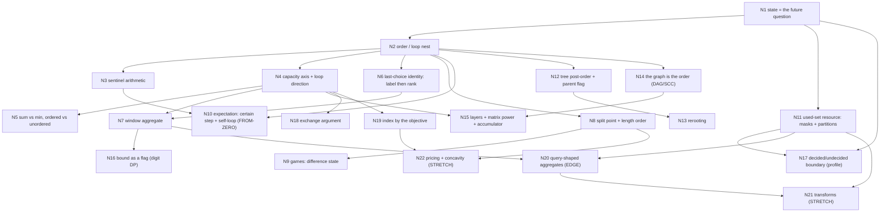

# DP — Stage 2 Curriculum Blueprint (svg treatise + 66 cards)

> `stage: 2` · `state: active` · `frontier: verified`
> Architect-owned. The teacher reads this file **only at node boundaries** and keeps the live board in `courses/dp/course.md`. This file contains no session log — that belongs to `course.md`.
> Sources: `courses/dp/sources/article.md` (970 lines, svg's TopCoder treatise reposted as CF blog 43256) and the 66 cards in `courses/dp/sources/problems/`.

---

## Verified Frontier Baseline

**Confirmed floor** (audited; do not re-teach, only re-verify where marked FRAGILE):
- Dependency/traversal order in every probed form: backward interval DP with all four loop nests analysed correctly; forward relaxation on a DAG (spotted the non-topological label order and the read-before-finalised bug); the consequence of reading an unfinalised state.
- Loop direction as problem semantics: descending capacity = 0/1, ascending = unbounded; coin-outer vs capacity-outer = unordered vs ordered. Both articulated from the mechanism, not memorised.
- Canonicalisation factor for 2 groups: 14 labelled splits → 7 unordered. **FRAGILE — rests on a single click. Re-verify at 11b.**
- Digit DP tight flag derived from the sufficiency test; the all-zero subtraction reasoned correctly (the *click* was wrong → FRAGILE, C4).
- LCS match guard: identified that an unguarded `+1` yields `min(len(s),len(t))`.
- Complete tree-merge transition set for a component constraint, including cut transitions, built even against an incomplete prior board. **FRAGILE — single click. Re-verify at 12b.**

**Pinned ceiling:** expected value / self-referential equations. Answered "I don't know" to `E = 1 + (1/3)E` after an earlier 2-state failure (two variables for one state, dropped branch). No template for `E = 1 + Σ p·E(next)`, no self-loop elimination. **N10 is from-zero and must not be compressed.**

**Unverified:** state *derivation*. The tree probe handed over `dp[v][0/1]` in the stem, so it tested transition completion, not discovery. The marked-tree instance is **not** evidence for state design. State derivation is first contact at N1, with the tree independent-set drill as the fallback (C2).

**Misconceptions to dismantle:**
- Expectation: no separation between the certainly-paid step and the branch outcomes; invents extra variables per state; drops branches. → N10, rules E1/E3.
- Sentinel arithmetic: mechanism understood when articulated, bookkeeping slips. Needs a fully specified board before any question. → N3 (C5 board contract).
- State design: initially reached for a *count* of marked vertices instead of a reachability bit (repaired in dialogue, still unproven). → N1, N12 fallback.
- Answer integrity: twice produced correct free-text reasoning while selecting a contradicting option (sentinel `2e9`; digit "subtract 1" vs click `3`). **The note is the datum; the click is unreliable.** → C4 everywhere.

---

## [COURSE_CONTRACT]

1. **Attempt before hint.** Every card: the student reads the statement and produces a state sentence, a transition inventory, and a complexity claim *before* the teacher names any technique. The teacher's first move on every card is a question, never an explanation.
2. **Statement only, editorial closed.** The cards ship with editorials and verified C++ (`sources/solutions/`). Neither enters the room until the student has a passing solution or has explicitly surrendered. Surrender is recorded in `course.md` with what was missing.
3. **One question per board step.** No stacked questions, no multi-part stems. Each gate item is one thing to write down.
4. **Answer-integrity protocol (C4).** On any boundary/sentinel/precision item: demand the one-line reason **before** accepting a click. Any click that contradicts the written note is re-asked as a prediction ("write the value the loop leaves in `dp[v][0]`") before it is scored. A floor that rests on a single click is marked FRAGILE in its node entry and re-verified at its practice block.
5. **Fresh-instance rule (C6).** No exit gate reuses an audit instance, and no retry reuses the previous gate's numbers. Every CORE gate is a new asymmetric input with 3–5 elements. The student's own "unfamiliar CORE card" marking is used to **order** probes, never to skip them.
6. **Ceiling and stretch policy.** CORE nodes are the course. EDGE (N20) is opt-in after the CORE loop closes. STRETCH (N21, N22, plus the parked cards) are named so they can be refused honestly; they never block the ~2000 line and are never used as a gate.
7. **Floors are verified, not re-taught.** A node marked `FLOOR` gets one sitting: a boundary drill plus its gate. If the gate passes first try, move on; if it fails, the node is promoted to `BUILD` on the spot.

---

## [HORIZON_DAG]

Each horizon isolates one generating bottleneck. A node inside a horizon is a lesson; the horizon is the reason the lesson exists. Numbering is **identity-stable across stages** (so audit references keep resolving), not a session order.

Refinements vs Stage 1: `N3 → N10` (a probability state must distinguish 0 from impossible), `N11 → N17` (a profile is a mask over the cut), `N14 → N15` (matrix power over a condensation). `N10` depends only on N1+N2, which is why it may start immediately after N3.

| # | Bottleneck in one sentence | Nodes | Student status | Primary cards |
|---|---|---|---|---|
| H1 | A DP is correct only if the state determines the future and the traversal respects the dependency DAG; sentinels are part of that contract | N1–N3 | N2 floor · N1 first-contact · N3 first-contact | DPC-A/H/F, DPC-D, TDPC-A |
| H2 | What the transition aggregates and the axis it runs over are design choices; reuse is encoded by loop direction | N4–N5 | N4 floor · N5 fragile | DPC-D, DPC-Y, TDPC-A, TDPC-H |
| H3 | The identity of the last element reduces to its rank among elements seen so far | N6 | build | DPC-C, DPC-T |
| H4 | When the transition ranges over a contiguous window, maintain the aggregate instead of rescanning | N7 | build | DPC-M/Q, TDPC-F/K/L |
| H5 | The last operation splits; both halves must exist, so the order is interval length | N8 | floor (compress) | DPC-N, TDPC-B |
| H6 | In a zero-sum alternating game the future only needs the score difference | N9 | build | DPC-K/L, TDPC-B |
| H7 | A random process whose move can fail to change the state is an equation with a self-term, not a recurrence | N10 | **from-zero** | DPC-I/J, TDPC-C/D |
| H8 | "Which elements are used" is a resource; partitions need a canonical decomposition | N11 | fragile + build | DPC-O/U |
| H9 | A subtree's answer must expose exactly what the parent asks about the component crossing the edge | N12–N13 | N12 fragile · N13 build | DPC-P/V, TDPC-P |
| H10 | The input's order (topological, layered) *is* the DP order; cycles need contraction or exponentiation | N14–N15 | N14 floor · N15 build | DPC-G/R, NDPC-B/E |
| H11 | An upper bound is a boolean flag; the rest of the state is arithmetic residue/carry | N16 | floor + build | DPC-S, TDPC-E, NDPC-J/D |
| H12 | For grid-like objects the state is the boundary between decided and undecided | N17 | build (late) | NDPC-A |
| H13 | The item order can be a theorem about the input, proved by pairwise exchange | N18 | first-contact | DPC-X |
| H14 | If one coordinate is monotone in the objective, index by the objective | N19 | build (late) | DPC-E, NDPC-H |
| H15 | The queried set's shape picks the structure | N20 | edge | DPC-W, DPC-Z |
| H16 | Change the index set so a convolution becomes pointwise | N21 | stretch | NDPC-M/L/K/Q |
| H17 | Price a constraint with a multiplier; exploit concavity | N22 | stretch | NDPC-O, NDPC-N |

---

## [NODE_MAP]

Legend — `FLOOR`: audited command, drill only. `FRAGILE`: floor resting on one click, re-verify in situ. `FROM-ZERO`: no template exists, build by ladder. `FIRST-CONTACT`: the node owns the first exposure, never cite as foundation. `BUILD`: normal treatment.

Two mandatory deviations from numeric order:
- **N10 opens right after N3.** It is the only from-zero horizon, it depends only on N1+N2, and its cards (DPC-I/J, TDPC-C/D) are gated behind it.
- **N2 and N8 are floor-confirmed** and each cost one boundary sitting. Their contents below are autopsies and drills, not derivations. Audit constraint C1 is satisfied by this ordering.

---

### N1 · A state is the future's question — not a summary of the past  `CORE · FIRST-CONTACT (state derivation)`

- **Anchors:** L25–63 (coins: `mink[P]` is only ever read at `P−W`), L118–125 (memoisation is the same recurrence, lazily), L271–277 ("equivalent states" = identical future), L666–740 (a subtree state must expose the parent's question).
- **Primary cards:** DPC-A Frog 1, DPC-H Grid 1. **Practice-only:** DPC-B (same shape, one more bound).
- **Motivating Fracture:** `dp[i]` answers Frog 1. Add "you may not land on the same stone twice": the array still compiles, still runs, and now answers a different problem, because the extension step spends a resource (which stones were used) that `i` never recorded. Nothing in the code looks wrong.
- **Core Invariant:** a state is legal iff the set of legal continuations of the state equals the set of legal continuations of the problem restricted to that prefix. Everything the transition spends must be in the state; nothing else may be.
- **Contest Signature:** one index plus moves that only look forward → scalar state. Any clause naming *which* earlier things were used/touched ("each at most once", "must pass through", "at least one of", "already visited") is the missing coordinate, handed to you by the statement.
- **Boundary & Sentinel Contract:** `dp[0]=0`, everything else `+INF`; `INF` must lose every `min`; never relax *from* an unreachable state; `dp[0]` means "cost 0 at the start", not "cost 0 everywhere". Grid 1: `dp[0][0]=1`, first row/column propagate only from the left/up, a blocked start cell kills the whole table.
- **First contact (C2, non-negotiable):** bare Frog 1 statement with **no proposed state on the board**. Then: "you may not land on the same stone twice — what is the smallest thing you must add?" Accept only an answer phrased as the future's question ("where I have been", "whether I touched X"). If the answer is a count, a total, or a raw visited *set* where a bit suffices, run the same drill on a bare tree independent-set statement ("paint black/white, no two adjacent black — what must the state carry?") **before N12 opens**.
- **Exit gate (fresh, asymmetric):** stones with `h = {0, 40, 10, 30, 20}` (5 stones), jumps of length 1 or 2, cost `|h_i − h_j|`, **and you must land on stone 3 at least once**. Write: the state tuple, its meaning as one sentence, the base, the transition, the answer state. Expected shape `dp[i][b]`, `b' = b | (landed == 3)`, answer `dp[4][1]` (the value is 20, via `0→2→4`). Then: "does `b` need one bit or three?" — the minimum is the invariant.
- **Practice 1b — `Anchor`:** Frog 1 and Grid 1 written from the state sentence alone (no recurrence given), then break each with one "which cells/stones" clause and name the minimal added coordinate.

---

### N2 · Order is part of the answer  `CORE · FLOOR (one boundary sitting; no rebuild)`

- **Anchors:** L65–117 (LCS), L157–206 (forward vs backward, `relax`), L207–260 (reconstruction), L583–608 (lexicographic order).
- **Primary card:** DPC-F LCS (including reconstruction). **Practice-only:** DPC-A (forward relaxation on a chain), DPC-G (read-only: find the non-topological label ordering).
- **Motivating Fracture:** the recurrence is right and the answer is wrong because a state was used before its last write. The article's own forward LCS writes a phantom row and column, and its reconstruction walks `prev[s]` with no reachability check.
- **Core Invariant:** every edge of the state graph points forward in the traversal; forward-style relaxation is legal iff no later write can improve a state already used as a source. *(Audited floor — the student reproduces this in all probed forms. Do not derive it again.)*
- **Contest Signature:** reads `(i−1,j)`, `(i,j−1)`, `(i−1,j−1)` → lexicographic; a single read at `(i−1,j+1)` → anti-diagonal; input is a graph → topological order (N14).
- **Boundary & Sentinel Contract:** base row **and** column; transition bounds `i<n1 && j<n2` vs `<=`; string 0-indexed vs table 1-indexed; phantom `(n1+1,n2+1)` created by equal NUL terminators (F2); reconstruction needs `np <= s` and `mink[s] < INF/2` before tracing (F4).
- **Sitting content:** F2 autopsy (name every escaping write), F4 guards, one "read before final" trace. No loop-nest teaching.
- **Exit gate (fresh):** `s="abc"`, `t="zabc"` (3 vs 5 chars, last real chars equal, terminators equal). (1) List every out-of-range write the article's bounds produce. (2) Give the LCS length and the reconstruction with an exact-size `vector<vector<int>>(n1+1, vector<int>(n2+1))`. (3) Second instance `s="aaaa"`, `t="bbbb"`: the reconstruction must print nothing and must not read `prev`. Pass = all three with the reason said aloud.
- **Practice 2b — `Boundary`:** forward LCS with an assertion that every read cell was finalised; exact-size vectors so the phantom write aborts loudly; then the empty-LCS reconstruction.

---

### N3 · Impossible is a number too  `CORE · FIRST-CONTACT (sentinel board contract)`

- **Anchors:** L126–135 (neutral element ±infinity), L279–296 (pruning = distinguishing impossible), L852–880 (BlockEnemy's `nres`).
- **Cards:** this node owns none — it is a sentinel/instrumentation node, and it drills the initialisation and merge conventions of cards owned elsewhere. **Practice-only:** DPC-D (exact `−INF` init, owned by N4), TDPC-A (reachability counts init 0/1, owned by N4), DPC-U (negative `a_ij` so `0` is not a valid max base, owned by N11), DPC-E (exact-value init), TDPC-H (three states, two impossible at a leaf).
- **Motivating Fracture:** `INF` gets added, doubled and merged. Once it overflows or gets "improved", an impossible state starts winning. BlockEnemy's `nres[0] = res[v][0] + res[s][0]` with two `1e9`s is exactly one merge away from a negative number (F18).
- **Core Invariant:** for every operation the DP applies, `sentinel ⊕ delta` must stay strictly worse than every real value. `0` is a legal count and a legal score, so it can never mean "impossible" in a sum-DP or in a max-DP with negative values.
- **Contest Signature:** min over an empty candidate set; "print −1 if impossible"; values that can be negative; merges that *add* two child results; counting DP where the true count can be 0.
- **Boundary & Sentinel Contract:** `memset(...,63)` → `0x3F3F3F3F = 1_061_109_567` (safe for one add, not two); `memset(...,−63)` → `0xC1C1C1C1 = −1_044_266_559`; `INF/2` read guard; strict `<` vs `<=` in `relax`; clamp after each add vs `long long`; `INF + w` vs `INF`.
- **Board contract (C5, non-negotiable):** before *any* arithmetic question about a merged tree DP, the board must show all four of:
  1. the exact `INF` constant **and** its type width (`int` 2.147e9 / `long long`),
  2. the initial pair for a **marked** vertex and for an **unmarked** vertex,
  3. the exact assignment from the merge accumulator `nres` back into `dp[v][0]` / `dp[v][1]`,
  4. which merges can meet two impossible values.
  No full table → no question. The audit's first "I don't know" was a misspecified stem, not a knowledge gap.
- **First contact:** the board above. The drill is *writing the table*, not re-explaining sentinels — the mechanism is understood, the bookkeeping slips.
- **Exit gate (fresh, asymmetric; write the number before clicking):** tree `1–2, 1–3, 3–4, 3–5` with marks `{2,4}`; merge order chosen so one child contributes `INF` into a real value and later two `INF`s meet. Predict the value left in `dp[1][0]`, then rerun with `INF = 1e8` and predict again. Pass = written number **plus** the one-line reason (C4).
- **Practice 3b — `Boundary`:** BlockEnemy's merge with three levels, two `1e9`s meeting at level 2; predict the overflow, fix by clamp; then `long long INF = 4e18` and show the read guard is still needed.

---

### N4 · The capacity axis, and the direction that means "reuse"  `CORE · FLOOR (drill the init and the 1D rewrite)`

- **Anchors:** L553–582 (row-by-row knapsack, no in-place form), L297–310 (two layers), L311–317 (precalculate).
- **Primary cards:** DPC-D Knapsack 1, TDPC-A Contest, TDPC-H Knapsack. **Practice-only:** DPC-E (reserved for N19). Frog 2 (`DPC-B`) is read here only as "the bound is a second axis"; its home is N7.
- **Motivating Fracture:** the article's row-by-row code is correct but never says why, and never shows the 1D form everyone writes. Flipping one loop bound silently converts 0/1 into unbounded.
- **Core Invariant:** row `i+1` reads only row `i`, so the two rows are disjoint. In place, descending `j` reads only not-yet-updated (previous-item) entries; ascending `j` lets the current item be taken again. *(Direction semantics audited — drill only.)*
- **Contest Signature:** `N ≤ 100, W ≤ 1e5` or a small sum of weights → capacity axis. `W ≤ 1e9` with small values → N19. "Each item once" vs "unlimited supply" is a loop direction, not a new recurrence.
- **Boundary & Sentinel Contract:** `j >= w` vs `j > w`; `dp[0]=0` rest `−INF` (exact) vs all zeros (at-most); answer `dp[W]` (exact) vs `max_j dp[j]` (at-most); the `w_i > W` guard; `W = 0`; the 1D array must be re-zeroed per test case.
- **First contact (C3, exact-vs-at-most):** board `w={2,3,4}, v={3,4,5}, W=6`. Fill both inits and report `dp[1]`: exact must be `−INF` (nothing sums to 1), at-most must be 0. Then `dp[6] = 8` for both — the lesson is that the **answer index** differs, not the value.
- **Exit gate (fresh, verified numbers):** items `(w,v) = (2,3), (5,8), (3,4)`, `W=9`. (1) Exact table: `dp[1] = dp[9] = −INF` (reachable sums are 0,2,3,5,7,8,10 — 9 is missing). (2) At-most: answer 12 (`{5,3}`). (3) Flip to ascending `j` from the at-most init: answer 14 (`5+2+2`), and say which problem it now solves. Pass = all three with reasons.
- **Practice 4b — `Twist`:** one 1D array, two loop directions, three outputs predicted before running.

---

### N5 · Sum is not min, and "ordered" is a loop-nesting choice  `CORE · FRAGILE (canonicalisation floor = one click)`

- **Anchors:** L136–156 (combinatoric DP, the 74-way table), L279–296 (skip zeros — but zero is a real count), L271–277 (merge equivalent states).
- **Primary card:** DPC-Y Grid 2 (count with a canonical "first violated cell" → subtraction). **Practice-only:** TDPC-A (count *sums* with multiplicity), DPC-M (distributions over labelled children).
- **Motivating Fracture:** the article's coin table counts *sequences* of coins while the prose sounds unordered; swapping the two loops counts multisets. Both are correct for something — the loop nesting *is* the definition of what is being counted, and nothing in the code says which one you meant.
- **Core Invariant:** a sum-DP counts each object once iff the decomposition has a canonical distinguished choice (the last coin, the lowest set bit, the first violated cell). Without one, the count is inflated by the symmetry factor — `k!` for `k` interchangeable groups. *(The 2-group case is an audited floor; the general `k!` is not.)*
- **Contest Signature:** "number of ways", "mod 1e9+7", "choose a subset / partition / distribution". The words *sequence* vs *set* decide the loop order; "at least once" clauses invite subtraction over the first hit.
- **Boundary & Sentinel Contract:** base `dp[empty] = 1` (one way to do nothing) vs `0` (impossible) — different objects in a sum-DP; subtraction needs `(a−b+MOD)%MOD`; the 74-way table's base is `mink[0] = 1`; Grid 2 sorts obstacles by `(i,j)` and subtracts `paths(before) × paths(before→here)`, which counts each path once at its first obstacle.
- **First contact (C3, `k!` for `k>2`):** partition `{1..6}` into 3 unlabelled pairs → 15. An ordered-groups DP gives 90 = 15·3!. The board question is "what exactly does your loop count?"
- **Exit gate (fresh):** (1) coins `{2,3}`, target 7: predict the multiset count (1) and the sequence count (3) by hand, then produce each with a one-line loop swap. (2) Grid 2 on a 3×3 board with one obstacle at (2,2): total 6, through-obstacle 2·2 = 4, answer 2. Pass = both numbers plus which decomposition was canonical.
- **Practice 5b — `Boundary`:** reproduce the article's 74; then the multiset count for the same input; then Grid 2 with the obstacle at the start or the goal (answer 0).

---

### N6 · Last-choice identity: name it, then compress it to a rank  `CORE · BUILD`

- **Anchors:** L25–63 (the transition is "which coin was last"), L136–156 (the last choice is the canonical decomposition), L271–277 (rank = equivalence class of identities).
- **Primary cards:** DPC-C Vacation, DPC-T Permutation. **Practice-only:** NDPC-I (EDGE, insertion DP), TDPC-O (STRETCH, same shape with equal-letter gaps).
- **Motivating Fracture:** `dp[i][last]` only needs the *identity* of the last choice, not the history — but when identities are a permutation of `1..N`, storing the value makes every transition invalidate every stored value. Storing the *rank* makes the update local (±1) and turns the transition into a prefix/suffix sum.
- **Core Invariant:** (a) the future asks only "what was the last choice" (Vacation); (b) when choices come from a fixed ordered set, the future asks only for the rank of the last element among the first `i`, because all comparisons are relative. Appending an element of rank `j` shifts every old rank `≥ j` up by one, but the number of old elements below `j` is exactly `j−1`, so reads need no shift.
- **Contest Signature:** `dp[i][label]` with a small label set → keep the label. "Permutation of 1..N", "relative order only", a pattern of `<`/`>`, `N ≤ 3000` → rank.
- **Boundary & Sentinel Contract:** Vacation has three states with `dp[0][*] = 0`; Permutation has `dp[1][1] = 1`; `<` reads a prefix sum over `k < j`, `>` a suffix over `k ≥ j`; both loops must read the **previous** row; `dp[i][j]` with `j > i` is meaningless and must stay 0.
- **First contact:** none from C3 — build.
- **Exit gate (fresh, asymmetric):** sign string `"<><"` on 4 elements (Euler count 5). Predict the rank table row by row (i = 1..4) and the final sum, then verify against a 4! brute force. The asymmetry is that the string starts with `<`.
- **Practice 6b — `Twist`:** write the `O(N³)` rank DP first, then the prefix/suffix compression; both must agree on `"<><"` and on `"><>"` (also 5).

---

### N7 · Aggregate over a window instead of rescanning  `CORE · BUILD (prefix sums, then prefix-max over values)`

- **Anchors:** L311–317 (precalculate, add a prefix axis), L339–343 (LIS "accelerated by a structure", never derived), L319–329 (index by something other than the input order).
- **Primary cards:** DPC-M Candies, TDPC-F Semi Express, TDPC-L Cat, DPC-Q Flowers, TDPC-K Target. **Practice-only:** DPC-B (window with a non-separable weight), DPC-T (already N6).
- **Motivating Fracture:** the transition is a max/sum over a contiguous range of earlier states; the inner loop costs `O(NK a_i)` or `O(N²)`. The range need not be re-walked — but the prefix must be built from the *previous* row, and sometimes the queried set is over *values* (`h_j < h_i`), which no running scalar can express.
- **Core Invariant:** (a) if the queried set is a prefix/suffix/fixed-width window over the **index**, a running prefix aggregate answers in `O(1)` amortised; (b) if it is over a **value**, the aggregate is indexed by value and needs a Fenwick/segment tree (or a monotone pointer when query order is monotone in the value).
- **Contest Signature:** `a_i ≤ K ≤ 1e5` with `Σ_{j'=j−a_i}^{j}`; "stops must be at least K apart"; "`h_i` distinct and `h_i ≤ N`"; "longest chain of nested circles/dolls"; `N ≤ 1e5` with a transition that reads as `O(N)`.
- **Boundary & Sentinel Contract:** `pre[−1] = 0`; the window is `a_i+1` values; the subtraction can go negative → `(x%MOD+MOD)%MOD`; build the prefix from the previous row; TDPC-L has negative `f`, so a running max must start at `−INF`, not 0; DPC-Q strictness (`max over h < h_i` vs `≤`) is invisible while heights are distinct — the drill must use duplicates.
- **First contact (C3, two items):**
  - *negative modulo:* board `MOD = 1e9+7, pre[j] = 3, pre[j−a−1] = 5`. What does C++ print for `(3−5) % MOD`? (−2). What must the code say? `1000000005`.
  - *prefix-max over values:* `h = {3,3,1,2}`. Strict answer 3, non-strict 6. Which query does your Fenwick issue?
- **Exit gate (fresh):** (1) Candies `N=3, K=5, a={2,1,3}` → 3 ways; report the window bounds for the middle child and what `pre[−1]` must be. (2) Flowers on `h={2,5,2,4}, a={3,1,4,1}` → strict answer 5 (`h=2` third flower, then `h=4`), non-strict 8. Pass = both numbers plus which query produced each.
- **Practice 7b — `Anchor`:** Candies with `a_i=0`, `a_i=K`, `K=0`; Semi Express and which row is the window; Frog 2 and why a prefix sum does **not** apply (`|h_i−h_j|` is not separable) and why `O(NK) = 1e7` is the intended cost.

---

### N8 · The last operation splits: interval DP  `CORE · FLOOR (length order audited; new content = split legality, cost, sentinel)`

- **Anchors:** L643–664 (substrings, split at M), L825–850 (Breaking Strings, Knuth).
- **Primary card:** DPC-N Slimes. **Practice-only:** TDPC-B (interval game, primary at N9), TDPC-I (EDGE: erasability).
- **Motivating Fracture:** the recurrence is right but the *split set* is wrong: allowing `M = L` or `M = R` reads a 0 and an unfilled `INF`. If the merge cost can be negative, `INF + cost > INF` stops holding and the unfilled state becomes a real candidate (F10's hidden dependence).
- **Core Invariant:** the last operation partitions a segment into two strictly shorter independent segments; the split set is exactly the interior split points, both halves must already exist, and the fill order is non-decreasing length. *(Length order audited.)*
- **Contest Signature:** `N ≤ 3000` with `O(N³)`; "merge/burst/remove/fold a segment"; cost = sum of the segment (prefix sums).
- **Boundary & Sentinel Contract:** split endpoints (`L ≤ M < R` half-open vs `L < M < R` closed); base length 0 vs length 1 (`dp[i][i] = 0`); answer `dp[0][N−1]`; merge cost via prefix sums; with negative costs the sentinel needs `long long` and an explicit `filled[][]` flag; `N = 1`.
- **First contact:** none from C3 — the ordering floor is audited, the split-set drill is this node's own.
- **Exit gate (fresh, negative costs so the sentinel is load-bearing):** `v = {5, −2, 3, 1}`, cost of a segment = its sum. (1) Enumerate the legal splits of `[1,4]`. (2) Compute the answer by hand = **10** (1-indexed: merge `3` with `1` first, then `−2`, so `cost(2..4) = 3`; then `sum(1..4) + 0 + 3 = 7+3`). (3) Say what breaks if the split set includes `M = L` given `dp[1][4]` starts at `INF`. Pass = the number and the sentinel sentence.
- **Practice 8b — `Boundary`:** Slimes with `N=1`, `N=2`; fill with `L` outer / `R` inner to watch `dp[M][R]` fail; then the negative-cost instance with an explicit `filled` flag. Knuth's quadrangle inequality (F10) is a **stretch note only** — state the precondition, do not teach the optimiser.

---

### N9 · Games: the state is a difference, not two totals  `CORE · BUILD`

- **Anchors:** L126–135 (optimal substructure, the TSP counterexample as a warning), L643–664 (the interval recursion reused as a game).
- **Primary cards:** DPC-K Stones, DPC-L Deque, TDPC-B Game.
- **Motivating Fracture:** "both players play optimally" cannot be written with one score; storing two totals doubles the state and still doesn't alternate. Storing `current − other` makes the alternation a single sign flip.
- **Core Invariant:** zero-sum with a conserved total → the value to the mover is `max over moves (gain − value(child))`; the total is recovered at the end (`X = (sum + D)/2`). For win/lose games the value is boolean: `exists a move to a losing state`.
- **Contest Signature:** two players, alternating, perfect information, "maximise your total"; interval game with `N ≤ 3000`; subtraction game asking "does the first player win".
- **Boundary & Sentinel Contract:** `dp[0] = lose` (no move = lose); `dp[i][i] = a_i`; `X−Y` has the same parity as the total; `N=1`; Stones is a plain subtraction set (no disjunctive sum, so no Grundy).
- **First contact:** none from C3 — build.
- **Exit gate (fresh):** (1) Stones with moves `{1,3}`, `N=7` → first player wins (7→6 is losing); give the full win/lose vector for 0..7 and the winning move. (2) Deque on `[4,1,9,2]` → `D = 10`, so `X = 13, Y = 3`. Pass = both numbers plus the "total is recoverable" sentence.
- **Practice 9b — `Twist`:** Stones as win/lose only; then Deque with the difference state and the reported first-player score; then the same interval with the take order inverted to check the symmetry.

---

### N10 · Expectation: the certain step, the branches, and the self-loop you must subtract  `CORE · FROM-ZERO`

- **Anchors:** L126–135 and L136–156 (the closest thing in the article — sums of *counts*), L118–125 + F6 (the memoisation claim). Expectation itself is **absent from all 970 lines** (F12).
- **Primary cards:** DPC-I Coins, DPC-J Sushi, TDPC-C Tournament, TDPC-D Dice. **Practice-only (parked rung 5):** TDPC-J Ball — EDGE, only after N11.
- **Motivating Fracture:** `E = 1 + Σ p_i E(next_i)` contains `E(current)` whenever a move can do nothing. That is an equation, not a recurrence: memoised recursion recurses forever (F6), and the certainly-paid `1` is routinely folded into the branch list or multiplied by a probability.
- **Core Invariant — four sentences, taught in this order:**
  - **E1. The certain step sits outside the branches.** `E(s) = 1 + Σ_i p_i · E(next_i)`, with `Σ p_i = 1` **including** the no-op branch. Dropping the no-op branch is the same error as dropping a transition.
  - **E2. If the same state appears on the right with coefficient `q < 1`, move it left and divide by `1−q`.** `q` is `P(no progress)`, so `1−q = P(progress)`.
  - **E3. One state gets exactly one variable.** Two variables for one state is not extra rigour; it is an under-determined system.
  - **E4. After E2 removes self-terms the remaining dependencies are acyclic in every card here,** so back-substitute in that order. No Gaussian elimination is needed — but the equations must be written before any code.
  - **Paired with F6:** naive memoisation on a self-loop diverges; the fix is algebra *at the state*, not memoisation.
- **The ladder (all five rungs, in order; the audit's `3/2` and any geometric-series view are not evidence — the student derives each):**
  1. One state, stop certain → `E = 1`.
  2. One state, `1/3` stay → `E = 1 + (1/3)E = 3/2`.
  3. Two states: `A (1/2→A, 1/2→B)`, `B (1/2→A, 1/2→stop)` → `E_A = 6`, `E_B = 4`, both equations written and the substitution shown.
  4. Three states with per-state denominators → Sushi. Write the general `(x,y,z)` equation with denominator `n` (dishes) and self-coefficient `(n−x−y−z)/n`; then `N=1` with `a_1 ∈ {1,2,3}` → 1, 2, 3; then `N=2` with `a={1,1}` → 3 (the intermediate state `(1,0,0)` carries a genuine self-loop: `E = 1 + (1/2)E → 2`).
  5. Parked as stretch: bitmask expectation (TDPC-J Ball) — only after N11, and only opt-in.
- **Exit gate (fresh; both equations written; no clicking):** `A: 1/2→A, 1/2→B`; `B: 1/3→A, 1/3→B, 1/3→stop`. Must yield `E_A = 7`, `E_B = 5`, with the substitution check `E_A = 1 + 0.5·7 + 0.5·5 = 7`. Also state `P(progress)` for each state. Fail modes to watch: a third variable, a missing `1`, or treating `E_A` on the right as an assignment instead of an unknown.
- **Boundary & Sentinel Contract:** tolerance `1e−9` as stated by the problem; probability 0 ≠ impossible; DPC-I's convention `dp[0][0] = 1` with the answer summed over `heads > tails`; TDPC-D caps exponents at the required prime powers (`min(j+2,p2)`) — a state-merge (F16) that keeps the domain finite; Sushi's `(x,y,z)` is itself a merge of the `3^N` configurations by count; print with 10+ decimals.
- **First contact:** rungs 1→2→3 of the ladder. Nothing in this node may be cited as "already known".
- **Practice 10b — `Anchor`:** rungs 1–3 on *different* numbers (e.g. `1/4` stay → `4/3`; a 3-state chain with a self-loop in the middle).
- **Practice 10c — `Boundary`:** Sushi `N=1` (1,2,3) and `N=2, a={1,1}` (3); Ball with one object (`E=3`, `q=2/3`); Dice with `N=1, D=6`; then write the memoised version without the algebraic move and watch it hang.

---

### N11 · The used-set resource: masks and canonical partitions  `CORE · FRAGILE + BUILD (3^N budget)`

- **Anchors:** L609–641 (subsets, TSP, `4^N → 3^N`), L437–457 (GameWithGraphAndTree), L797–823 (InformFriends).
- **Primary cards:** DPC-O Matching, DPC-U Grouping. **Practice-only:** the count version of DPC-U (the drill). TDPC-M (STRETCH) belongs to N15; NDPC-C (EDGE) is parked.
- **Motivating Fracture:** DPC-O needs "which columns are taken" and `dp[i]` cannot say it. Once the mask exists, DPC-U's submask loop is fine for max and catastrophic for counts, because each partition is generated once per ordering of its groups.
- **Core Invariant:** (a) a mask state is legal when every transition only *adds* elements, so increasing popcount/mask is a topological order; (b) for partitions, fixing "the group containing the lowest set bit of `S`" gives each partition exactly one decomposition.
- **Contest Signature:** `N ≤ 20`; "assign each to exactly one"; "partition into groups"; matching/assignment. The budget is arithmetic, not fashion (F14): `N·2^N ≤ 1e8` → `N ≤ 20`; `3^N ≤ 4e7` → `N ≤ 16`.
- **Boundary & Sentinel Contract:** `for (t=s; t; t=(t-1)&s)` includes `s`, excludes 0, runs zero times for `s=0`; `1<<N` overflows at `N=31` (use `1LL`); `dp[0]=1` for counting vs `0` for max; iterate `S` increasing so all proper submasks are final; `__builtin_popcount(S)` = number of already-assigned men in DPC-O.
- **First contact (C3, `k!` for `k>2`, and the re-verification of the FRAGILE floor):** partition `{1..6}` into 3 unlabelled pairs → 15; the uncorrected loop yields 90 = 15·3!.
- **Exit gate (fresh):** (1) count set partitions of `{1..5}` into exactly 2 blocks (15) with the lowbit rule, and say how many times the uncorrected loop visits each partition (2). (2) A DPC-U-style max on `N=5` with a teacher-supplied asymmetric matrix — the only requirement is that the transition enumerates all submasks of the complement including "everything in one group".
- **Practice 11b — `Twist`:** Grouping's submask loop *without* the lowbit rule still gives the right max; convert the same code to "count partitions into exactly `k` groups" and watch the `k!` overcount appear. This is where the fragile canonicalisation floor is confirmed or demoted.

---

### N12 · Trees: post-order induction and the parent's question  `CORE · FRAGILE + FIRST-CONTACT (tree state derivation)`

- **Anchors:** L666–740 (subtrees, inner DP, `sum K_i = N−1`), L852–880 (BlockEnemy).
- **Primary cards:** DPC-P Independent Set, TDPC-P Eel. **Practice-only:** NDPC-F (STRETCH), TDPC-N (STRETCH). `DPC-V` belongs to N13 and is not opened here.
- **Motivating Fracture:** a subtree answer that doesn't say whether the component touching the parent is black cannot be merged; and a state *handed to you* is not a state you can design — the audit's tree probe supplied `dp[v][0/1]` in the stem, so it tested transition completion, not discovery.
- **Core Invariant:** given the parent's state the children are independent; merge them one at a time with an inner DP over "children processed so far"; the state exposes exactly the property the parent asks about ("is `v` black"), and every cut transition is present.
- **Contest Signature:** tree + local constraint; "connected component containing v"; "for every edge cut"; "any two black vertices connected through black".
- **Boundary & Sentinel Contract:** leaf base (`dp[v][0]=1, dp[v][1]=1` for independent set); the root has no parent edge, so no cut transition is applied there; `INF+INF` in merges (F18); allocate/clear only the `K_i+1` rows you own; `sum K_i = N−1` → `O(N A²)`, while a per-vertex global `memset` → `O(N² A)`.
- **First contact (C3, merge-cost accounting):** bound both codes aloud on a 6-vertex tree — row-local allocation and per-vertex `memset` — and name which one the article's code does.
- **State-derivation fallback (C2):** if N1's probe produced a count or a raw set, open N12 with the **bare** independent-set statement, no proposed state, and require the parent's question in words before any `dp[v][…]` is written.
- **Exit gate (fresh, asymmetric):** tree `1–2, 2–3, 2–4, 4–5, 4–6` with marks `{3,6}`; write the complete transition set (including the cut), the initial pair for a marked and an unmarked vertex, predict `dp[root][0]` **in writing**, then give the merge-count bound for this tree. This is where the fragile "complete transition set" floor is confirmed.
- **Practice 12b — `Anchor`:** Independent Set from the state sentence; then Eel's 3-state merge; instrument the merge counter and confirm `O(N K²)`.

---

### N13 · Rerooting: all roots from one  `CORE · BUILD (division is first-contact)`

- **Anchors:** L666–740 (single-root subtree DP — the thing that becomes `O(N²)` if repeated).
- **Primary card:** DPC-V Subtree.
- **Motivating Fracture:** "for every vertex as root" run `N` times is `O(N²)` at `N = 1e5`. Moving the root across one edge changes only that edge's contribution.
- **Core Invariant:** `down[v]` = answer for `v`'s subtree; `up[v]` = answer for everything outside, built from `up[parent]` and the siblings' `down`. The combination must be associative (product/min/max), which is what legalises reuse; when it is not invertible, use prefix/suffix products around the child.
- **Contest Signature:** "for each vertex, the number of ..."; `N ≤ 1e5`; a modulus that is **not necessarily prime**; "assuming `v` must be black".
- **Boundary & Sentinel Contract:** composite `M` → division fails (first contact); empty product = 1, empty min = `+INF`; root's `up` = identity; `N=1`; degree-1 vertices (the prefix/suffix array has length 1); recursion depth → iterative DFS at `N=1e5`.
- **First contact (C3, rerooting):** `M = 10^9` non-prime. Construct a `down` value like 8 and show `gcd(8, 10^9) ≠ 1`, so no inverse exists. The division solution must fail on the spot; the prefix/suffix one must pass.
- **Exit gate (fresh):** tree `1–2, 2–3, 3–4, 2–5` with `M = 12`; write `down[]`/`up[]` symbolically for `v=2` and name a value in the array that is non-invertible mod 12.
- **Practice 13b — `Twist`:** Subtree with `M = 10^9` — division must fail, prefix/suffix must pass; then `N=2` in both directions, then `N=200000` as a stack-depth check.

---

### N14 · The graph is the order  `CORE · FLOOR + BUILD (SCC, multi-test hygiene)`

- **Anchors:** L583–608 (order = dependency), L157–206 (forward relaxation).
- **Primary cards:** DPC-G Longest Path, NDPC-B DAG. **Practice-only:** TDPC-R (EDGE: SCC + two-path DP).
- **Motivating Fracture:** "longest path" is not a function on a cyclic graph; memoised DFS recurses forever; a topological order does not exist until SCCs are contracted. *(Audited floor: the non-topological label order and the read-before-finalised bug are already spotted — this sitting is condensation and hygiene.)*
- **Core Invariant:** on a DAG any reverse-topological order is a valid DP order; inside an SCC every vertex reaches every other, so path counting needs condensation (or matrix power, N15), never a recurrence on vertices.
- **Contest Signature:** "the graph has no cycles"; `N,M ≤ 2e5`; "number of paths from 1 to N"; self-loops left after condensation; multiple test cases.
- **Boundary & Sentinel Contract:** visited-mark timing (entry vs exit); unreachable target → 0 or `−INF`, never "uninitialised"; reinitialise per test case (vectors, not globals); a 1-vertex DAG; self-loop after contraction; SCC size when counting vertices vs edges.
- **First contact (C3, SCC condensation):** add a 2-cycle to DPC-G (`7→3` and `3→7`) — the DP must condense or loop. Then NDPC-B with `T` test cases including a 1-vertex DAG.
- **Exit gate (fresh):** DAG `5→3, 5→1, 3→2, 1→4, 2→4` (labels reversed relative to the topological order): longest path = 3 edges. Then add `4→5` and say exactly what must happen (condense; the original problem is no longer well-defined). Pass includes "the label order is not the DP order".
- **Practice 14b — `Boundary`:** DPC-G with the 2-cycle; NDPC-B with `T` test cases and a 1-vertex DAG; then a 2-vertex graph with both directions and no other edges.

---

### N15 · Layers that repeat: matrix power and the accumulator row  `CORE · BUILD (accumulator is first-contact)`

- **Anchors:** L331–337 (matrix power), L459–509 (TourCounting accumulator).
- **Primary card:** DPC-R Walk. **Practice-only:** TDPC-T (EDGE linear recurrence), NDPC-E (doubling, the min/monoid cousin), TDPC-M (STRETCH, subset path counts).
- **Motivating Fracture:** `K ≤ 1e18` makes layer iteration impossible; the layer transition is linear and layer-independent, so the whole iteration is one matrix power. But the answer may be a sum over layers, which `M^K` alone cannot express.
- **Core Invariant:** `V(i+1) = V(i)·M` (row-vector) and `M^K` by squaring; if the answer is `Σ_i f(V(i))`, add accumulator coordinates to `V` and matching rows/columns to `M` so the running sum is part of the state.
- **Contest Signature:** `N ≤ 50`, `K ≤ 1e18`, "number of walks of length exactly K", "after K steps", a linear recurrence with a huge index.
- **Boundary & Sentinel Contract:** `A^0 = I`; row vs column convention decides **where the answer index lives** (row-vector: the last coordinate; column-vector: the first entry after `M^K·V`); subtract the `n` empty cycles in TourCounting; modular products need `long long`; `K=1`; accumulator matrix size `2n × 2n`. F15: D&C path recovery is `O(T log N)`, not `O(log N)`, and **no card needs it** — mention and move on.
- **First contact (C3, matrix accumulator):** (a) what does `K=0` compute (sum of all entries of `I` = `N`)? (b) where does the answer index live under your convention?
- **Exit gate (fresh):** 3-vertex graph `1→2, 1→3, 2→1, 3→2`. For `K = 0,1,2` report "walks of length exactly K summed over ordered pairs" and "sum over lengths ≤ K", predicted from `I + A + A²` by hand, then confirmed with a 10-line brute force. State the accumulator row explicitly.
- **Practice 15b — `Boundary`:** DPC-R with `N=1` (single vertex, no self-loop → 0 for every `K`) and `K=1`; then the `2n × 2n` accumulator for "sum over lengths ≤ K" checked against brute force at `K=5`.

---

### N16 · The bound is a flag: digit DP  `CORE · FLOOR (tight) + BUILD (carry, conventions)`

- **Anchors:** absent from the article (F13); L279–296 (prune impossible states) reads as the same idea.
- **Primary cards:** DPC-S Digit Sum, TDPC-E Number, NDPC-J Number and Total, NDPC-D Banknote. **Practice-only:** TDPC-G (EDGE: digit DP + k-th construction, cap counts at K).
- **Motivating Fracture:** `N < 10^10000` cannot be a loop bound; the only thing the prefix must remember about the bound is whether it is still equal to it. Once tight drops the rest is free. *(Audited: tight is derived from the sufficiency test, and the all-zero subtraction is reasoned correctly. The reasoning is a floor; the click was wrong → FRAGILE, C4.)*
- **Core Invariant:** tight is monotone (`1→0` once), so the state graph is a DAG; the digit sum / residue / carry is pure arithmetic and must be bounded by the arithmetic, not by the bound.
- **Contest Signature:** "count integers in `[0,N]` with property P"; `N` given as a string; the property depends on digit sum mod `D`, on prime exponents of a product, or on a carry chain; "positive integers".
- **Boundary & Sentinel Contract:** leading zeros (DPC-S's suffix table vs TDPC-E's padded-string view); subtract the all-zero number exactly once; `tight=1` survives to the last digit and contributes 1 to the answer, not 0; NDPC-J's carry is bounded by `Σ A_i ≤ 200`; NDPC-D's borrow is the same flag with the sign flipped, over denominations `10^0..10^100`; `T` test cases → clear the table.
- **First contact (C3, digit carry/borrow bound):** NDPC-J — what is the largest carry that can arrive at a digit, and why must the state bound it? Then TDPC-E with `N=0` (illegal input, but the printed value reveals whether the all-zero was subtracted).
- **Exit gate (fresh):** (1) count `x ∈ [0,47]` with digit sum ≡ 0 mod 3 → **16**, computed through the tight table (write the `dp[pos][rem][tight]` rows for tens-digits 4 and 7 first). (2) TDPC-E on `N="25", D=4`, then say what your code prints for `N="1"` and for `N="0"`. Pass requires the number 16 and the all-zero sentence.
- **Practice 16b — `Anchor`:** TDPC-E with the smallest legal `N` and `D=1`; NDPC-D with `N` one digit and with `N` all nines; NDPC-J with `N=1`.

---

### N17 · The decided/undecided boundary: profile DP  `CORE (late) · BUILD`

- **Anchors:** L741–793 (layer + profile, `(1+φ)^N`), L882–926 (ConstructionFromMatches), L297–310 (two layers).
- **Primary card:** NDPC-A Polyomino. **Practice-only:** TDPC-S, TDPC-Q (STRETCH).
- **Motivating Fracture:** a 2×N tiling cannot be counted by `dp[column]`; the overhang into the next column is information the column index does not carry. And the cost is not the number of profiles but the number of `(profile, next-profile)` pairs (F7).
- **Core Invariant:** at any cut between columns the only thing the future needs is which cells of the cut are already covered; the transition enumerates every way to fill one column consistently with that boundary; the answer is the state after the last column with an empty profile.
- **Contest Signature:** one dimension small (`≤ 6`, or width fixed at 2), "tile/cover/place pieces", count modulo, `N` up to 40+ with width 2.
- **Boundary & Sentinel Contract:** choose `min(H,W)` as the profile width; clear the destination layer (F8: the article preaches two layers then allocates all of them); the answer needs the empty final profile, not the sum over profiles; `N=1`; reset per source profile; the pair count is `Σ_h C(N−h,h)·2^{N−2h} ≈ 2.414^N`, not `(1+φ)^N = 2.618^N` (F7) — ~1.0845× per unit width, i.e. 25–30× at width 40, which is exactly why the card must be solved at width 2.
- **First contact (C3, profile boundary):** `N=1,2,3` by hand (1, 2, 5) against a brute-force tiling enumerator.
- **Exit gate (fresh):** with dominoes + L-trominoes, hand-tabulate `N=1..4` (1, 2, 5, 11) and produce `N=5` (24) by program; then answer "how many `(profile, next-profile)` pairs does your code enumerate for width 3?" by counting, not quoting φ.
- **Practice 17b — `Anchor`:** Polyomino hand-count `N=1,2,3` vs brute force vs program; then a 3×N domino-only variant at `N=2,3,4` (3, 0, 11 — the 0 is the parity trap).

---

### N18 · When the DP order must be proven: exchange arguments  `CORE (late) · FIRST-CONTACT`

- **Anchors:** absent (F13); L319–329 (reorder/rotate) is the nearest thing.
- **Primary card:** DPC-X Tower.
- **Motivating Fracture:** Tower is a knapsack only after an order on the blocks is proved. Without the proof the DP processes an arbitrary input permutation and silently misses the optimum.
- **Core Invariant:** if swapping two adjacent items never worsens the objective whenever a stated key is out of order, then some optimal solution is sorted by that key; only then may the DP process items in that order. For Tower, `i` above `j` is safe iff `w_i + s_i ≤ w_j + s_j`.
- **Contest Signature:** items with two attributes and a pairwise feasibility condition (`w_i + s_i`); "arrange in some order"; `N ≤ 1000` with `w,s ≤ 1e4`.
- **Boundary & Sentinel Contract:** sort key `w+s` ascending; ties are free; after sorting the state is "weight strictly below", so the transition requires `j ≤ s_i` **before** adding; `j` descending; the capacity axis is `max s_i`, not `Σ w`; `N=1`.
- **First contact (C3, exchange argument):** (a) all `w+s` equal — every order is optimal, so a wrong key is invisible; (b) one block that only fits on top. Both on the board before the card opens.
- **Exit gate (fresh):** blocks `(w,s,v) = (2,5,10), (3,1,7), (4,2,9), (1,3,5)`. Sort by `w+s`, run the knapsack, verify against brute force over all `4!·2^4` placements; then name the pair the exchange argument compares and why ties are free.
- **Practice 18b — `Twist`:** the tie case; then a block with `s=0`; then `N=1`.

---

### N19 · Index by the objective: dominance and rotation  `CORE (late) · BUILD`

- **Anchors:** L319–329 (rotate — the condition stated there is monotonicity, not dominance; F11), L279–296 (prune impossible).
- **Primary cards:** DPC-E Knapsack 2, NDPC-H Coin.
- **Motivating Fracture:** Knapsack 2 has values `≤ 1e3·N` but weights `≤ 1e9`, so the capacity axis explodes. Swapping the axes works only if "more value, less weight" dominates for **every** continuation — the step the article never states.
- **Core Invariant:** `(W1,R1)` dominates `(W2,R2)` iff `W1 ≤ W2`, `R1 ≥ R2`, and every transition is monotone in both coordinates; then `min weight achieving exactly value R` is a sufficient state and feasibility is a scan at answer time.
- **Contest Signature:** `Σ v_i` small with `W` huge; "cost vs quality with a hard budget"; per-cell min/max envelopes where the reachable counts form an interval (NDPC-H).
- **Boundary & Sentinel Contract:** `R` must be achieved *exactly* → `INF` init, not all-zeros; the answer is the largest `R` with `W(R) ≤ C` (a scan, not `dp[V]`); `v=0` items; the dominance proof must name the continuation.
- **First contact:** none from C3 — build (dominance was not probed).
- **Exit gate (fresh):** items `(w,v) = (5,4), (3,3), (7,5), (2,2)`, `W=9`. Write the exact-`R` min-weight table, then the feasibility scan → answer **7** (feasible `R` = 0,2,3,4,5,6,7 with weights 0,2,3,5,5,7,8; `R=8` costs 10, `R=9` costs 12). Pass includes "why `R=8` is not the answer".
- **Practice 19b — `Boundary`:** add a `(w=1, v=0)` item; then an unreachable `R`; then NDPC-H's "reachable counts form an interval" argument (min/max DP + IVT via adjacent swaps).

---

### N20 · Query-shaped aggregates: lazy sweep and CHT  `EDGE (opt-in)`

- **Anchors:** L339–343 (complex structures), L319–329 (dominance).
- **Primary cards:** DPC-W Intervals, DPC-Z Frog 3. **Practice-only:** NDPC-G (STRETCH, ear DP + segment tree).
- **Motivating Fracture:** the transition is a query over a set whose shape changes with the index — a range that grows or shrinks as the sweep advances — or an argmin over lines with monotone slopes.
- **Core Invariant:** maintain exactly the aggregate the transition asks for, updated at the same event that changes the queried set; if the argmin index is monotone in the query parameter, a pointer/deque replaces the search.
- **Contest Signature:** `N,M ≤ 2e5`; "an interval contributes iff it contains the last chosen position"; `(h_i−h_j)² + C` with increasing `h`; `h_i` distinct.
- **Boundary & Sentinel Contract:** apply the lazy range-add to exactly the positions `j < l_i` at the moment the sweep reaches `r_i` (both endpoints and the event order matter); signed `a_i` (±1e9) → max must start at `−INF` and an empty range is a no-op; CHT overflow (`h ≤ 1e9` → squares need `__int128` or cross-product comparison), decreasing/increasing slopes, monotone query order.
- **First contact (C3, prefix-max over values, shared with N7):** `h = {3,3,1,2}` strictness — here the question is "does your Fenwick issue `< h_i` or `≤ h_i`, and does the card's distinctness make the difference invisible?"
- **Exit gate (fresh):** (1) Intervals on `N=3` with `[1,2] w=5` and `[2,3] w=6` → answer 11, with the sweep table by hand. (2) Frog 3 on `h={1,3,4}, C=5` → `dp[3] = 14`, and the deque invariant stated.
- **Practice 20b — `Twist`:** Flowers with reversed `h` (query becomes a suffix), equal `h` (strictness), then Frog 3 with decreasing `h` to watch the monotone deque break — that is the precondition, not an implementation detail.

---

### N21 · Stretch: change the index set  `STRETCH`

- **Anchors:** absent. Nearest: L339–343.
- **Primary cards:** NDPC-M Numeral (SOS), NDPC-L LCM (divisor zeta), NDPC-K Addition and Subtraction (FPS log/exp), NDPC-Q Union of Intervals (interpolation). **Parked:** NDPC-P, NDPC-R, NDPC-S, NDPC-T.
- **Motivating Fracture:** a convolution over subsets, divisors or degree is `O(3^N)` or `O(S²)`; the transform turns it pointwise because the index set is a product of chains.
- **Core Invariant:** zeta/Möbius over the subset lattice (bit-by-bit), divisor zeta over prime exponents, FPS `log`/`exp` over a prime field, and `M+1` evaluations determine a degree-`M` polynomial.
- **Contest Signature:** "for every mask, the sum over its submasks"; `N ≤ 22`; LCM/divisor structure; "answer for every K" with a degree bound.
- **Boundary & Sentinel Contract:** transform direction and inverse; the modulus must exceed the degree for FPS division (998244353 vs `S ≤ 2e5`); interpolation needs distinct points; `long long` products.
- **Exit gate (fresh):** SOS on `N=3` against brute force for every mask; divisor zeta for `n ≤ 12` against brute force.
- **Practice 21b — `Anchor`:** as above, plus one "why not `O(3^N)`" arithmetic check.

---

### N22 · Stretch: price a constraint, exploit concavity  `STRETCH`

- **Anchors:** absent.
- **Primary cards:** NDPC-O Game (Alien + max-plus concavity), NDPC-N Knapsack (unbounded + eventual greedy).
- **Motivating Fracture:** "exactly `k` groups" is a dimension; pricing it with `λ` removes the dimension, and concavity makes the binary search on `λ` recover `k`; max-plus convolution of concave sequences is linear.
- **Core Invariant:** `f(k) = min cost with exactly k`; `g(λ) = min_k (f(k) + λk)` is the lower envelope; if `f` is convex the optimal `k` is monotone in `λ`, and the answer is recovered as `g(λ) − λk`.
- **Contest Signature:** "exactly K segments/groups"; `N ≤ 1e5` with `K` large; a max-plus merge inside an interval DP.
- **Boundary & Sentinel Contract:** integer `λ` and tie-breaking to recover the count; concavity must be proved; reconstruction from `g(λ) − λk`.
- **Exit gate (fresh):** a 1D "exactly k segments" toy with brute-force `f(k)` for all `k`, then recover `f(k)` by pricing.
- **Practice 22b — `Boundary`:** as above.

---

## [FIRST_CONTACT_REGISTER]

Every row is probed **at the node**: none may be cited as a foundation, and none may be assumed from the audit. "Pass looks like" is the minimum acceptable board output before the node's cards open.

| # | Item | Node(s) | Gate question | Pass looks like |
|---|---|---|---|---|
| FC1 | exact-vs-at-most init | N1 (as statement meaning), N4 (as answer index) | `w={2,3,4}, v={3,4,5}, W=6`: fill both inits, report `dp[1]` | exact `−INF`, at-most 0, and "the answer index differs, not the value" |
| FC2 | `k!` for `k>2` | N5, N11 | partition `{1..6}` into 3 unlabelled pairs | 15, and 90 = 15·3! for the uncorrected loop |
| FC3 | negative modulo | N7 | `(pre[j]−pre[j−a−1]) % (1e9+7)` with `pre[j]=3, pre[j−a−1]=5` | −2 in raw C++, `1000000005` with the fix |
| FC4 | merge-cost accounting | N12 | `sum K_i = N−1` vs per-vertex `memset`, on a 6-vertex tree | `O(N A²)` vs `O(N² A)`, both bounded aloud |
| FC5 | matrix accumulator | N15 | `K=0` on DPC-R; where the answer index lives | `N` (sum of `I`), and the convention named |
| FC6 | digit carry/borrow bound | N16 | NDPC-J max carry; TDPC-E with `N=0` | `Σ A_i ≤ 200`, and the all-zero sentence |
| FC7 | profile boundary | N17 | `N=1,2,3` hand count vs brute force | 1, 2, 5 with the profile named at the cut |
| FC8 | exchange argument | N18 | all `w+s` equal; one block that only fits on top | a proved key, and the tie case declared free |
| FC9 | LIS / prefix-max over values | N7, N20 | `h={3,3,1,2}` strictness | strict 3 vs non-strict 6, with the query inequality stated |
| FC10 | rerooting | N13 | `M=10^9` non-prime | division must fail on the spot; prefix/suffix passes |
| FC11 | SCC condensation | N14 | 2-cycle added to DPC-G; `T` tests; 1-vertex DAG | "condense or the problem is ill-defined" |
| FC12 | state derivation (C2) | N1, fallback N12 | bare Frog 1 + "no stone twice"; bare tree independent set | the future's question, not a count and not a raw set |
| FC13 | expectation ladder (E1–E4) | N10 | rungs 1→2→3, then the `E_A=7, E_B=5` gate | both equations written, `1` outside, self-term moved left |
| FC14 | sentinel board (C5) | N3 | the four-part table before any arithmetic | INF + width, both init pairs, `nres` assignment, collision list |

**Answer-integrity protocol (C4) applies to every row.** Signed notes are evidence; clicks are not. Any click that contradicts the note is re-asked as a prediction before scoring. Rows whose floor rests on a single click are FRAGILE and are re-verified at N3, N11b, N12b, N16.

---

## [CARD_TRIAGE]

66 cards, complete accounting: **40 CORE, 9 EDGE, 17 STRETCH** (26 DPC + 20 TDPC + 20 NDPC). A card has exactly one primary node; extra appearances are practice-only.
Card ids are the codes from `sources/index.md`: `DPC-A` = #1 … `DPC-Z` = #26, `TDPC-A` = #27 … `TDPC-T` = #46, `NDPC-A` = #47 … `NDPC-T` = #66.

### CORE — upstream of CF ~2000 (40)
`DPC-A`→N1 · `DPC-B`→N7 (practice N1) · `DPC-C`→N6 · `DPC-D`→N4 (practice N3) · `DPC-E`→N19 · `DPC-F`→N2 · `DPC-G`→N14 · `DPC-H`→N1 · `DPC-I`→N10 · `DPC-J`→N10 · `DPC-K`→N9 · `DPC-L`→N9 · `DPC-M`→N7 · `DPC-N`→N8 · `DPC-O`→N11 · `DPC-P`→N12 · `DPC-Q`→N7 · `DPC-R`→N15 · `DPC-S`→N16 · `DPC-T`→N6 · `DPC-U`→N11 · `DPC-V`→N13 · `DPC-X`→N18 · `DPC-Y`→N5 · `TDPC-A`→N4 · `TDPC-B`→N9 (practice N8) · `TDPC-C`→N10 · `TDPC-D`→N10 · `TDPC-E`→N16 · `TDPC-F`→N7 · `TDPC-H`→N4 · `TDPC-K`→N7 · `TDPC-L`→N7 · `TDPC-P`→N12 · `NDPC-A`→N17 · `NDPC-B`→N14 · `NDPC-D`→N16 · `NDPC-E`→N15 · `NDPC-H`→N19 · `NDPC-J`→N16

### EDGE — 2000–2200, opt-in after the CORE loop closes (9)
- `DPC-W` Intervals → N20 (lazy range-add / range-max sweep)
- `DPC-Z` Frog 3 → N20 (monotone CHT, `h_i` increasing)
- `TDPC-I` Iwi → N8 (erasable-interval DP: the split rule must also model one outer removal; the editorial's `iiwiiwiwi` is the counterexample to the naive split)
- `TDPC-J` Ball → N10 (bitmask expectation, ladder rung 5, parked until N11 is done)
- `TDPC-T` Fibonacci → N15 (linear recurrence → polynomial mod)
- `TDPC-G` Lexicographical → N16 (next-occurrence table + k-th construction; cap counts at `K`)
- `TDPC-R` Graph → N14 (SCC condensation + two-path DP)
- `NDPC-I` Update Positions → N6 (insertion DP with prefix/suffix counts)
- `NDPC-C` String → **parked** (state = progress in each of 3 subsequences; a product automaton, no clean node)

### STRETCH — above the ceiling, named so they can be refused (17)
- `TDPC-M` House → N15 (subset path counts, matrix power over `R ≤ 16`)
- `TDPC-N` Tree → N12 (edge-order counting, multinomial merge, all `N` roots)
- `TDPC-O` String → N6 (insertion DP with equal-letter gap counts)
- `TDPC-Q` Concatenation → N17 (last 7 bits + cut-position mask)
- `TDPC-S` Grid → N17 (connectivity profile / plug DP)
- `NDPC-F` Set → N12 (Cartesian tree + tree knapsack for every `K`)
- `NDPC-G` Mouth → N20 (ear DP + segment tree)
- `NDPC-K` Addition and Subtraction → N21 (FPS `log`/`exp` in `F_998244353`)
- `NDPC-L` LCM → N21 (divisor zeta transform)
- `NDPC-M` Numeral → N21 (SOS DP, string-as-number per subset)
- `NDPC-N` Knapsack → N22 (unbounded + eventual greedy, `O(N² log N)` pruning)
- `NDPC-O` Game → N22 (Alien pricing + concave max-plus convolution)
- `NDPC-Q` Union of Intervals → N21 (evaluate at `0..M` + interpolation)
- `NDPC-P`, `NDPC-R`, `NDPC-S`, `NDPC-T` → **parked** (digit DP on LIS + functional-graph orbit; `(4/3)^L` pattern strategies; planar dual min cut over characteristic 2; static top tree)

**Accounting:** DPC 24 CORE + 2 EDGE = 26 · TDPC 10 CORE + 5 EDGE + 5 STRETCH = 20 · NDPC 6 CORE + 2 EDGE + 12 STRETCH = 20. Total 40 + 9 + 17 = 66.

**Ordering rule (C6):** the student's own "unfamiliar CORE card" marking **orders** probes inside a node and across nodes; it never removes a probe. If an unfamiliar CORE card belongs to a node that is already passed, re-run that node's exit gate on *that card's* numbers rather than re-teaching the node.

---

## [SOURCE_FLAWS_TO_USE]

Carried forward from Stage 1 as F1–F18. Each line names the node where the flaw becomes a teaching beat. Do not "correct the article" in the abstract — the flaw is the lesson.

| Flag | Type | Node | Teaching beat |
|---|---|---|---|
| **F1** | Inaccurate diagnosis | N1, N11 | The TSP `(k,l)` recurrence is not "missing optimal substructure" — it merges different visited sets. Numeric witness: `d(0,3)=d(2,3)=d(1,2)=1`, `d(0,1)=d(0,2)=d(1,3)=100`; the literal recurrence returns a "tour" of 4 (walk `0→3→2→3→0`) while the optimum is 103. State the test as "does the state determine the legal continuations?" |
| **F2** | Bug | N2 | Forward LCS `relax(lcs[i+1][j])` at `i==n1` writes row `n1+1`; `j==n2` writes column `n2+1`; equal NUL terminators write the phantom diagonal. Silent with `lcs[1024][1024]`, a heap overflow with exact-size vectors. |
| **F3** | Inaccurate | N3 | `memset(lcs,−63,…)` writes `0xC1C1C1C1 = −1_044_266_559`, not `−inf`; it survives only because real LCS values are `≥ 0`. Choose a sentinel with an invariant, not a habit. |
| **F4** | Bug + missing step | N2 | Reconstruction has no `np <= s` bound and no `mink[s] < INF/2` check; `while (cp != 0)` walks the memset pattern when `s` is unreachable. |
| **F5** | Unstated contract | N4 | Forward coins visits sources `0..s−1`; safe only because every edge increases weight. A 0-weight coin makes `s→s` matter. The comment "res is automatically zeroed" is false for a local array. |
| **F6** | Inaccurate absolute | N10, N14 | "Memoisation works only in backward-style DP" is wrong. The real precondition: a state's value is final the first time it is computed (no later re-relaxation). Counterexample: a self-loop makes naive memoisation diverge; direction of code is irrelevant. |
| **F7** | Hand-wavy | N17 | `Σ_F C(N,F)F_F = F_{2N} ≈ φ^{2N}/√5 = (1+φ)^N/√5` is true but not the count that matters. Pairs are `Σ_h C(N−h,h)2^{N−2h} ≈ (1+√2)^N = 2.414^N`; N=10 → 5,741 (article bound 15,127); N=40 → 1.75e15 (article 5.24e16). Count pairs, then choose `min(H,W)` as width. |
| **F8** | Self-contradiction | N17, N15 | The profile section says "always store two layers" and then declares `res[M+1][1<<N]`. Treat the advice as the contract; the code is the naive version. |
| **F9** | Hand-wavy | N11 | `3^N` is right (`Σ_s 2^{n−|s|} = 3^n`), but `O(3^N N^2.5)` is not derived — it substitutes `C(n,size)` for a loop that is not the one being counted. Honest bound `O(N²3^N)`; the practical speedup is the zero-check pruning. |
| **F10** | Missing precondition | N8 (stretch note), N20 | Knuth needs the quadrangle inequality `w(a,c)+w(b,d) ≤ w(a,d)+w(b,c)` plus monotonicity, giving `mid[L][R−1] ≤ mid[L][R] ≤ mid[L+1][R]`. The code also writes `mid[L][R]=l` (typo) and allows `M=L, M=R`, relying on `INF+cost > INF` — which fails for negative costs. |
| **F11** | Misleading | N19 | Rotation needs **dominance preserved by every continuation**, not one-coordinate monotonicity. Also: answer extraction becomes a scan over `R`, and the FPTAS error budget is `nK ≤ ε·V_max` with `K = ε·V_max/n`. |
| **F12** | Missing topic | N10 | Expected value appears **zero** times in 970 lines, while five cards live there. The Sushi editorial's "multiply by n" hides the self-loop move to the left; without it there is no equation to solve. |
| **F13** | Missing topics | N16, N7/N20, N18, N13, N14 | Digit/tight state, LIS, exchange arguments, rerooting and SCC are all absent. LIS is one sentence (L339–343) with no DP and no patience invariant. |
| **F14** | Priority-distorting | N11 | "Subsets are much more popular" is dated. The real constraint is arithmetic: `N·2^N` and `3^N` must fit ~1e7–1e8. That number, not fashion, decides the technique. |
| **F15** | Hand-wavy | N15 | D&C path recovery costs `O(T log N)` where `T` is one full DP pass (level `d` has `2^d` subproblems each covering `N/2^d` layers), not an additive `O(log N)`. No card here needs it. |
| **F16** | Circular | N1, N11, N19 | "Equivalent states" is defined by the answer depending on them the same way. Operational test: identical set of legal continuations plus a merge operator the transitions respect (min/max need monotonicity; sum needs disjointness). |
| **F17** | The most transferable omission | N4 (main), N18, N19 | Part 3's knapsack never explains why row-by-row is 0/1-safe, never shows the descending-`j` in-place form, never says the loop direction *is* the 0/1-vs-unbounded switch, and never distinguishes exact-`j` from at-most-`j` init. Those four facts decide DPC-D/X, TDPC-A/H, NDPC-N. |
| **F18** | Bug (silent) | N3, N12 | BlockEnemy's `nres[0] = res[v][0] + res[s][0]` with two `1e9`s gives `2e9` (fits `int`), but the next merge of two such values overflows negative and then *wins* every `min`. One merge from a wrong answer: use `long long`, clamp, or `INF = 1e8`. |

---

## [PROGRESS_PROTOCOL]

**Reading discipline.** This file is architect-owned and read-only for the teacher. Open it at exactly two moments: when a node starts, and when a node ends. Take the eight fields of the node (anchor, cards, fracture, invariant, signature, boundary, first-contact, gate) into `course.md` in the teacher's own words. Never paste this file into `course.md`, never read it mid-explanation.

**`course.md` owns the live state.** Active node, the current board, the last exit-gate result, the open question, completed cards, active misconceptions. This file holds no session log and no diary prose.

**Advance condition.** A node is passed only by its exit gate, run on a **fresh** instance (C6). Gate failure → repeat the node with different numbers; record the failure mode (which field it broke: invariant, signature, boundary, or first-contact) in `course.md`. Two consecutive failures on the same field → demote the node from `FLOOR` to `BUILD` and re-open the predecessor edge from the DAG.

**Answer integrity (C4), always.** On boundary/sentinel/precision items, the one-line reason comes before the click. A click contradicting the written note is re-asked as a prediction. The four FRAGILE floors (N3 bookkeeping, N11b canonicalisation, N12b transition set, N16 all-zero) are confirmed in situ; if one fails, the predecessor stays open.

**First-contact discipline.** A node marked `FIRST-CONTACT` or `FROM-ZERO` is taught from zero even if the student's notes look right — the audit's clicks were unreliable twice. A node marked `FLOOR` gets one sitting and no derivation; if the student starts explaining the mechanism unprompted, accept it and move to the boundary drill.

**Order.** Numeric order is the default, with two sanctioned deviations: N10 opens immediately after N3 (from-zero long pole), and N2/N8 are single boundary sittings. All other edges are dependencies, not suggestions: do not open N15 before N14's condensation gate, do not open N17 before N11's lowbit gate.

**Stretch policy.** N20 (EDGE) opens only after every CORE gate N1–N19 is green, or at the student's explicit request with the risk stated. N21/N22 and the parked cards are name-only: they exist so the teacher can say "that is above the ceiling, here is its name" without pretending it is part of the course. No stretch node ever blocks the ~2000 line, and none is ever used as an exit gate.

**Budget.** CORE floor nodes (N2, N4, N8, N14, N16-tight) ≤ 1 sitting each. N10 is allotted 2–4 sittings by design and is never compressed — it is the only horizon where the student starts from nothing. N1's state-derivation probe is the single highest-leverage 15 minutes in the course.
