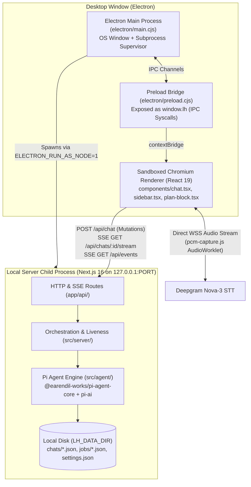
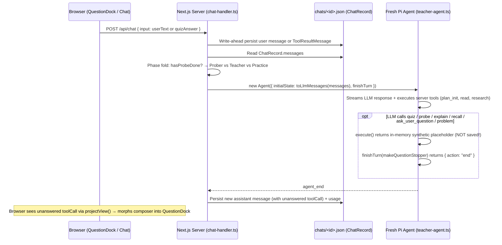
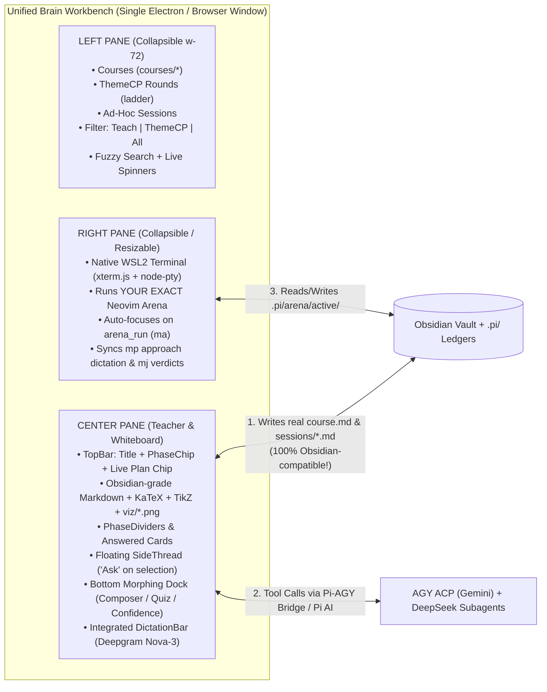

# LearnHarness Architecture Deep Dive & "Brain" Adoption Blueprint

> **Goal of this document:** Demystify every layer of [learnharness](file:///c:/Users/tssha/OneDrive/Desktop/curriculum-ledger/learnharness) from zero UI/app-dev background, explain how it uses Pi's internal libraries (`@earendil-works/pi-*`), inventory all of its features and how each is implemented, compare it head-to-head against our current competitive-programming **Brain** ([.pi/](file:///c:/Users/tssha/OneDrive/Desktop/curriculum-ledger/.pi), [nvim/](file:///c:/Users/tssha/OneDrive/Desktop/curriculum-ledger/nvim), [pi-agy-bridge/](file:///c:/Users/tssha/OneDrive/Desktop/curriculum-ledger/pi-agy-bridge)), and lay out a concrete architectural blueprint to marry our Brain with `learnharness`'s essential UX/structural features into a **Single Unified Workbench**—keeping Neovim and Obsidian-quality Markdown while shedding bloat.

---

## 1. Executive Summary & The Core Friction

### Our Current "Brain" Setup (3-Tab Triad)
Today, our competitive programming academy splits its responsibilities across three separate windows/panes (see [system-architecture-audit.md](file:///c:/Users/tssha/OneDrive/Desktop/curriculum-ledger/system-architecture-audit.md)):

1. **The Teacher (Terminal CLI):** `pi-coding-agent` CLI + [.pi/extensions/](file:///c:/Users/tssha/OneDrive/Desktop/curriculum-ledger/.pi/extensions) + [pi-agy-bridge](file:///c:/Users/tssha/OneDrive/Desktop/curriculum-ledger/pi-agy-bridge) (routing through `agy acp` to Gemini frontier models or direct APIs).
2. **The Whiteboard Viewer (GUI App):** Obsidian reading `courses/<slug>/course.md` and real-time mirrored transcripts written by [.pi/extensions/md-log.ts](file:///c:/Users/tssha/OneDrive/Desktop/curriculum-ledger/.pi/extensions/md-log.ts) (`courses/<slug>/sessions/YYYY-MM-DD.md` and `practice/themecp/sessions/YYYY-MM-DD.md`).
3. **The Coding Arena (Terminal Pane):** Neovim ([nvim/lua/competitive/arena/init.lua](file:///c:/Users/tssha/OneDrive/Desktop/curriculum-ledger/nvim/lua/competitive/arena/init.lua)) running natively in WSL2 (`herdr` panes), executing local C++/Python builds, custom checkers, and Elo/ThemeCP telemetry.

**The Friction:** The backend cognitive engine, RBAC kernel, and competitive Arena are world-class, **but you have to manually context-switch across three tabs/apps** (Pi TUI to read/answer quizzes, Obsidian to view clean LaTeX/diagrams/course state, and Neovim to code). Furthermore, because our Teacher runs in one long `pi-coding-agent` session driven by prose rules in [SKILL.md](file:///c:/Users/tssha/OneDrive/Desktop/curriculum-ledger/.pi/skills/teach/SKILL.md), fast models occasionally suffer from *"checklist mentality"* during intake and *"persona decay"* over 20+ turns.

### What `learnharness` Is
[learnharness](file:///c:/Users/tssha/OneDrive/Desktop/curriculum-ledger/learnharness) (`v0.6.1`, Next.js + Electron + `@earendil-works/pi-ai` / `pi-agent-core`) is a **single-window desktop learning harness** with astonishingly similar pedagogical DNA to our Brain:
- It shares the exact same conceptual ancestry—notice how [learnharness/components/dictation.tsx](file:///c:/Users/tssha/OneDrive/Desktop/curriculum-ledger/learnharness/components/dictation.tsx) explicitly cites porting patterns from `~/.pi/agent/extensions/dictate`, [learnharness/src/agent/subagents/researcher.ts](file:///c:/Users/tssha/OneDrive/Desktop/curriculum-ledger/learnharness/src/agent/subagents/researcher.ts) cites `interactive-subagents/agents/researcher.md`, and its `quiz`, `ask_user_question`, and `visual-maker` (`write_svg`/`edit_svg`/`render_svg` with `snippetAround`) mirror our own extensions almost 1-for-1.
- Its **Markdown view** (`streamdown`) is noticeably weaker than Obsidian, and its **coding editor plugin** (`coding-questions`) is far weaker than our Neovim Competitive Arena + `lab` + `problem-grader`.
- It also invests heavily in two subsystems that add little value to competitive programming mastery: a **Global Knowledge Graph** (force-directed node web) and **FSRS-6 Flashcards**. 
- **However**, it solves the **"Single UI"** problem brilliantly and introduces several structural innovations—**Prober $\to$ Teacher phase separation**, **zero-bookkeeping live Plan DAGs**, **in-app Deepgram Voice Dictation**, **Confidence-calibrated quizzes**, **PDF visual/math-density triage**, and **non-disruptive Side Threads**—that can transform our Brain if adopted selectively.

---

## 2. Zero-to-One UI & App Architecture Primer (For a Systems/CP Engineer)

If you have zero UI or web-app background, think of `learnharness` using **systems programming analogies**: it is essentially a **single-machine client-server architecture** where a lightweight native window wraps a local HTTP/SSE backend daemon.

### 2.1 The 4 Runtime Layers Explained Simply

| Layer | Directory / File | Systems Analogy | What It Actually Does |
| :--- | :--- | :--- | :--- |
| **1. Electron Main** | [electron/main.cjs](file:///c:/Users/tssha/OneDrive/Desktop/curriculum-ledger/learnharness/electron/main.cjs) | `init` / `systemd` + X11 window manager | Picks a free localhost TCP port (`freePort()`), spawns Next.js's compiled `server.js` using `ELECTRON_RUN_AS_NODE=1`, enforces single-instance locking, paints native titlebar chrome, and opens a `BrowserWindow` pointed at `http://127.0.0.1:<port>`. Also runs a hidden `--browser-service` Chromium CDP helper for testing interactive demos. |
| **2. Electron Preload** | [electron/preload.cjs](file:///c:/Users/tssha/OneDrive/Desktop/curriculum-ledger/learnharness/electron/preload.cjs) | Kernel `syscall` boundary | Because the browser UI runs inside a strict sandbox (no arbitrary disk access), `preload.cjs` exposes a tiny allowlisted object `window.lh` to React: `getPathForFile()` (extracts real OS path when you drop a file), `chooseAttachmentFolder()` (native folder dialog), `expandWindow()` (auto-widens window if you open sidebar), and `onZoom()` / `getZoom()`. |
| **3. Next.js Server** | [src/server/](file:///c:/Users/tssha/OneDrive/Desktop/curriculum-ledger/learnharness/src/server), [app/api/](file:///c:/Users/tssha/OneDrive/Desktop/curriculum-ledger/learnharness/app/api) | Backend daemon | Owns all durable state (`LH_DATA_DIR`), reads/writes JSON files (`chats/*.json`, `jobs/*.json`, `settings.json`, `auth.json`), runs the `@earendil-works/pi-agent-core` `Agent` loop, runs background workers (`pdf-reader`, `visual-maker`, `researcher`, `demo-builder`), and exposes REST + SSE endpoints. |
| **4. React Browser UI** | [components/](file:///c:/Users/tssha/OneDrive/Desktop/curriculum-ledger/learnharness/components), [src/core/](file:///c:/Users/tssha/OneDrive/Desktop/curriculum-ledger/learnharness/src/core) | Pure projection (`f(state) → pixels`) | React is declarative: instead of manually mutating DOM widgets like `ncurses`/`pi-tui`, it computes `viewMessages = projectView(chatRecord, liveTurnState)` ([src/core/view.ts](file:///c:/Users/tssha/OneDrive/Desktop/curriculum-ledger/learnharness/src/core/view.ts)) and renders HTML/SVG from that pure function. |

### 2.2 How Real-Time Streaming Works Without Polling (Two SSE Streams)
In a terminal app, stdout prints characters synchronously. In a web/Electron app, the UI talks to the backend over two **Server-Sent Events (`SSE`)** streams—unidirectional HTTP connections kept open by the server to push JSON frames as they happen:

1. **Per-Turn Stream (`POST /api/chat` & `GET /api/chats/[id]/stream` in [src/server/pi/ui-stream.ts](file:///c:/Users/tssha/OneDrive/Desktop/curriculum-ledger/learnharness/src/server/pi/ui-stream.ts)):**
   - A turn executes as an **in-memory server object (`PiTurnHandle`) decoupled from the HTTP connection**. If you close/refresh the browser tab mid-turn, the agent does *not* die—only explicit `abort()` kills it.
   - **Compacted State Log ("Wire Diet"):** Every `message_update` from Pi contains the *entire* partial assistant message so far (not just a 1-token delta). Keeping all chunks in a replay array caused quadratic $O(N^2)$ memory/serialization freezes on long thinking models. So `runPiTurn()` keeps an in-memory log that **replaces in-flight `message_update` slots in-place** and throttles live browser pushes to **1 frame per `100ms` (`updateFlushMs`)**. Reattaching mid-turn replays settled messages + 1 snapshot in $O(\text{messages})$.
2. **Window-Wide Notification Bus (`GET /api/events` in [src/server/events-stream.ts](file:///c:/Users/tssha/OneDrive/Desktop/curriculum-ledger/learnharness/src/server/events-stream.ts) & [src/core/events.ts](file:///c:/Users/tssha/OneDrive/Desktop/curriculum-ledger/learnharness/src/core/events.ts)):**
   - **Notify $\to$ Fetch pattern:** Instead of polling `/api/chats` every 2.5 seconds, the server emits tiny signals (`chats-changed`, `turn-started`, `turn-settled`, `jobs-changed`, `record-changed`, `compaction-changed`, `side-chats-changed`, `plugins-changed`) with a 25s `: ping` heartbeat. Components subscribe via `useServerEvent` and refetch canonical JSON after a `250ms` debounce.

### 2.3 Single-Window Z-Stack & Escape Key Ownership
When you put everything in one window (sidebar, main chat, bottom question dock, floating side-thread, full-screen plan DAG overlay, settings modal), pressing `Esc` could become ambiguous. [components/interaction-layers.tsx](file:///c:/Users/tssha/OneDrive/Desktop/curriculum-ledger/learnharness/components/interaction-layers.tsx) solves this with an explicit **Layer Ownership Stack** (`"view" | "popup" | "modal"`):
- Every open overlay registers an `InteractionLayer` with monotonic ordering.
- `Esc` is claimed exclusively by the **topmost eligible owner** (e.g., active dictation cancels first $\to$ context menu closes $\to$ `PlanPopup` closes $\to$ pending question opens dismissal confirmation $\to$ running LLM turn asks abort confirmation). Covered layers underneath cannot accept keystrokes, submits, or dictation.

---

## 3. How `learnharness` Uses Pi's Internal Modules (`@earendil-works/pi-*`)

You noted in your prompt that `learnharness` appears to use `pi-coding-agent`'s internal modules. Checking [package.json](file:///c:/Users/tssha/OneDrive/Desktop/curriculum-ledger/learnharness/package.json#L29-L32) and [docs/archive/pi-engine-swap.md](file:///c:/Users/tssha/OneDrive/Desktop/curriculum-ledger/learnharness/docs/archive/pi-engine-swap.md) reveals the exact breakdown:

`learnharness` **does not depend on `@mariozechner/pi-coding-agent` at runtime** (no TUI, no bash/edit coding-agent tools, no Pi session JSONL files). Instead, it extracts the **two lower-level engine packages** and **ports one heuristic module**:

1. **`@earendil-works/pi-ai` (`1.4.0`) — The Model Catalog & Streaming Wire:**
   - Used in [src/agent/models.ts](file:///c:/Users/tssha/OneDrive/Desktop/curriculum-ledger/learnharness/src/agent/models.ts) via `createModels()`, `builtinProviders()`, `getSupportedThinkingLevels()`, `clampThinkingLevel()`, `models.streamSimple()`, and `calculateCost()`.
   - Also adds custom local bridges for **Claude Code CLI** ([src/agent/claude-code/](file:///c:/Users/tssha/OneDrive/Desktop/curriculum-ledger/learnharness/src/agent/claude-code)), **ChatGPT / Copilot / Grok web subscriptions**, and **Custom OpenAI-compatible servers**.
2. **`@earendil-works/pi-agent-core` (`1.4.0`) — The Agent Loop Engine:**
   - Used in [src/agent/teacher-agent.ts](file:///c:/Users/tssha/OneDrive/Desktop/curriculum-ledger/learnharness/src/agent/teacher-agent.ts) and [src/agent/subagents/pi-run.ts](file:///c:/Users/tssha/OneDrive/Desktop/curriculum-ledger/learnharness/src/agent/subagents/pi-run.ts).
   - Drives the tool-calling loop (`new Agent({ initialState, streamFn, convertToLlm, finishTurn, prepareNextTurnWithContext, prepareRequest, beforeToolCall, steeringMode: "all" })`, `agent.continue()`, `agent.abort()`, `agent.subscribe()`).
3. **Ported from `@earendil-works/pi-coding-agent` (`1.4.0`) — Context Compaction Heuristic:**
   - [src/core/compaction.ts](file:///c:/Users/tssha/OneDrive/Desktop/curriculum-ledger/learnharness/src/core/compaction.ts) and [docs/compaction-accounting.md](file:///c:/Users/tssha/OneDrive/Desktop/curriculum-ledger/learnharness/docs/compaction-accounting.md) explicitly port the MIT-licensed cutoff-selection algorithm from `@earendil-works/pi-coding-agent` (`dist/core/compaction/compaction.js`), keeping a `~20,000`-token retained tail (`KEEP_RECENT_TOKENS = 20_000`), reserving `16,384` tokens (`COMPACTION_RESERVE_TOKENS`), estimating post-usage tokens at `chars / 4` (+ `1,200` tokens per image), and never cutting between a `toolCall` and its `toolResult`.

### The Critical Architectural Twist: Stateless Per-Turn `Agent` vs. Held-Live `pi-coding-agent`

In our `.pi/` setup, `pi-coding-agent` holds **one live `Agent` in RAM** for the entire terminal session; when the teacher calls `quiz`, [quiz.ts](file:///c:/Users/tssha/OneDrive/Desktop/curriculum-ledger/.pi/extensions/quiz.ts) opens a blocking `ctx.ui.custom()` TUI modal inside `execute()`, holding the agent loop suspended in RAM until you hit Enter.

In `learnharness`, **every HTTP turn constructs a brand-new `Agent` from disk, runs it, saves the diff, and throws the `Agent` away**:

**Why this pattern is brilliant:**
1. **Zero lost state on crash/restart:** You can close the app mid-quiz, reopen it 3 days later, and the unanswered `toolCall` in `chats/<id>.json` immediately re-mounts the exact `QuestionDock` (with deterministic shuffled option order seeded by `toolCallId` via `seededRandom(toolCallId)` in [src/core/question-core.ts](file:///c:/Users/tssha/OneDrive/Desktop/curriculum-ledger/learnharness/src/core/question-core.ts)).
2. **Dynamic Prompt & Tool Swapping Mid-Conversation:** Because the `Agent` is reconstructed per turn from `ChatRecord`, the system prompt and tool registry can **completely switch** at exact transcript boundaries (`Prober` $\to$ `Teacher`), and system prompt edits take effect on the very next turn.
3. **Clean Compaction Windows:** Because `finishTurn` ends the run whenever a question/problem is posed, the minutes you spend thinking/coding are a natural idle window where background compaction runs (`kickCompaction`) without blocking you.

---

## 4. Complete Feature Inventory of `learnharness` & How Each Works

Below is every major feature in `learnharness`, mapped to its exact implementation files.

### 4.1 Single-Window Layout & Morphing Bottom Dock
- **Files:** [components/top-bar.tsx](file:///c:/Users/tssha/OneDrive/Desktop/curriculum-ledger/learnharness/components/top-bar.tsx), [components/chat.tsx](file:///c:/Users/tssha/OneDrive/Desktop/curriculum-ledger/learnharness/components/chat.tsx), [components/composer.tsx](file:///c:/Users/tssha/OneDrive/Desktop/curriculum-ledger/learnharness/components/composer.tsx), [components/dock-morph.ts](file:///c:/Users/tssha/OneDrive/Desktop/curriculum-ledger/learnharness/components/dock-morph.ts)
- **How it works:**
  - The workspace has one persistent **TopBar** (`h-15` / 60px, Electron drag region, `SidebarToggle`, session title, `PhaseChip`, `Plan` chip, `SideThread` / plugin actions) and one persistent **Bottom Dock Overlay**.
  - Instead of popping up modal windows that hide the lesson text (like our TUI modals), the bottom composer smoothly height-morphs (`createDockMorph()`, 120ms Web Animations API) between three states:
    1. **Chat Composer** (`ChatSessionComposer`) — normal prompt input + file attachment button.
    2. **Question Dock** (`QuestionDock`) — when a `probe`, `quiz`, `explain`, `recall`, or `ask_user_question` call is pending.
    3. **Practice Dock** (`PracticeDock`) — when a `problem` call is active.
  - When you scroll up to re-read an earlier explanation, the dock automatically collapses into a slim 1-line bar (`QuestionDockBar` / `PracticeDock` bar) while keeping its form DOM **mounted in memory (`hidden` / `h-0 overflow-hidden`)** so half-typed thoughts or selected options are never lost.

### 4.2 Structural Phase Machine & The Prober $\to$ Teacher Split
- **Files:** [src/core/phases.ts](file:///c:/Users/tssha/OneDrive/Desktop/curriculum-ledger/learnharness/src/core/phases.ts), [components/phase-divider.tsx](file:///c:/Users/tssha/OneDrive/Desktop/curriculum-ledger/learnharness/components/phase-divider.tsx), [src/agent/teacher-agent.ts](file:///c:/Users/tssha/OneDrive/Desktop/curriculum-ledger/learnharness/src/agent/teacher-agent.ts), [src/agent/tools/probe.ts](file:///c:/Users/tssha/OneDrive/Desktop/curriculum-ledger/learnharness/src/agent/tools/probe.ts), [src/agent/prompts/prober/10-probe-doctrine.md](file:///c:/Users/tssha/OneDrive/Desktop/curriculum-ledger/learnharness/src/agent/prompts/prober/10-probe-doctrine.md), [src/agent/prompts/teacher/10-planning.md](file:///c:/Users/tssha/OneDrive/Desktop/curriculum-ledger/learnharness/src/agent/prompts/teacher/10-planning.md)
- **How it works:**
  - `learnharness` eliminates phase drift by **physically separating the Prober and Teacher into two different Agents with different prompts and different tool schemas** over the same chat transcript:
    - **Phase 1 — `probe` (`Probing`):** Before `probe_done` succeeds, [chat-handler.ts](file:///c:/Users/tssha/OneDrive/Desktop/curriculum-ledger/learnharness/src/server/chat-handler.ts) builds `createProberAgent()`. Its tools are `probe` (choice) or `recall` (free-text), `ask_user_question`, `probe_done`, read-only FS, `research`, `pdf`, and optional graph readers. Crucially, **`probe` and `recall` have NO `nodeId` or `type` field** because no plan exists yet, and the Prober cannot call `plan_init` or `visual`/`demo`.
    - **The Seam (`probe_done`):** Once every dependency strand has a measured **floor** and **ceiling**, the Prober calls `probe_done` with structured strand assessments. `probe_done` validates that no question is open, records the assessment in the transcript, and queues an auto-wake steer (`buildProbeHandoffSteer`).
    - **Phase 2 — `plan` (`Planning`):** On the very next turn, `hasProbeDone(messages)` is `true`, so the server constructs `createTeacherAgent()` with `prompts/teacher/` and `plan_init`, `quiz`/`explain`, `visual`, `demo`, `show_image`.
    - **Phase 3 — `teach` (`Teaching`):** Derived purely by `phaseAt3(messages)` in [src/core/phases.ts](file:///c:/Users/tssha/OneDrive/Desktop/curriculum-ledger/learnharness/src/core/phases.ts) when the Teacher fires the **first `nodeId`-tagged `quiz`/`explain` call** (not simply when `plan_init` runs, because the student must confirm the plan first!).
  - **UI Signal:** The TopBar shows `PhaseChip` (`PROBING` $\to$ `PLANNING` $\to$ `TEACHING`), and the transcript draws dotted horizontal `PhaseDivider` rules (`--- Plan · N nodes ---` and `--- Teaching ---`) at exact step boundaries (`teachStepIndex`).

### 4.3 Always-Available Live Curriculum / Plan DAG
- **Files:** [src/agent/tools/plan.ts](file:///c:/Users/tssha/OneDrive/Desktop/curriculum-ledger/learnharness/src/agent/tools/plan.ts), [src/core/plan-tree.ts](file:///c:/Users/tssha/OneDrive/Desktop/curriculum-ledger/learnharness/src/core/plan-tree.ts), [src/core/contracts/plan.ts](file:///c:/Users/tssha/OneDrive/Desktop/curriculum-ledger/learnharness/src/core/contracts/plan.ts), [components/plan-block.tsx](file:///c:/Users/tssha/OneDrive/Desktop/curriculum-ledger/learnharness/components/plan-block.tsx), [components/plan-window.tsx](file:///c:/Users/tssha/OneDrive/Desktop/curriculum-ledger/learnharness/components/plan-window.tsx)
- **How it works:**
  - **Author-Once + Rewrite Protocol:** There are **no** `add_node`, `mark_done`, or `set_current` tools. The teacher writes the entire dependency DAG via `plan_init({ mermaid })` (e.g., `primitives[Number primitives] --> operators[Arithmetic]`), and if the student reveals an unexpected gap mid-lesson, the teacher simply calls `plan_init` again to replace the tree cleanly.
  - **Strict Structural Validation:** `createTree()` checks unique lowercase slugs, valid edge endpoints, no self-loops, and **acyclic DAG integrity** via DFS (`createsCycle`) before persisting to `ChatRecord.tree`.
  - **Zero-Bookkeeping Progress Tracking (`derivePlanStatuses`):** Progress is **derived at render time**, never stored! Every `quiz`/`explain` call in the Teaching phase **must** carry `nodeId` (validated against `ChatRecord.tree` at call time in `nodeIdProblem()`). `derivePlanStatuses()` scans the transcript's `quiz`/`explain` tool calls:
    - The most recently tagged node = **`current`** (rendered with a soft blurred yellow SVG halo `<feGaussianBlur>`).
    - Any node tagged in an earlier turn = **`visited`** (high-contrast white/ink border & text).
    - Everything else = **`upcoming`** (muted gray border & text).
  - **Three Simultaneous Views of the Plan:**
    1. **In-Chat `PlanBlock`:** Spliced inline in the transcript right after `plan_init` succeeds.
    2. **Ambient `PlanMarginalia`:** Floats borderlessly in the right flank of the bottom dock band whenever a question is open.
    3. **Full `PlanPopup`:** Opened anytime from the TopBar `Plan` chip or by clicking the block/marginalia. Laid out synchronously via `dagre-d3-es` (`blockLayout`) with custom cubic B-splines (`d3-shape` `curveBasis`) and interactive pan/zoom (`components/pan-zoom.ts`).

### 4.4 Sessions Sidebar (Teach & Practice Index, Fuzzy Search, Live Status)
- **Files:** [components/sidebar.tsx](file:///c:/Users/tssha/OneDrive/Desktop/curriculum-ledger/learnharness/components/sidebar.tsx), [src/core/fuzzy.ts](file:///c:/Users/tssha/OneDrive/Desktop/curriculum-ledger/learnharness/src/core/fuzzy.ts)
- **How it works:**
  - Collapsible `w-72` inline sidebar (`Cmd/Ctrl+B`; auto-hides when window width `< 928px`, calls `window.lh.expandWindow()` if reopened narrow).
  - **Mode Filter:** Segmented switch for `Teaching` / `Practice` / `All` (Practice rows get a `DumbbellIcon`).
  - **Live State Indicators:** Shows `BrailleSpinner` only when an agent turn or compaction is actively running; otherwise shows state + relative age (`Waiting for input · 5m ago`, `Problem waiting · 2h ago`, `Compacting context · just now`).
  - **Fuzzy Quick-Open (`Cmd/Ctrl+Shift+F`):** Subsequence scorer (`fuzzyScore`, prioritizing prefixes and word boundaries) with `↑`/`↓` keyboard walk and `Enter` to jump straight to a session.
  - **Context Menu:** Right-clicking any session row allows inline rename, deletion (optionally keeping/removing graph nodes), and manual graph extraction coverage inspection.

### 4.5 Voice Dictation (`AudioWorklet` + Warm Deepgram Nova-3 WebSocket)
- **Files:** [app/api/stt/token/route.ts](file:///c:/Users/tssha/OneDrive/Desktop/curriculum-ledger/learnharness/app/api/stt/token/route.ts), [components/dictation.tsx](file:///c:/Users/tssha/OneDrive/Desktop/curriculum-ledger/learnharness/components/dictation.tsx), [public/worklets/pcm-capture.js](file:///c:/Users/tssha/OneDrive/Desktop/curriculum-ledger/learnharness/public/worklets/pcm-capture.js), [src/core/dictation.ts](file:///c:/Users/tssha/OneDrive/Desktop/curriculum-ledger/learnharness/src/core/dictation.ts)
- **How it works (engineered specifically for low latency & zero dropped words):**
  1. **Server-Side Short-Lived Token Mint:** `GET /api/stt/token` uses `DEEPGRAM_API_KEY` (requiring Deepgram Member role) to POST `/v1/auth/grant` (`ttl_seconds: 300`). The client pre-mints a **warm token** on page mount (`createWarmMinter`, 3-min TTL) so clicking Mic/`Mod+D` has zero HTTP delay.
  2. **Off-Main-Thread Audio Capture:** Uses a persistent `16000 Hz` `AudioContext` + `PcmCaptureProcessor` (`AudioWorkletProcessor` in `public/worklets/pcm-capture.js`). Every 128-sample quantum (~8ms), it computes RMS loudness for the UI meter; every 2,048 samples (128ms), it transfers a zero-copy `Int16Array` (`linear16`) frame to the main thread.
  3. **Queue-Don't-Drop Handshake:** Audio captured during the mic/WebSocket handshake buffers in `pendingRef` (up to 256 frames $\approx 32\text{s}$) and bursts out immediately when the WebSocket to `wss://api.deepgram.com/v1/listen?model=nova-3&encoding=linear16&sample_rate=16000&channels=1&smart_format=true&punctuate=true&endpointing=300` opens.
  4. **Deferred Transcript & Dynamic Destination Routing:** While recording, **no interim words appear** (to avoid distraction); only a 48-cell 60ms dB meter (`-50 dB` to `-10 dB`) animates in `DictationBar`. Stopping (`Mod+D`) sends `{ type: "CloseStream" }` and flushes the final joined transcript into whichever input claimed ownership (`questionTarget` inside `QuestionDock`/`PracticeDock`, `ReadingThinkingField` if check is unrevealed, `SideThread` if focused, or `composerTarget`). Pressing `Esc` discards the buffer.
  5. **Nothing-Gets-Lost Submit:** Pressing `Enter` to submit while still recording calls `await finishDictation()`, which flushes Deepgram's trailing words into the input *before* dispatching `POST /api/chat`.

### 4.6 Rich Question Mechanics (`probe`/`quiz`, `recall`/`explain`, Confidence Rail, Predict vs. Check)
- **Files:** [src/core/question-core.ts](file:///c:/Users/tssha/OneDrive/Desktop/curriculum-ledger/learnharness/src/core/question-core.ts), [components/question-dock.tsx](file:///c:/Users/tssha/OneDrive/Desktop/curriculum-ledger/learnharness/components/question-dock.tsx), [components/confidence-rail.tsx](file:///c:/Users/tssha/OneDrive/Desktop/curriculum-ledger/learnharness/components/confidence-rail.tsx), [components/reading-thinking.tsx](file:///c:/Users/tssha/OneDrive/Desktop/curriculum-ledger/learnharness/components/reading-thinking.tsx)
- **How it works:**
  - **2 Quizzing Mechanics (Settings Toggle):**
    - *Choice Mode (`probe` / `quiz`):* Single- or multi-select options with deterministic Fisher-Yates shuffling (`seededRandom(toolCallId)`), no per-option `description` (preventing hint leakage!), an always-present `"I don't know"` row, and client-side instant grading. Notice schema field order: `explanation` is placed *before* `correctAnswer` so the LLM reasons first before committing the answer key!
    - *Free-Recall Mode (`recall` / `explain`):* Student types/dictates in their own words. Enforces **The Commitment Rule**: the model must supply `correctAnswer` upfront before the question is shown; upon submit, the student sees the committed answer and the model grades strictly against that commitment without sycophantically revising it.
  - **6-Stop Confidence Rail (`CONFIDENCE_STOPS = [0, 30, 50, 70, 90, 100]`):** Default `50` (coin flip). Resolution concentrates at `[70, 90, 100]` to distinguish shaky guesses from mastered certainty. Passed to the agent in `compactAnswerForModel()` so the Prober jumps sharply on `correct + 90–100%` and probes gently on `correct + 30–50%`.
  - **Predict vs. Check Reveal Pacing:** Every teaching quiz declares `type: "predict" | "check"`.
    - `predict` arrives **expanded immediately** (posed before teaching a step).
    - `check` arrives **collapsed behind `"Check your understanding → Open"`** (`questionNeedsReveal()`), while exposing a `ReadingThinkingField` (`"Thinking while reading"`) so you can read the explanation and jot/dictate reactions without seeing the quiz prematurely.

### 4.7 Deliberate Practice Sessions (`problem` + `conclude` + Hint Ladder `R0–R5`)
- **Files:** [src/agent/tools/practice.ts](file:///c:/Users/tssha/OneDrive/Desktop/curriculum-ledger/learnharness/src/agent/tools/practice.ts), [src/agent/prompts/practice/10-doctrine.md](file:///c:/Users/tssha/OneDrive/Desktop/curriculum-ledger/learnharness/src/agent/prompts/practice/10-doctrine.md), [components/practice-dock.tsx](file:///c:/Users/tssha/OneDrive/Desktop/curriculum-ledger/learnharness/components/practice-dock.tsx)
- **How it works:**
  - Dedicated session kind (`kind: "practice"`) built from turn 1 with `createPracticeAgent()` (only `problem`, `conclude`, read-only FS, `research`, `pdf`, optional graph readers).
  - Trains retrieval from an **inactive** state across three modes: `recall`, `discrimination`, and `composition` (explicitly *not* long contest search problems).
  - `problem` commits `statement`, `mode`, `target`, and hidden `modelSolution`. A turn-scoped `PracticeGate` enforces strictly one active problem at a time.
  - You submit repeated thinking attempts in `PracticeDock`; the agent uses a strict 6-rung hint ladder (`R0` attention redirect $\to$ `R1` pattern class $\to$ `R2` candidate cluster $\to$ `R3` proposition named $\to$ `R4` move outlined $\to$ `R5` worked step).
  - `conclude` logs `{ outcome, verdict, rung, missClass, retest }`, reveals the committed `modelSolution`, and pauses until you press `Enter` on an empty composer (`Next problem`).

### 4.8 Floating Side Conversations & Text Selection Citations (`Ask` & `Cite`)
- **Files:** [components/selection-toolbar.tsx](file:///c:/Users/tssha/OneDrive/Desktop/curriculum-ledger/learnharness/components/selection-toolbar.tsx), [components/citation-chip.tsx](file:///c:/Users/tssha/OneDrive/Desktop/curriculum-ledger/learnharness/components/citation-chip.tsx), [components/side-thread.tsx](file:///c:/Users/tssha/OneDrive/Desktop/curriculum-ledger/learnharness/components/side-thread.tsx), [src/server/side-chat.ts](file:///c:/Users/tssha/OneDrive/Desktop/curriculum-ledger/learnharness/src/server/side-chat.ts), [src/core/side-chat.ts](file:///c:/Users/tssha/OneDrive/Desktop/curriculum-ledger/learnharness/src/core/side-chat.ts)
- **How it works:**
  - Highlighting any text in a teacher message pops up two buttons:
    - **Cite:** Inserts a compact visual chip into your composer or thinking field, carrying `{ messageId, text, start, end, prefix, suffix }`, which expands to the full quote (`expandCitationsForModel`) when submitted.
    - **Ask:** Opens a **Side Companion Thread** scoped to that explanation/check segment (can be dragged/resized from all 4 edges/corners as a translucent `backdrop-blur` floating window or pinned to a right dock).
  - **Non-Blocking Execution:** `createSideChatService` runs a tool-less, ultra-brief stream (1–2 sentences) on its own endpoint (`/api/chats/[id]/side-chats`), **bypassing main-turn liveness**. You can ask a quick clarifying question *even while a quiz or practice problem is open or the main teacher is streaming*!
  - **Context Continuity:** When the next main Teacher turn runs, `prepareNextTurnWithContext` in [teacher-agent.ts](file:///c:/Users/tssha/OneDrive/Desktop/curriculum-ledger/learnharness/src/agent/teacher-agent.ts) pulls any newly settled side exchanges via watermarks (`sideConversationEntries`) and hands them to the main Teacher as quoted reference context.

### 4.9 Files, Local PDF Reader Subagent, Image Snapshots & Extraction
`learnharness` has **two distinct file/extraction systems**—do not confuse them:

1. **In-Lesson File Path Chips + Visual `pdf-reader` Subagent + `show_image` (Direct Grounding):**
   - **Path Attachment ([components/attach-files-button.tsx](file:///c:/Users/tssha/OneDrive/Desktop/curriculum-ledger/learnharness/components/attach-files-button.tsx)):** Dropping files/folders or clicking the paperclip does **not** upload or copy files. Electron's `window.lh.getPathForFile` / `chooseAttachmentFolder` inserts quoted local path chips (`PathInput`). Prober/Teacher/Practice agents get read-only `read`, `ls`, `find`, `grep` (protected by a sensitive-path blocklist in [src/agent/tools/fs-shared.ts](file:///c:/Users/tssha/OneDrive/Desktop/curriculum-ledger/learnharness/src/agent/tools/fs-shared.ts) rejecting `.ssh`, `.env`, `auth.json`, browser profiles, etc.).
   - **`pdf-reader` Subagent ([src/agent/subagents/pdf-reader.ts](file:///c:/Users/tssha/OneDrive/Desktop/curriculum-ledger/learnharness/src/agent/subagents/pdf-reader.ts), [pdf-ops.ts](file:///c:/Users/tssha/OneDrive/Desktop/curriculum-ledger/learnharness/src/agent/subagents/pdf-ops.ts)):** Uses `pdfjs-dist` + `@napi-rs/canvas` (pure Node, no external Python or browser needed!) to run a 4-tool triage loop:
     - `pdf_info`: Scans every page and computes `text_length`, `image_count`, and **`math_density`**. Branches strategy automatically by page count (`<=10` short, `11–40` medium, `>40` long).
     - `pdf_search`: Regex/literal search returning matching page numbers + context lines.
     - `pdf_extract`: Converts layout/font-sizes into structured Markdown via [pdf-markdown.ts](file:///c:/Users/tssha/OneDrive/Desktop/curriculum-ledger/learnharness/src/agent/subagents/pdf-markdown.ts).
     - `pdf_render`: Rasterizes math/diagram-heavy pages to PNG at `100 / 150 / 200 DPI` (max 6 per batch) and **injects the PNGs as image parts back into the subagent's vision loop** so equations and figures are read visually! Enforces an *unread-finish gate* (`consulted.size === 0` blocks premature answers).
   - **`show_image` & Image Annotation ([src/agent/tools/learner-image.ts](file:///c:/Users/tssha/OneDrive/Desktop/curriculum-ledger/learnharness/src/agent/tools/learner-image.ts)):** Snapshots local raster images (`.jpg`/`.png`/`.webp`) under SHA-256 into `ChatRecord.imageSnapshots` (max `1600px`, `<1 MiB`) and lets `visual-maker` overlay SVG arrows/callouts on top of the student's diagram/photo using `<image href="lh://learner-image"/>`.

2. **Knowledge Graph Proposition Extraction (`extraction.ts` + `notes-import.tsx`):**
   - **Files:** [src/agent/subagents/extraction.ts](file:///c:/Users/tssha/OneDrive/Desktop/curriculum-ledger/learnharness/src/agent/subagents/extraction.ts), [src/core/coverage.ts](file:///c:/Users/tssha/OneDrive/Desktop/curriculum-ledger/learnharness/src/core/coverage.ts), [src/core/graph.ts](file:///c:/Users/tssha/OneDrive/Desktop/curriculum-ledger/learnharness/src/core/graph.ts), [components/notes-import.tsx](file:///c:/Users/tssha/OneDrive/Desktop/curriculum-ledger/learnharness/components/notes-import.tsx), [components/graph-view.tsx](file:///c:/Users/tssha/OneDrive/Desktop/curriculum-ledger/learnharness/components/graph-view.tsx)
   - **How it works:**
     - **Session Extraction:** `coverage.ts` fingerprints teacher prose by `messageId`; once uncovered text passes `4,096` tokens, a background pipeline runs an **Extractor** LLM (proposing `{ propositions, chains }`) $\to$ an **Auditor** LLM (linking equivalent propositions across sessions via graph search tools) $\to$ deterministic **`mergeFindings()`** writing append-only JSONL ledgers (`graph/{nodes,chains,sessions,coverage}.jsonl`) and simplifying redundant transitive chains.
     - **File/Folder Import (`Extract files…`):** Uploads `.txt`, `.md`, `.markdown`, `.rst`, `.org`, `.adoc`, `.tex`, `.pdf` (up to `25 MiB` each, 3 concurrent), converts PDFs locally via `pdf-markdown.ts` (no OCR), and feeds them into the same Extractor $\to$ Auditor $\to$ Merger pipeline.
     - **Canvas Renderer:** [graph-canvas.ts](file:///c:/Users/tssha/OneDrive/Desktop/curriculum-ledger/learnharness/components/graph-canvas.ts) + `d3-force` renders nodes, cluster hulls by birth-source provenance, and pan/zoom on an HTML5 `<canvas>` with a detail sidebar.

### 4.10 Background Subagents (`researcher`, `visual-maker`, `demo-builder`) & Durable Job Delivery
- **Files:** [src/agent/subagents/runner.ts](file:///c:/Users/tssha/OneDrive/Desktop/curriculum-ledger/learnharness/src/agent/subagents/runner.ts), [src/server/jobs.ts](file:///c:/Users/tssha/OneDrive/Desktop/curriculum-ledger/learnharness/src/server/jobs.ts), [src/agent/worker-request-admission.ts](file:///c:/Users/tssha/OneDrive/Desktop/curriculum-ledger/learnharness/src/agent/worker-request-admission.ts), [src/agent/subagents/visual-maker.ts](file:///c:/Users/tssha/OneDrive/Desktop/curriculum-ledger/learnharness/src/agent/subagents/visual-maker.ts), [src/agent/subagents/demo-builder.ts](file:///c:/Users/tssha/OneDrive/Desktop/curriculum-ledger/learnharness/src/agent/subagents/demo-builder.ts)
- **How it works:**
  - **Concurrency & Recovery:** All background LLM calls share a process-global FIFO permit pool (`workerRequestConcurrency = 8`). Jobs persist to `jobs/*.json` and separate *computation completion* from *transcript delivery* (delivering via `agent.steer()` if a turn is running, or waking an idle chat once no question is pending).
  - **`researcher`:** Isolated loop with `web_search` (Tavily/Brave/Exa/Firecrawl/Ollama) + `web_fetch` + `web_fetch_pdf` + PDF tools so raw search noise never pollutes the Teacher's context window.
  - **`visual-maker`:** Uses `write_svg` / `edit_svg` (with `snippetAround` fuzzy error hints) / `render_svg` (rasterized via `@resvg/resvg-js`). Enforces an **Unlooked-Finish Gate** in code: if the model tries to return without rendering its latest SVG, the loop intercepts, renders the PNG, injects it as a user message (`UNLOOKED_FINISH_MESSAGE`), and forces the model to visually inspect it before delivery.
  - **`demo-builder`:** Writes single-file HTML/JS/Canvas interactive simulations (`write_demo`) and verifies them with `run_demo` in Electron's headless `--browser-service` (CDP) or system Chrome (`consoleErrors`, `pageErrors`, `failedRequests`, plus optional JS `probe` assertion). Delivered in sandboxed `<iframe>` cards (`sandbox="allow-scripts"`).

### 4.11 Trusted Local Plugin System (API v1) & 4 Core Plugins
- **Files:** [src/server/plugins.ts](file:///c:/Users/tssha/OneDrive/Desktop/curriculum-ledger/learnharness/src/server/plugins.ts), [docs/plugin-architecture.md](file:///c:/Users/tssha/OneDrive/Desktop/curriculum-ledger/learnharness/docs/plugin-architecture.md), [plugins/](file:///c:/Users/tssha/OneDrive/Desktop/curriculum-ledger/learnharness/plugins)
- **How it works:** Server-side CommonJS backends (`scripts/plugin-loader.cjs`) + browser ESM frontends (`public/plugin-loader.js`) can register sidebar views, top-bar actions, shortcuts, fenced code block renderers, custom question/problem types, and submission interceptors.
  - **[coding-questions](file:///c:/Users/tssha/OneDrive/Desktop/curriculum-ledger/learnharness/plugins/coding-questions/README.md):** Contributes `coding_question` and `coding_problem`. Embeds a single-file CodeMirror 6 editor with 300ms Lezer syntax diagnostics and executes teacher-written test drivers against `answer.txt` (30s timeout, 64 KiB stdout/stderr cap). *No multi-file workspace, no OJ flags, no stress testing, no custom `checker.cpp`.*
  - **[drawing-pad](file:///c:/Users/tssha/OneDrive/Desktop/curriculum-ledger/learnharness/plugins/drawing-pad/README.md):** Press `Cmd/Ctrl+Shift+D` to open a transparent stylus/mouse sketchpad floating over a rasterized snapshot of the current question/problem; attaches your hand-drawn PNG to the next submission.
  - **[rich-code-blocks](file:///c:/Users/tssha/OneDrive/Desktop/curriculum-ledger/learnharness/plugins/rich-code-blocks/README.md):** Renders `tikz` (TikZ, CircuitikZ, `tikz-cd`, PGFPlots via a bundled WASM TeX WebWorker with 10s deadline), `smiles` (chemistry), and `abc` (musical scores) into sanitized, theme-aware transparent SVGs.
  - **[flashcards](file:///c:/Users/tssha/OneDrive/Desktop/curriculum-ledger/learnharness/plugins/flashcards/README.md):** FSRS-6 spaced-repetition deck builder from graph nodes or uploaded files.

### 4.12 Model Slots, Prompt Overrides, Context/Cost Telemetry & Themes
- **Files:** [src/core/settings.ts](file:///c:/Users/tssha/OneDrive/Desktop/curriculum-ledger/learnharness/src/core/settings.ts), [src/agent/prompts/README.md](file:///c:/Users/tssha/OneDrive/Desktop/curriculum-ledger/learnharness/src/agent/prompts/README.md), [components/stats-bar.tsx](file:///c:/Users/tssha/OneDrive/Desktop/curriculum-ledger/learnharness/components/stats-bar.tsx)
- **How it works:**
  - **Tiered Slots (`strong` / `cheap` / `vision`):** Conversations default to `strong` (overrideable per chat); background roles default to `cheap` (`researcher`, `demoBuilder`, `extractor`, `auditor`) or `vision` (`visualMaker`, `pdfReader`), with per-role overrides and `cacheRetention` controls (`none` / `short` / `long`).
  - **Editable Prompt Segments:** Every `.md` fragment in `src/agent/prompts/` can be overridden per-segment in Settings (`data/prompts/`).
  - **Live Stats Bar:** Displays `lastTurnTokens / modelContextWindow`, observed session prompt-cache hit rate (`sum(cacheRead) / sum(input + cacheRead + cacheWrite)`), and calculated dollar cost.

---

## 5. Head-to-Head Comparison: `learnharness` vs. Our "Brain" (`curriculum-ledger`)

| Dimension | `learnharness` | Our "Brain" (`curriculum-ledger`) | Verdict |
| :--- | :--- | :--- | :--- |
| **User Interface & Ergonomics** | **Single Electron/Web window** (`Sidebar` + `Whiteboard` + `Morphing Dock` + `SideThread` + `PlanPopup`). Zero tab switching. | **3-Tab Split** (Pi TUI + Obsidian + Neovim in `herdr`/OS tabs). High context-switch friction. | **`learnharness` wins decisively** |
| **Phase & Persona Enforcement** | **Structural split** (`ProberAgent` vs `TeacherAgent` vs `PracticeAgent`) with phase-locked tool schemas (`probe` vs `quiz` requiring `nodeId`) and `PhaseChip` / `PhaseDivider`. | Single `pi-coding-agent` session reading [SKILL.md](file:///c:/Users/tssha/OneDrive/Desktop/curriculum-ledger/.pi/skills/teach/SKILL.md) + voice-only anchor in [teacher.ts](file:///c:/Users/tssha/OneDrive/Desktop/curriculum-ledger/.pi/extensions/teacher.ts). Suffers from checklist intake & turn-20 persona decay. | **`learnharness` wins decisively** |
| **Curriculum & Plan Visibility** | Always-visible **live DAG** (`PlanPopup`, `PlanMarginalia`, in-chat `PlanBlock`) with zero-bookkeeping derived status (`current` glow, `visited`, `upcoming`). | Rich `courses/<slug>/curriculum.md` queried via [curriculum.ts](file:///c:/Users/tssha/OneDrive/Desktop/curriculum-ledger/.pi/extensions/curriculum.ts) + `course.md` checklist in Obsidian. Not live-rendered as an interactive DAG inside the chat UI. | **`learnharness` wins UX; Brain wins deep curriculum structure** |
| **Markdown & Note Portability** | Locked inside proprietary `chats/*.json` rendered with `streamdown`. Harder to browse/edit outside app. | **Obsidian Vault First-Class** (`course.md` with strict [teacher.ts](file:///c:/Users/tssha/OneDrive/Desktop/curriculum-ledger/.pi/extensions/teacher.ts) section budgets + clean `sessions/YYYY-MM-DD.md` transcripts via [md-log.ts](file:///c:/Users/tssha/OneDrive/Desktop/curriculum-ledger/.pi/extensions/md-log.ts)). | **Brain + Obsidian wins decisively** |
| **Coding Environment & Judging** | Toy single-buffer CodeMirror widget (`coding-questions`) running LLM-authored inline test scripts (`30s` cap). No multi-file, no OJ flags, no stress tests. | **Neovim Competitive Arena** ([nvim/lua/competitive/arena/](file:///c:/Users/tssha/OneDrive/Desktop/curriculum-ledger/nvim/lua/competitive/arena/init.lua)) + `.pi/arena/arena.py` + pure OJ compilation + `lab` hidden suites & `checker.cpp` + `problem-grader` brute-force stress testing + `thinking_seconds` cut-point telemetry. | **Brain + Neovim wins by a landslide** |
| **Competitive Practice Engine** | Generic concept retrieval drills (`recall` / `discrimination` / `composition`, explicitly *"Not search training"*). | **ThemeCP Ladder** ([ladder.ts](file:///c:/Users/tssha/OneDrive/Desktop/curriculum-ledger/.pi/extensions/ladder.ts)) with 4-slot balanced timed rounds, silent proctor mode, Three I's post-analysis, Elo rating, Upsolve Gate, + `course.ts` bridge to targeted courses. | **Brain wins by a landslide** |
| **Problem & Resource Catalog** | None. Relies on LLM memory or general web search. | **Curated Local Catalog** ([catalog.ts](file:///c:/Users/tssha/OneDrive/Desktop/curriculum-ledger/.pi/extensions/catalog.ts), `catalog_problems.csv`, `problem-recommender.md`, `resource-recommender.md`, `browser-fetch.ts`). | **Brain wins by a landslide** |
| **Voice Dictation** | Built-in `AudioWorklet` + warm Deepgram `nova-3` + 60ms RMS meter routing automatically to thinking/reading/side fields. | Missing from `.pi/extensions/` in this repo. | **`learnharness` wins** |
| **Quiz Signal & Pacing** | Shuffled MC + committed free-recall (`explain`) + **6-stop Confidence Slider** + **Predict (open) vs Check (collapsed behind reveal)** + `ReadingThinking`. | Shuffled MC (`quiz.ts`) + `"I don't know"` + optional `note`, blocking TUI modal (`ask-user-question.ts` / `quiz.ts`). No confidence rail, no reveal gate, no committed free-recall. | **`learnharness` wins** |
| **File & PDF Handling** | Drag-and-drop path chips + `pdf-reader` (`pdfjs-dist` with `math_density` triage & page-to-PNG vision loop) + `show_image` snapshots. | Manual path typing + bash/read + `curriculum-extractor.md` text DAG extraction. No built-in visual PDF page renderer. | **`learnharness` wins** |
| **Side Clarifications** | Selection toolbar (**Ask** / **Cite**) + non-blocking floating `SideThread` synced back via `prepareNextTurnWithContext`. | Must interrupt main chat or dilute Socratic thread. | **`learnharness` wins** |
| **Global Knowledge Graph & Flashcards** | Heavy multi-stage LLM extractor/auditor building a global proposition canvas + FSRS-6 flashcard decks. | Intentionally absent (`course.md` + `learner.md` + `arena` history serve as persistent memory). | **Brain's restraint wins** (graph/flashcards are bloat for CP) |
| **Security & Model Bridge** | Path blocklist (`fs-shared.ts`). Direct Pi AI / Claude Code CLI / ChatGPT / Custom endpoints. | **746-test RBAC kernel** ([rbac.ts](file:///c:/Users/tssha/OneDrive/Desktop/curriculum-ledger/.pi/extensions/rbac.ts)) + **Pi-AGY Bridge** ([pi-agy-bridge](file:///c:/Users/tssha/OneDrive/Desktop/curriculum-ledger/pi-agy-bridge)) running `agy acp` with zero prompt leakage. | **Brain wins** |

---

## 6. The Marriage Blueprint: Adopting the Essential Gems into Our Brain

Our guiding rule: **Never downgrade Neovim or Obsidian-grade Markdown, and never import bloat.** We want to combine the **cognitive rigor, Neovim Arena, ThemeCP Ladder, Catalog, RBAC, and Obsidian Vault** of our Brain with the **Single-UI Workbench, Structural Phase Machine, Live Curriculum/Plan View, Voice Dictation, Confidence/Reveal Quizzing, Visual PDF Reader, and Side-Chat Companion** of `learnharness`.

### 6.1 Explicit Triage: What to Reject vs. What to Adopt

| Reject (Do NOT Port) | Adopt & Marry (Essential Value) |
| :--- | :--- |
| **Global Knowledge Graph** (`graph-view.tsx`, `extraction.ts`, `nodes.jsonl`, `chains.jsonl`) — CP mastery is algorithmic intuition + problem reduction + implementation speed, already tracked better by `course.md`, `curriculum.md`, `arena/history.json`, and `ladder/rounds.json`. | **1. Single Unified Workbench UI** (1 app hosting Courses/ThemeCP Sidebar + Whiteboard/Chat + Embedded WSL2 Neovim Arena). |
| **Flashcards Plugin** (`plugins/flashcards`) — FSRS rote cue cards don't solve live problem recognition. | **2. Structural Phase Enforcement & Prober/Teacher Split** (curing checklist intake & persona decay via distinct agent registries + ACP rotation). |
| **CodeMirror `coding-questions` Editor** — Pale imitation of Neovim + pure OJ compilation + `checker.cpp`. | **3. Always-Visible Live Curriculum & Plan DAG** (`PlanPopup` + `PlanMarginalia` powered by `curriculum.md` + `course.md` + derived node status). |
| **Proprietary Opaque Storage Only** — Never abandon readable `.md` files in Obsidian. | **4. Built-In Deepgram `nova-3` Voice Dictation** (into quiz/approach thinking fields & chat composer). |
| | **5. Rich Quiz Mechanics** (`ConfidenceRail`, `predict`/`check` reveal gating, `explain`/`recall` committed free-text). |
| | **6. Visual `pdf-reader` Subagent + Drag-Drop File Chips** (`pdf_info` `math_density` + `pdf_render` PNG loop + `show_image`). |
| | **7. Floating `SideThread` + Selection `Ask`/`Cite` + `rich-code-blocks` (`tikz`)**. |

---

### 6.2 Target Architecture: The Unified "Brain Workbench" (Single UI)

How do you get **one single window** while keeping **real Neovim inside WSL2** and **Obsidian-quality Markdown files on disk**?

You build (or fork from `learnharness`'s Next.js + Electron shell, stripping out the Graph and Flashcards) a **3-Pane Unified Workbench** running on Windows/WSL2:

#### Why This Solves Every Friction Point Simultaneously:
1. **Zero 3-Tab Switching:**
   - **Left:** Your full course list (`courses/<slug>/`), ThemeCP rounds, and ad-hoc sittings—always one click or `Cmd/Ctrl+Shift+F` away.
   - **Center:** Your Teacher + Whiteboard. Instead of an ugly terminal scrollback, teacher prose renders in crisp typography with KaTeX math (`$...$`, `$$...$$`), `tikz`/`mermaid`/`svg-maker` visuals, clickable `Plan` DAG maps, and the bottom `QuestionDock` (so quizzes never cover up the problem statement or proof you are reading!).
   - **Right:** A real `xterm.js` + `node-pty` PTY pane spawning `wsl.exe` inside your vault, running **your exact Neovim Competitive Arena** (`init.lua`, `<leader>ma`, `<leader>mt`, `<leader>mj`, `<leader>mp`). Zero editor compromise—you keep every Neovim keybinding, LSP, compiler flag, and custom checker!
2. **Dual-Write Storage (Keep Obsidian Alive Forever):**
   - Unlike `learnharness` (which traps transcripts inside opaque JSON), our Workbench writes `ChatRecord` JSON for structured UI state **and** continues running our `md-log` mirror into `courses/<slug>/sessions/YYYY-MM-DD.md` and `courses/<slug>/course.md`. Obsidian remains a first-class external vault viewer whenever you want to browse notes offline or in Obsidian Graph/Canvas.
3. **Resolving the Windows vs. WSL2 Split:**
   - Running the Next.js server natively inside WSL2 (where `g++`, `python3`, `agy acp`, and `nvim` live) while pointing the Electron shell (or Windows browser) at `http://127.0.0.1:<port>` eliminates manual file syncing during live sessions—one source of truth in WSL2, one single GUI window on Windows!

---

### 6.3 Deep-Dive on Adopting Each Essential Gem (How It Integrates With Our Brain)

#### Gem 1: Structural Phase Machine + Prober/Teacher Split (Fixing `system-architecture-audit.md` §3)
Remember the two biggest cognitive pain points identified in [system-architecture-audit.md](file:///c:/Users/tssha/OneDrive/Desktop/curriculum-ledger/system-architecture-audit.md#L89-L94):
- **Checklist Mentality during Intake**
- **Persona Decay after 15–20 turns**

**How `learnharness` solves this & how we adopt it:**
1. **Course Mode Phases (`Probing` $\to$ `Planning` $\to$ `Teaching`):**
   - **During `Probing`:** Strip away `arena_run`, `svg-maker`, and full teaching guidelines. Load only `prober` voice + intake doctrine + `probe`/`recall` (no `nodeId`, no `type`) + `ask_user_question` + `curriculum` + `auditor` + `probe_done`. Because the model's context is tiny and focused strictly on bracketing *floor and ceiling* using `(verdict + confidence + thinking)`, it stops lecturing or rushing.
   - **At `probe_done`:** Automatically trigger `curriculum-architect` (Stage 2) and rotate to a fresh **Teacher** context (`acp-driver.ts` session rotation + compact handoff summary, which [pi-agy-bridge](file:///c:/Users/tssha/OneDrive/Desktop/curriculum-ledger/pi-agy-bridge/src/acp-driver.ts) *already supports*!).
   - **During `Planning` $\to$ `Teaching`:** Require `nodeId` (referencing a chapter/node in `curriculum.md` or `plan_init`) and `type: "predict" | "check"` on every `quiz`/`explain` call.
2. **ThemeCP Mode Phases (`Inception` $\to$ `Live Round [Silent Proctor]` $\to$ `Settle & 3 I's Post-Analysis` $\to$ `Surgical Upsolve`):**
   - Model `practice/themecp` with its own 4-phase badge in the TopBar (`INCEPTION` $\to$ `LIVE ROUND` $\to$ `POST-MORTEM` $\to$ `UPSOLVE`) derived deterministically from `ladder.ts` + `arena_ledger` events!
   - During `LIVE ROUND`, the phase machine physically swaps the Teacher to a tiny **Silent Proctor** prompt (strictly forbidden from giving hints until `arena-result` lands), making accidental mid-contest spoilers structurally impossible.
   - Re-injecting the lean Feynman voice anchor (`readVoice`) on every phase transition keeps the persona crisp across 50-turn sittings.

#### Gem 2: Always-Available Live Curriculum & Plan View
- **How to marry `curriculum.md` + `PlanDiagram`:**
  - Today, [curriculum-architect.md](file:///c:/Users/tssha/OneDrive/Desktop/curriculum-ledger/.pi/agents/curriculum-architect.md) already outputs a `## Map` Mermaid `graph TD` DAG and `## Chapters` in `courses/<slug>/curriculum.md`, and [curriculum.ts](file:///c:/Users/tssha/OneDrive/Desktop/curriculum-ledger/.pi/extensions/curriculum.ts) queries it.
  - By adopting `learnharness`'s [plan-block.tsx](file:///c:/Users/tssha/OneDrive/Desktop/curriculum-ledger/learnharness/components/plan-block.tsx) (`dagre-d3-es` + custom SVG) and [plan-window.tsx](file:///c:/Users/tssha/OneDrive/Desktop/curriculum-ledger/learnharness/components/plan-window.tsx):
    - Parse `courses/<slug>/curriculum.md` (`## Map` + `## Chapters`) and `course.md` (`## Plan`) into the TopBar **`Plan` button (`PlanPopup`)** and **`PlanMarginalia`** dock flank.
    - Derive node status (`current` yellow glow / `visited` / `upcoming`) automatically from `quiz` `nodeId` tags **and** `arena_ledger` problem solves (`solved` $\to$ `visited`, `active` $\to$ `current`).
    - Clicking any node in the `PlanPopup` can show that chapter's `Focus`, problems, and status from `curriculum.md` without dumping 2,000 lines into the LLM's context.

#### Gem 3: Voice Dictation (`AudioWorklet` + Deepgram `nova-3`) Everywhere
- **Why it is transformative for Competitive Programming:** Explaining *why* your greedy/DP transition works out loud in `"Your thinking"` or before coding (`<leader>mp` approach note) is 5x faster by voice than typing prose, and gives the Teacher rich diagnostic signal about your mental model.
- **How to adopt it:**
  - Use `learnharness`'s exact WebSocket + `AudioWorklet` pipeline ([pcm-capture.js](file:///c:/Users/tssha/OneDrive/Desktop/curriculum-ledger/learnharness/public/worklets/pcm-capture.js) + [dictation.tsx](file:///c:/Users/tssha/OneDrive/Desktop/curriculum-ledger/learnharness/components/dictation.tsx) + `/api/stt/token`) with Deepgram `nova-3` (`endpointing=300`, deferred flush on stop, `Esc` to discard).
  - **Arena Bonus:** Add a voice-dictation hook (or button/shortcut) that can also paste or feed your spoken **pre-code approach** directly into `.pi/arena/active/approach.md` (the file `<leader>mp` reads/writes), automatically triggering the `thinking_seconds` telemetry cut-point cleanly!

#### Gem 4: Confidence Slider + Predict/Check Reveal + Committed Free-Recall (`explain`/`recall`)
- **Upgrade `quiz` schema & UI:**
  1. Add `type: "predict" | "check"` and `nodeId` to teaching quizzes, and collapse `"check"` quizzes behind `"Check your understanding"` (mounting `ReadingThinking` while reading proofs/editorials).
  2. Add the 6-stop `ConfidenceRail` (`[0, 30, 50, 70, 90, 100]`) to every graded quiz. In CP, knowing whether a student answered *"Because monotonic stack maintains a convex hull"* with **30% confidence (lucky guess)** vs **100% confidence (ironclad)** completely changes whether the Teacher moves on or drills a counterexample with `lab`.
  3. Add `explain` / `recall` (committed free-recall): e.g., *"In 2 sentences, state the DP transition invariant and base case before coding."* The Teacher commits the reference answer before showing the prompt, and grades strictly against it.

#### Gem 5: Local Visual `pdf-reader` Subagent & Drag-Drop File Path Chips
- **Why we need this:** CP textbooks (*CP4*, *Guide to Competitive Programming*), university slides, and editorial PDFs are full of recurrence equations, trees, and matrices where raw `pdftotext` outputs garbled garbage.
- **How to adopt it:**
  - Port [pdf-ops.ts](file:///c:/Users/tssha/OneDrive/Desktop/curriculum-ledger/learnharness/src/agent/subagents/pdf-ops.ts), [pdf-markdown.ts](file:///c:/Users/tssha/OneDrive/Desktop/curriculum-ledger/learnharness/src/agent/subagents/pdf-markdown.ts), and [pdf-reader.ts](file:///c:/Users/tssha/OneDrive/Desktop/curriculum-ledger/learnharness/src/agent/subagents/pdf-reader.ts) (`pdfjs-dist` + `@napi-rs/canvas`) into our `.pi/` stack (or Workbench backend).
  - Register a new `.pi/agents/pdf-reader.md` specialist (or tool) that uses `pdf_info` (`math_density`) + `pdf_render` to visually inspect equation-heavy pages before answering, while keeping `curriculum-extractor.md` for whole-source DAG decomposition.
  - Add drag-and-drop file/folder path chips (plus `show_image` snapshot embedding) so you can drop a problem screenshot or handwritten tablet proof into chat and have `svg-maker` annotate your exact diagram.

#### Gem 6: Side-Thread Companion (`Ask` / `Cite`) & Inline TikZ Rendering
- **Side-Thread Companion:** While working through a hard derivation or reading a `problem-grader` counterexample, you often have a small side question (*"Wait, why does $\binom{n}{k} \equiv 0 \pmod 2$ when `k & ~n != 0`?"*). Highlighting that line and clicking **Ask** opens a 2-sentence floating helper without polluting the main `course.md` / session whiteboard or breaking your current step—and automatically notifies the main Teacher before the next turn.
- **Optional `rich-code-blocks` (`tikz`):** Worth adopting selectively for clean geometric/graph diagrams alongside `svg-maker` and `mermaid-maker`.

---

### 6.4 Phased Implementation Roadmap (Two Execution Tracks)

To avoid a risky big-bang rewrite, you can adopt these upgrades incrementally in **3 clean phases**:

| Phase | Scope | What Changes | Value Unlocked Immediately |
| :--- | :--- | :--- | :--- |
| **Phase 1: Brain Kernel Upgrades (Inside `.pi/` — Zero GUI Required Yet)** | Upgrade `.pi/extensions/` & `.pi/agents/` in our existing WSL2/CLI setup. | 1. Split `teacher.ts` / `SKILL.md` into structural `Prober` vs `Teacher` phase state (`probe` vs `quiz` with `nodeId` + `type: predict/check`) + ACP session rotation on `probe_done`. 2. Upgrade `quiz.ts` & `md-log.ts` with the `0–100%` Confidence Rail and `explain`/`recall` committed free-recall. 3. Add `pdf-reader` (`pdfjs-dist` `math_density` + PNG vision triage) into `.pi/` alongside `curriculum-extractor.md`. 4. Add a CLI Deepgram dictation extension (`dictate.ts`) bound to `Ctrl+D`. | Cures intake checklist mentality & persona decay, adds voice dictation and visual PDF reading **today** inside `pi-coding-agent`. |
| **Phase 2: Unified Single-UI Shell (Forking `learnharness` Shell + Ripping Out Bloat)** | Stand up a Next.js + Electron shell (inside WSL2 or talking to WSL2) built on `@earendil-works/pi-agent-core` + `pi-agy-bridge` + our `.pi/` extensions. | 1. Fork `learnharness`'s UI shell (`sidebar.tsx`, `top-bar.tsx`, `chat.tsx`, `question-dock.tsx`, `plan-block.tsx`, `plan-window.tsx`, `side-thread.tsx`, `dictation.tsx`). 2. **Delete** `graph-view.tsx`, `extraction.ts`, `flashcards`, and `coding-questions`. 3. Wire the backend `Agent` adapter to our existing `.pi/` extensions (`rbac.ts`, `teacher.ts`, `catalog.ts`, `curriculum.ts`, `ladder.ts`, `arena.ts`, `md-log.ts`) and `pi-agy-bridge` (`agy acp`). 4. Upgrade Markdown rendering to match Obsidian callouts (`> [!question]`, `> [!info]`, `> [!success]`), wikilinks (`![[viz-...]]`), and full KaTeX/TikZ. | Eliminates switching between Pi TUI and Obsidian! You get the Sidebar, Live Plan DAG, Morphing Question Dock, Confidence Slider, Voice Dictation, and Side Threads—while `md-log.ts` still keeps your Obsidian `.md` vault 100% synced. |
| **Phase 3: Embedded Neovim Arena Pane (`xterm.js` + `node-pty`)** | Complete the "One App Does It All" vision by embedding Neovim directly in the right split pane. | 1. Add a collapsible, resizable right pane running `xterm.js` connected over WebSocket to `node-pty` spawning `wsl.exe -e nvim` inside the active workspace. 2. When `arena_run` stages a problem in `.pi/arena/active/`, emit a server event (`arena-staged`) that opens/focuses the right pane and triggers `<leader>ma` or opens `sol.cpp`. 3. When `<leader>mj` / `<leader>mx` writes `result.json`, immediately surface the verdict card and debrief in the center Teacher pane. | **True Single-Window Perfection:** Course Sidebar + Obsidian-quality Lesson/Whiteboard + Voice Dictation + Live Curriculum Map + Native Neovim Competitive Arena in one unified window. |
