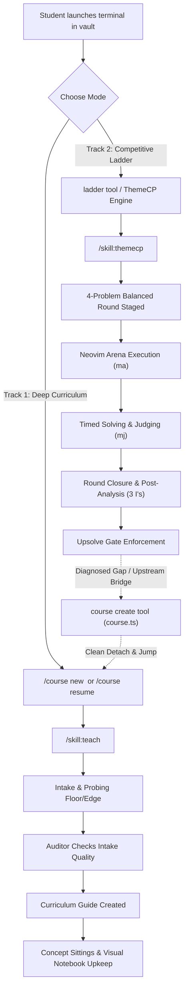
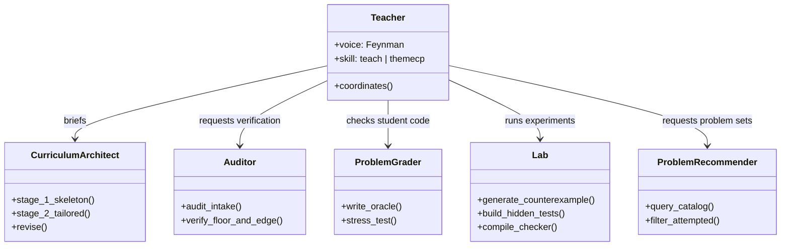

# System Architecture & Technical Audit: Curriculum Ledger, The Teacher & The Competitive Arena

> **Audit Baseline Document**  
> **Target Audience:** Independent Lead AI Systems & Software Architect Auditor  
> **System Scope:** `.pi/` subsystem, `pi-agy-bridge/`, and `nvim/lua/competitive/arena/`  
> **Date:** November 17, 2026 (Updated Audit Checkpoint)  
> **Status:** Active / Verified Checkpoint (746/746 RBAC tests, 15/15 Bridge unit tests, 9/9 Arena tests, 6/6 Browser Fetch tests, 4/4 Curriculum tests, 1/1 Ladder test, Lua bytecode & headless Neovim verified)

---

## 1. Executive Summary & Core Philosophy

This system is an **autonomous, terminal-native competitive programming academy and algorithmic mastery ecosystem**. It bridges three computing environments:
1. **The Cognitive Brain:** [Pi Coding Agent](file:///c:/Users/tssha/OneDrive/Desktop/curriculum-ledger/.pi) coupled with [Antigravity ACP](file:///c:/Users/tssha/OneDrive/Desktop/curriculum-ledger/pi-agy-bridge) (Google Gemini frontier reasoning engines).
2. **The Execution Arena:** [Neovim Competitive Arena](file:///c:/Users/tssha/OneDrive/Desktop/curriculum-ledger/nvim/lua/competitive/arena/init.lua) (modular Lua workspace with `timer.lua`, `popup.lua`, `runner.lua`, `verdicts.lua`, `dashboard.lua`, `commands.lua`, and `config.lua`).
3. **The Persistent Mirror:** Obsidian Markdown Vault (curriculum guides, living course notebooks, and immutable session transcripts).

```
 ┌────────────────────────────────────────────────────────────────────────┐
 │                              THE STUDENT                               │
 └──────────────────┬─────────────────────────────────┬───────────────────┘
                    │                                 │
         Conversational Sittings                Hands-on Coding
                    │                                 │
                    ▼                                 ▼
         ┌─────────────────────┐           ┌─────────────────────┐
         │   Pi CLI / Bridge   │           │     Neovim Arena    │
         │  (Teacher Persona)  │           │  (<leader>ma / mj)  │
         └──────────┬──────────┘           └──────────┬──────────┘
                    │                                 │
         Telemetry & Sync                   Local Execution & Tests
                    │                                 │
                    ▼                                 ▼
         ┌───────────────────────────────────────────────────────┐
         │              OBSIDIAN VAULT & FS LEDGERS              │
         │  • courses/<slug>/course.md      (Living Notebook)    │
         │  • courses/<slug>/sessions/*.md  (Session Transcripts)│
         │  • .pi/arena/                    (Rating & History)   │
         │  • .pi/ladder/                   (ThemeCP State)      │
         └───────────────────────────────────────────────────────┘
```

---

## 2. Host Topology & Execution Environment Transparency

To preempt trivial platform or environment objections (such as *"this bash command or `/tmp` path won't work on Windows"*), we state the host topology upfront:

### The Dual-World Operating Model
1. **Primary Runtime & Execution Target: Linux WSL2 (Ubuntu / Debian)**
   - The student lives and codes inside **WSL2**.
   - Neovim runs natively inside WSL2.
   - C++ compilation (`g++ -O2 -std=c++17 -Wall`), Python 3.10/3.12 runtimes, bash subshells, test case execution, and test piping (`./checker <in> <actual> <expected>`) execute natively in a **pure POSIX Linux environment**.
   - The true vault root on the Linux side is `/mnt/c/Users/tssha/OneDrive/Desktop/brain/learn/` (or synced Linux workspaces).
   - All shell commands, heredocs, pipeline splits, and `/tmp/pi-*` scratch paths evaluated by RBAC and extensions are designed for POSIX compliance.

2. **The Windows Synchronized Mirror (Agent & Authoring Workspace)**
   - The authoring/audit workspace resides on the Windows side (`c:\Users\tssha\OneDrive\Desktop\curriculum-ledger`), where `pi-agy-bridge/` sits at the repository root (deployed under `.pi/extensions/pi-agy-bridge/` inside the WSL2 vault) alongside `.pi/` and `nvim/`.
   - **Important operational reality:** `curriculum-ledger/` and WSL2 `/mnt/c/Users/tssha/OneDrive/Desktop/brain/learn/` (+ `~/.config/nvim/lua/competitive/arena/`) are distinct filesystem trees synced explicitly rather than symlinked; runtime fixes verified in `curriculum-ledger/` only affect live WSL sessions once synced across.
   - The Antigravity ACP binary (`agy`, v1.5.9) runs on WSL2 alongside Pi.

> [!NOTE]
> When auditing shell execution, pipeline splitting, and path security in `rbac.ts` or `arena.py`, evaluate them against **POSIX Linux standards (WSL2)**, where the actual binary execution and judging take place.

---

## 3. Pedagogical Ambition vs. Current Reality: Honest Self-Criticism

We do not shy away from fair criticism. Our design goals were extremely ambitious. While the infrastructure, test suites, and security kernel are rock-solid, our pedagogical delivery has experienced tension between our grand vision and model execution.

### The Grand Vision: The "Chalk and Blackboard" Tutoring Experience
We envisioned our Teacher not as a prompt-answering chatbot, but as an authentic, charismatic mentor sitting across a wooden desk with a blackboard:
1. **The Feynman Persona:** Playful, intuitive, irreverent toward dry academic definitions, relentlessly probing, using everyday mechanical analogies before writing a single line of math.
2. **Absolute Immersion (Zero Fourth-Wall Breakage):** The student must never hear:
   - *"I am calling the `catalog` tool."*
   - *"According to my system prompt guidelines..."*
   - *"As an AI assistant, let me consult my `auditor` subagent."*
   - *"Encountered error in JSON-RPC tool execution."*
   The backstage crew (`lab`, `problem-grader`, `curriculum-architect`) must remain completely invisible. The teacher simply "knows" or "runs an experiment on their notepad" without breaking character.
3. **Socratic Spontaneity:** Natural give-and-take. Posing counterexamples that lead the student to realize their own logical flaws, rather than handing down algorithmic recipes.

### The Active Model Split & Reality Gaps
To balance persona quality, multi-turn latency, 1M-token context, and continuous API/quota cost, the system currently separates the **Teacher** from **Subagents**:
- **Main Teacher (`/skill:teach`, `/skill:themecp`):** `antigravity/gemini-4-hydrogen` at `thinking: medium` via Antigravity ACP (`pi-agy-bridge`). Keeping `medium` rather than `high` preserves Socratic tone without inflating quota/latency across 40–60 turn sittings (especially since computational work is delegated).
- **Subagents (9 of 10 `.pi/agents/` specs):** `deepseek/deepseek-flash` (DeepSeek V4.1 Flash) at `thinking: max`, with `curriculum-architect.md` remaining on `google/gemini-3.8-flash` (`thinking: medium`). Notice an acknowledged tuning lag here: simple retrieval/visual subagents (`researcher`, `resource-recommender`, `mermaid-maker`) are still pinned at `thinking: max` in frontmatter rather than stepped down to `low`/`high`.

While these models are fast and strong at code/tool calls, specific cognitive tradeoffs remain openly acknowledged:

| Ideal Vision | Flash Model Reality | Root Cause |
|---|---|---|
| **Organic Socratic Discovery** | **"Checklist / Rubric" Mentality** | Fast models default to robotic compliance. During the intake phase, instead of having a natural exploratory chat, the model sometimes fires rapid-fire questions like an interrogator checking boxes. |
| **Consistent Persona Immersion** | **Persona Decay Over Long Turns** | After 15–20 complex turns involving debugging or test judging, the model's attention drifts away from the Feynman voice in the system prompt, reverting to standard assistant-speak. |
| **Impermeable Fourth Wall** | **Occasional Backstage Leaks** | When an edge-case tool error or permission rejection occurs, the model can momentarily slip and expose internal mechanics ("My tool was blocked by notebook guard") instead of staying in character. |

### Open Invitation for Auditor Guidance
We explicitly invite the auditor to evaluate our prompt architecture and agent orchestration:
* *How can we enforce deep persona anchoring in fast models without ballooning token latency?*
* *Would a two-stage cognitive pipeline (an analytical "Planner" subagent diagnosing the algorithmic gap, feeding a dedicated "Feynman Voice Actor" agent) deliver a more immersive blackboard experience?*
* *How can we dynamically re-anchor the Feynman persona over 30+ conversational turns without context rot?*

---

## 4. The Two Pedagogical Tracks & Cross-System Bridging



### Track 1: Course-Based Curriculum (`/skill:teach`)
Designed for deep conceptual mastery of an algorithmic topic (e.g. `dynamic-programming`, `typical90`, `graph-algorithms`).
* **Scaffolding:** `/course new <slug>` deterministically builds the notebook (`course.md`), seed sources (`sources/`), and session logs (`sessions/`).
* **The Intake Ceremony:** Probes both the student's *floor* (mastered foundations) and *edge* (where reasoning fails). The `auditor` checks that the intake was rigorous, and `curriculum-architect` tailors the roadmap.
* **The Sitting:** The teacher lectures, asks questions, requests diagram visuals, and records progress in `course.md` within strict section character budgets.

### Track 2: ThemeCP Competitive Ladder (`/skill:themecp`)
Designed for contest toughness, time pressure, and self-balancing rating progression.
* **4-Problem Balanced Rounds:** Slots `P1` → `P2` → `P3` → `P4` under one shared clock, keyed to the student's Codeforces-equivalent rating level.
* **The Three I's Post-Analysis:**
  - **Inception:** How long from opening to a committed idea?
  - **Intuition:** Did the committed model match reality?
  - **Implementation:** How cleanly did the idea become bug-free code?
* **The Upsolve Gate:** Solving fewer than threshold opens a mandatory surgical upsolve (`ladder` gate). No new rounds can be staged until the pending upsolve is repaired or explicitly waived.

### Cross-System Bridging (ThemeCP $\leftrightarrow$ Course & Arena $\leftrightarrow$ Teacher)

#### 1. ThemeCP $\to$ Course Bridge (`course.ts`)
When a student is grinding ThemeCP and repeatedly misses a recurring concept (e.g., on `P3`):
* The teacher doesn't just force more blind grinding.
* `teacher:themecp` calls the narrow cross-boundary tool **`course`** (`course.ts`):
  - `course create <slug>`: Scaffolds a targeted course (e.g., `courses/tree-rerooting/`) with diagnostic context notes and starter source briefs—**without touching or corrupting active ThemeCP session pointers**.
  - `course detach`: Cleanly unlinks the ThemeCP session and restores developer (`user`) mode.
* The student can then immediately run `/course resume tree-rerooting` and `/skill:teach` to master the prerequisite before returning to the ladder!

#### 2. Arena $\to$ Teacher Bidirectional Flow
* Neovim Arena operates asynchronously. The student can write code in Neovim while the conversation in Pi remains live.
* When the student runs `<leader>mj`, the verdict (AC, WA, TLE), runtime, and test results are recorded in `.pi/arena/history.json`.
* In Pi, the teacher monitors this through `arena_ledger` (`inspect`, `get_standing`, `record_verdict`).
* The teacher automatically debriefs the submission without the student ever having to manually copy-paste terminal outputs or source code into chat.

---

## 5. Nuts-and-Bolts Deep Dive: Extensions (`.pi/extensions/`)

Every extension is an uncoupled TypeScript module loaded into Pi's runtime.

### 1. `rbac.ts` — The Security Kernel
* **Purpose:** Authoritative access control middleware. Enforces [policy.json](file:///c:/Users/tssha/OneDrive/Desktop/curriculum-ledger/.pi/rbac/policy.json).
* **Key Logic & Conditionals:**
  - `toRelVaultPath(vaultRoot, cwd, rawTarget)`: Canonicalizes paths relative to `vaultRoot`; out-of-vault targets (such as `/tmp/pi-*`) return `null` and pass immediately.
  - `stripHeredocs(command)`: Strips `cat << 'EOF' ... EOF` multi-line blocks *before* bash command tokenization. **Intent:** Prevents C++ code containing `#include <iostream>` or `<vector>` from being misparsed as file redirection `<` on vault files.
  - `splitPipelineSegments(command)` & `tokenizeSegment(segment)`: Quote-aware splitting on `;`, `&&`, `||`, `|`, and newlines, tracking `cd` changes across chained segments (`simCwd`) and excluding comparison operators (`=`, `==`, `!=`, `<`, `>`, `[`, `]`, `!`) from path classification.
  - `expandReadGlobTargets(cwd, rawTarget)`: For `READ_COMMANDS` (`cat`, `file`, `ls`, `head`, etc.) targeting a trailing `*` glob on an **existing** directory (e.g., `file .../.pi/lab/tests/cf_630c/*`), resolves actual matching entries on disk before evaluating `policy.json` — allowing `.in`/`.out` reads while continuing to block forbidden directories like `cat courses/dp/*`. Non-existent directories fail closed on the raw glob literal.
  - `extractBashChecks(...)` & `evaluateAccess(relPath, { verb }, caller, policy)`: Maps commands/redirections/inline paths to canonical verbs against `policy.json` glob patterns (`patternSpecificity` longest-prefix match). **Intentional limitation:** Shell variable assignments (`WORKDIR=$(mktemp ...)`, `$(cat /tmp/...)`) are **not** evaluated or expanded; subagent bash commands are expected to use literal `/tmp/pi-{role}-{epoch}-{rand}` paths.
* **Separation of Concerns:** RBAC strictly enforces actor/path/tool permissions (it does not validate notebook character budgets) and exposes `__piRbac.checkPermission` and `__piRbac.setEnabled` (allowing `/rbac off` transitions cleanly).
* **State Management:** Tracks active principal (`user`, `teacher:teach`, `teacher:themecp`, or `subagent:<name>` via `PI_SUBAGENT_*` env vars or `<!-- agent:... -->` prompt markers).

### 2. `teacher.ts` — Voice & Notebook Guard
* **Purpose:** Keeps persona voice anchored across turns without leaking Pi harness text to AGY ACP, and enforces structural and character budgets on `course.md` independently of RBAC.
* **Key Logic & Conditionals:**
  - `readVoice(cwd, skill)`: Reads the `<!-- voice:start -->...<!-- voice:end -->` block directly from `.pi/skills/teach/SKILL.md` or `.pi/skills/themecp/SKILL.md`.
  - `before_agent_start` conditional ACP isolation:
    - When `ctx.model?.api === "agy-bridge"`, returns **strictly** `# Your voice in this sitting\n\n${voice}\n` alone. Forwarding Pi's full default `event.systemPrompt` (`"You are a coding assistant running inside pi..."` Line 1 + `.pi`/`.nvm` doc paths + `<tools>`/`<rules>`) leaks Pi harness metadata and triggered upstream Google Cloud Code Assist `429 RESOURCE_EXHAUSTED` rejections. AGY ACP already supplies native harness context, `cwd`, skill discovery, and MCP tool schemas independently.
    - When running on non-ACP direct API models (or unit tests), returns `${event.systemPrompt}\n\n# Your voice in this sitting...` so stateless HTTP providers still receive full context.
  - **Single-Source Tool Descriptions (Zero `promptSnippet` / `promptGuidelines`):** All 8 domain extensions (`arena.ts`, `ask-user-question.ts`, `browser-fetch.ts`, `catalog.ts`, `course.ts`, `curriculum.ts`, `ladder.ts`, `quiz.ts`) folded their behavioral rules directly into each tool's canonical `description` and purged Pi-only `promptSnippet`/`promptGuidelines` fields so MCP (`tools/list`) and Pi receive identical, non-duplicated tool contracts.
  - `validateNotebookBudget({ toolName, input, cwd })` & `__piTeacher.checkNotebookGuard(...)`:
    - Used by both Pi `tool_call` interception and `pi-agy-bridge` native ACP permission checks.
    - Simulates file edits in-memory (`applyEdits`).
    - Verifies section flatness: rejects any line matching `/^#{3,}\s/` (sub-headings like `###` are forbidden; notebooks must stay flat).
    - Enforces static `SECTION_BUDGETS` character limits:
      - Header lines budget: **600 characters**
      - `## Where the student stands`: **2,600 characters**
      - `## Plan`: **6,000 characters**
      - `## On the board`: **1,400 characters**
      - `## Practice`: **600 characters**
      - `## Agreements`: **700 characters**
      - `## For learner.md`: **500 characters**
      - `## Parked`: **700 characters**
      - `## Session log`: **3,000 characters**
* **Intent:** Protects against LLM "context bloat", keeps ACP payloads clean, and keeps RBAC focused on access control.

### 3. `course.ts` — The Bridge Tool from ThemeCP to Courses
* **Purpose:** Narrow cross-boundary tool allowing `teacher:themecp` to transition students to focused courses.
* **Key Actions:**
  - `action: "create"`: Calls `learn.ts`'s `createTargetedCourse` to scaffold `courses/<slug>/` with diagnostic briefs without altering active session pointers.
  - `action: "detach"`: Unlinks active ThemeCP session and restores developer principal (`user`).

### 4. `arena.ts` — The Neovim Arena Bridge
* **Purpose:** Connects Pi to the Neovim Arena runner and maintains the competitive problem ledger.
* **Key Logic & Conditionals:**
  - `arena_run`: Stages a problem session, resolves tests from `.pi/lab/tests/<id>/` or catalog sets, copies custom checkers (`checker.cpp`, `checker.py`, `checker.sh`), and writes `.pi/arena/active/manifest.json`.
  - `arena_ledger`: Queries and updates `.pi/arena/history.json` and `rating.json` (`get_standing`, `inspect`, `record_verdict`, `annotate`, `abandon_active`), clearly separating **Total time** (with optional passive **`thinking_seconds`** cut-point breakdown `thinking MM:SS · coding MM:SS`) from **Solved at round clock**.
  - `/arena` slash commands: `/arena standing`, `/arena history`, `/arena discard`.

### 5. `ladder.ts` — ThemeCP State Machine
* **Purpose:** Implements the 4-problem (`P1`–`P4`) competitive practice ladder and upsolve gate.
* **Key Logic & Conditionals:**
  - Tool actions: `status`, `slots`, `open_round`, `close_round`, `clear_upsolve`, `waive`, `stats`, `rounds`, `label` plus deterministic `/themecp` slash commands.
  - Calculates performance rating, All-Kill (AK) rate, and auto-adjusts level (Level 1–30).
  - Enforces the Upsolve Gate: blocks staging round $N+1$ if a mandatory upsolve remains pending.

### 6. `learn.ts` — Course Workspace Scaffolding
* **Purpose:** Deterministic workspace creation and session pointer management.
* **Key Logic & Conditionals:**
  - `/course new <slug>`: Enforces lowercase kebab-case naming. Creates `courses/<slug>/course.md`, `sources/`, and `sessions/`.
  - Pointer files: Atomically updates `.active-course` and `.active-session` at the vault root.
  - Records dated session entries under `## Session log` in `course.md`.

### 7. `curriculum.ts` — Curriculum Guide Query Bridge
* **Purpose:** Exposes structured query tools (`overview`, `intake`, `chapter`, `practice`, `lookup`) over `courses/<slug>/curriculum.md`.
* **Intent:** Avoids dumping 2,000 lines of curriculum text into the model's context. The teacher queries only the relevant chapter or exercise on demand.

### 8. `catalog.ts` — Static Problem Catalog Bridge
* **Purpose:** Provides structured query operations over `.pi/catalog/` (`domains`, `buckets`, `bucket`, `find`, `problem`, `resources`, `pick`, `similar`, `round`, `statement`).
* **Intent:** Replaces messy `grep` or ad-hoc bash scripts with deterministic, validated tool calls for selecting problems and reading statements.

### 9. `md-log.ts` — Obsidian Session Mirror
* **Purpose:** Dumb, clean real-time mirror of student/teacher conversation turns into Obsidian markdown files (`sessions/YYYY-MM-DD.md`).
* **Logic:** Writes user prompts, native full-width assistant prose, and interactive `quiz`/`ask_user_question` prompts + graded answers (omitting backstage thoughts and raw internal tool calls). On `session_start`, automatically rolls stale dated session files across midnight under `courses/<slug>/sessions/` and `practice/themecp/sessions/` while updating `.active-session` and `course.md`.

### 10. `housekeeping.ts` — Ephemeral Lifecycle Sweeper
* **Purpose:** Cleans stale scratch files and transient artifacts.
* **Logic:** On root interactive `session_start`, sweeps `.pi/catalog/sets/*.json` and `.pi/lab/tests/*` older than `ARTIFACT_TTL_DAYS = 7`, plus `purgeSessionArtifacts`.

### 11. `ask-user-question.ts` & `quiz.ts` — TUI Interactive Modals
* **Purpose:** Render rich TUI popup dialogs in the terminal.
* **Logic:** Share `__piSharedUiLock` (`ctx.ui.custom`) and `__piInteractiveBatchGuard` so popups and multi-choice questions serialize without terminal race conditions or per-turn batch collisions.

### 12. `browser-fetch.ts` — Safe Web Research Helper
* **Purpose:** Fetches live problem statements and contest editorials via `.pi/browser/browser_fetch.py`.
* **Logic:** Uses `curl_cffi` browser TLS impersonation (`chrome120`, with time-budgeted `safari15_5` retry on `403`/`429`) for HTTP(S) URLs and strips HTML bloat into clean Markdown, plain text, or HTML (shared by `.pi/catalog/catalog.py`'s `_fetch_url`). HTTP errors (`404`, `500`), timeouts, and network failures raise cleanly without double-fetching via `urllib` (`urllib` is reserved for `file://` or missing `curl_cffi`).

### 13. `visual-tools/` — Visual Authoring Loop (`mermaid_tools.ts`, `svg_tools.ts`)
* **Purpose:** Registers `write_mermaid`, `edit_mermaid`, `render_mermaid`, `write_svg`, `edit_svg`, and `render_svg` directly in Pi (and legacy `interactive-subagents` hooks), sweeping staging scratch on root `session_start` (`sweepStagingRootAtStartup`) and publishing verified PNGs into `<cwd>/viz/`.

---

## 6. Nuts-and-Bolts Deep Dive: Subagents (`.pi/agents/`)

Ten specialized subagent specs under `.pi/agents/` operate in isolated processes, communicating through structured input/output briefs:

*(Scratch convention across `lab`, `problem-grader`, `problem-recommender`, `auditor`, and `curriculum-architect`: pick one unique literal `/tmp/pi-<role>-<epoch>-<rand>` directory created via `mkdir -p` and reuse that literal path verbatim across `bash` calls — no `$WORKDIR` shell variables, no pointer files, and no manual `rm -rf` cleanup chores.)*



| Subagent | Role & Trigger | Permissions (RBAC) | Key Design Intent |
|---|---|---|---|
| **`curriculum-architect.md`** | Authors and revises `courses/<slug>/curriculum.md`. Stage 1 before intake; Stage 2 after intake; `revise` during course progression. | Sole write permission to `courses/*/curriculum.md`. No catalog write. | Keeps curriculum schema strictly compliant (`overview`, `prerequisites`, `chapters`, `practice`). |
| **`auditor.md`** | Quality control for the intake sitting. Validates whether the teacher actually probed the student's *floor* and *edge*. | Read-only access to intake logs and curriculum. | Prevents "false consensus" where student says "I know graphs" and teacher skips basics without testing. |
| **`curriculum-extractor.md`** | Source-document DAG decomposition (`Teach-Source` planning): extracts unconditional truths, derived insights, dependency DAG, and inaccurate/hand-wavy flags. | Read-only vault access (inherits `PI_SUBAGENT_*` env defaults; lacks explicit `<!-- agent:curriculum-extractor -->` HTML body marker). | Separates logical dependency structure from an author's narrative order before lesson delivery. |
| **`problem-grader.md`** | Independent algorithmic oracle. Writes brute-force or mathematical solvers and stress-tests student submissions. | Scratch in literal `/tmp/pi-grader-<epoch>-<rand>`. | Never relies on LLM gut feel to judge code correctness; uses deterministic execution against random inputs. |
| **`lab.md`** | Algorithmic experimenter. Disproves false student claims with minimal counterexamples; builds hidden test suites and custom `checker.cpp`. | Writes test suites to `.pi/lab/tests/<id>/`; scratch in literal `/tmp/pi-lab-<epoch>-<rand>`. | Generates adaptive checkers when multiple valid outputs exist (e.g. topological orders, subset covers). |
| **`problem-recommender.md`** | Selects problems from `catalog.py` matching rating curves and domain requirements, excluding attempted problems. | Writes sets to `.pi/catalog/sets/*.json`; scratch in literal `/tmp/pi-recommender-<epoch>-<rand>`. | Avoids repeating solved problems; ensures ladder slots match target rating spreads. |
| **`resource-recommender.md`** | Finds curated visualizations, articles, and book chapters. | Read-only catalog. | Recommends external high-signal materials when the student hits a conceptual wall. |
| **`researcher.md`** | Performs deep dives into obscure algorithms or editorial nuances. | Read-only web/catalog. | Pulls editorial approaches to synthesize into hints without giving away answers. |
| **`svg-maker.md` / `mermaid-maker.md`** | Generates hand-written SVGs (`svg-maker`) and Mermaid charts (`mermaid-maker`), renders previews for visual inspection, and publishes PNGs to `viz/`. | Tool-managed sandbox + vault `viz/viz-<slug>-<ts>.png` output. | Creates legible, verified architectural and spatial state diagrams for Obsidian. |

---

## 7. The Security Kernel: RBAC Deep Dive (`.pi/rbac/`)

The RBAC system enforces least privilege across the entire filesystem.

```
Principal Lifecycle:
user (Default)
  │
  ├──► Enter /skill:teach ────► Principal: teacher:teach
  │
  ├──► Enter /skill:themecp ──► Principal: teacher:themecp
  │
  ├──► Delegate Subagent ─────► Principal: subagent:<role>
  │
  └──► Exit Sitting ──────────► Principal: user
```

### The 14 Resource Classes (`policy.json`)

1. **`catalog_sets`** (`.pi/catalog/sets`, `.pi/catalog/sets/*.json`): Staged problem sets produced by `problem-recommender`.
2. **`lab_tests`** (`.pi/lab/tests/*/{*.in,*.out,checker.cpp,checker.py,checker.sh}`): Hidden test suites and adaptive checkers produced by `lab`.
3. **`catalog_static`** (`.pi/catalog/**` excluding sets): Protected problem database accessed via `catalog`.
4. **`arena_state`** (`.pi/arena/**`): Arena active manifest, ledger, and history managed via `arena_run` / `arena_ledger`.
5. **`ladder_state`** (`.pi/ladder/**`): ThemeCP ladder and round state managed via `ladder`.
6. **`curriculum_state`** (`.pi/curriculum/**`): Curriculum validation engine (`curriculum-architect` may run `curriculum.py validate`).
7. **`pi_system`** (`.pi/**` excluding domain data dirs): Extensions, skills, agents, and RBAC configs (readable by `teacher`; `subagent:*` may execute `browser_fetch.py`).
8. **`course_guide`** (`courses/*/curriculum.md`): Structured course roadmaps written solely by `curriculum-architect`.
9. **`course_notebook`** (`courses/*/course.md`): Living teacher notebooks (`structuredWriteOnly`, written by `teacher:teach`).
10. **`course_sources`** (`courses/*/sources/**`): Student-provided reference texts (read-only during lessons and helper runs).
11. **`course_sessions`** (`courses/*/sessions/*.md`): Obsidian session logs owned by `md-log`.
12. **`themecp_docs`** (`practice/themecp/{ladder.md,rounds/*.md,diagnoses/*.md}`): ThemeCP workspace documents owned by `teacher:themecp`.
13. **`themecp_sessions`** (`practice/themecp/sessions/*.md`): ThemeCP session logs owned by `md-log`.
14. **`learner_notes`** (`learner.md`): Student's personal learner profile (AI agents read-only).

### The Verified 746-Test Suite
The 700-verdict matrix plus C1–C25 boundary checks, shell variable/glob guardrails, guard separation, and extension contracts are verified by automated unit tests in [.pi/rbac/rbac.test.ts](file:///c:/Users/tssha/OneDrive/Desktop/curriculum-ledger/.pi/rbac/rbac.test.ts):
- `user`: Full read/write access (developer mode).
- `teacher:teach`: Read/write access to notebooks, session logs, and scratch; **strictly blocked** from mutating catalogs, ladder state, or system config.
- `subagent:lab`: Allowed to create `.in`/`.out`/`checker.cpp` in `.pi/lab/tests/<id>/`; **strictly blocked** from touching course notebooks or ratings.
- `subagent:curriculum-architect`: Sole writer to `curriculum.md`; blocked from modifying anything else.

---

## 8. The Execution Arena: Neovim Competitive Integration

The Neovim Arena resides in [nvim/lua/competitive/arena/](file:///c:/Users/tssha/OneDrive/Desktop/curriculum-ledger/nvim/lua/competitive/arena/init.lua), organized into focused submodules (`init.lua`, `timer.lua`, `popup.lua`, `runner.lua`, `verdicts.lua`, `dashboard.lua`, `commands.lua`, and `config.lua`). It layers cleanly onto `<leader>cs` (`competitive/init.lua`) and communicates with the Pi ecosystem via `.pi/arena/active/`.

```mermaid
sequenceDiagram
    participant Student
    participant Neovim as Neovim Arena
    participant Bridge as arena.ts (Pi)
    participant Engine as arena.py / C++
    
    Student->>Bridge: Staged round (ThemeCP or Course)
    Bridge->>Neovim: Writes .pi/arena/active/manifest.json + tests
    Student->>Neovim: <leader>ma (Arena Dashboard & Problem Queue)
    Neovim->>Neovim: Scaffolds sol.cpp, loads problem metadata
    Student->>Neovim: Writes code in problem .cpp
    Student->>Neovim: <leader>mt / <leader>mj (Samples / Hidden Tests)
    alt Custom Checker Present
        Neovim->>Neovim: Compiles checker.cpp -> bin/<pid>_checker
        Neovim->>Engine: Runs pure OJ binary -> ./checker <in> <actual> <exp>
        Engine-->>Neovim: Exit 0 = AC / Exit non-zero = WA + Checker diagnostic
    else Standard Exact Match
        Neovim->>Engine: Token / float tolerance match vs test .out
    end
    Neovim->>Student: Live progress & verdict popup (AC / WA / TLE / RE)
    Student->>Neovim: <leader>mv / <leader>mx (Record verdict & submit packet)
    Neovim->>Bridge: Writes result.json; arena.ts updates history.json
```

### Key Keybindings, Timing Telemetry & Workflows
* **`<leader>cs` / `<leader>ce`:** Explicit competitive session activation/tear-down gate (`competitive/init.lua`).
* **`<leader>ma` (`Arena` Dashboard):** Opens the Queue & Standing dashboard without starting any timer (`session_opened`); pressing **`c`** in Queue previews the card before committing, while **`a` / `<CR>`** calls `accept_problem` and starts the per-problem & pooled stopwatches.
* **Thinking vs. Coding Cut-Point (`thinking_seconds`):** Recorded monotonically at the **first** of saving a non-empty approach (`<leader>mp` / card close) or making the first post-template buffer edit (`TextChanged` / `TextChangedI`, armed via `vim.schedule` after `scaffold.lua`'s `BufNewFile` template load). Once crossed, subsequent pivots stay under coding time (`duration_seconds - thinking_seconds`), while budgets and Elo still score against total `duration_seconds`. Older `history.json` entries stay `null` without backfill.
* **`<leader>mc` (Problem Card):** Views problem statement, limits, samples, hints, and approach note.
* **`<leader>mt` (Samples) & `<leader>mj` (Hidden Judge):** Compiles pure Online Judge mode (intentionally omitting `-D LOCAL`, unlike `<leader>c*`) with live progress spinner and custom checker support (`checker.cpp`, `checker.py`, `checker.sh`).
* **`<leader>mp` (Approach), `<leader>mh` (Hints), `<leader>mo` (Browser URL), `<leader>mv` (Verdict Menu), `<leader>mx` (Close Session):** Full problem workflow returning structured telemetry to Pi.

---

## 9. The Bridge: Marrying Google Antigravity (ACP) & Pi (`pi-agy-bridge/`)

The [pi-agy-bridge](file:///c:/Users/tssha/OneDrive/Desktop/curriculum-ledger/pi-agy-bridge) enables running Google's Antigravity subscription models (via `agy acp`) inside the Pi coding agent CLI.

```
 ┌────────────────────────────────────────────────────────┐
 │                      Pi CODING AGENT                   │
 │  • TUI Terminal Interface & Interactive Prompt Modal   │
 │  • Local Agent Loop & Extension Lifecycle Hooks        │
 │  • MCP Tool Registry (catalog, ladder, arena_run...)   │
 └───────────────────────────┬────────────────────────────┘
                             │
                      streamSimple()
                             │
                             ▼
 ┌────────────────────────────────────────────────────────┐
 │                     pi-agy-bridge                      │
 │  • AcpDriver (Prompt hash rotation, queuing & parking) │
 │  • McpServer (Bridge catalog + 1,800s modal grace)     │
 │  • RbacPermissionHandler + permission-prompt.ts TUI    │
 └───────────────────────────┬────────────────────────────┘
                             │
                      stdio / JSON-RPC
                             │
                             ▼
 ┌────────────────────────────────────────────────────────┐
 │                   ANTIGRAVITY (ACP)                    │
 │  • Binary Process (`agy acp` v1.5.9)                   │
 │  • Gemini 3.8 Flash / 4 Argon / 4 Hydrogen / Claude    │
 │  • Innate Tools: read_file, write_file, edit_file, etc.│
 └────────────────────────────────────────────────────────┘
```

### Key Bridge Mechanics
1. **Prompt Isolation, Hash Rotation & Message Queuing (`acp-driver.ts` + `sessions.ts`):**
   - `resolveEffectiveSystemPrompt(context)` collects only string/array `systemPrompt` and `role === "system"` messages (deliberately ignoring Pi's plain-object `sections` outside active sittings).
   - **Zero Pi leakage:** Outside a sitting, `teacher.ts` returns early, so `pi-agy-bridge` omits `_meta.antigravity.systemPrompt.append` (`0` bytes). Inside `/skill:teach` or `/skill:themecp`, `teacher.ts` emits strictly `# Your voice in this sitting` (~2 KB).
   - Stores a SHA-256 `systemPromptHash` in `SessionStore` (`sessions.json`). When a persona activates or pauses mid-conversation (`user` <-> `teacher:teach`), `acp-driver.ts` transparently rotates the ACP session and prepends a bounded 10-turn summary (`buildCompactHandoff`, clipped at 260 chars/turn) so voice anchors take effect immediately.
   - Collects all unsent queued/steered user messages per session via `#sentCountBySession`.
2. **Bridged Pi Tools via Standard MCP (`bridge-catalog.ts` + `mcp-server.ts`):**
   - Filters out Pi builtins (`read`, `bash`, `edit`, `write`) and registers domain tools (`catalog`, `ladder`, `course`, `curriculum`, `arena_run`, `arena_ledger`, `quiz`, `ask_user_question`, `browser_fetch`, `subagent`, `visual-tools`, plus `bridge_poll_result`) over local HTTP MCP (`tools/list`). Each tool's self-contained `description` carries its full contract.
   - Handled via `parkToolCall`, with `1_800_000` ms (`INTERACTIVE_ESCALATE_MS`) for `quiz`/`ask_user_question`, `120_000` ms (`DELEGATION_ESCALATE_MS`) for delegation (`subagent`), and `20_000` ms (`ESCALATE_AFTER_MS`) for fast tools before async poll escalation.
3. **Separated 2-Option Permission Gate (`rbac-permission.ts` + `permission-prompt.ts`):**
   - Native ACP `session/request_permission` checks cleanly classify blocks from **RBAC** (`__piRbac.checkPermission`) vs **Teacher Notebook Guard** (`__piTeacher.checkNotebookGuard`) vs custom validators.
   - Instead of writing `⚠️ [Notebook Guard / RBAC Blocked]` into chat/Obsidian transcripts, blocked calls pause ACP and open an interactive TUI modal with **2 explicit choices**: **`Allow this once`** (`allow`) or **`Let me chip in`** (`chip_in`, also triggered on `Esc`/`Ctrl+C`). Privilege overrides (`/rbac off`) remain an explicit user command rather than an inline modal option.

---

## 10. Known Quirks, Tradeoffs & Scope Boundaries (Transparency Ledger)

We highlight the remaining rough edges and deliberate compromises upfront for the audit jury:

1. **Dual-Root Synchronization Burden:** `curriculum-ledger/` (Windows audit/authoring repo) and `brain/learn/` + `~/.config/nvim/` (live WSL2 runtime) are synced manually; changes validated here require explicit sync before live runs reflect them.
2. **Subagent Frontmatter & Marker Parity:**
   - `curriculum-extractor.md` currently lacks `<!-- agent:curriculum-extractor -->` in its body (relying on `PI_SUBAGENT_*` env vars during spawned runs; the older monolithic `subagents preserve frontmatter...` check in `rbac.test.ts` was removed rather than silently altering the agent).
   - 9 subagents still specify `thinking: max` on `deepseek/deepseek-flash`, while `curriculum-architect.md` uses `google/gemini-3.8-flash` (`thinking: medium`); tuning `thinking: low` / `high` per role and verifying `deepseek-flash` visual PNG inspection on `svg-maker` remains open polish.
3. **Static Bash Guard Tradeoffs (`rbac.ts`):**
   - By design, `rbac.ts` is an LLM guardrail ("keep mistakes in `/tmp`"), not kernel isolation (`Docker` / `bwrap`). Dropping variable/$WORKDIR emulation keeps `rbac.ts` clean, at the cost that any model slipping `$WORKDIR` gets blocked and must self-correct to a literal `/tmp/pi-{role}-{epoch}-{rand}` path.
   - `expandReadGlobTargets` expands globs only for read commands on directories already existing on disk; non-existent glob directories fail closed.
4. **Neovim Arena Telemetry Boundaries:**
   - `<leader>mp` / `TextChanged` capture a single monotonic `thinking_seconds` cut-point; typing scratch pseudocode inside `.cpp` before `<leader>mp` flips the problem to coding, and the 69 historical `history.json` rows prior to this feature intentionally remain `null` (no invented backfill).
   - Live Neovim changes (`init.lua`, `verdicts.lua`) must be synced into WSL `~/.config/nvim/lua/competitive/arena/` for runtime capture.
5. **ACP Upstream & Rotation Rough Edges:**
   - `agy acp` can still emit transient upstream Google Cloud Code Assist `429 RESOURCE_EXHAUSTED` retry bursts under per-minute concurrency/capacity pressure even with zero Pi harness leakage.
   - Rotating an ACP session on mid-chat `/course` <-> `/course pause` drops native ACP memory down to `buildCompactHandoff`'s 10-message × 260-char summary.

---

## 11. Defending the Design & Execution (Auditor Q&A)

Here we address potential architectural objections an auditor might raise:

### Objection 1: "Why parse bash commands in RBAC instead of running subagents in Docker containers?"
* **Auditor Concern:** Bash AST inspection can theoretically be tricked with complex shell obfuscation; Docker containers provide absolute kernel-level isolation.
* **Design Defense:**
  1. **Latency & Developer Ergonomics:** Docker containers on Windows WSL2 introduce filesystem mount latency, Neovim IPC socket friction, and significant compilation overhead for C++ competitive programming.
  2. **Pipeline-Aware Parser:** Our `stripHeredocs`, quote-aware tokenization, `expandReadGlobTargets`, and operator exclusions prevent common parsing pitfalls (`cat << 'EOF'`, C++ `<iostream>` operators, chained `cd`, `file .../tests/*`) cleanly.
  3. **Literal `/tmp/pi-<role>-<id>` Separation:** Subagents are instructed to work in unique literal `/tmp` scratch directories without shell variables; RBAC governs `vaultRoot` (`toRelVaultPath` returns `null` for `/tmp`), treating LLM accidents rather than adversarial malware as the threat model.

### Objection 2: "Why enforce hard 2,600-character section budgets on `course.md`? Isn't that arbitrary?"
* **Auditor Concern:** Character limits might force the model to omit useful mathematical details.
* **Design Defense:**
  1. **The Context Rot Disaster:** In long-running sittings (20+ turns), unbudgeted notebooks grow to 50KB+. LLMs suffer from "lost-in-the-middle" attention degradation, causing them to hallucinate past student progress.
  2. **The Living Document Philosophy:** `course.md` is an executive dashboard of the *present*. Historical logs, proofs, and failed code live in immutable timestamped session files (`sessions/*.md`). If a concept cannot be summarized in 2,600 characters, it belongs in a dedicated resource or session log.

### Objection 3: "Why build a custom Neovim Arena instead of using Competitive Companion or online judges directly?"
* **Auditor Concern:** Re-inventing the wheel when tools like `oj` and Competitive Companion already exist.
* **Design Defense:**
  1. **Zero Git Pollution:** Standard online judge plugins dump dozens of `.in`/`.out` test files directly into the repository root. The Arena stages everything in `.pi/arena/active/`, keeping the workspace pristine.
  2. **Adaptive Checker Integration:** Online judge plugins typically do exact text diffing. Our engine automatically compiles and runs `checker.cpp`, supporting graph traversals, multiple optimal answers, and floating-point geometry problems with zero false WA verdicts.
  3. **Integrated Ledger & Upsolve Gate:** The Arena feeds results directly into `.pi/arena/history.json` and `.pi/ladder/rounds.json`, powering the automated upsolve gate.

### Objection 4: "Why does the Pi-AGY Bridge use JSON-RPC permission denial instead of wrapping all native tools as MCP tools?"
* **Auditor Concern:** Wrapping all tools as MCP would create a single, unified execution path.
* **Design Defense:**
  1. **Native Performance:** Go-native `edit_file` in Antigravity utilizes streaming hunk replacements and AST awareness that generic MCP file proxies cannot match.
  2. **Protocol Integrity:** ACP's `session/request_permission` was designed specifically for access control. Using it as intended preserves Antigravity's internal safety architecture while allowing Pi's RBAC to act as the authoritative gatekeeper.

---

## 12. Conclusion & Readiness Checklist

| Subsystem | Implementation Status | Test Coverage | Verification Method |
|---|---|---|---|
| **RBAC & Guard Kernel** | Complete (literal `/tmp` + read-glob rules) | 746 / 746 tests passing | `node --experimental-strip-types --test .pi/rbac/rbac.test.ts` |
| **Pi-AGY Bridge** | Complete (2-option modal + zero Pi prompt leak) | 15 / 15 unit tests passing *(plus `e2e.test.ts`)* | `node --experimental-strip-types --test pi-agy-bridge/tests/bridge.test.ts` |
| **Teacher & Voice** | Complete (ACP voice-only conditional + single-source descriptions) | Verified in `rbac.test.ts` | Conditional ACP voice anchor, purged prompt guidelines, & notebook guard tests |
| **Arena Engine (Python)** | Complete (with optional `thinking_seconds`) | 9 / 9 tests passing | `python3 .pi/arena/arena.test.py` |
| **Browser Fetch** | Complete (no double-fetch fallback) | 6 / 6 tests passing | `python3 .pi/browser/browser_fetch.test.py` |
| **Curriculum Engine** | Complete | 4 / 4 tests passing | `python3 .pi/curriculum/curriculum.test.py` |
| **ThemeCP Ladder** | Complete | 1 / 1 test passing | `python3 .pi/ladder/ladder.test.py` |
| **Neovim Arena (Lua)** | Complete (`thinking_seconds` cut-point hook) | Verified via `luac -p` & headless Neovim | `luac -p nvim/lua/competitive/arena/*.lua` + headless `nvim --clean` `result.json` check |

The core architecture in `curriculum-ledger/` is modular, verified across unit tests (`781` automated tests + Lua syntax/headless Neovim verification), and explicitly documents its remaining sync/tuning edges for independent jury review.
