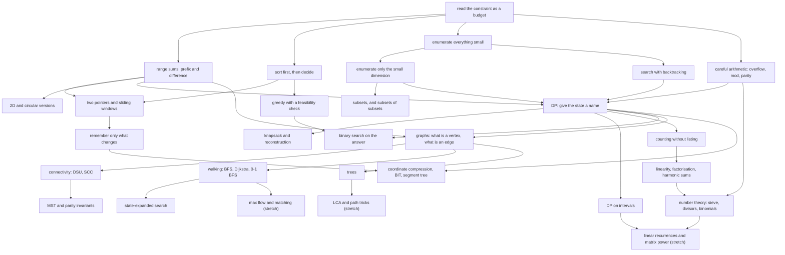

# Lesson Guide: Typical90 — Ninety Problems, One Idea at a Time

stage: 2
source: courses/typical90/sources/ (INDEX.md + 001.md … 090.md, all 90 cards complete)
scope: All 90 AtCoder Typical90 cards, in one deliberate pass, for maximum absorption. The concept ceiling is **Codeforces ≤ 2000**: everything tagged `core` or `edge` below is inside that ceiling, and `stretch` cards are above it — kept because they are interesting and because they explain *why* the ceiling sits where it does, never used as a blocker.

Tags used throughout:
`core` = needed for the 2000 frontier · `edge` = sits right at 1800–2100, worth full absorption · `stretch` = above the ceiling, take it slowly and happily drop out mid-way.

---

## Where the Student Stands

Measured by ten graded probes, all with working shown. **Ten for ten at the conceptual level; nothing failed.** The plan below is built for someone who is *fast, formal and careful*, and whose live risks are narrow procedural habits rather than missing foundations.

- **Solid on (verified — lean on it, do not re-teach it):**
  1. **Cost arithmetic.** Derived Σ i = n(n−1)/2 unprompted and converted 5×10^9 ops into "~50 seconds" without being told. Separates *how many* from *does it fit*.
  2. **The prefix-sum identity.** Stated `S[l−1] + A[l..r] = S[r]` immediately and cleanly. Counting with it is a separate skill — see the crack below.
  3. **Recursion call-counting.** Enumerated the `f(5)` tree to 15 calls via `T(n) = 1 + T(n−1) + T(n−2)`, and knows the call count is not the return value. Do not spend board time on Chapter 7's base cases; they are already understood.
  4. **64-bit widening.** Chose exactly `1LL*a*b` and `(long long)a*b`, rejected cast-after-product and `long long x = a*b`. States "widen the first operand" as an existing habit.
  5. **Bitmask vocabulary.** `1<<20 ≈ 10^6`, the `2^n·n` budget, `mask=13 → bits 0,2,3`, `mask=0` is the empty subset, and the loop runs `2^n` times not `2^n−1`. Chapter 5's enumeration idiom will land in one pass.
  6. **Signed modulo.** `(3−5)%7 = −2`, and volunteered the `((a−b)%M+M)%M` fix before being asked.
  7. **A graph as data.** Read `dist[5]=3` off an edge list, and *volunteered* that the matrix's real advantage is O(1) edge lookup — i.e. they understand the trade, not just the memory number.
  8. **Two pointers, with a proof.** Gave an independent, complete, symmetric safety argument for `l++`. Monotone-predicate reasoning is therefore already available — Chapter 14 is a *naming* chapter for them, not a new idea, and can be moved earlier in spirit (see Ch 14 notes).
  9. **Boundaries.** Interior cells at H=1,W=5 → 0, and named `(H−2)(W−2) = −3` as the trap before being asked. This is why Chapter 1 skips the boundary sermon.
  10. **Log cost.** `for(i=1;i<=n;i*=2)` at 10^6 → 2×10^7 with O(N log N) reasoning, base 2 not base 10. The `log₂ 10^6 ≈ 20` reflex is installed, which Chapter 14's binary searches and Chapter 16's trees both spend.

- **Areas to watch and build in live problem solving:**

  **(A) Counting discipline — the one live risk.** On "count zero-sum subarrays of `{3,−3,1,−1,2}`" they produced **2 instead of 3**, by enumerating `l..r` pairs by eye and missing `[3..4]`. The identity was right; the *count* was wrong. Once shown the mechanical rule — bucket the S-indices by value, add `C(k,2)` per bucket — a two-bucket re-probe (`{1,−1,1,−1}` → 4) came back perfect with every bucket enumerated, and they self-diagnosed it as "a human counting mistake". The pattern to note is: **reproduces derivations reliably, but defaults to inspection over mechanisation whenever the case looks small.** Typical90 counts constantly — `C(k,2)` per bucket appears again almost verbatim in **021** (SCC sizes), triangular counts in **084** (`d(d+1)/2` per run) and **082**, multiplicities in **063**, and complement-counting in **080** and **017**. Watch that they set up explicit bucket/run/class decompositions rather than eyeballing small examples.

  **(B) Language rules in live C++.** In probing they answered the overflow and negative-`%` questions accurately, while referring to them as "a quirk of the language". Because no C++ has been written yet in the course, watch how naturally widening (`1LL`), safe modulo (`((a−b)%M+M)%M`), and division-before-multiply overflow guards (`038`) show up in their actual code on Chapters 1, 7, and 16.

  **(C) Unmeasured in prose probing (will show up naturally in the cards):**
  1. **Mining constraints for the technique** (e.g. `024`, `055` in Ch 1; `016`, `085` in Ch 4; `063`, `086` in Ch 5).
  2. **Translating a clear mathematical proof into clean code and debugging own WAs.**
  3. **Open-ended search / novelty problems where no standard template applies** (e.g. `025` in Ch 4, `072`/`088` in Ch 6, `039` in Ch 13, `074` in Ch 17).

- **Pacing preference to honour:** comfortable depth over breadth; **one to three cards per sitting is fine, no sprinting.** The chapter sizes below are set to that, not to a schedule. If a chapter takes two sittings longer than the estimate, that is the course working as designed.

---

## Concept Dependency Map

**Already owned** (skip the derivation, go straight to the card): node **A** (read the constraint as a budget), node **B**'s identity (as an equation — *not* its counting use), node **E**'s two rules (as knowledge), the bitmask vocabulary under **D**, and sortedness under **C**. **Genuinely new in the first ten chapters:** node **G** (2D difference arrays), node **N** (counting as structure), and node **K** (naming a state) — those three are where the real teaching time goes.

---

## The Ramp

Sittings are retuned for the measured frontier: chapters the probes cleared are compressed, chapters with a live crack or an unmeasured unknown keep their time.

| # | Chapter (plain English) | Cards | n | Load-bearing idea | Sittings | Frontier note |
|---:|---|---|---:|---|---:|---|
| 1 | Reading the constraint as a budget | 024 022 027 033 055 067 038 020 | 8 | estimates decide the design | 3 | arithmetic verified; focus on constraint mining and overflow boundaries (038, 020) |
| 2 | One array, many range questions | 004 010 084 064 028 081 076 | 7 | a range is two stored numbers | 3 | 004/010 are near-free; 084 tests bucketed run-counting, 076 is the circle test |
| 3 | Order first, then decide | 014 007 070 048 | 4 | sorting converts a search into a scan | 2 | exchange + two-pointer already proven → fast; 007 tests the two-neighbour boundary |
| 4 | Guess-and-check that survives the limits | 002 032 016 085 023 025 | 6 | enumerate, then remove a dimension | 2 | bitmask cards are quick wins; **025 is the first true novelty** |
| 5 | Enumerate the small dimension | 063 086 080 045 | 4 | the odd constraint is the door | 2 | 063 = row-subset × column-multiplicity product; 080 = inclusion–exclusion |
| 6 | When the structure is too weird for loops | 072 088 | 2 | backtracking and pigeonholes | 1 | both are open-ended search / pigeonhole problems |
| 7 | DP: give the state a name | 050 008 042 046 069 | 5 | state + transition + base case | 3 | load-bearing; recursion is already solid → spend it on *counting* DPs |
| 8 | Packing decisions into a bag | 056 011 051 | 3 | choose-or-skip, then reconstruct | 2 | 011 is heavy (proof + 2D table) |
| 9 | Into and out of an interval | 019 | 1 | last-move reasoning on a range | 1 | new *shape*, not new trick; even-length parity is the whole card |
| 10 | Counting without listing | 052 082 066 015 | 4 | sum/product structure, never enumerate | 2 | the counting chapter proper; 015 tests stars-and-bars with forced gaps |
| 11 | Graphs: what is a vertex, what is an edge | 078 012 068 021 058 054 071 | 7 | model first, algorithm second | 4 | **021 replays the C(k,2) bucket identity on SCCs** |
| 12 | Walking the graph | 013 043 | 2 | distances are a *state* too | 2 | 043 = state expansion; the hinge into Ch 17/21 |
| 13 | Trees: the graph with no choices | 003 026 039 073 | 4 | one path, one root, one direction | 2 | 026 is one line for a prover; 073 is the first real tree DP |
| 14 | Turn the answer into a yes/no question | 001 006 060 087 | 4 | monotone predicates | 3 | **reordered**: 001 first, since monotonicity is already proven |
| 15 | Two pointers and sliding windows | 034 089 | 2 | the right end never moves backwards | 2 | 089 is the `edge`-tier final exam |
| 16 | Remember only what changes | 061 044 029 037 | 4 | lazy state, compression, range queries | 3 | 044 = negative-modulo index shift; 029/037 both need a built-by-hand tree |
| 17 | Order does not matter | 079 074 062 049 057 | 5 | invariants and reverse time | 3 | **reordered**: 074 early, it rewards guess-then-prove |
| 18 | Games | 031 | 1 | XOR of independent games | 1 | self-contained; good bad-day card |
| 19 | Number theory beyond the warm-up | 030 075 065 | 3 | factor structure is sparse | 2 | 065 is stretch-in-a-core-chapter |
| 20 | Coordinates | 018 036 041 | 3 | geometry is algebra you can see | 2 | 018 = continuous trig vs 020's discrete inequality |
| 21 | Stretch: bigger machinery | 009 017 059 047 053 035 083 077 040 005 090 | 11 | the ceiling, and what lies above it | 4–6 | do **009, 017, 059, 047** at full depth; taste 053/035/083/077; park 040/005/090 |

## Topic-by-Topic Guide

### 1. Reading the constraint as a budget
*(8 cards — 3 sittings. Arithmetic is verified; focus is on mining constraints for hidden bounds and catching overflow boundaries before they bite.)*

**Sitting plan.** Sit 1: 024, 022, 027. Sit 2: 033, 055, 067. Sit 3: 038, 020.

- **Problems (teaching order):**
  1. 024 Select +/− One ★1 `core` — https://atcoder.jp/contests/typical90/tasks/typical90_x
  2. 022 Cubic Cake ★1 `core` — https://atcoder.jp/contests/typical90/tasks/typical90_v
  3. 027 Sign Up Requests ★2 `core` — https://atcoder.jp/contests/typical90/tasks/typical90_aa
  4. 033 Not Too Bright ★2 `core` — https://atcoder.jp/contests/typical90/tasks/typical90_ag
  5. 055 Select 5 ★2 `core` — https://atcoder.jp/contests/typical90/tasks/typical90_bc
  6. 067 Base 8 to 9 ★2 `core` — https://atcoder.jp/contests/typical90/tasks/typical90_bo
  7. 038 Large LCM ★3 `core` — https://atcoder.jp/contests/typical90/tasks/typical90_al
  8. 020 Log Inequality ★3 `core` — https://atcoder.jp/contests/typical90/tasks/typical90_t

- **Frontier note (why this order).** `055` and `067` are swapped relative to the printed numbering so that sitting 2 runs **033 → 055 → 067**: the two cards that punish copy-paste arithmetic arrive together right after 033. `038` and `020` are deliberately last and paired: they are the two cards where the *arithmetic itself* is the problem.

- **Why the naive way breaks & the core idea:** Two habits are being installed here, and neither is a technique.
  **(a) N is a cost, not a number.** 055 looks hopeless: five nested loops at N = 100 reads like 10^10. But the number of *five-element subsets* is N(N−1)⋯/(5!) = (1/120)·N^5 ≈ 8×10^7 — the constant is the whole problem. The lesson: before rejecting a brute force, count the actual number of cases, not the number of loop levels. **This student will get this in one pass** (they already separate "how many" from "does it fit"), so the real meat is the *reason the constant is 120* — the overcounting-and-divide idea — rather than the estimate.
  **(b) The statement's own guarantees are a budget.** 024 asks whether exactly K operations reach B from A. The naive search over "which operation, in which order" is infinite even for tiny K. What saves it: each single step changes one element by ±1, so the *minimum* number of operations is Σ|A_i − B_i|; anything beyond that must be spent in pairs. "Exactly K" therefore splits into "at least" plus a parity check. The load-bearing sentence in the statement that makes the problem finite is "each operation changes exactly one element by exactly 1".
  The other six cards each break a different wrong instinct:
  - 022: cutting a cuboid into equal cubes looks like a search over side lengths → it is a divisibility question, and the best side is the **largest common divisor**. (`gcd`, and its O(log) cost, appears as a *fact*, not a tool yet.) Treat as a 5-minute win; the only content is "equal cubes ⇒ side divides all three".
  - 027: "was this name seen before?" is a memory question. Re-scanning the prefix is O(N²); the instinct to install is *keep a set of what you have seen*. Straightforward implementation warm-up (`unordered_set` vs `set` is irrelevant; the main slip is forgetting that the *first* occurrence is the one to output).
  - 033: a counting problem with an ugly local condition. Partitioning the grid into disjoint 2×2 blocks bounds how many lights can be on; lighting every cell with both coordinates odd attains the bound. The break: the 2×2 condition is **vacuous** when H = 1 or W = 1, and the bound then collapses. **They already answered the H=1,W=5 boundary correctly in probing** — so skip the boundary sermon and verify only that their code handles `H = 1` or `W = 1` cleanly.
  - 055: see (a). Sharpen with: with A_i = 10^9, three factors already exceed 2^63 — so the reduction after every factor is not style.
  - 067: converting base 8 → base 9 directly is hard, so pass through base 10: read the digits, then repeatedly take the remainder mod 9. The break: an "8" digit must be rewritten as "5" after every one of the K rounds, or the next read is not a base-8 numeral at all. This is the *same class* as 055's "reduce after every step".
  - 038: `lcm(a,b) = a*b/gcd` overflows *before* you can test whether it exceeds 10^18. Divide first (`b/gcd`), then test the **quotient** against `10^18 / a`. The intuition "just use long long" is exactly the bug: widening the first operand (`1LL * a * b`) is *insufficient here* because `a * b` can reach `10^{36}`, so this card tests overflow avoidance via division before multiplication.
  - 020: comparing log₂a with b·log₂c in floating point gives the wrong answer on the one input where the values differ by ~10^-19 (`13^17 = 8650415919381337933`). Monotone ⇒ compare a with c^b in integers. The general instinct: floating point is a *presentation* format, not a decision format.

- **Sharp edges & optional variations (use as needed):**
  - 024 — "exactly K" vs "at most K": ask what changes if the operation may also *swap* two elements (the parity argument dies; the reachable set becomes everything). This is a genuinely non-vacuous variation: it changes the answer from a parity test to always-Yes, and it is the fastest way to check they modelled parity rather than memorised "sum of differences".
  - 033 — push the student to H = 1, W = 7; the formula must give 7, not ⌈1/2⌉·⌈7/2⌉.
  - 038 — A = B = 10^18: lcm is exactly 10^18, which is *not* "Large". The bound is `≤`, not `<`. (This is the input where a "test q > LIMIT/a" guard and a "test q >= LIMIT/a" guard differ — worth making them decide on purpose.)
  - 055 — reduce after every factor, once, and let them watch it break under sanitizer.
  - 067 — N = 0 as the starting numeral; also K rounds when the numeral is already single-digit. (`long_to_base9` in the source has no N=0 branch.)
  - 020 — the equality boundary a = c^b. If they wrote `>` they are wrong here; if they wrote `>=` they are right. Make them derive which.

- **Private teacher notes (source):** 055's printed snippet contradicts its own warning (it overflows as shown; the reference reduces mod P per factor). 067's slide bound "number of base-9 digits = ⌊log₉N⌋" is off by one, and its `long_to_base9` has no N = 0 branch. 038's slide demonstrates with B = 9×10^18, which violates the stated constraint B ≤ 10^18 — the point survives, the number does not. 020's slide shows *that* floating point fails but never shows *how far apart* the two values are; 13^17 = 8650415919381337933 sits one above the input, and that gap is the whole demonstration.

---

### 2. One array, many range questions
*(7 cards — 3 sittings. 004 and 010 are near-free; 084 tests bucketed run-counting; 076 is the circle test; 028/081 are the genuine new tool.)*

**Sitting plan.** Sit 4: 004, 010, 084. Sit 5: 064, 028. Sit 6: 081, 076.

- **Problems (teaching order):**
  1. 004 Cross Sum ★2 `core` — https://atcoder.jp/contests/typical90/tasks/typical90_d
  2. 010 Score Sum Queries ★2 `core` — https://atcoder.jp/contests/typical90/tasks/typical90_j
  3. 084 There are two types of characters ★3 `core` — https://atcoder.jp/contests/typical90/tasks/typical90_cf
  4. 064 Uplift ★3 `core` — https://atcoder.jp/contests/typical90/tasks/typical90_bl
  5. 028 Cluttered Paper ★4 `core` — https://atcoder.jp/contests/typical90/tasks/typical90_ab
  6. 081 Friendly Group ★5 `core` — https://atcoder.jp/contests/typical90/tasks/typical90_cc
  7. 076 Cake Cut ★3 `core` — https://atcoder.jp/contests/typical90/tasks/typical90_bx

- **Frontier note (why this order).** 084 moves from fifth to **third**: it is the first card in the course that is *purely a count*, arriving while the probing lesson is fresh. 076 moves to the end: it stacks prefix sums, a doubled array, **and** a two-pointer search, so it is the chapter's real test. 064 sits in the middle as deliberately the *hardest reasoning* of the first five cards.

- **Why the naive way breaks & the core idea:** **A contiguous range answer is the difference of two stored numbers.** Everything in this chapter is that sentence wearing a different costume, and the student should be made to say it themselves in 064 and again in 076. They already state the identity correctly and unprompted, so the teaching work is not the identity — it is the *bookkeeping at the ends* and the *counting*.
  - 004: summing H+W−1 cells per cell is O(HW(H+W)). The waste: the row part is identical for every cell in the row. Store the row sums and column sums once → `Row_i + Col_j − A[i][j]`. The `− A[i][j]` is not cosmetic; without it the shared centre is counted twice. *They will produce this in under a minute; spend the time on the 1×W sanity check below and move on.*
  - 010: two interleaved classes. Keep **one array per class**, `S_x[i] = Σ_{j ≤ i, class j = 1} P_j`; each query becomes two lookups. The instinct "prefix sums, but I need two of them" is the whole card. Subtle boundary trap: answering with `S_R − S_L` instead of `S_R − S_{L−1}` survives every query whose `L`-th student belongs to the *other* class, so an off-by-one can hide behind a class filter.
  - 084: count substrings containing both `o` and `x`. Both solutions are worth showing — the complement (total − all-`o` runs − all-`x` runs, using d(d+1)/2 per maximal run) and the cumulative scan (for each right end, the number of valid left ends is the *smaller* of the two most recent positions). The first teaches decomposition, the second teaches "sweep and remember the last time each thing happened". Note that `d(d+1)/2` per run is `C(d+1,2)` over run boundaries — the identical bucket-counting shape to the prefix-sum probe's `C(k,2)` per bucket.
  - 064: the objective is a sum of |adjacent differences| and the update is "add V to a whole range". Interior adjacent pairs both move by V *and cancel*; only the two boundary differences change. So store the **difference array** and keep a running total of |B|. O(N + Q). The transferable half is "an update that looks O(N) is O(1) in the right coordinate system" — the same sentence that later explains 029.
  - 028: N rectangles, report the area covered by exactly k. Per-cell coverage is a **2D difference array**: +1 at two corners, −1 at the other two, then one horizontal and one vertical prefix pass. The student should be asked to draw the four corner markers on a 4×4 grid and check one cell by hand. **This is the chapter's only genuinely new tool** — everything else is a re-arrangement of something they own.
  - 081: two conditions that look coupled (`height spread ≤ K` **and** `weight spread ≤ K`) but are actually "both coordinates lie in a window of width K". Plot the points; a valid team is exactly the points inside an axis-aligned K×K square; a 2D prefix sum counts each square in O(1). The *insight* is the 2D-ness, so the 028-to-081 pair should be back-to-back in the same sitting if energy allows.
  - 076: a circle is awkward, so **write it twice**. Every arc becomes an ordinary interval of the doubled row; with prefix sums the question is "does `B_R − B_L` equal `total/10` exist?" — a two-pointer or binary search. The instinct "a circle is a line with a seam I have to handle" is what we are removing. **This card is a decision, not a count** — the output is Yes/No, so the two-pointer may stop at the first hit and there is nothing to bucket. The two things to insist on: the window being maintained is a *sum of a contiguous arc*, and the doubled array is what makes `B_R − B_L` well-defined across the seam.

- **Sharp edges & optional variations (use as needed):**
  - 004 — a 1×W grid: the answer for each cell is the whole row sum. Good check that the `− A[i][j]` is placed correctly. With the footing verified, this is the *only* boundary check needed for 004.
  - 010 — the L = 1 query, i.e. `S_R − S_0`; this is *why* `S[0] = 0` must exist. They already know it — state it once as a reminder of the probe and move on.
  - 064 — L = 1 and R = N are the two updates where one of the two boundary differences falls off the array. Ask which guard is load-bearing before writing it.
  - 028 — k = 0 (area *not* covered) and rectangles that touch only at a corner.
  - 076 — total not divisible by 10 ⇒ answer is immediately No; and the chosen arc may use at most N of the 2N doubled positions, so the left end only needs to range over the first copy. Variation with teeth: an arc that wraps more than halfway around — legitimate, and the doubled array handles it while the `L ≤ N` restriction must still hold.
  - 081 — students whose coordinates are outside every window; K = 0 (each distinct point is its own team).

- **Private teacher notes (source):** 010's slide snippet is mis-indexed (loops `x` but tests `C[i]`/`A[i]`), and the table's score row invites the misreading that the prefix sum covers both classes. 028, 081, 084 are clean. 076 silently assumes 10 | total; the reference checks `B[N] % 10 != 0`. 064's guards on `B[L−1]` and `B[R]` are load-bearing and unstated; an unguarded `B[0] += V` corrupts only the total, not the array.

---

### 3. Order first, then decide
*(4 cards — 2 sittings. Fast chapter: the exchange argument and the two-pointer safety proof are already verified. Focus is on defending an exchange/convexity greedy argument rigorously and the two-neighbour boundary on 007.)*

**Sitting plan.** Sit 7: 014, 007. Sit 8: 070, 048.

- **Problems (teaching order):**
  1. 014 We Used to Sing a Song Together ★3 `core` — https://atcoder.jp/contests/typical90/tasks/typical90_n
  2. 007 CP Classes ★3 `core` — https://atcoder.jp/contests/typical90/tasks/typical90_g
  3. 070 Plant Planning ★4 `core` — https://atcoder.jp/contests/typical90/tasks/typical90_br
  4. 048 I will not drop out ★3 `core` — https://atcoder.jp/contests/typical90/tasks/typical90_av

- **Frontier note.** Do **not** re-derive `lower_bound` mechanics or "sortedness lets you scan" — both probes landed. The two things worth the time: (i) 014 is the first place they must produce an exchange argument *in their own words* while a grader-style reader could object, and (ii) 007's boundary trap (checking only the next element from `lower_bound`, never the previous).

- **Why the naive way breaks & the core idea:** Sorting does not "make it faster" — sorting *destroys the choices*. Once the data is in order, the local decision stops depending on the rest.
  - 014: matching homes to schools to minimise total distance. Any two matching segments that cross can be uncrossed without increasing the cost (the student should draw the two cases and see the sum is unchanged or smaller). Hence pairing the i-th smallest home with the i-th smallest school is optimal — a *proof by exchange*, and the first one in the course. **They will produce the correct pairing immediately.** The sitting's real content is making them state the uncrossing inequality concretely: for `a ≤ b ≤ c ≤ d`, `|a−c| + |b−d| ≥ |a−d| + |b−c|`. A verbal "you can uncross them" is not enough for a student this formal, and it is exactly the kind of statement that later fails on a grid.
  - 007: for one query, the closest rating is either the first one ≥ the query or the one just before it. That needs the array sorted plus a binary search; then the answer is the better of **two** neighbours, not one. The instinct to check both is the card. Looking only at `lower_bound` (never the element before it) fails whenever the query sits closer to the rating *below* it, e.g. ratings `{10, 20}` with query `14`: `lower_bound` gives 20 at distance 6, while 10 is at distance 4. Note that a query below every rating is **not** a counterexample to that omission; the failing test lives in the middle of a gap, while a query below every rating tests the `it != begin()` boundary guard.
  - 070: |X−a| + |Y−b| — the two coordinates never talk to each other, so the problem is two independent 1-D problems, and a sum of absolute distances is minimised at a **median**. The break: moving the target right by 1 changes the total by (#left − #right); at a median that count stops being negative. **They have not met a convexity argument yet**, so this is the chapter's one piece of new reasoning: the *derivative as a count* is a transferable idea (it returns in 074 as a potential and in 048 as a marginal value).
  - 048: with K minutes and N problems, each minute is one of exactly 2N moves (start problem i for B_i, or upgrade it from partial to full for A_i − B_i), each usable once. Upper bound: the sum of the K largest values. The card's real content is showing the bound is **achievable** — and that is exactly where the constraint A_i/2 < B_i earns its keep (if the upgrade is among the top K, the start move was strictly bigger and came earlier). This is the chapter's hardest card and the one where "I proved a bound" and "I proved it's attainable" must be separated out loud; a bound without attainability is the classic half-proof.

- **Sharp edges & optional variations (use as needed):**
  - 014 — two schools at the same position; negative positions. (Cheap; use only if the uncrossing inequality was stated sloppily.)
  - 007 — query smaller than every rating, larger than every rating, and exactly equal to one (the `lower_bound` boundary).
  - 070 — even N: an *interval* of medians minimises the sum, not a unique point. Ask whether the answer changes. (It does not — but the student must see why. For a student this formal, "the objective is flat on the median interval" is the sentence that makes it click, and it also explains why `a[N/2]` works without averaging.)
  - 048 — ties at the K-th largest value; A_i/2 = B_i is excluded by the constraints, which is worth pointing out as "the problem is telling you something". Variation with teeth: ask what breaks if A_i/2 < B_i is dropped (the greedy's achievability argument collapses, and the true optimum becomes a knapsack).

- **Private teacher notes (source):** 014's crossing-elimination is asserted with "whatever the case", not case-checked — do the four relative orders on the board. 007's slide asserts "the optimum is one of two candidates" with no V-shape argument, and its figure captions are garbled (the examined values 42 → 69 → 58 are the reliable part). 048 compresses the achievability induction into one parenthetical. 070 never mentions convexity, the median interval for even N, or the ~2×10^14 answer size (which matters: they will reach for `int`).

---

### 4. Guess-and-check that survives the limits
*(6 cards — 2 sittings. The bitmask cards are quick wins; 025 is the first genuine novelty.)*

**Sitting plan.** Sit 9: 002, 032, 016. Sit 10: 085, 023, 025 (025 alone if it runs long).

- **Problems (teaching order):**
  1. 002 Encyclopedia of Parentheses ★3 `core` — https://atcoder.jp/contests/typical90/tasks/typical90_b
  2. 032 AtCoder Ekiden ★3 `core` — https://atcoder.jp/contests/typical90/tasks/typical90_af
  3. 016 Minimum Coins ★3 `core` — https://atcoder.jp/contests/typical90/tasks/typical90_p
  4. 085 Multiplication 085 ★4 `edge` — https://atcoder.jp/contests/typical90/tasks/typical90_cg
  5. 023 Avoid War ★7→easy `core` — https://atcoder.jp/contests/typical90/tasks/typical90_w
  6. 025 Digit Product Equation ★7 `edge` — https://atcoder.jp/contests/typical90/tasks/typical90_y

- **Frontier note (why this order).** 016 and 085 move **ahead** of 023: they are the two cards in the chapter that genuinely eliminate a dimension, whereas 023 is subset enumeration the student will see through instantly (and the source's ★7 is misleading). Putting 023 fifth means it functions as a *reward* and as the constraint-mining test — "you said HW ≤ 16 is the budget; now believe it" — rather than as filler. 025 is last and is the first card where **no previously taught technique applies**.

- **Why the naive way breaks & the core idea:** Learn to read N ≤ 20 as "2^N", N ≤ 10 as "N!", and HW ≤ 16 as "2^16", *before* looking for an algorithm. Then learn the second move: **delete a dimension from the brute force.** The probing showed the first half of this is complete (bitmask budget and `2^n` vs `2^n − 1` both correct), so the chapter's whole weight is on the second half.
  - 002: 2^N candidates, and validity is two cheap tests — running balance never negative, ends at zero. The card is really about the *encoding*: one integer `i` in `[0, 2^N)` read bit by bit, so N nested loops become two. Emitting `'('` for bit 0 gives lexicographic order for free. With the bitmask vocabulary verified, this is a clean execution card; the main slips are the lexicographic tie-break direction and the odd-N / N = 0 boundary (where an unguarded loop prints one empty line).
  - 032: N! ≤ 3.6M permutations, each verified in O(N) by walking the order and checking adjacent "dislikes". The precomputed `kenaku[x][y]` table turns each check into an array lookup. Fast card; the *only* interesting decision is the "no valid order" sentinel (the reference prints −1) and N = 1.
  - 016: three coin counts, three nested loops → 10^12. But once two counts are fixed the third is forced: `z = (N − Ax − By)/C`. O(L²) with L ≈ 10^4. **One degree of freedom is not free — it is determined.** Note the exact loop bound: `min(9999LL, N / A)`, since bounding only by `9999` or using the wrong denomination causes TLE or negative remainders.
  - 085: count triples a·b·c = K with a ≤ b ≤ c. Every one of a,b,c divides K, and K ≤ 10^12 has at most ~6700 divisors, so enumerate *divisor pairs* and force c. The break: the naive divisor-triple loop is still ~5×10^10. Here the budget does not come from N, it comes from **τ(K)** — a number the student has to estimate, not read.
  - 023: this card is rated ★7 in the source's star scale but is nothing more than 2^(HW) ≤ 2^16 subset enumeration with a local check. Excellent card for the habit of *not trusting the star rating* — the difficulty label is about the author's intended lesson, not about the algorithm. Because the student will solve it quickly, use the surplus to make them write the local check as a *predicate on the bitmask* and argue that checking each cell once suffices (the answer must not depend on visit order).
  - 025: m − (product of digits of m) = B, count m ≤ N. The trick is an equivalence: f depends only on the *multiset* of digits, so enumerate digit strings in non-decreasing order (~C(20,10) ≈ 1.8×10^5 of them), reconstruct the unique candidate m = B + f, and test whether m's sorted digits match. **This is the first card where "search over a canonical representative instead of the objects" appears** — a genuinely transferable move, and it is not derivable from anything earlier in the course.
  - Note the *repeated shape* across 025, 046 and 063: "collapse the objects by an equivalence before enumerating".

- **Sharp edges & optional variations (use as needed):**
  - 002 — odd N ⇒ print nothing (the loop must produce zero lines, not an empty line).
  - 032 — a permutation whose *first* pair is already disliked; and N = 1.
  - 016 — N not representable exactly (must print −1 or the stated failure value). Ask the student to find a case with a two-coins-only solution.
  - 085 — K a perfect cube (a = b = c) and K with repeated prime factors; the `a ≤ b ≤ c` filter must not drop the cube case. (This is the trap that the source's own worked example dodges.)
  - 025 — leading zeros: `100` and `010` have the same digit product but only the former is a number; ask what the sorted-digit representative does about that. Variation with teeth: allow m = 0 as an input value — `f(0) = 0`, so B = 0 would count 0, and whether that is legal depends on the statement's lower bound `m ≥ 1`.

- **Private teacher notes (source):** 055 (Chapter 1) and 016 share the "estimate the constant, then eliminate a dimension" reflex — cross-reference them in the closing question. 023's slide and 025's slide are clean. 085's slide is clean. 032's is self-contained. 002's is clean, but note it never mentions the N = 0 / odd-N output discipline.

---

### 5. Enumerate the small dimension
*(4 cards — 2 sittings. One product-objective trap (063), one near-free card (086), one genuinely new idea (080), one stretch card (045).)*

**Sitting plan.** Sit 11: 063, 086. Sit 12: 080, 045 (045 may be its own half-sitting).

- **Problems (teaching order):**
  1. 063 Monochromatic Subgrid ★4 `edge` — https://atcoder.jp/contests/typical90/tasks/typical90_bk
  2. 086 Snuke's Favorite Arrays ★5 `edge` — https://atcoder.jp/contests/typical90/tasks/typical90_ch
  3. 080 Let's Share Bit ★6 `edge` — https://atcoder.jp/contests/typical90/tasks/typical90_cb
  4. 045 Simple Grouping ★6 `stretch` — https://atcoder.jp/contests/typical90/tasks/typical90_as

- **Frontier note.** No reordering needed here — this chapter's own difficulty gradient is already right. 086 should be *fast*, because bit-independence is the kind of decomposition this student does well, and 045 is `stretch` (the reusable nugget is the `3^N` submask enumeration idiom).

- **Why the naive way breaks & the core idea:** Every card here has one constraint that is *suspiciously* small. That constraint is the door.
  - 063: H ≤ 8 but W ≤ 10000. Rows are the cheap axis, so enumerate all 2^H − 1 non-empty row subsets. Once the rows are fixed, a column is usable only if all chosen rows agree in it, and the subgrid must use a single integer — so the answer for a fixed row set is (#rows) × (largest multiplicity among the agreeing columns). The connection to 027: the multiplicity count is a `map`. The objective is a **product**, and the slide never writes it: it is easy to compute the correct multiplicity vector and then return `max(multiplicity)` while forgetting `× popcount(mask)` (or vice versa).
  - 086: 12 unknowns up to 2^60 would be hopeless, but OR acts **bit by bit**, so the 60 bit-planes are independent; count the assignments satisfying all Q conditions for one bit by brute-forcing 2^N masks, then multiply the 60 answers. This is the "decompose into independent subproblems, then multiply" move from 052, applied to bits. *The student's bitmask fluency makes this the chapter's easy card; the only new thing is that the product is over planes, and that one zero plane zeroes everything.*
  - 080: count x with `A_i & x ≠ 0` for all i. Counting the **complement** — x that miss *every* A_i — is easy: x may use only bit positions where all A_i have a 0, giving 2^E. Then inclusion–exclusion over the N conditions, enumerated as 2^N subsets. The break: students try to count the good set directly and get stuck in overlaps. **This is the chapter's new idea and the only one worth a board derivation** — but do it as a two-set case first (|A| + |B| − |A∩B|) and let them generalise; the `2^N` subset sum with a sign is then their own construction, not a formula handed over.
  - 045: partition ≤ 15 points into K groups minimising the max intra-group distance. State = the set already placed, as a bitmask; transition = "the last group is some non-empty submask". It looks like 4^N (all `(b, bit)` pairs) but each point is in `b`, in `bit−b`, or in neither — exactly 3^N. This is a stretch card; the reusable nugget is only "**subsets of subsets total 3^N, not 4^N**", and the enumeration idiom `for (s = m; s; s = (s-1) & m)`. Take the nugget and leave the rest if it gets heavy — that is what `stretch` means and the student should see an example of stopping on purpose.

- **Sharp edges & optional variations (use as needed):**
  - 063 — the empty row subset is excluded by the statement; and what if W < H (transpose, or just don't care because H ≤ 8)? Ask which one the code actually relies on.
  - 086 — bit 59 vs bit 60 boundary (`W_i < 2^60`); and the case where one bit-plane has zero valid assignments, which must zero the whole product. A zero-plane test is a one-line variation that catches a product initialised to 1 and never checked.
  - 080 — x = 0 (fails every condition) and x at the top of the range; also N = 1, where inclusion–exclusion degenerates to subtraction. The N = 1 case is a genuine check that the `2^N` loop includes the empty subset with the right sign.
  - 045 — `d[one-point set] = 0` (the max over an empty family of pairs); K > N has no valid partition; the initialisation `dp[0][0] = 0` with everything else at +∞.

- **Private teacher notes (source):** 063's slide never writes the A × B objective and hides an O(H) factor inside its stated complexity; its worked example stops at the vector R = (1,5,2,4,2,3,2) without evaluating the multiplicity. 045's slide excludes neither `b = bit` (empty group) nor `b = 0`, and hides the O(2^N N²) precomputation of d[·] outside its quoted bound; it also never proves that "last group + rest" is a valid decomposition (it over-counts partitions K! times, which is harmless for a minimum). 086 and 080 are clean; 080's slide only ever writes the single-condition count, not the subset-OR form needed for inclusion–exclusion.

---

### 6. When the structure is too weird for loops
*(2 cards — 1 sitting. Both are open-ended search / pigeonhole problems.)*

**Sitting plan.** Sit 13: 072, then 088.

- **Problems (teaching order):**
  1. 072 Loop Railway Plan ★4 `core` — https://atcoder.jp/contests/typical90/tasks/typical90_bt
  2. 088 Similar but Different Ways ★6 `edge` — https://atcoder.jp/contests/typical90/tasks/typical90_cj

- **Frontier note.** The student is a prover who likes a formula; these two cards have no closed-form formula, only a search and a counting argument. The insight worth highlighting is: **"I don't need a named technique; I need an honest bound on how many things there are."**

- **Why the naive way breaks & the core idea:** Some state spaces cannot be written as nested counters because the set of legal moves depends on a *set* of already-used cells. Then recursion is not a style choice — it is the only notation that fits.
  - 072: longest simple cycle in a small grid. From each start cell, recurse into the four neighbours, never revisit a cell, and count when you return to the start. The card's real skill is a **feel for how many paths exist** (≤ 28512 for 4×4): "the structure is complicated" and "the count is small" are different claims, and only the second one matters. They already know how to count calls (`f(5)` → 15) — the same arithmetic that says Fibonacci recursion is 1.6^n is what licenses this search.
  - 088: find two different selections of cards with equal sum, subject to "at most one of X_i, Y_i". The sum of all cards is ≤ 8888, so there are only 8889 possible totals — with 8890 legal selections, two must collide. So *enumerate legal selections with a DFS* and stop the instant a total repeats. Two ideas stack: pigeonhole converts "find a pair" into "produce enough objects", and DFS produces them cheaply while maintaining a per-card conflict counter. The pigeonhole step turns an *existence* question into a *quantity* question.

- **Sharp edges & optional variations (use as needed):**
  - 072 — cycles of length 1 or 2 are not cycles of the grid; the answer for a grid with no cycle; HW ≤ 16 means one of H, W can be 1.
  - 088 — the pigeonhole count needs *more legal selections than boxes*, which is not automatic for small N; the input guarantee is what closes the gap. Ask the student to find N = 2 where the naive pigeonhole argument fails as stated. This is one of the best "where does the proof break?" moments in the list.

- **Private teacher notes (source):** 072's editorial gives no complexity bound (only the 28512 heuristic) and never states the "answer = cycle length, −1 if ≤ 2" convention. 088's slide moves from "8889 boxes" to "enumerate 8890 selections" without noticing that 8890 legal selections need not exist, and never invokes the input guarantee.

---

### 7. DP: give the state a name
*(5 cards — 3 sittings. Load-bearing. The mechanics are already there; the work is naming states and *counting* them accurately.)*

**Sitting plan.** Sit 14: 050, 008. Sit 15: 042, 046. Sit 16: 069 (+ any card from the chapter that needs a second pass).

- **Problems (teaching order):**
  1. 050 Stair Jump ★3 `core` — https://atcoder.jp/contests/typical90/tasks/typical90_ax
  2. 008 AtCounter ★4 `core` — https://atcoder.jp/contests/typical90/tasks/typical90_h
  3. 042 Multiple of 9 ★4 `core` — https://atcoder.jp/contests/typical90/tasks/typical90_ap
  4. 046 I Love 46 ★3 `core` — https://atcoder.jp/contests/typical90/tasks/typical90_at
  5. 069 Colorful Blocks 2 ★3 `core` — https://atcoder.jp/contests/typical90/tasks/typical90_bq

- **Frontier note (why this order).** 008 moves ahead of 042: it is the *subsequence-matching* template, and it returns in 060 and 089, so it should be established early. 050 → 008 is also the cleanest possible state ladder (a *position* state, then a *matched-prefix* state). **Base cases need no board time** — the `f(5)` call-tree probe settled that.

- **Why the naive way breaks & the core idea:** The naive way is "enumerate all sequences", which is exponential. The core idea is that two partial sequences which are *indistinguishable to the future* should be counted together — so the state is exactly "what the future can still tell apart", and nothing more.
  - 050: reaching step i, the last move came from i−1 or i−L. So `dp[i] = dp[i−1] + dp[i−L]`, with `dp[0] = 1` and — the part everyone gets wrong — for i < L the L-jump is unusable, so `dp[i] = dp[i−1]`. The card teaches **"the recurrence is a statement about the last move"**, and that base cases are part of the state, not boilerplate.
  - 008: count subsequences equal to "atcoder". Enumerating positions is |S|^7. State = "how many letters of the target are matched so far" — 8 states, O(|S|) transitions. This is **the** template for subsequence counting. Two things to watch: the update must go **right-to-left** over the 8 states for in-place 1D variants (otherwise one character is counted several times), and the answer is `dp[7]`.
  - 042: count multiples of 9 with digit sum K. The break: 9 | X iff 9 | digit_sum(X), so if 9 ∤ K the answer is 0, and otherwise *every* number with digit sum K qualifies. What remains is counting compositions of K into parts 1..9 — a one-dimensional DP where the state is "how much sum is left". Different flavour of state (a quantity, not a position) and worth naming.
  - 046: three values up to 10^9, sum divisible by 46. Only residues matter, so collapse each array to 46 counts and brute-force the 46³ residue triples. The lesson: reduce the state space by an **equivalence** before doing anything else. (Directly the same move as 025 and 063.) Note that the `46³ × (multiplicities)` products and accumulator can reach `~10^{15}` and require 64-bit integers.
  - 069: colour a row of blocks so that blocks at distance ≤ 2 differ. Counting left to right: K, then K−1, then K−2 forever. This is the card that teaches *"if the DP transition is the same at every step, the DP has a closed form"* — the bridge to 005 and 090 much later. Watch the three boundary cases where the closed form `K(K−1)(K−2)^{N−2}` needs guarding: `K = 1`, `N = 1`, and `N = 2`.

- **Sharp edges & optional variations (use as needed):**
  - 050 — L > N (no L-jump ever fires; answer 1) and L = 2, N = 2 (answer 2). Also the modulus: it must be applied at every addition, not once at the end.
  - 008 — a string shorter than 7 characters; the state must still reach `dp[·][7] = 0` rather than crash.
  - 042 — K < 9 (only one composition); and the `min(i, 9)` clamp that stops the recurrence from reading negative indices. Variation with teeth: K = 0 — is the empty number a number? (No; state the convention deliberately.)
  - 046 — a value that is 0 mod 46 as an input (it contributes to residue 0 and the triple (0,0,0) must include it).
  - 069 — K = 1 (answer 0 for N ≥ 2 — the closed form would produce a negative factor), N = 1, N = 2. All three are special cases the formula silently assumes away.

- **Private teacher notes (source):** 050's slide never states the i < L branch's reason and never mentions the modulus as part of the recurrence. 042's slide code **omits the `% mod`** entirely (it overflows if copied) and its `dp[i−1]+…+dp[i−9]` shorthand reads negative indices unless clamped. 008's slide has one table cell (state row 2, column 8) that contradicts the recurrence — the code is right, the table is wrong; it also mixes 0- and 1-based indices in one sentence. 069's closed form K(K−1)(K−2)^{N−2} is invalid at K = 1, N = 1, N = 2 with no warning. 046 has a typo (`C_j` for `C_k`) and never says the (10^5)³ accumulator needs 64 bits.

---

### 8. Packing decisions into a bag
*(3 cards — 2 sittings. 011 is the heavy one; 056's reconstruction walk is the transferable skill.)*

**Sitting plan.** Sit 17: 056, then 011 across the sitting boundary. Sit 18: 051.

- **Problems (teaching order):**
  1. 056 Lucky Bag ★5 `core` — https://atcoder.jp/contests/typical90/tasks/typical90_bd
  2. 011 Gravy Jobs ★6 `edge` — https://atcoder.jp/contests/typical90/tasks/typical90_k
  3. 051 Typical Shop ★5 `edge` — https://atcoder.jp/contests/typical90/tasks/typical90_ay

- **Frontier note.** No reordering. Note that 011 is the first card in the course with a **two-dimensional** DP table whose second dimension is a *time/capacity axis* after an exchange-argument sort.

- **Why the naive way breaks & the core idea:** "Choose or skip, and a running total matters" is the shape; the three cards each add one wrinkle.
  - 056: reachability, then *reconstruction*. First answer only "can exactly j yen be spent in the first i days?"; then walk the table backwards from (N, S) and at each day read off which choice is consistent. The card's transferable content is the **reconstruction walk** — many students can build the table and freeze at "now print a plan". Make sure they see *why* the walk cannot dead-end (a reachable state always has at least one reachable predecessor, by construction).
  - 011: jobs with deadlines and rewards. The naive worry is "in what order?", and the answer is a proof: among any chosen set, doing them earliest-deadline-first is never worse (exchange argument — the *second* one in the course, after 014). That proof is what lets you sort once and then run a plain 0/1 knapsack over "days used so far".
  - 051: N ≤ 40 items, exactly K chosen, total ≤ P. 2^40 ≈ 10^12 is too many, but 2^20 is nothing — so split in half, bucket each half's subset sums by *how many items were used*, sort the buckets, and binary-search the complement. This is the first card where the answer is "two enumerations and a lookup" rather than one clever structure. The **bucketing by count** is another instance of "group by a value, then count/lookup inside groups".

- **Sharp edges & optional variations (use as needed):**
  - 056 — A_i or B_i larger than S (the guard `j ≥ A_i` is the transition's whole correctness); A_i = B_i (both choices legal — no uniqueness).
  - 011 — the DP's second index must be bounded by `max(D)` (or N), not by the largest reward; an off-by-one at "job ends exactly at its deadline" is legal. Variation with teeth: `D_i = 0` for some job — is it still doable? (Under the usual statement, no, and the sorted order must not silently place it first.)
  - 051 — N = 1 and N = 40; duplicate values; the case where no subset qualifies.

- **Private teacher notes (source):** 011's slide hides the earliest-deadline-first exchange argument in a footnote and asserts it ("実はどのような場合でも"). 056's slide says "one of the two must be true" without stating the `j ≥ A_i` / `j ≥ B_i` guards, and the statement allows A_i, B_i > S. 051 is the one card in the chapter whose slide is fully clean and matches the reference code.

---

### 9. Into and out of an interval
*(1 card — 1 sitting. It introduces a DP **shape**, not a trick.)*

**Sitting plan.** Sit 19: 019 alone.

- **Problems (teaching order):**
  1. 019 Pick Two ★6 `edge` — https://atcoder.jp/contests/typical90/tasks/typical90_s

- **Frontier note.** The student's DP vocabulary in this course up to here is "scan left to right". Interval DP breaks that: the fill order is **by length**, not by position.

- **Why the naive way breaks & the core idea:** The operation is "remove two *adjacent* people", so which pairs are adjacent depends on everything removed before — the order space is exponential. The escape is to ask about the **last** move instead of the first: for the interval [l, r], either l and r leave together at the very end (everything strictly between them is already gone), or the interval splits into two intervals solved independently. That gives `dp[l][r] = min(dp[l+1][r−1] + |A_l − A_r|, min_k dp[l][k] + dp[k+1][r])`, filled by increasing length. Emphasise the general recipe: *an interval DP is "what happens last, or where does it split"*. Then the fill-order consequence: because `dp[l][r]` depends on *shorter* intervals, **length is the outer loop variable and position is the inner one**.

- **Sharp edges & optional variations (use as needed):** Only even-length intervals are feasible (someone can only leave with a neighbour) — the fill must step by 2, and the base case is the 2-element interval `|A_i − A_{i+1}|`, with `dp[l+1][r−1] = 0` for the empty interval. Ask the student to find where the naive "all lengths" loop produces nonsense. Variation worth checking on paper: does the split point need the *same parity* on both halves? (Yes — otherwise one half has odd length and is infeasible.)

- **Private teacher notes (source):** four separate omissions: even-length only, the 2-element base case, the empty-interval base case, and the parity of the split point. Also never proved: that "l and r leave last" + "split" covers every valid removal order.

---

### 10. Counting without listing
*(4 cards — 2 sittings. This is the counting chapter proper: per-term linearity on 066 and forced-gap binomials on 015.)*

**Sitting plan.** Sit 20: 052, 082. Sit 21: 066, 015.

- **Problems (teaching order):**
  1. 052 Dice Product ★3 `core` — https://atcoder.jp/contests/typical90/tasks/typical90_az
  2. 082 Counting Numbers ★3 `core` — https://atcoder.jp/contests/typical90/tasks/typical90_cd
  3. 066 Various Arrays ★5 `edge` — https://atcoder.jp/contests/typical90/tasks/typical90_bn
  4. 015 Don't be too close ★6 `edge` — https://atcoder.jp/contests/typical90/tasks/typical90_o

- **Frontier note (why this order).** 082 moves up to second: it is the chapter's purest "decompose at a structural breakpoint" card and it is `core`, so it builds confidence before the two probability/binomial cards. 015 is last because it combines a **stars-and-bars forced-gap identity** with a harmonic-series complexity bound.

- **Why the naive way breaks & the core idea:** The object being counted is exponentially large, so you never sum over objects — you sum over **structure**.
  - 052: Σ over all 6^N outcomes of the product = ∏ over dice of that die's face-sum. Expanding the product shows the two sides are literally the same sum in a different order. The card is "distributivity is a counting theorem". *Fast card for this student* — the algebra is transparent to them — so ask the sharper question: why does the factorisation survive when the faces repeat? (Because the product is over **dice**, not over face values.)
  - 082: for each x in [L, R] the integer x is written x times, and each copy costs `digits(x)` characters — so the answer is Σ x·digits(x). Split by digit length: within one length the x's form an arithmetic progression, so the sum of x over them, and the count of them, are both O(1) formulas (triangular numbers over a geometric staircase). The card's real content is **decomposition at a structural breakpoint** (the powers of 10), plus modular arithmetic that never overflows — the natural form needs a division by 2 (or by 10^9+7's inverse), and doing it safely is half the card.
  - 066: expected number of inversions = Σ_{i<j} P(A_i > A_j). This works with no independence at all, because expectation is linear — the card's whole content is that sentence. Each term is a small double loop over the two value ranges (values ≤ 100). Note that the source slide's worked example has two index typos, so tracing individual `P(A_i > A_j)` terms directly is cleaner than relying on the slide's intermediate numbers.
  - 015: count subsets of size a with pairwise gap ≥ k. Insert the a chosen balls, then insert (k−1) forbidden balls between consecutive chosen ones — leaving `C(N − (k−1)(a−1), a)`. Then sum over a; for a fixed k only a ≤ ~N/k matters, and the total over all k is a harmonic sum, O(N log N). Two lessons: the **stars-and-bars-with-forced-gaps** identity, and "the loop bound shrinks as k grows".

- **Sharp edges & optional variations (use as needed):**
  - 052 — a die with repeated face values (the factorisation still holds, but the "product over dice" is over dice, not over distinct values).
  - 082 — R = 10^d exactly (the top of a digit length), and the mod-10^9+7 division. Ask for the overflow-safe version (split by parity instead of dividing).
  - 066 — i < j ordering (the slide prints E_{1,1} where it means E_{1,2}); and pairs where both ranges are single values.
  - 015 — k = 1 must give 2^N − 1 (all non-empty subsets); a = 1 must give N. Two cheap sanity checks that catch most off-by-ones in the gap identity. Variation with teeth: k = 2, N = 4 — hand-count the answer (subsets of size 2 with gap ≥ 2: {1,3},{1,4},{2,4} = 3) and compare with the formula at both a = 2 and the full sum.

- **Private teacher notes (source):** 066's slide has two internal typos (E_{1,1} for E_{1,2}; E_{1,2} = 5/6 where it must be E_{2,3}), so the printed total 13/9 is only correct after the fix. 015 leaves the harmonic-sum proof as an exercise and derives the binomial identity only by example. 082 is clean and explicitly notes the parity-based alternative to the modular inverse. 052 is clean.

---

### 11. Graphs: what is a vertex, what is an edge
*(7 cards — 4 sittings. The chapter where modelling beats algorithms, and where 021 replays the C(k,2) bucket identity on SCCs.)*

**Sitting plan.** Sit 22: 078, 012. Sit 23: 068, 021. Sit 24: 058, 054. Sit 25: 071.

- **Problems (teaching order):**
  1. 078 Easy Graph Problem ★2 `core` — https://atcoder.jp/contests/typical90/tasks/typical90_bz
  2. 012 Red Painting ★4 `core` — https://atcoder.jp/contests/typical90/tasks/typical90_l
  3. 068 Paired Information ★5 `edge` — https://atcoder.jp/contests/typical90/tasks/typical90_bp
  4. 021 Come Back in One Piece ★5 `edge` — https://atcoder.jp/contests/typical90/tasks/typical90_u
  5. 058 Original Calculator ★4 `core` — https://atcoder.jp/contests/typical90/tasks/typical90_bf
  6. 054 Takahashi Number ★6 `edge` — https://atcoder.jp/contests/typical90/tasks/typical90_bb
  7. 071 Fuzzy Priority ★7 `edge` — https://atcoder.jp/contests/typical90/tasks/typical90_bs

- **Frontier note (why this order).** 058 moves from sixth to fifth and 071 to the end. Reason: 058 is the closer, easier idea (a walk on a functional graph must cycle) and it *wants* to be reached while 021's SCC machinery is still warm — both are "find the cycle". 071 is genuinely the hardest card in the chapter (enumerate a prefix of an exponential space), so it goes last. 078 will take ten minutes: the student already volunteered that a matrix's real advantage is O(1) edge lookup, so they understand the trade rather than just the memory bound.

- **Why the naive way breaks & the core idea:** The recurring failure in this chapter is not "I don't know the algorithm" — it is "I didn't see that this *is* a graph".
  - 078: the algorithm is a one-line count; the content is **adjacency lists, not an adjacency matrix** (10^5 × 10^5 ints is 40 GB). Install the reflex: `vector<vector<int>>` sized N+M.
  - 012: cells are vertices, adjacencies are edges; painting is "add edges to the freshly red cell's red neighbours", and the query is "same component?". The modelling is the card. (The mechanism is a DSU — the student will invent the need for one when they realise re-running BFS per query is too slow.)
  - 068: relations `T = 0, X, Y` mean "A_Y is determined by A_X". Model each relation as an edge between positions; then a query is answerable iff X and Y are in the same component, and the *value* comes from a ±1 alternation along the path. That alternation is why the DSU must carry a **sign/parity** relative to a component representative, and why pre-reading all relations is useful. This is the chapter's hardest *state design* card: the DSU stores two things, not one.
  - 021: pairs that can reach each other = pairs inside the same **strongly connected component**. Then the answer is Σ C(size, 2) over all SCCs — the exact same bucket-counting identity (`C(k,2)` per bucket, singletons contributing 0) as the prefix-sum probe. Worth teaching Kosaraju's two passes as "order by finish time, then traverse the reversed graph" and letting the student convince themselves why the second pass cannot escape an SCC.
  - 058: a deterministic map on 10^5 states. Every vertex has exactly one out-edge, so the walk must repeat; find the entry point into the cycle and the period with a visited array, then reduce K by the period arithmetically. **Periodicity converts an impossible number of steps into a subtraction.** The card is a clean instance of "the pigeonhole principle does arithmetic for you" and it pairs naturally with 088 from Chapter 6.
  - 054: the Takahashi number is a shortest-path distance — but the naive graph has an edge for every co-author pair, up to N²/2 of them. Insert **one extra vertex per paper**, joined to that paper's authors: author-to-author distances are unchanged (two half-edges instead of one), and the graph shrinks to N + M vertices. The lesson: when the edges blow up because of a *group*, make the group a vertex. Note that the "0.5 weight" device in the source slides cannot be fed directly to integer BFS — BFS the bipartite author–paper graph with unit edges and halve the distance at the end.
  - 071: precedence constraints are a directed graph, and a valid permutation is exactly a topological order. The extension is the interesting half: to output *K* orders, run a DFS that branches over "which currently-available vertex to place next" and stops after K — enumerating a prefix of an exponential space is a transferable skill, and here it is *correct* because K is small and the DFS never needs the untouched suffix.

- **Sharp edges & optional variations (use as needed):**
  - 078 — vertex 1 always has 0 smaller neighbours; parallel edges would break the count (the graph is simple).
  - 012 — painting the same cell twice; querying two cells neither of which is red.
  - 068 — a query on two positions known to be equal (the sign alternation must produce 0 difference, not "ambiguous"); queries before any relation is known.
  - 021 — a self-contained SCC of size 1 contributes `C(1,2) = 0`.
  - 058 — the start value already inside the cycle; K smaller than the pre-period. Both are the same off-by-one and both are invisible without a small hand trace.
  - 054 — researcher 1 with no papers at all (distance undefined → −1), and a paper with a single author.
  - 071 — K larger than the number of topological orders (print them all and stop); a graph with a cycle (no answer). Variation with teeth: two available vertices with equal numbers — does the tie-break matter for correctness? (No, but it does for the *count* of distinct orders, so say which question is being asked.)

- **Private teacher notes (source):** 054's "0.5-weight edges" are a conceptual device that BFS cannot consume — either double the weights or BFS the author–paper bipartite graph and halve the distances. 068's monotonicity claim ("once it's not Ambiguous it never becomes Ambiguous again") is asserted, and the ±1 formula is never written out. 071's stated bound is loose; the reference DFS is O((N+M+K)·K). 021, 058, 078, 012 are clean. 078's "10^10 entries ⇒ MLE" silently assumes 4-byte ints.

---

### 12. Walking the graph
*(2 cards — 2 sittings. 043 is the hinge into state-expanded search and deserves its own sitting.)*

**Sitting plan.** Sit 26: 013. Sit 27: 043.

- **Problems (teaching order):**
  1. 013 Passing ★5 `core` — https://atcoder.jp/contests/typical90/tasks/typical90_m
  2. 043 Maze Challenge with Lack of Sleep ★4 `edge` — https://atcoder.jp/contests/typical90/tasks/typical90_aq

- **Frontier note.** 013 is the easiest card in Chapters 11–12 and is pure implementation (two Dijkstras). Spend the second half of 013 on the *reason* it works — a route through i is a concatenation, which is only valid because distances are additive and positive. Then 043 alone, because "the state is not the vertex" is the single most transferable sentence in this half of the course.

- **Why the naive way breaks & the core idea:** Both cards are about noticing that the quantity you need is *not* a function of the vertex alone.
  - 013: the route is 1 → i → N, so the answer for each i is `dist(1,i) + dist(i,N)`. Running a shortest-path computation per i is O(N·M log N); running it **twice** and combining is the whole card. The transferable habit: when a query has a fixed start and a fixed end, precompute from *both*.
  - 043: the cost is the number of *direction changes*, which a cell cannot remember. So the state is (cell, direction) — a graph four times larger in which moving forward costs 0 and turning costs 1. All edge weights are 0 or 1, so a deque-based 0–1 BFS is O(HW). Note the free starting direction: all four `dist[start][·] = 0`, which is exactly what makes a start-equals-goal maze answer 0. This is the first card in the course where **expanding the state** is the answer, and it foreshadows 059, 074 and 083.

- **Sharp edges & optional variations (use as needed):**
  - 013 — the graph is guaranteed connected; still, ask what the code would print for an unreachable N (INF + INF overflow is a real bug).
  - 043 — start = goal (0); a 1×1 grid; a maze with no path (the reference prints a large sentinel — decide the convention deliberately). Variation with teeth: make the turn cost 2 instead of 1 — the 0–1 BFS dies (weights are now 0 and 2) and Dijkstra is needed. That single change is the cleanest way to test whether they know *why* the deque works and not just that it does.

- **Private teacher notes (source):** 043's slide never states that the initial direction is free, and names 0–1 BFS without specifying the push-front/push-back discipline. 013 is clean.

---

### 13. Trees: the graph with no choices
*(4 cards — 2 sittings. 026 is one line for a prover; 039 and 073 carry the transferable ideas.)*

**Sitting plan.** Sit 28: 003, 026. Sit 29: 039, 073.

- **Problems (teaching order):**
  1. 003 Longest Circular Road ★4 `core` — https://atcoder.jp/contests/typical90/tasks/typical90_c
  2. 026 Independent Set on a Tree ★4 `core` — https://atcoder.jp/contests/typical90/tasks/typical90_z
  3. 039 Tree Distance ★5 `edge` — https://atcoder.jp/contests/typical90/tasks/typical90_am
  4. 073 We Need Both a and b ★5 `edge` — https://atcoder.jp/contests/typical90/tasks/typical90_bu

- **Frontier note.** 003 and 026 will collapse quickly for this student (bipartite colouring is a two-line proof and they produce proofs unprompted). Let 026's surplus time go to the *non-obvious* half of 003: why the farthest vertex from an arbitrary start must be an endpoint of *some* diameter. 039 then becomes the chapter's real lesson (change the summation order), and 073 the first tree DP.

- **Why the naive way breaks & the core idea:** A tree has exactly one path between any two vertices. Every card in this chapter is a consequence, and the student should be able to *derive* the card's trick from that sentence.
  - 003: N−1 edges and connected ⇒ a tree. Adding one edge u–v creates exactly one cycle, of length (path u→v) + 1, so the answer is 1 + the tree **diameter**. The diameter is found by two traversals: BFS from any vertex to the farthest u, then BFS from u and take the maximum. Do not skip the "why" — that the farthest vertex from an arbitrary start is an endpoint of *a* diameter is the non-obvious step, and it is worth a picture.
  - 026: every tree is bipartite (2-colour it), one colour class has ≥ N/2 vertices, and a colour class is independent — so take any N/2 from the larger side. The modelling insight is that "no two chosen vertices adjacent" is exactly "choose from one side of a bipartition". Two minutes of board time; the *consequence* worth naming is that the bound ⌈N/2⌉ is tight on a path and achieved on any tree.
  - 039: sum of all pairwise distances. Reverse the summation: each edge is used by exactly `r·(N−r)` pairs, where r is the size of the subtree below it. One DFS computing subtree sizes gives every r. **Contribution per element** is the transferable idea — it reappears in 086 (per bit), 017 (per chord) and 065 (per colour count).
  - 073: cut edges so that every resulting component contains both an 'a' and a 'b'. Root the tree and carry "what does the component containing this vertex still look like?" as three states (only-a, only-b, both); combine children multiplicatively, deciding at each child edge whether to cut. This is the first genuine **tree DP**, and the reusable skeleton is: state = what the component touching the current root looks like, transition = per-child product, answer = at the root.

- **Sharp edges & optional variations (use as needed):**
  - 003 — N = 1 (the statement allows it; the reference prints 1). Also u and v already adjacent.
  - 026 — odd N: one class has ⌈N/2⌉, take N/2 from it. A path graph is a good trace.
  - 039 — N = 1 ⇒ 0; a star graph (one huge subtree); the answer's size (N = 10^5 gives answers around 10^15, requiring 64-bit).
  - 073 — a single vertex; a vertex whose children are all one type; cutting every edge (each leaf must then satisfy the condition alone, which forces the leaf's own letter).

- **Private teacher notes (source):** 003's two-pass diameter is presented as a recipe with no proof, and the "score = E+1" reduction is a footnote. 039 never proves "only cross pairs use the edge", and the slide's dp recurrence silently assumes rooting at 1. 073's printed formula for `dp[pos][2]` is cut off at the slide edge — the reference code is authoritative (`∏(dp[child][0]+dp[child][2])` for 'a'); the "two ways" sentence is garbled. 026 is clean.

---

### 14. Turn the answer into a yes/no question
*(4 cards — 3 sittings. **Reordered.** The most important chapter for the 2000 frontier, and for this student it is a *naming* chapter rather than a new idea.)*

**Sitting plan.** Sit 30: 001. Sit 31: 006, 060. Sit 32: 087.

- **Problems (teaching order):**
  1. 001 Yokan Party ★4 `core` — https://atcoder.jp/contests/typical90/tasks/typical90_a
  2. 006 Smallest Subsequence ★5 `edge` — https://atcoder.jp/contests/typical90/tasks/typical90_f
  3. 060 Chimera ★5 `edge` — https://atcoder.jp/contests/typical90/tasks/typical90_bh
  4. 087 Chokudai's Demand ★5 `edge` — https://atcoder.jp/contests/typical90/tasks/typical90_ci

- **Frontier note (why 001 first).** In probing, this student gave an independent, complete, symmetric safety proof for the two-pointer step — i.e. **monotone reasoning is already installed**. So 001 is not "the new idea"; it is the card where they learn that the thing they already do has a name and a standard shape (`predicate(M)` monotone ⇒ binary search the boundary). Starting here means the chapter's four cards all become "which predicate?", which is the actual skill. 087 stays last: it is the only one where the monotone object is a *family of instances* rather than a single parameter, and it needs Floyd–Warshall as an aside.

- **Why the naive way breaks & the core idea:** All four are "the answer is a number, but the *decidable* thing is a yes/no". The technique is: find a predicate that is **monotone in the answer**, then binary-search the boundary.
  - 001: maximise the shortest piece. Ask instead "can every piece be ≥ M?" — monotone in M, and checkable by a single greedy left-to-right scan (cut as soon as the current piece reaches M, provided the remaining bar can still yield M). Binary search over M ∈ [0, L]. This is the canonical "binary search on the answer" and the student should leave able to state *why the predicate is monotone* and *why the greedy scan is optimal* (accepting every feasible cut as early as possible can only leave more room).
  - 006: greedily take the smallest character you can *still finish from*. "Finish from" is a feasibility test, and it is answered by a precomputed next-occurrence table (`nxt[i][c]` = first position ≥ i with character c). The two-line greedy is easy; the card is the feasibility oracle and the lexicographic-then-induction argument. **The feasibility count's off-by-one** (does the character itself count toward the remaining length?) is the actual bug source.
  - 060: the sequence rises to a peak then falls, so fix the peak position L: the best left part is the longest increasing subsequence **ending at** A_L, and the best right part the longest decreasing run **starting at** A_L, giving `P_L + Q_L − 1`. Both are computed with the O(N log N) tails-array LIS — which is itself a binary search over a maintained monotone array. Careful: the anchored reading ("ending at") is what makes the formula valid, and it differs from "LIS of the prefix".
  - 087: fill the unknown edges with length x; let f(x) be the number of pairs at distance ≤ P. Raising x only lengthens paths, so f never decreases ⇒ {x : f(x) = K} is one contiguous interval, and the answer is its length. Each evaluation is a Floyd–Warshall; the two endpoints come from two binary searches. This is the "monotone **family** of instances" version of the same idea, and the frontier card for the chapter. The non-obvious step is that f is monotone *non-decreasing* here rather than non-increasing like 001's — so the binary search finds the *left* boundary of an interval and then the right one.

- **Sharp edges & optional variations (use as needed):**
  - 001 — M = 0 (always feasible); the case where the greedy's "remaining suffix ≥ M" guard changes the answer. Ask the student to build a 6-cut example where dropping the suffix guard gives the wrong answer.
  - 006 — K = |S| (answer is S itself), K = 1 (the smallest character anywhere), and the feasibility count that must include the character itself.
  - 060 — strictly increasing input (the peak is at the end); strictly decreasing (the peak is at the start); all-equal values. (The all-equal case is the one that decides whether they used `<` or `≤`.)
  - 087 — ties exactly at distance P (the count is ≤); paths that use several −1 edges; the boundary of the binary search on x.

- **Private teacher notes (source):** 001's slide omits both the greedy's optimality argument and the suffix guard (the code has both). 060's slide contradicts itself: Step 1 defines P_i as the prefix LIS, but the Step 3 values are the *anchored* LIS ending at A_i — the formula only works for the anchored reading, so re-derive it on the board. 087's monotonicity is asserted in one line; the underlying "raising x only lengthens edges" argument should be derived. 006's optimality argument stops at "[以下略]" exactly at the induction and the off-by-one in the feasibility count.

---

### 15. Two pointers and sliding windows
*(2 cards — 2 sittings. The licence for the technique is already proven; the work is combinable parts.)*

**Sitting plan.** Sit 33: 034. Sit 34: 089.

- **Problems (teaching order):**
  1. 034 There are few types of elements ★4 `core` — https://atcoder.jp/contests/typical90/tasks/typical90_ah
  2. 089 Partitions and Inversions ★7 `edge` — https://atcoder.jp/contests/typical90/tasks/typical90_ck

- **Frontier note.** 034 is nearly free — the student *independently* produced the full monotonicity safety proof in probing, including the symmetric case. Do not re-derive it; confirm it briefly and focus on the **map-of-counts bookkeeping** (add on the right, remove on the left, and the count that hits zero must be *erased* — a classic silent bug). 089 then gets a full, unhurried sitting: it is the `edge`-tier final exam and it stacks three known parts (two-pointer + BIT + prefix-sum DP).

- **Why the naive way breaks & the core idea:** A window is worth maintaining only when moving the left end cannot force the right end **backwards**. That monotonicity is the entire licence for the technique.
  - 034: let c_i be the largest right end such that A_i..A_{c_i} has at most K distinct values. Then c_1 ≤ c_2 ≤ ⋯ — dropping an element can never make the window illegal. So one right pointer only advances, one left pointer only advances, and a map holds per-value counts inside the window. O(N log N).
  - 089: partition into contiguous pieces, each with at most K inversions. Two steps: (i) the number of inversions of A[L..r] is monotone non-decreasing in L, so for each r there is a smallest valid L = cl[r], and cl is non-decreasing ⇒ one two-pointer sweep; maintaining the inversion count incrementally with a **BIT** over compressed values makes the sweep O(N log N). (ii) then `dp[r] = Σ_{t = cl[r]−1}^{r−1} dp[t]`, made O(1) per r with a prefix-sum array. This is the card where a monotone window feeds a DP; it is the most sophisticated "combination of known parts" in the list.

- **Sharp edges & optional variations (use as needed):**
  - 034 — K ≥ total distinct count (the whole array is the answer); K = 0 is not allowed by the constraints (worth reading).
  - 089 — equal adjacent values: the inversion count uses `>`, not `≥`, and the source's own first slide writes it strictly. Test A = (1,1) with K = 0 (answer 2). Also K = 0 (only constant-value pieces) and K huge (2^{N−1}).

- **Private teacher notes (source):** 034 is clean. 089's slide defines `cnt` with a strict `<` while equal neighbours are allowed by the statement (`<=` in the reference) — this is the boundary to test; the "bubble-sort swaps = inversions" identity is only sketched by two bullets.

---

### 16. Remember only what changes
*(4 cards — 3 sittings. 044 exercises negative-modulo index shifts; 029 and 037 both require building a range structure by hand.)*

**Sitting plan.** Sit 35: 061, 044. Sit 36: 029. Sit 37: 037.

- **Problems (teaching order):**
  1. 061 Deck ★2 `core` — https://atcoder.jp/contests/typical90/tasks/typical90_bi
  2. 044 Shift and Swapping ★3 `core` — https://atcoder.jp/contests/typical90/tasks/typical90_ar
  3. 029 Long Bricks ★5 `edge` — https://atcoder.jp/contests/typical90/tasks/typical90_ac
  4. 037 Don't Leave the Spice ★5 `edge` — https://atcoder.jp/contests/typical90/tasks/typical90_ak

- **Frontier note.** 044 puts the negative-modulo rule `(i − s % N + N) % N` to work directly on array indices. 029 is the chapter's real work — coordinate compression *and* a lazy range-assign structure in one card — so give it a full sitting. 037 follows naturally because it asks the same question of a DP transition.

- **Why the naive way breaks & the core idea:** Each card shaves one log or one factor by noticing that the expensive thing is *not actually changing*.
  - 061: the three operations are exactly a deque's interface. Even without a deque, one large array plus a `(cl, cr)` window of live indices gives O(1) per operation — and the x-th card from the top is `A[cl + x − 1]`. The card is "pick the data structure that matches the interface", and the sizing argument (Q front pushes) is the sharp edge.
  - 044: a right shift rotates, so the *relative* order never changes — only the offset does. Store one integer "how far have we shifted" and translate every query index through it. O(N + Q). The whole difficulty is the sign and the mod: apparent index i corresponds to original `(i − s) mod N` after s right shifts.
  - 029: bricks stacked on cells; each brick's top = 1 + max over its covered cells, then those cells all become that value. A per-cell simulation is O(NW). Coordinate compression shrinks W to ≤ 2N, after which the operation is "range max query, then range assign" — and the assignment's monotonicity (values never decrease) is what makes the simple version correct. Compression is the new tool; the "assign to a range" part is a lazy-tag pattern the student should build by hand if they have not met one. **The invariant worth saying out loud:** the value at any cell is a "water level", and each brick raises its interval to a *common* level — so the structure stores levels, and "assign" is not the same as "add".
  - 037: a knapsack where dish i consumes between L_i and R_i, so each transition reads a **window** of the previous row. Scanning the window is O(W) per state → O(NW²). A range-maximum structure (segment tree, or a monotone deque when the window slides by one) turns each transition into O(log W) or O(1). The card's real content is recognising "this DP transition is a range query" — which is this chapter's own sentence applied to Chapter 7's object.

- **Sharp edges & optional variations (use as needed):**
  - 061 — Q front pushes exhausting the buffer (start the window in the middle); the type-3 query at x = 0 / x = size.
  - 044 — s must be reduced mod N (the slide's own example uses 17 ≡ 7 mod 10), and **T = 1 (swap) uses *apparent* indices too** — so the swap must be translated through the same offset as T = 3. A solution that translates only the queries and not the swap passes every test with s = 0 and fails the first `T=2` followed by `T=1`. Variation with teeth: `T=2` twice in a row, then a `T=3` for index 1 — three lines, and it pins down whether the offset composes additively.
  - 029 — coordinates at 0; a brick covering a single compressed segment.
  - 037 — exact reachability of the final spice amount (print −1 if unreachable); `dp[i][j] = −∞` for j < L_i; V_i can be 0 or negative, so "unreachable" must not be 0. (This last point is a genuine trap: −∞ vs 0 changes the answer silently.)

- **Private teacher notes (source):** 044's prose never says to reduce the shift counter mod N, and the direction/sign convention is only demonstrated. 029's slide gives no proof of the "top = 1 + max, then assign" invariant. 037's slide calls the structure a Range *Minimum* Query while using a max, its O(NW) deque variant is asserted with no algorithm, and initialisation/infeasibility are never discussed. 061's buffer sizing is one parenthetical clause.

---

### 17. Order does not matter
*(5 cards — 3 sittings. **Reordered:** 074 second, because guess-then-prove pairs cleanly with 079's induction.)*

**Sitting plan.** Sit 38: 079, 074. Sit 39: 062, 049. Sit 40: 057.

- **Problems (teaching order):**
  1. 079 Two by Two ★3 `core` — https://atcoder.jp/contests/typical90/tasks/typical90_ca
  2. 074 ABC String 2 ★6 `edge` — https://atcoder.jp/contests/typical90/tasks/typical90_bv
  3. 062 Paint All ★6 `edge` — https://atcoder.jp/contests/typical90/tasks/typical90_bj
  4. 049 Flip Digits 2 ★6 `edge` — https://atcoder.jp/contests/typical90/tasks/typical90_aw
  5. 057 Flip Flap ★6 `stretch` — https://atcoder.jp/contests/typical90/tasks/typical90_be

- **Frontier note (why 074 second).** 074's own slide admits the formula is a *guess*. Putting it right after 079 highlights a key contrast: an experiment on small strings can *propose* a potential function, and an invariant can *certify* it. 057 stays last (`stretch`); 049 before it, because 049 is where MST appears *because* a parity invariant forced the question.

- **Why the naive way breaks & the core idea:** Each card's search space is "all sequences of operations", which is exponential or worse. The escape is always a **quantity that the operations cannot change**, or a direction of time in which the choice becomes forced.
  - 079: every operation adds ±1 to one fixed 2×2 block, so only the *counts* matter, not the order. That lets you fix a row-major order and, at each block, read off the only possible count (once you reach block (i,j), `A[i][j]` can no longer be touched). The remaining H+W−1 entries decide Yes/No. Both the algorithm and the minimality claim come from that induction.
  - 074: assign a, b, c the digits 0, 1, 2 and define the potential Σ d_i · 2^{i−1}. Every operation drops the potential by at least 1, and an operation dropping it by exactly 1 always exists — so the maximum number of operations equals the potential. The *experiments* on single-non-`a` strings suggest the formula; the two facts prove it.
  - 062: forwards, you cannot decide which item to use, because usability depends on balls that *later* items will paint. Reverse time: start all black, "un-paint", and notice that once an item becomes usable it can never become unusable again — so any available item is safe to take. Then only the bookkeeping remains (a bucket per ball, plus a queue), giving O(N). The transferable move is **"run the process backwards and the dependency disappears"**.
  - 049: flipping a contiguous interval of bits touches exactly two entries of the **difference array** — so a purchased interval is an edge in a graph on N+1 difference-positions, and an edge flips the colours of its two endpoints. Flipping along edges preserves the parity of the number of whites in each component, so all 2^N targets are reachable iff the graph is **connected**; the cheapest connected subgraph is a minimum spanning tree. The hard step is the modelling, not Kruskal: a purchased interval becoming an *edge* is the leap.
  - 057: pressing switches is XOR of row vectors over GF(2), so counting solutions is linear algebra: row-reduce, check consistency, and the number of solutions is 2^(number of free variables). Stretch, but the *shape* of the statement ("each switch flips a known set of panels") is a strong enough signal that a 2000-rated student should recognise it.

- **Sharp edges & optional variations (use as needed):**
  - 079 — negative required counts (the sign convention); H = 1 or W = 1 (no 2×2 blocks at all, so the answer is Yes iff the arrays already match).
  - 074 — the string "a" (potential 0, so zero operations); a single `c` at position 1 (potential 2).
  - 062 — N = 1; an item with A_i = B_i; an item whose two balls are the same.
  - 049 — N = 1 (no difference entry inside the interval, only sentinels); an interval covering the full row; M intervals that do not connect the graph (answer −1).
  - 057 — an inconsistent system (must print 0); the number of solutions can be 2^N, so it must be printed mod 998244353 as the statement says.

- **Private teacher notes (source):** 049's slide **contradicts itself** on the definition of the difference array (it says "same" where the algebra forces "differ") — re-derive with XOR and never quote the slide. 074's slide explicitly says the formula is a *guess* ("予測できます", "正しそうに見えますね") and never justifies superposition or attainability. 079's slide asserts the forcing invariant with no induction and its sign sentence conflicts with its own figure. 062's slide asserts the equivalence with the original problem and never proves either direction, and its monotonicity sentence is only true in the *reversed* process. 057's slide never invokes rank–nullity for the 2^(free) formula.

---

### 18. Games
*(1 card — 1 sitting. Self-contained; a good low-energy-day card.)*

**Sitting plan.** Sit 41: 031.

- **Problems (teaching order):**
  1. 031 VS AtCoder ★6 `edge` — https://atcoder.jp/contests/typical90/tasks/typical90_ae

- **Frontier note.** No adjustment needed. The Sprague–Grundy theorem is used as a black box by the source, and for a student who wants *why*, the mex argument is worth ten minutes — the whole theorem rests on "independent games combine by XOR", and that one sentence is checkable on two tiny mountains.

- **Why the naive way breaks & the core idea:** The game state is a vector of N mountains, so the state space is a product and direct search is hopeless. But the mountains are **independent** (a move touches one mountain only), so each has its own small game value, and the whole position is decided by the XOR of those values. Concretely: for each mountain, memoise mex over the legal moves on (white, blue); with both ≤ 50, the whole table is small. Then XOR all N and the first player wins iff the result is non-zero.

- **Sharp edges & optional variations (use as needed):** a single mountain (XOR = its own Grundy); a mountain already at (0,0) (no moves); a mountain whose Grundy number is 0 (it contributes nothing — good sanity check that "adding a passive pile changes nothing"). One authentic variation: what if a move could also *split* one mountain into two (a Nim-heap split)? The XOR rule still applies but the Grundy computation changes — a good way to test whether the student understands what "independent subgame" means.

- **Private teacher notes (source):** the slide's memo-array size note (51×1326 stated, 55×1555 allocated) is a safety margin, not a contradiction; the O(P^5) complexity is stated without deriving the mex cost. The theorem itself is used as a black box.

---

### 19. Number theory beyond the warm-up
*(3 cards — 2 sittings. 030 and 075 are quick; 065 is stretch-in-a-core-chapter.)*

**Sitting plan.** Sit 42: 030, 075. Sit 43: 065 (or park 065 after the reduction).

- **Problems (teaching order):**
  1. 030 K Factors ★5 `core` — https://atcoder.jp/contests/typical90/tasks/typical90_ad
  2. 075 Magic For Balls ★3 `core` — https://atcoder.jp/contests/typical90/tasks/typical90_bw
  3. 065 RGB Balls 2 ★7 `stretch` — https://atcoder.jp/contests/typical90/tasks/typical90_bm

- **Frontier note.** 075 is the better *teaching* card (invariant + attainable bound) but 030 is the better *warm-up* (a sieve with a twist), so keep this order and note that 030's content is mostly "the sieve touches multiples, not numbers". 065's transferable half is the substitution `z = K − x − y`; the convolution is a lookup.

- **Why the naive way breaks & the core idea:** Factorisation is *sparse*, and sparsity is what makes these problems finite.
  - 030: count x ≤ N with ≥ K distinct prime factors. For each prime p, add 1 to every multiple of p — a sieve whose total cost is Σ N/p = O(N log log N). The reusable idea: **for each prime/structure, touch its multiples** rather than factorising each number. The "distinct" wording is the only trap: a prime power p² must be touched once by p, not twice — so the increment happens per *prime*, not per prime power, and that is exactly why the harmonic sum is over primes.
  - 075: however the magics are ordered, the pieces at the end are exactly the prime factors of N with multiplicity, so that count K is an invariant; x magics make at most 2^x pieces; the answer is the smallest x with 2^x ≥ K. Trial division up to √N computes K. Two lessons: an invariant fixes the endpoint, and an *upper* bound that is also attainable can be the answer.
  - 065: fix how many balls of each colour are taken; for fixed counts the number of choices is a product of binomial coefficients, so enumerating all triples is O(K²). The full score replaces the "two colours ≤ limit" conditions by a lower bound on the third (because the total is exactly K) and evaluates the resulting sum as a **convolution** of two binomial arrays in O(K log K). Stretch: the transferable part is "use x+y+z = K to eliminate one variable and turn a double sum into a convolution"; the FFT is a tool you look up.

- **Sharp edges & optional variations (use as needed):**
  - 030 — K = 1 (count primes plus prime powers); x = 1 (0 prime factors, so it never counts); the sieve must not double-count a prime power.
  - 075 — N = 1 (K = 0 ⇒ 0 magics, not 1); N prime (K = 1 ⇒ 0 magics).
  - 065 — a colour limit of 0; K larger than some colour's count; the `K − i − j` index going out of the binomial array (zero-pad or guard).

- **Private teacher notes (source):** 030's keyword promises O(N log log N) while the boxed proof shows only O(N log N) — the softer bound is deliberate. 075's slide never proves the multiset invariance (it needs "a split replaces x by a·b with ab = x" plus unique factorisation) nor attainability of 2^x. 065's slides **rename the colours** (statement: red/green/blue; slides: red/white/blue) and rename the limits; the double sum silently assumes out-of-range binomial indices are 0.

---

### 20. Coordinates
*(3 cards — 2 sittings. 018 contrasts continuous trig with 020's discrete inequality; 036 is a coordinate change; 041 is stretch.)*

**Sitting plan.** Sit 44: 018, 036. Sit 45: 041 (or park it after the hull).

- **Problems (teaching order):**
  1. 018 Statue of Chokudai ★3 `core` — https://atcoder.jp/contests/typical90/tasks/typical90_r
  2. 036 Max Manhattan Distance ★5 `edge` — https://atcoder.jp/contests/typical90/tasks/typical90_aj
  3. 041 Piles in AtCoder Farm ★7 `stretch` — https://atcoder.jp/contests/typical90/tasks/typical90_ao

- **Frontier note.** In 018 floating point is *correct*, because every quantity is continuous and there is no discrete decision to make — a clean contrast with Chapter 1's 020. What can still go wrong is the radian→degree conversion and printing too few digits. 036 is fast for a student who reads algebra geometrically — the whole card is one substitution — so pair it with 018 in the same sitting and let 041 stand alone.

- **Why the naive way breaks & the core idea:** Geometry cards are won by choosing coordinates in which the awkward quantity becomes simple.
  - 018: parametrise the wheel as a circle of radius L/2 centred at (0,0,L/2); after θ = 360°·E/T the rider sits at (0, −(L/2)sinθ, L/2 − (L/2)cosθ). The depression angle is `atan2(height, horizontal distance)`. The card is honest trigonometry plus the conversion back to degrees. Floating point is fine in the *output* here because every quantity is continuous and no discrete comparison is being made (unlike Chapter 1's 020).
  - 036: the set of points within Manhattan distance K of P is a diamond; the map (x, y) ↦ (x−y, x+y) turns it into an axis-aligned square and turns Manhattan distance into `max(|Δx|, |Δy|)`. So the farthest point from a query is determined by only **four** extremes (min/max of each rotated coordinate). The transferable move: a change of coordinates that converts a coupled constraint into independent ones. (Note that the map is a rotation *and* a scale by √2, and only the rotation part matters.)
  - 041: the shortest fence is the convex hull; the lattice points to count are those inside it, so the answer is (lattice points in hull) − N. Hull by monotone-chain + cross products in O(N log N), then lattice points via **Pick's theorem**: S = i + b/2 − 1, with b = Σ gcd(|Δx|, |Δy|) over hull edges and S by the shoelace formula. Stretch, but the pieces (cross product sign, shoelace, gcd per edge) are each within reach and each individually worth owning.

- **Sharp edges & optional variations (use as needed):**
  - 018 — E = 0 (rider at the bottom); the answer is a real number with 10^-7 tolerance, and the final radians→degrees conversion is the classic omission.
  - 036 — the query point is itself one of the points; duplicate points; the four extremes when N = 1.
  - 041 — all points collinear (hull degenerates to a segment — Pick's theorem still applies and this is the hardest boundary); duplicate points; a single point; 64-bit for the answer.

- **Private teacher notes (source):** 018's slide never says the answer must be converted to degrees or that the tolerance is 10^-7, and renames the statue's coordinates. 036's slide calls (x−y, x+y) a "45° rotation" though it also scales by √2 — harmless because the formulas are used consistently, but a student who divides by √2 will be confused. 041's slide calls *both* l_i and r_i "the minimum y", which is a typo (r_i is the maximum); its subtask-2 sweep only works because x_i ≤ 1000.

---

### 21. Stretch: bigger machinery
*(11 cards — above the 2000 ceiling. Ramp note: only four of these are at the frontier; the rest are taste, and dropping out mid-card is a success, not a failure.)*

**Sitting plan (frontier-first).** Sit 46–47: **009, 017**. Sit 48–49: **059, 047**. Then, if appetite remains: 053, 035, 083, 077 as one-sitting tastes. Park 040, 005, 090 — read the idea, skip the implementation.

- **Problems (teaching order):**
  1. 009 Three Point Angle ★6 `edge` — https://atcoder.jp/contests/typical90/tasks/typical90_i
  2. 017 Crossing Segments ★7 `edge` — https://atcoder.jp/contests/typical90/tasks/typical90_q
  3. 059 Many Graph Queries ★7 `edge` — https://atcoder.jp/contests/typical90/tasks/typical90_bg
  4. 047 Monochromatic Diagonal ★7 `edge` — https://atcoder.jp/contests/typical90/tasks/typical90_au
  5. 053 Discrete Dowsing ★7 `stretch` — https://atcoder.jp/contests/typical90/tasks/typical90_ba
  6. 035 Preserve Connectivity ★7 `stretch` — https://atcoder.jp/contests/typical90/tasks/typical90_ai
  7. 083 Colorful Graph ★6 `stretch` — https://atcoder.jp/contests/typical90/tasks/typical90_ce
  8. 077 Planes on a 2D Plane ★7 `stretch` — https://atcoder.jp/contests/typical90/tasks/typical90_by
  9. 040 Get More Money ★7 `stretch` — https://atcoder.jp/contests/typical90/tasks/typical90_an
  10. 005 Restricted Digits ★7 `stretch` — https://atcoder.jp/contests/typical90/tasks/typical90_e
  11. 090 Tenkei90's Last Problem ★7 `stretch` — https://atcoder.jp/contests/typical90/tasks/typical90_cl

- **Frontier note (which four matter).** The ceiling is CF ≤ 2000, so 009, 017, 059 and 047 are the four cards here that pay for themselves; the other seven are the ceiling's *explanation*, not its requirement. **017 is a complement count** with three distinct non-crossing classes (shared endpoint, disjoint around the circle, and nested) — keeping those three classes explicitly separate is essential so none is dropped or double-counted. **059 is a bitset trick** and this student's bitmask fluency makes it the easiest of the four. **009** rewards geometric thinking.

- **Why the naive way breaks & the core idea (one line each):**
  - 009: fix the middle vertex as the origin, sort the others by polar angle, and for each A binary-search the angle closest to t_A + 180°. O(N² log N). The new skill is **angular sweep around a pivot**; the tricky part is the circular array and wrap-around, not the maths.
  - 017: two chords cross iff their endpoints alternate. Count the complement instead: pairs sharing an endpoint, pairs disjoint around the circle, and pairs nested — the last one counted with a **BIT** over the circle. O(N + M log N). This is the standard "count the complement with a Fenwick tree" pattern, and the complement is *three* classes, not one — enumerate all three or the total will be quietly wrong.
  - 059: because X_i < Y_i, the given numbering is already topological, so reachability is one sweep with `dp[v] = OR over in-neighbours`. Pack 64 queries' bits into one integer and answer 64 at a time — the **bitset trick** that turns O(Q·(N+M)) into O(Q·(N+M)/64).
  - 047: "diagonal k is monochromatic" is a **string-equality** statement once you relabel colours, so it becomes 3·(2N−1) substring comparisons, each O(1) under **rolling hash**. The lesson is the reduction, not the hash.
  - 053: an interactive unimodal search. Ternary search costs ~2 log_{1.5}N probes; binary search on the *sign of the difference* B_i = A_{i+1} − A_i costs 2⌈log₂N⌉; **golden-section** reuses one probe per step and wins the last tier. Four scoring tiers = four algorithms, which is a rare and instructive structure. (This is Chapter 14's monotone predicate, in a setting where each *look* costs something — a good closing thought on that chapter.)
  - 035: for a query set of K vertices, an edge is kept iff the number of chosen vertices below it is between 1 and K−1. For large K that is a tree DP with LCA and a DFS-order closed walk: the answer is half the length of the walk that visits the K vertices in DFS order. **Virtual-tree** material — take the small-K formulas (K = 2 is just a distance) and stop there if the machinery gets heavy.
  - 083: recolouring a high-degree vertex repeatedly is the worst case; **square-root decomposition over vertices** (degree ≥ B is "large", colours updated lazily) gives O(Q√M). The card's real content is *thinking about which input makes the naive solution slow*.
  - 077: an assignment is valid iff the multiset of shifted positions equals the reported multiset. Model it as a **bipartite graph** (planes vs positions, edge when some direction carries i to j) and the question becomes "is there a perfect matching?" — Dinic/Hopcroft–Karp. Stretch.
  - 040: "burn-or-bury" is exactly an s-t **min cut**: source→i with capacity y_i, i→sink with capacity x_i, a→b with the fine. Then map "visit house i" onto the cut side and the forbidden (visit c_ij, skip i) becomes an ∞ edge. Stretch; the transferable idea is *recognising a min cut in disguise*.
  - 005: digit DP with the remainder as state, and because the transition is the same at every digit it is a fixed B×B matrix, so N digits cost O(B³ log N). The upgrade from O(NBK) to O(B² log N) merges two blocks of 2^i digits directly. Stretch, but the first step (state = remainder, transition depends only on the state) is `edge`-level and worth having. **The bridge from 069 is exact:** "if the transition is the same at every step, the DP has a closed form" — here the closed form is a matrix power.
  - 090: a histogram whose every rectangle has area ≤ K. Build the picture top-down; the answer depends only on the level h and the interval *length* m; the resulting recurrence is linear, so the N-th term comes from polynomial division / fast Kitamasa. This is the course's ceiling card by design — the author placed it last to say that the technique barely matters and the *order of learning* does.

- **Sharp edges & optional variations (use as needed):** 009 wrap-around indexing at the array ends; 017 chords that share an endpoint (must not be counted as crossings); 059 Q < 64 and Q not a multiple of 64; 047 the two different colour encodings used by the two reference solutions; 053 golden-section with integer division and the fixed iteration count; 035 K = 1 and K = N; 083 B chosen near √M; 077 the path-shaped special case; 040 confirming which side of the cut means "visit"; 005 the answer vector's initialisation; 090 the `dp[0][1]` base case (N = 1, K = 1 gives 2, not 3).

- **Private teacher notes (source):** 047's slide writes out only the red case and the two reference solutions use different encodings — pin one convention before teaching. 053's slide demo uses a *continuous* function while the problem is discrete, and its ternary-search width can fail to shrink with integer division (hence the fixed 11 iterations in the tier-3 code). 059's two complexity boxes disagree (one drops the N term). 077's "equal red/blue counts ⇒ Yes" is only argued for path-shaped components. 040 uses max-flow = min-cut as a black box and never says which side of the cut is "visit" — the reference adds the ∞ edge as c→i, which is the fact to state. 005's slide says "O(N²)" where the state space is over B remainders. 090's printed P1 code initialises `dp[0][1] = 1`, contradicting its own table and the reference (`dp[0][1] = 0`); the P3 pruning writes h×(r−l) ≤ K with a half-open interval convention; the Bostan–Mori section is a sketch by design.

---

## Checkpoints

Natural consolidation points across the 21 chapters and the core transferable idea each block installs:

| After | Core Transferable Idea |
|---|---|
| Ch 3 | "Before I choose, I can reorder the input so the local choice stops depending on the rest." |
| Ch 6 | "The structure is complicated and the count of states is small — those are different claims." |
| Ch 9 | "The state is what the future can tell apart, the transition is what happened last, and interval DP fills by length." |
| Ch 10 | "Never enumerate the objects; sum over structure (linearity, breakpoints, forced gaps)." |
| Ch 13 | "In a tree the path is unique, so every global question decomposes over subtrees or edges." |
| Ch 14 | "Turn the optimization into a yes/no question, prove monotonicity, and binary-search the boundary." |
| Ch 17 | "When sequences of operations explode, look for a quantity the operations cannot change or reverse time." |
| Ch 21 | "Recognise when a problem crosses the 2000 ceiling into heavier machinery (flows, NTT, virtual trees, Kitamasa)." |

---

## Probing record (done — do not repeat)

The footing check was run and audited before this revision; **all ten items passed at the conceptual level**, so the probe list is retired. One-line record of what each established, because later cards rely on it:

1. Cost arithmetic — `n(n−1)/2` derived, 5×10^9 → ~50 s unprompted. *Leaned on by 055, 085, 045.*
2. Prefix-sum identity — stated correctly and immediately; the *counting* slip on small eyeball enumeration is recorded separately under Where the Student Stands. *Leaned on by all of Chapter 2, 021, 084.*
3. Recursion call-counting — `T(n) = 1 + T(n−1) + T(n−2)`, f(5) = 15 calls. *Leaned on by 002, 032, 072; base cases in Ch 7 need no board time.*
4. 64-bit widening — chose exactly the two correct forms; states "widen the first operand" as a habit.
5. Bitmasks — `2^n·n` budget, bit decode, `mask = 0` as the empty subset. *Leaned on by all of Ch 4–5, 059.*
6. Signed modulo — sign-of-left-operand, and volunteered the `+M` fix. *Put to work directly at 044.*
7. Graph as data — distance read, O(N+M) vs N², and *volunteered* the O(1)-lookup trade. *078 becomes a ten-minute card.*
8. Two pointers with proof — complete and symmetric, including why moving `r` is useless. *Chapter 15's monotonicity needs no derivation; Chapter 14 is reordered because of this.*
9. Boundaries — H=1,W=5 → 0, and named the negative-formula trap unprompted. *Chapter 1 skips the boundary sermon.*
10. Log cost — O(N log N) with base 2, 2×10^7 at 10^6. *Leaned on by Ch 14–16.*

---

## Hold Back for In-Course Discovery

These are the ideas the cards themselves are supposed to *produce*. Never name one, never hint at one, and never let a probe leak one. Each line is "the idea — first card that needs it". The probing did **not** name or test any of these techniques, so the list is intact; the parenthetical marks are the ones where this student's profile makes the discovery unusually likely to arrive fast (do not take that as permission to pre-empt). The one boundary to keep in mind: probe 8 demonstrated the *reasoning* that 034/089's licence rests on — it did not supply the licence itself (that a left pointer never needs to move backwards for a new right end), so Chapter 15 still asks for it.

- Binary search on the answer; the monotone predicate; the feasibility scan — **001** (the *monotonicity* half they already own; do not say so, let them notice the reuse)
- Tree diameter by two traversals — **003**
- 2D difference arrays (imos) — **028**
- Coordinate compression — **029**
- Union-Find / DSU; weighted DSU — **012**, **068**
- Strongly connected components — **021**
- Dijkstra; 0–1 BFS; state expansion (cell, direction) — **013**, **043**
- Minimum spanning tree — **049**
- Topological sort; DFS enumeration of the first K solutions — **071**
- Max-flow / min-cut; bipartite matching — **040**, **077**
- Interval DP — **019**
- Subset DP and the 3^N submask enumeration — **045**
- Tree DP — **073**
- LIS with the tails array — **060**
- Digit DP with a remainder state — **005**, **042**
- Inclusion–exclusion — **080**
- Linearity of expectation — **066**
- Harmonic-series counting and the forced-gap binomial — **015**
- Meet in the middle — **051**
- Rolling hash — **047**
- Fenwick tree (BIT) — **017**, **089**
- Segment tree / monotone deque inside a DP — **037**
- Bitset reachability — **059**
- Square-root decomposition — **083**
- Gaussian elimination over GF(2) — **057**
- Grundy numbers / Sprague–Grundy — **031**
- Convex hull, shoelace, Pick's theorem — **041**
- The 45° rotation for Manhattan distance — **036**
- Potential/invariant arguments; running time backwards — **074**, **062**
- Matrix exponentiation; fast evaluation of linear recurrences — **005**, **090**
- FFT / convolution — **065**
- Ternary and golden-section search — **053**
- Pigeonhole + DFS enumeration — **088**
- "Invent a vertex for each group" edge reduction — **054**
- Contribution-per-element summation — **039**
