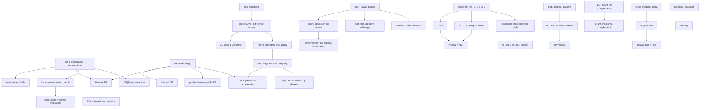
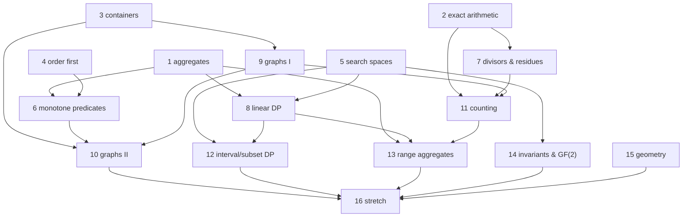

# Curriculum Blueprint: Typical90 — all 90 problems, ordered by idea

Mode: `deconstruct` (source = `courses/typical90/sources/001.md … 090.md` + `INDEX.md`).
Goal: student solves all 90, guided discovery (attempt → trace → nudge), resumable at node granularity.
Conceptual ceiling: everything up to CF ~2000; >2000 included only where the idea transfers.

This file is written for the **teacher**, not the student. It contains technique names, so it must never be shown to the student before the corresponding problem. The teacher reads it when the roadmap starts and when crossing a node boundary, then takes notes in its own words into `course.md`.

---

## 0. Frontier verification

Measured by probe on 2026-10-19, before a single node was taught. §1's strands were the diagnostic targets; the results below are what the teacher re-reads on resume when deciding how much to slow down. The strands themselves are unchanged — only their status is now known.

**One-sentence profile.** Comfortable with the standard toolset and with abstraction; will not need re-teaching of basic mechanics; will need sign/coefficient discipline enforced and proofs demanded rather than sketched.

| Strand | Status | Evidence |
|---|---|---|
| S1 cost arithmetic | **CONFIRMED FLOOR** (partial) | Self-derived `Σ_{i=1..N} N/i ≈ N ln N ≈ 1.15e6` for `N = 1e5`, explicitly rejecting the "nested loops ⇒ quadratic ⇒ 1e10" reflex. The constants / ops-budget sub-point ("is 5e10 over budget at 2 s?") was **not** measured — deferred in-node to 081. |
| S5 DP state design | **CONFIRMED FLOOR** | Exactly-capacity semantics, backward iteration = use-once, and base-case construction all correct. Sentinel model is now *directional* (below). |
| S6 graph state | **CONFIRMED FLOOR** | Spontaneously articulated "the state must record what the future needs" on a bomb/wall BFS, and diagnosed a single-`dist` model as insufficient, unprompted. |
| S10 counting | **CONFIRMED FLOOR** | On a fresh inclusion–exclusion instance produced the whole chain unprompted: complement direction, `|X| = 2·4!`, `|X ∩ Y| = 2·2·3!`, `|X ∪ Y| = 72`, `120 − 72`. No coefficient dropped. |
| S2, S3, S4, S7, S8, S9, S11, S12, S13 | **DELIBERATELY UNPROBED** | Probing them would name the technique of the problem that teaches them — a leak. S2 is curriculum-subsumed: node 1 both installs it and diagnoses it live. The rest stay unprobed and serve as each node's own first diagnostic. |

**Pinned ceiling: bookkeeping hygiene, not modelling.** Both observed misses were "correct model, one coefficient or term lost" — `−INF` treated as absorbing, and an all-equal case scored with weight 1 instead of 2. Both were repaired under probe, so the *model* is sound and the *trait* is live. Assume one sign or coefficient will vanish at any sign-heavy step; audit it in-node instead of pre-teaching it.

**Directional sentinel model (S5, confirmed).** `max(NEG, NEG + w)` drifts off `NEG` — a poisoned sentinel. `min(INF, INF + w)` stays exactly `INF` — absorbing. The overflow variant (`INF` large enough that `INF + w` wraps negative, so `min` *selects* it) was demonstrated but never produced by the student. Open item; re-tested at 037 and 089 (§6).

**Where the audit is booked.** 004's overlap cell subtracted exactly once; 028's four-corner sign pattern; 081's window subtraction. All three are node 1, and all three are coefficient/sign steps — by design, node 1 doubles as the hygiene test.

---

## 1. Prerequisite foundations (what the whole set assumes)

Each strand: what "solid" looks like, the boundary that separates real from shaky, and the smallest trace that exposes the gap. These were the teacher's first probes — binary-search the frontier, don't lecture. **Results are recorded in §0; the strands below are unchanged.**

### S1. Cost arithmetic — counting operations, not loops
- **Solid:** converts constraints into an operation count *with* the constant (`C(100,5) ≈ 7.5e7`, not `100^5 = 1e10`); knows ~1e8 cheap ops/sec for a 2 s limit; can say which of two O(1e7) loops is 20× the other.
- **Boundary:** a `Θ(N⁵)` loop that passes because the constant is 1/120, and a `Θ(N log N)` loop that fails because each iteration touches 1e6 bytes.
- **Probe:** 001 with N=1e5, L=1e9 — how many predicate calls, and what does each call cost? Then 055: "100^5 is 1e10 ops; do we TLE?" A student who says yes without computing C(100,5) is shaky. Follow with: 030 at N = 1e7 — is `Σ_{p≤N} N/p` about 1e14 operations, or about 3e7? (Answer: N log log N.)

### S2. Prefix sums, difference arrays, imos (1D and 2D, half-open vs closed)
- **Solid:** `S[i] = S[i−1] + A[i]` with `S[0] = 0`, interval sum `S[R] − S[L−1]`; range-add → two point changes on the difference array; 2D imos as four corner writes; knows whether the interval is `[l, r]` or `[l, r)`.
- **Boundary:** `L = 1` (needs the index-0 sentinel), `R = N` (the array must have room for N+1), and absolute-value summaries where writing `B[0]` corrupts the answer instead of the data.
- **Probe:** 010 with N=7, classes `1,2,2,1,1,2,1`, scores `72,89,94,23,40,78,75`, query (L,R)=(1,2): require the two prefix arrays and both answers. Then 064 with `A=(1,10,1)`, `L=R=2`, `V=−10`: ask for `mae`, `ato`, `Δ`, and which two `B` entries may change. A student who updates `B[L−1]` at `L=1` fails this.

### S3. Sorting and binary-search boundaries
- **Solid:** `lower_bound` = first index with `A[i] ≥ x`; the nearest element is at `pos` or `pos−1`; duplicate ties; `pos == end` and `pos == begin`; a *circular* sorted array needs wrap-around candidates; sorting once then Q lookups.
- **Boundary:** `x` below everything, above everything, exactly equal to a duplicated value; two equal candidates at the same distance.
- **Probe:** sorted `13 15 26 32 42 58 69 90`, `x = 50` — which indices, which one wins? Then `x = 5`, `x = 95`, `x = 58` (exact hit), then 009's circular case: angles sorted `40°,125°,180°,250°,300°`, pivot 40°, target `(40+180) mod 360 = 220` — which two entries are the candidates and why must the search wrap?

### S4. Enumeration: bit, base-N, permutation, recursion, meet-in-the-middle
- **Solid:** maps a mask ↔ a subset both ways; knows the sizes (`2^20 ≈ 1e6`, `10! = 3.6e6`, `2^40 ≈ 1e12` ⇒ split); can write a DFS that branches on one item and un-does its own state on return.
- **Boundary:** choosing *which* dimension to enumerate; excluding the empty selection; not double-counting when the recursion branches "take / don't take"; at what N the exponent stops being affordable (40, not 50).
- **Probe:** 002 for N=3 — list all 8 strings and mark the valid ones (and say why `())` fails at prefix 3). Then 051: N=40, K=20 — why enumerate 2^20 twice instead of 2^40 once, and what does each half's bucket contain? A student who says "2^40 ≈ 1e12, just optimise the loop" has not internalised the split.

### S5. DP state design
- **Solid:** writes the state as a sentence ("dp[i][j] = max reward using the first i jobs with j days used"), orders the fill so every read is already computed, names the base case, uses an unreachable sentinel (`−∞`, not `0`) and reduces mod.
- **Boundary:** the sentinel leaking into `max`/`+`; the empty interval; states that are structurally impossible (parity, adjacency) and must be excluded rather than left at 0.
- **Probe:** 050 with N=10, L=3 — ask for `dp[0..10]` (`1,1,1,2,3,4,6,9,13,19,28`) and *why* `dp[2] = 1`. Then 019 with 4 people: which intervals are even-length and what is `dp[1][2]`? Then 011: `dp[i−1][j−C_i] + S_i` when `j < C_i` — what does `dp[i−1][negative]` mean?

### S6. Graph representation and traversal
- **Solid:** adjacency list (not matrix) at N=1e5; BFS = distance layers; DFS = subtree/post-order; visited array vs parent check; tree vs general graph; can tell when the *state* is not a vertex.
- **Boundary:** the start vertex marks itself; a tree visited only by `parent` check; distances when edge costs are 0/1; whether the start's direction is free.
- **Probe:** 043 — is `dist[start][dir] = 0` for all four directions, or only one? What is the answer when start and goal are adjacent and the start's facing is unconstrained? A student who fixes the initial direction will fail sample 2 (answer 0). Then 003: why is one BFS from vertex 1 not enough?

### S7. Connectivity: DSU, SCC, topological order
- **Solid:** `find` with path compression, `unite` returning whether it merged; "connected *so far*" semantics under incremental edge insertion; SCC = mutually reachable classes, condensation is a DAG; topological order exists iff no cycle, and is producible by in-degree queue.
- **Boundary:** DSU answers about the *current* prefix of operations (offline vs online); a self-loop; two distinct SCCs with one-way reachability (not "unreachable").
- **Probe:** 068 — relations `A_1+A_2 = 5`, `A_2+A_3 = 7`; query (1,3) then (1,4). Which is determined and which is "Ambiguous"? Then: in a 3-cycle `1→2→3→1` plus `3→4`, how many SCCs, and what is the condensation?

### S8. Shortest paths
- **Solid:** Dijkstra needs non-negative weights; BFS is Dijkstra at unit cost; 0-1 BFS needs a deque and *no* visited array; `dist1[i] + distN[i]` for a "must pass through i" route; Floyd–Warshall O(N³) when N ≤ 40 is the simplest correct thing.
- **Boundary:** `i = 1` and `i = N` in the two-Dijkstra sum; INF + weight overflow; an unreachable vertex.
- **Probe:** 013 with N=2, one edge of weight 7: what is the answer for `i = 1`, `i = 2`? Then 043: two different paths reach a cell with equal turn counts — what does the relaxation do?

### S9. Modular arithmetic and exactness
- **Solid:** reduce at every multiply; `a·b` with both ~1e9 must not be evaluated before reducing; fast power; inverse via Fermat (`a^(p−2)`); comparing rationals/logs by exact integer tests; 64-bit vs 32-bit vs unsigned.
- **Boundary:** equality at the boundary (`lcm = 1e18` is a valid printed answer); division by `gcd` before multiplying; negative intermediate values.
- **Probe:** 038 with `a = 1e18, b = 1e18`: is the answer "Large", and does `a*b/g` even evaluate meaningfully? Then 020 with `a = 8650415919381337932, b = 17, c = 13` — `13^17 = a+1`, so `a < c^b` is true; what does `log2` say and why?

### S10. Counting principles
- **Solid:** `nCr` with factorials + inverse factorials; Pascal's rule when the table is small; count the complement; inclusion–exclusion with alternating signs; linearity of expectation (no independence needed); group equal values; pigeonhole.
- **Boundary:** complement + total must be disjoint and exhaustive; the empty selection; `2^N` vs `N!` vs `C(N,K)`; signs in inclusion–exclusion; products only when independent.
- **Probe:** 084 with `S = "oxo"`: total intervals, run-length contributions, answer — enumerate the 3 valid intervals. Then 066: N=3, ranges `[1,3],[2,4],[1,2]` — compute `P(A_1 > A_2)` by counting pairs and explain why you may add the three probabilities even though `A_2` appears in two of them.

### S11. Geometry basics
- **Solid:** cross-product sign for orientation; `atan2` returns radians in `(−π, π]`; convert to degrees at the very end; `(x−y, x+y)` turns `|dx|+|dy|` into `max(|Δ|)` up to a factor; hull by monotone chain; Pick's theorem `S = i + b/2 − 1`; lattice points on a segment `gcd(|dx|,|dy|) + 1`.
- **Boundary:** collinear triples; vertical segments (division by zero); the scale factor of the 45° map; 2e9-sized rotated coordinates overflowing 32-bit.
- **Probe:** 036 with points `(0,0),(1,1),(2,0)` and query `(1,1)`: rotated coordinates, the four extremes, the answer. Then 009: what happens when two points have the same polar angle from the pivot, and when all three are collinear?

### S12. Bit manipulation
- **Solid:** bit `i` is `(x >> i) & 1`; masks as sets; popcount; OR/XOR per bit; packing 64 booleans into one word; GF(2) row reduction = XOR of rows.
- **Boundary:** `1 << 63` needs `1ULL`; "bits independent ⇒ multiply the counts" requires the conditions to be per-bit; a column with no pivot; `S = 0` (empty press set always works).
- **Probe:** 086 with N=3 and one condition `A_1 or A_2 or A_3 = 5`: how many per-bit assignments for bit 0 and for bit 2, and why multiply? Then 059: why must the word type be `unsigned long long` when 64 queries are packed?

### S13. Amortisation and data-structure cost
- **Solid:** knows the price list (array O(1), BIT O(log), segment tree O(log), sqrt decomposition O(√), harmonic sum O(log)); can say *which* operation is the bottleneck before choosing a structure; knows a lazy tag must compose.
- **Boundary:** BIT answers prefix queries only (range max needs a segment tree); range-assign lazy ≠ range-add lazy; `Σ N/i` is O(N log N) and `Σ_{p prime} N/p` is O(N log log N).
- **Probe:** 037 — the transition reads `dp[i−1][j−R … j−L]`; is that a BIT or a segment tree, and why not a prefix sum? Then 029 — you need range max *and* range assign: what must the lazy tag store, and why is "add 5 to the range" a different tag?

---

## 2. Source flaws and gaps (grouped by family)

These are the places where the card's editorial is terse, self-contradictory, or leans on a fact it never states. Each entry names the skipped step and the concrete wrong belief a literal reader would form. The teacher turns each into a "prove or break it" moment, not a correction.

### F1. Binary search on the answer (001, 076, 087, 053)
- **001 — missing proof of greedy optimality.** The card states the left-to-right cut rule and the "final interval exception" but never argues that cutting as early as possible is optimal (exchange: any solution's first piece ends at or after the greedy cut, so the greedy prefix leaves ≥ as much room). A literal reader writes `A[i] − pre ≥ M` *without* `L − A[i] ≥ M` and gets WA only on suffix-starved cases.
- **001 — the predicate's edges.** `M = 0` is trivially true (`left` initialised to −1 exists for this), `M = L+1` is false; the card never says the search range is `(−1, L+1)` because the answer can be 0.
- **076 — unstated divisibility gate and the L-restriction.** The card writes `B_N/10` as an integer throughout and never says what happens when `10 ∤ B_N` (answer No); it also restricts `L` to the first copy without justifying that no arc is lost.
- **087 — the substitution `−1 → x` is never written.** The card's init is `dist[i][j] = A[i][j]`, but the input stores `−1` for undetermined edges; leaving `−1` in `dist` silently breaks every `min`. Also unstated: the statement wants a **positive** integer `X` (the card's trace starts at `x = 0`), and the two `+∞` cases (`R = ∞`, and `(L,R) = (∞,∞)` ⇒ answer 0) are described only qualitatively.
- **053 — unimodality is assumed, and integer division can stall ternary search.** The claim "`f(c1) < f(c2)` ⇒ the max is in `[c1, r]`" needs *strict* unimodality, and the card's own demo uses non-integer `c1 = 1.33`. The discrete case is where a naive `while (r − l > 2)` loop stalls; the reference hides it behind a fixed 11 iterations. The golden-section padding recipe ("pretend N = 1596") never says which values the padding must take.

### F2. Greedy and exchange arguments (014, 048, 079, 006, 033, 048)
- **014 — the crossing-elimination case analysis is skipped** ("holds in every case"). The four relative orders of two homes and two schools are exactly the proof; without them the student can't transfer the argument to 048 or 070.
- **048 — the whole proof is one parenthetical.** `B_i > A_i − B_i` (i.e. `A_i/2 < B_i`) is what guarantees the partial-credit move for problem `i` is already among the top `n` when its upgrade is. The card never says the constraint exists *for* this. Break it: `N=1, K=1, A=10, B=3` ⇒ values `3, 7`; top-1 is 7 but 7 is unreachable in one minute.
- **079 — the invariant is asserted and the sign convention contradicts the card's own figure.** "After block (i,j) is fixed no later block can change it" is the induction that makes both the algorithm and the minimality claim work. Worse, the card says `v > 0 ⇒ decrease`, while its figure applies `+2` to go from 1 to 3 — `v` must mean *current minus target*. And the card's worked example is actually a **No** instance (`[[3,5,0],[5,3,1],[2,5,7]] ≠ B`), which it never says.
- **006 — the induction is `[以下略]`.** "Fixing the earliest feasible character never makes the remaining positions worse" is the exchange step, and the feasibility count must include the chosen character and the already-fixed prefix. Off-by-one here produces a subsequence that is one character short.
- **033 — the formula without its corner.** The card shows the WA on `(1,8)` only after presenting the wrong formula; a student who reads the upper-bound argument ("each 2×2-ish region holds ≤ 1") will not see that the argument is vacuous when there is no 2×2 block at all.

### F3. Counting: complement, inclusion–exclusion, independence, pigeonhole (084, 017, 080, 066, 086, 065, 015, 088)
- **017 — the three-way split of the complement is asserted, not proved**, and the final subtraction `M(M−1)/2 − (A1+A2+A3)` is *never written on the slide*; only "consider the complement" implies it. Also the card says `cnt_i` = "segments at point i" while the code counts endpoints (each segment contributes twice) — the formula is only correct because the pairs `(L,R)` are distinct.
- **080 — only the single-condition count `2^E` is stated.** Applying subset inclusion–exclusion needs `f(D) = 2^(#{positions where the OR of A[i] over i∈D is 0})`, which the card never writes. A literal reader tries to use `2^E` per subset.
- **066 — two printed typos inside the argument**: `E_{1,1}` should be `E_{1,2}`, and the third probability is labelled `E_{1,2} = 5/6` instead of `E_{2,3}`. The value 13/9 is right only after both corrections.
- **086 — "bits are independent" is stated but the *count per bit* is left to a masked loop**, and the card never says that independence is what licenses the **product** (as opposed to a sum).
- **065 — the colours are renamed** (statement 赤/緑/青 with `R,G,B`; card 赤/白/青 with `A,B,C` and `lx,ly,lz`), and the double sum runs `i=0..A, j=0..B` although only `i+j ≤ K` contributes — zero-padding of `c` is assumed silently.
- **015 — both load-bearing steps are outsourced**: the harmonic bound is "an exercise for the reader" and the identity `C(N−(k−1)(a−1), a)` is illustrated, not derived. The insertion argument ("`k−1` forbidden balls between consecutive chosen ones") is the transferable part.
- **088 — the pigeonhole count has a hole the card never closes.** It moves from "8889 boxes" to "enumerate 8890 selections" without showing 8890 legal selections exist (for `N = 13`, `2^13 = 8192 < 8890`). The gap is closed only by the input guarantee "a valid selection exists" — never invoked. Also: the empty set must not be a partner (`A[i] ≥ 1` makes box 0 contain only ∅ — asserted nowhere), and `X[i] < Y[i]` is what makes the single conflict-counter array correct.
- **047 — only the red case is written out.** The per-colour reduction (with `R,G,B ↦ 0,1,2`, the cell colour is `(s_i + t_{i+k}) mod 3`) must be re-derived, and the card never says a monochromatic diagonal satisfies exactly one of the three colour conditions (which is why counting three times does not double count). Also: `p = 2^64` is attackable, but no failure probability is offered for a single prime either.

### F4. DP: state, order, sentinels (008, 019, 023, 037, 045, 089, 090, 005, 011)
- **008 — three omissions at once**: the modulus `1e9+7`, the base `dp[0][0] = 1`, and `j ∈ 0..7`; plus a table cell that contradicts the recurrence (state 2, column 8 reads 0, should be 2) and an index mismatch (`i+1`-th character vs `S[i]`).
- **019 — parity and base cases are silently assumed.** Only even-length intervals are feasible; `dp[i][i+1] = |A_i − A_{i+1}|`; the split `k` must make both halves even. None is on the slide. A literal reader initialises odd lengths and gets nonsense.
- **045 — the quoted `O(3^N · N)` covers the DP only.** Precomputing `d[bit]` for all `2^N` sets costs `O(2^N N²)`; `b ⊂ bit` must exclude `b = bit` (empty group) and `b = 0` (nothing for the earlier groups); `dp[0][0] = 0` with everything else `∞` is never stated.
- **037 — the sentinel trap is exactly what the card skips**: it tabulates `−∞` and then never says what `−∞ + V` or "max over an all-−∞ window" is; the reference guards with `if (val != −(1<<60))`. The window bounds are also unclipped in the prose (the code has `cl = max(0, j−R)`, `cr = max(0, j−L+1)` and an `if (cl == cr) continue`).
- **089 — `cl[1] ≤ … ≤ cl[N]` is called "obvious".** That monotonicity is the entire justification for the two-pointer sweep; without it the pointer can move backwards and the complexity claim collapses. Also `A_i = A_{i+1}` is a *free* cut (`<=`, not `<`), which the card's prose gets wrong.
- **090 — several: (a)** the printed `dp[0][1] = 1` contradicts the card's own table and the reference (`dp[0][1] = 0`); the `N = 1` answer would be 3 instead of 2. **(b)** the pruning is written `h × (r−l) ≤ K` while the state is over `A[l..r]` (length `r−l+1`) — the reference uses a half-open interval. **(c)** P4's "m+2-term recurrence" is asserted: the coefficients are never written and the polynomial-division identity is never proved. **(d)** the "N^N after merging classes" step must be weighted by class *sizes*, which is never said.
- **005 — the P3 bullets say `O(N²)` where they must say `O(B²)`**; the reference arrays are sized 33, so P1/P2 silently only support `B ≤ 33` while the statement allows `B ≤ 1000`; and the block-merge formula `(j·10^(2^i) + k) mod B` is asserted, not proved.

### F5. Graphs (003, 039, 043, 049, 054, 059, 062, 071, 077, 040, 035, 068, 083)
- **003 — the two-pass diameter is a recipe with no lemma.** The missing fact: a farthest vertex from an arbitrary start is an endpoint of *some* diameter. Boundaries the card itself flags: `u,v` already adjacent, `N = 1`.
- **039 — "only cross pairs use the edge" is illustrated once, never proved.** Also the code takes `r = min(dp[a], dp[b])` (the smaller side) while the slide speaks of the lower endpoint's subtree — equal only because `r(N−r)` is symmetric.
- **043 — the initial direction is never discussed.** All four `dist[s][dir] = 0` is what makes sample 2 answer 0; a student who pins the start's facing breaks it. 0-1 BFS is named but not specified (push front on cost 0, back on cost 1, no visited array).
- **049 — the card's own definition contradicts its example.** `d[i]` is described as "are `s_i` and `s_{i+1}` the *same*", but the example `"101111" → (1,1,1,0,0,0,1)` and the whole flip-the-interval equivalence require `d` to be the **difference** (XOR) array. Also the `2^{N+1} → 2^N` step and the disconnected count `2^{N+1−F}` get one line each.
- **054 — the 0.5 weights are a picture, not an implementation.** BFS cannot consume them; you must double every weight or BFS the bipartite author–paper graph and halve. And the `−1` sentinel (the reference uses `−2` because `dist/2` must land on `−1`) is never mentioned.
- **059 — two complexity statements disagree** (`O(Q(N+M))` vs `O(QM)`), and the card never says *why* the sweep may start at `v = s+1` (it is exactly the `X[i] < Y[i]` guarantee — which P3 drops, hence SCC). The 64-query block boundary (`Q < 64`, partial last block) is only in the code.
- **062 — the reverse-process equivalence is asserted.** Two things need proof: the reverse of a legal reversed order is a legal forward order, and the reversed process cannot get stuck if a forward order exists. The queue seeding (`A_i = i or B_i = i`) appears only inside the rephrased rule and the code; the printed order must be reversed; `−1` when fewer than N items fire.
- **071 — the full-score bound is loose** (`O((N²+M)K)` then `O((N+M)K)`, while the reference is `O((N+M+K)K)`); the "only take the first K queue elements" optimisation is asserted.
- **077 — P2's "equal red and blue counts per component ⇒ Yes" is only true for path-shaped components** (which is why `AY = BY = 0` matters), and the card never warns that it fails on a general bipartite graph. Dinic's `O(N√N)` is quoted, not derived.
- **040 — the ∞-edge direction is the crux and is carried by one sentence**; which side of the cut means "visit" is never stated (it is the source side, hence `c → i` in the code). The two complexity claims (`O(N^4)` from Dinic vs the code's capacity-scaling `O(N^4 log W)`) disagree.
- **035 — the central claim is one picture**: "half the closed walk in DFS order = number of kept edges". Both the ÷2 and the need for DFS order are unproved, as is `dist(x,y) = depth[x] + depth[y] − 2·depth[LCA]`. Also the slide's condition (`1 ≤ subtree count ≤ K−1`) and the code's (`c[v] ≠ 0`) differ; they agree only because `sel[0]` is the root.
- **068 — the ± formula is never written.** With `p[]` the pattern whose component-first value is 0, the sign depends on the parity of `|X − Y|`; the card gives one worked example and leaves the formula to the reader. The `std::set` variant is stated only for the `X < Y` orientation.
- **083 — the `O(Q√M)` analysis is a loose estimate**; `B = √(2M)` minimisation is right, but the "number of large vertices ≤ 2M/B" and the per-query cost are not tied together carefully.

### F6. Number theory and arithmetic (020, 038, 075, 085, 030, 082)
- **020 — the counterexample is asserted to be "really different" but the gap is never shown.** It works because `13^17 = a+1`; the exact test is `a < c^b`. No overflow caution for `c^b` (it fits in `int64` only barely), and `a = 1`, `c = 1` untested.
- **038 — the card's own demo input violates its constraints** (`b = 9e18 > 1e18`). The `r ≤ ⌊1e18/a⌋ ⇔ a·r ≤ 1e18` equivalence is called 必要十分 with no proof (it needs `a ≥ 1` and floor division), and the equality boundary (`lcm = 1e18` must be printed) is only in sample 3.
- **075 — "with multiplicity" is never said.** `Ω(N)` vs the number of *distinct* primes changes the answer; the 120 example counts 2 three times without comment. Also a typo: "the remaining integer is 44" (it is 11).
- **085 — the `a·b` overflow (`10^24`) is warned about but not located**: it happens inside the *check* `K % (a*b) == 0`, so the guard must be `K / a % b` or `a*b` in `__int128`.
- **030 — keyword `O(N log log N)` vs the boxed proof of `O(N log N)`** — the card is honest about it, but a student quoting the proof will think sieve is `N log N` and mis-budget.
- **082 — the `1e18` corner needs 19 digits**, `long long` overflows, and the card's remedy ("use unsigned long long and case-split") is a hint, not a method. The modular-inverse argument is stated for division by 2 only.

### F7. Invariants, games, GF(2) (058, 074, 031, 057, 024, 069)
- **058 — the printed procedure never sets `vis[x]`**, so as written the loop cannot terminate early; and its 例 1 trace (`3 → 6 → 8 → 4 → 2 → 6`) runs the cycle **backwards** relative to its own table (`6 → 2 → 4 → 8 → 6`). The student must reconcile both.
- **074 — attainability is one sentence.** "Perform the operation at the first non-`a` position" must be argued to stay legal at *every* step until the potential hits 0.
- **057 — `2^(number of all-zero rows)` is stated without rank–nullity**, with no modulus (`2^300`), and the elimination step must exclude the pivot row itself or it destroys the pivot. Row permutations must be tracked to report switches.
- **031 — complexity `O(P⁵)` with no derivation**, and the mex table size (`51 × 1326`) vs the code (`55 × 1555`) differ.
- **069 — the closed form has no boundary**: `K(K−1)(K−2)^{N−2}` is meaningless at `N = 1` (exponent −1) and `K = 1` (factor −1).
- **024 — "the conditions are sufficient" is glossed**; the card's own caveat points at the code.

### F8. Geometry (036, 009, 041, 018)
- **036 — the map is a rotation *and* a scaling by √2**, never mentioned; a "pure rotation" reading (divide by √2) is wrong and the card's formulas use the scaled coordinates. Also the rotated coordinates reach `2e9` and the answer `4e9` — 32-bit overflow, unmentioned.
- **009 — the sorted angle array is circular**, so the two candidates are the entries around the target *with wrap*; the card says only "binary search finds C". Degenerate configurations (two points at the same polar angle from the pivot, collinear triple) are undiscussed.
- **041 — the card describes both `l_i` and `r_i` as "the minimum y"** (a typo; `r_i` is the maximum), and the subtask-2 sweep divides by `xb − xa`, which is zero for a vertical hull edge (RE).
- **018 — the final radian→degree conversion is missing from the formula**, as is the `0…90` output range and the `1e-7` tolerance.

---

## 3. Dependency skeleton

### 3.1 Concept DAG (what must exist before what)

### 3.2 Keystone problems (their idea is reused soon after, and often)

| Keystone | Idea it installs | Reused by |
|---|---|---|
| 010 | prefix sum per class, `S[R] − S[L−1]` | 064, 028, 081, 076, 039, 089, 090 |
| 002 | mask ↔ subset, validate a candidate in O(N) | 032, 055, 063, 080, 086, 045, 057 |
| 007 | sort once, then two neighbours / `lower_bound` | 001, 009, 051, 076, 089 |
| 050 | dp = "ways to be in this state", fill left to right | 008, 042, 056, 060, 011, 089, 090 |
| 012 | DSU, incremental connectivity | 068, 049 |
| 001 | monotone predicate ⇒ search the answer, greedy feasibility | 076, 087, 053 |
| 003 | two passes over a tree (farthest, then farthest) | 039, 073, 035 |
| 034 | monotone window ⇒ two pointers, total O(N) moves | 006, 089, 083 |
| 029 | lazy tag: what the node stores vs what it defers | 037, 017, 089, 083 |
| 084 | count the complement, subtract it from the total | 017, 080 |
| 023 | prune the state space to *reachable* masks | 090 |
| 019 | interval DP filled by increasing length | 090 |
| 021 | SCC condensation is a DAG | 059, 049 |
| 074 | potential function: every move drops it, and one move drops it by exactly 1 | 031, 057 |
| 069 | count first, exponentiate second | 005, 090, 082 |
| 030 | harmonic bound: the inner loop's *range* shrinks (`Σ N/p`) | 015, 083 |

### 3.3 One-off tricks (teach the move, expect no reuse)

016 (eliminate the forced variable) · 025 (enumerate sorted digit strings) · 026 (bipartite colouring) · 031 (Grundy mex) · 036 (45° rotation) · 044 (store the offset, not the array) · 047 (relabel + rolling hash) · 048 (bound then attain) · 053 (golden-section probe reuse) · 054 (vertex splitting) · 058 (functional graph) · 062 (run time backwards) · 063 (enumerate the small dimension) · 065 (convolution) · 071 (enumerate the first K topological orders) · 074 (potential) · 077 (bipartite matching) · 083 (degree-based sqrt split) · 088 (pigeonhole + DFS) · 090 (Kitamasa / Bostan–Mori).

### 3.4 Dependency direction of the course

`aggregate → exact arithmetic → containers → order → search → predicate → divisors → DP → graphs I → graphs II → counting → interval/bitmask DP → range structures → invariants → geometry → stretch`

Each arrow is a hard prerequisite except where noted: DP (node 8) needs node 6's binary search only for 060 (LIS via `lower_bound`), and counting (node 11) is independent of graphs (it is placed after them only because the student's stamina for abstraction grows there).

`N14` and `N15` can be interleaved anywhere after `N8`; they are sequenced late only so the student meets a potential-argument and an angular-sort before the stretch node, both of which re-appear there.

---

## 4. Ordering and tiers

### 4.1 Tier definitions and counts

| Tier | CF-equivalent | Meaning | Count |
|---|---|---|---|
| **A** | ≤ 1200 | floor: one idea, short code, the student should reach AC in ≤ 25 min | 32 |
| **B** | 1200–1600 | backbone: one idea plus one non-obvious boundary or proof | 25 |
| **C** | 1600–2000 | meat: two ideas composed, or a proof that must be produced | 27 |
| **D** | > 2000 | stretch: included only for transfer value (see §4.3) | 6 |

Difficulty is the *CF-equivalent of the idea*, not the star rating: ★6 problems like 062 are B/C because their idea is simple, and ★3 problems like 055 are A but boundary-hostile.

### 4.2 Global sequence (this is the course order)

Format: `# · problem — tag — CF≈ — why here`. Node boundaries are the resumable checkpoints (§5).

**N1 — Aggregate before you answer (prefix sums, difference arrays)** — *compressed opening; per-problem reasons and the checkpoint are in §5 Node 1*
1. 010 — Anchor — 800 — the first "precompute once, answer in O(1)", with the `L=1` sentinel built in.
2. 004 — Drill — 800 — two summaries plus one subtraction: the overlap cell must be subtracted exactly once.
3. 064 — Twist — 1200 — the summary is of *differences*, so a range add is two point changes; `|·|` makes it a running sum.
4. 028 — Drill — 1200 — the same four-corner idea in 2D; sign pattern is the whole content.
5. 081 — Transfer — 1300 — 2D prefix over a sliding K×K window: the aggregate becomes a search.

**N2 — Integers are exact, reals are not**
6. 022 — Anchor — 800 — Euclid's gcd; the cube side must divide all three lengths.
7. 067 — Anchor — 900 — positional value: base 8 → 10 → 9, with the digit rewrite as the twist.
8. 020 — Boundary — 900 — the same comparison, decided by integers; floats tie and lie.
9. 069 — Anchor — 1100 — count first (a closed form), then exponentiate.
10. 038 — Boundary — 1000 — divide before you multiply; the equality boundary is a valid answer.
11. 082 — Drill — 1200 — digit blocks + `N(N+1)/2` without overflow; 19 digits is the corner.

**N3 — Containers and lookups**
12. 027 — Anchor — 800 — "seen before?" is a set, not a scan.
13. 061 — Drill — 800 — a deque as an (index window), not a data structure you import.
14. 078 — Anchor — 800 — adjacency list vs matrix: the first memory-budget decision.
15. 007 — Anchor — 900 — sort once, then the answer is one of two neighbours.
16. 044 — Twist — 1100 — don't perform the shift; store the offset and remap indices.

**N4 — Order first, then the problem collapses**
17. 014 — Anchor — 1100 — sort both sides, pair in order; crossing pairs can be uncrossed.
18. 079 — Drill — 1200 — the operation order is free, so choose it and let each cell be forced.
19. 070 — Anchor — 1200 — for `Σ|x−a|` the median wins; x and y separate.
20. 048 — Twist — 1200 — upper bound first, then show the greedy attains it (the `A/2 < B` constraint is load-bearing).
21. 033 — Boundary — 900 — a formula that is right except when there is no 2×2 block at all.

**N5 — Search spaces: enumerate, then compress the dimension**
22. 002 — Anchor — 1000 — mask ↔ bracket string, plus an O(N) validity predicate.
23. 032 — Drill — 1000 — `N!` permutations with an O(1) legality table.
24. 055 — Boundary — 1000 — count subsets, not loop iterations; overflow is the real killer.
25. 016 — Twist — 1100 — two free variables determine the third.
26. 063 — Transfer — 1400 — enumerate the small dimension, count the rest with a map.
27. 072 — Anchor — 1400 — recursion where nested loops cannot go (simple cycles on a grid).
28. 051 — Drill — 1600 — split in half, sort the halves, binary search the completion.
29. 025 — Transfer — 1800 — enumerate value *classes* (sorted digit strings), not values.
30. 088 — Twist — 1900 — pigeonhole: you need 8890 candidates, and a DFS that never dead-ends supplies them.

**N6 — Monotone predicates**
31. 001 — Anchor — 1400 — "can the answer be ≥ M?" plus a greedy feasibility scan.
32. 076 — Transfer — 1300 — circle → doubled row, then prefix sums + binary search.
33. 034 — Drill — 1300 — the window's right end never moves left; the total moves is 2N.
34. 006 — Twist — 1500 — greedy from the front, with an O(1) "can I still finish?" test.

**N7 — Divisors, primes, residues**
35. 046 — Anchor — 900 — only residues mod 46 matter; group equal meanings.
36. 052 — Anchor — 900 — the sum of products factorizes into a product of sums.
37. 075 — Anchor — 1000 — trial division to √N; the leaves are forced.
38. 030 — Drill — 1400 — sieve with a harmonic bound; `Ω` not distinct count.
39. 085 — Drill — 1300 — few divisors, and two of them determine the third.

**N8 — Linear DP: state = what the future must know**
40. 050 — Anchor — 900 — dp by "which step did I jump from"; the modulus lives in the code only.
41. 008 — Drill — 1200 — state = how much of the target is matched.
42. 042 — Transfer — 1300 — state = the current digit sum; ordered compositions.
43. 056 — Drill — 1400 — decision DP, then walk the table backwards to recover a plan.
44. 060 — Drill — 1600 — LIS from the left and from the right, glued at the peak.
45. 011 — Twist — 1600 — sort by deadline to *fix* the order, then knapsack.

**N9 — Graphs I: store, traverse, connect**
46. 012 — Anchor — 1300 — DSU over cells; unite only with already-painted neighbours.
47. 068 — Drill — 1700 — DSU + read all updates first; the ± sign depends on parity.
48. 026 — Anchor — 1300 — a tree is bipartite; take the larger colour class.
49. 003 — Drill — 1300 — diameter in two passes; the lemma is the exercise.
50. 039 — Twist — 1500 — sum over pairs = sum over edges `r(N−r)`.
51. 073 — Drill — 1700 — tree DP where the state is "what the component still needs".
52. 062 — Twist — 1700 — run time backwards so availability becomes monotone.
53. 054 — Twist — 1600 — split each paper into its own vertex to cut the edge count.

**N10 — Graphs II: direction, distance, condensation**
54. 043 — Twist — 1500 — state = (cell, facing); costs are 0/1.
55. 013 — Anchor — 1600 — two Dijkstras, summed per vertex.
56. 087 — Drill — 1700 — Floyd for N ≤ 40, then binary-search the plateau's two boundaries.
57. 071 — Drill — 2000 — topological order, then backtrack for the first K.
58. 021 — Anchor — 1700 — SCC; the condensation is a DAG.
59. 049 — Transfer — 1900 — an interval flip touches two difference entries ⇒ an edge ⇒ connectivity ⇒ MST.

**N11 — Counting and O(1) comparison**
60. 084 — Anchor — 1100 — count the complement via runs; subtract from `N(N+1)/2`.
61. 080 — Drill — 1700 — inclusion–exclusion over conditions; `f(D)` is an OR-mask count.
62. 066 — Twist — 1500 — expectation is additive: one indicator per pair.
63. 086 — Transfer — 1500 — bits are independent, so the counts multiply.
64. 015 — Drill — 1700 — harmonic bound: for large k only few items fit.
65. 047 — Drill — 2000 — relabel one string, then substring equality by rolling hash.

**N12 — Interval, subset, profile DP**
66. 019 — Anchor — 1700 — `dp[l][r]`, filled by length; parity is a real constraint.
67. 045 — Drill — 1800 — `dp[mask][k]`; (subset, sub-subset) pairs are `3^N`.
68. 023 — Twist — 2000 — refine a row DP to a cell DP, then delete the impossible masks.

**N13 — The bottleneck is a range aggregate**
69. 029 — Anchor — 1700 — range max + range assign: a lazy tag must compose.
70. 037 — Drill — 1700 — a DP transition that reads a window *is* a range max.
71. 017 — Drill — 1900 — complement counting with a BIT; the final subtraction is yours to write.
72. 089 — Transfer — 1900 — monotone `cl[r]` + BIT + prefix-sum DP.
73. 059 — Twist — 2000 — 64 queries per word: reachability as a bitset DP.
74. 083 — Twist — 1900 — split vertices by degree; recompute the cheap side.

**N14 — Games, invariants, GF(2)**
75. 024 — Anchor — 900 — parity of total movement; "exactly K" needs slack of the right parity.
76. 058 — Anchor — 1400 — functional graph: a tail, then a cycle; reduce K by the period.
77. 074 — Twist — 1900 — a potential that drops by ≥1, and moves that drop it by exactly 1.
78. 031 — Anchor — 1800 — Grundy numbers: mex over reachable states, XOR across components.
79. 057 — Drill — 1800 — an XOR system is a linear system over F₂.

**N15 — Geometry and transforms**
80. 018 — Anchor — 1100 — position on a circle as a function of time; `atan2` in radians.
81. 036 — Twist — 1500 — `(x−y, x+y)` turns the diamond into a square; four extremes suffice.
82. 009 — Drill — 1700 — fix the middle point, sort by angle, search the antipode with wrap.
83. 041 — Twist — 2100 — convex hull, then Pick instead of an x-sweep.

**N16 — Stretch (transfer only)**
84. 077 — Anchor — 2100 — *why:* "assign each object to a distinct slot" is bipartite matching, and that recognition is worth the max-flow boilerplate; the feasible-pair graph is the modelling skill.
85. 040 — Twist — 2050 — *why:* the min-cut ≡ "burn or bury" reduction converts an ∞-fine condition into an edge; it is the only cut/flow modelling in the set and it generalises far past Typical90.
86. 005 — Drill — 2000 — *why:* "the same transition repeats N times" ⇒ matrix power, and the doubling variant (merge two blocks) is the reusable half; N ≤ 1e18 forces the idea.
87. 053 — Drill — 2050 — *why:* probe reuse (golden section) is the transferable part: one query per step instead of two, with integer rounding as the real enemy.
88. 035 — Transfer — 2100 — *why:* "half the closed walk in DFS order" and the virtual tree are the standard tools for "keep the query set connected" and they reappear in any subtree-query problem.
89. 065 — Transfer — 2000 — *why:* recognising `Σ_{i+j=X}` as a convolution is a reusable reduction; the nCr precomputation is a permanent tool.
90. 090 — Drill — 2400 — *why:* the last problem is a deliberate asymptotics ladder (brute force → grouped brute force → interval DP → length DP → polynomial division → Kitamasa). Its value is the *method of improving a bound*, not the trick.

### 4.3 Tier audit (each problem exactly once)

**Tier A (32):** 002, 004, 007, 008, 010, 014, 016, 018, 020, 022, 024, 027, 028, 032, 033, 038, 044, 046, 048, 050, 052, 055, 061, 064, 067, 069, 070, 075, 078, 079, 082, 084
**Tier B (25):** 001, 003, 006, 011, 012, 013, 026, 030, 034, 036, 039, 042, 043, 051, 054, 056, 058, 060, 063, 066, 072, 076, 081, 085, 086
**Tier C (27):** 005, 009, 015, 017, 019, 021, 023, 025, 029, 031, 037, 045, 047, 049, 057, 059, 062, 065, 068, 071, 073, 074, 080, 083, 087, 088, 089
**Tier D (6):** 035 (2100), 040 (2050), 041 (2100), 053 (2050), 077 (2100), 090 (2400)

> **Boundary calls.** Everything rated exactly 2000 sits in Tier C (005, 023, 047, 059, 065, 071). The D set is chosen by *transfer value*, not by raw difficulty: 040 and 053 are ~2050 but each installs a modelling move (cut ≡ "burn or bury"; probe reuse) that the student will meet again outside this set. If the student's measured frontier disagrees, 040 and 089 may swap tiers without disturbing the order.

### 4.4 Ordering constraints — how they were satisfied

1. **No ★7 opener.** The first ten problems are 010, 004, 064, 028, 081, 022, 067, 020, 069, 038 — all CF ≤ 1300, all short code, each with one boundary.
2. **No un-introduced technique.** Each problem's prerequisites appear earlier in the list (checked per problem: BIT at 017/089 needs 029's range-structure node first; 087 needs 013's Dijkstra/Floyd; 059 needs 071's topological DP and 021's SCC; 090 needs 019, 089, 050, 069).
3. **Interleaving.** No two consecutive problems share a technique after N4: N5 alternates enumeration kinds, N8 alternates DP flavours, N13 alternates segment tree / DP / BIT / two pointers / bitset / sqrt.
4. **Keystone spacing.** Every keystone except 019 and 023 has its reuse inside the next three nodes (see §3.2). The two deliberately long gaps — 019's interval DP (node 12) and 023's mask pruning (node 12), both reused only at 090 — are closed by the node-12 checkpoint, which makes the student re-derive interval parity and validate the `3^N` count before 090 needs them.

---

## 5. Roadmap blueprint (16 nodes)

Each node: the invariant it installs, the problems it contains, and the exit checkpoint. The checkpoint is a *question or trace the student must produce*, not a problem count.

### Node 1 — "One pass, many questions" (compressed opening)
- **Installs:** any quantity asked many times should be precomputed once; the answer to a range query is an arithmetic combination of summaries (`S[R] − S[L−1]`, four corners for 2D, two point changes for a range add). Because §0 measured the *models* as sound and the *bookkeeping* as the risk, this node is deliberately short on concept and long on "exactly once" arguments and operation budgets. Get the decomposition out of the way fast and spend the surplus time on signs.
- **Problems, in this order (the order is load-bearing: cold diagnosis → drill → checkpoint → sign hazard → transfer):**
  1. **010 — cold, unprimed.** The live diagnostic for `S[0] = 0` and `S[R] − S[L−1]` at `L = 1`. Do **not** pre-teach the prefix-sum formula or the index-0 sentinel: the student's first answer *is* the test. Use the card's sample-2 data — classes `1,2,2,1,1,2,1`, scores `72,89,94,23,40,78,75` — and ask for `(L,R) = (1,2)` **first** (`72 89`, unreachable without `S_0 = T_0 = 0`), then `(2,6)` (`63 261`, the card's own printed answer), then `(1,7)` (`210 261`). If they reach for `S[L]` instead of `S[L−1]`, that is the finding — do not hand over the correction.
  2. **004 — same sitting, short drill.** "Subtract the overlap cell exactly once." Expect `Row_i + Col_j − A[i][j]` within a couple of minutes; do not stretch it. Spend the saved time on the two things the card skips: **(i)** the feasibility argument — `O(HW(H+W))` at `H = W = 2000` is `4e6 · 4000 = 1.6e10` against `O(HW) = 4e6`, so the difference is a factor of 4000, not a constant; **(ii)** the claim that **nothing but cell (i,j) is double-counted** — make them say why the row strip and the column strip intersect in exactly one cell. That one sentence is what gets reused as "the overlap is one cell" in 028 and as "one point is double-counted" in 081.
  3. **064 — full treatment; this is the checkpoint.** Elevations → differences `B_i = A_{i+1} − A_i`; the inconvenience becomes a running sum of `|B|`; a range add moves only `B[L−1]` and `B[R]`, and every *interior* difference is untouched because both of its members moved by the same `V`. Then the guard question: `B[0]` and `B[N]` must stay 0. The card's own `mae`/`ato` pair reads `abs(B[L−1])` and `abs(B[R])` *around* the write, which is exactly what makes the guard load-bearing — an unguarded `B[0] += V` leaves the data fine and corrupts the delta by precisely `|V|`. Boundaries to run: `L = 1`, `R = N`, and `N = 1` (empty `B`, every answer 0).
  4. **028 — full treatment; the first four-term sign pattern.** The card's prose is internally inconsistent and must not be copied: it states `(rx, ry) = (3, 4)` and then writes corners at `(4,1)` and `(4,4)` — advancing one axis but not the other — and its "the top-left is `(i,j)`, the bottom-right is `(i+1,j+1)`" sentence mixes cell-indexing with corner-indexing. Have the student **derive** the four writes from half-open `[lx, rx) × [ly, ry)` under `A[x][y] = Σ_{x'≤x} Σ_{y'≤y} D[x'][y']`, then **verify by running both prefix passes by hand on a small grid**. The correct pattern is `+1` at `(lx,ly)`, `−1` at `(lx,ry)`, `−1` at `(rx,ly)`, `+1` at `(rx,ry)` — two `+` on the low-low/high-high diagonal, two `−` on the anti-diagonal. This is the §0 hygiene audit in its native habitat: four writes, two signs, one of which will get flipped.
  5. **081 — transfer, and it closes S1.** 004's "one cell" generalises to "one rectangle"; the aggregate stops being a per-cell answer and becomes something you *search*; the four-corner formula reappears as four prefix values around a `(K+1)×(K+1)` window (`P[i][j] + P[i+K+1][j+K+1] − P[i][j+K+1] − P[i+K+1][j]` — note the `+`/`−` placement, the same diagonal rule as 028). Before any code: make them compare `O(N·K²)` against `O(N + 5000²)` at `N = 2000` — `2000 · 2.5e7 = 5e10` versus `2000 + 2.5e7 ≈ 2.5e7` — and say which side of `~1e8` each falls on. That is §0's deferred S1 ops-budget sub-point, and it is why 081 sits last: the idea is a transfer, the arithmetic is the exam. Worth stating aloud that at the real bound `N ≤ 2e5` the verdict is unchanged, because the `5000²` grid term dominates `N` — so they can see which term is doing the work.
- **Checkpoint (both parts, no notes):**
  - **(a) the 064 trace.** With `A = (1,10,1)`, `N = 3`, `(L,R,V) = (2,2,−10)`: produce `mae`, `ato`, `Δ`, and the new inconvenience. Expected: `B = (9,−9)` with `Σ|B| = 18`; `mae = |B[1]| + |B[2]| = 18`; `B[1] → −1`, `B[2] → +1`; `ato = 2`; `Δ = −16`; answer `2`. Then state exactly which two entries of `B` may be written, and why writing `B[0]` or `B[N]` changes the answer but not the data.
  - **(b) the four-corner derivation.** Derive the four corners for `[1,3) × [1,4)` and verify them on a `4 × 5` grid (rows and columns `0..4`) by running the horizontal pass and then the vertical pass: the result must be 1 on the `2 × 3` block `x ∈ {1,2}, y ∈ {1,2,3}` and 0 everywhere else. Then say why four corners rather than two.

### Node 2 — "Integers are exact; reals are not"
- **Installs:** the computation must be arranged so that no intermediate exceeds the type and no comparison depends on a rounded value: divide before multiplying, compare powers instead of logs, exponentiate instead of looping.
- **Problems:** 022, 067, 020, 069, 038, 082.
- **Checkpoint:** write the overflow-free LCM test and prove `r ≤ ⌊1e18/a⌋ ⇔ a·r ≤ 1e18`. Explain why the card's demo input `(1e18, 9e18)` cannot appear in the judge data, and give an in-constraints instance that still overflows `a*b/g`. For 020, state exactly which integer comparison decides the case `(8650415919381337932, 17, 13)`.

### Node 3 — "What to store so a lookup is cheap"
- **Installs:** choose the container from the *query* (membership → set, both ends → deque, neighbours → adjacency list, nearest → sorted array), and note that some operations should be represented rather than performed.
- **Problems:** 027, 061, 078, 007, 044.
- **Checkpoint:** for `x = 5`, `x = 95`, and a duplicated `58` in `13 15 26 32 42 58 69 90`, name both candidate indices and the winning one, and say what `lower_bound` returns when the answer comes from the predecessor. For 044, after 17 right shifts of a 10-element array, which original indices do apparent indices 5 and 7 correspond to, and what is the counter stored as?

### Node 4 — "Order first"
- **Installs:** an ordering (sorted, by deadline, by coordinate, by forced-fix order) turns a search into a sweep, and the correctness argument is always an exchange: uncross, swap, or advance.
- **Problems:** 014, 079, 070, 048, 033.
- **Checkpoint:** prove the crossing swap for 014 by enumerating the four relative orders of two homes and two schools. Then, for 048, give an instance with `A_i/2 ≥ B_i` where "sum of the top K" is unattainable, and say which constraint of the statement the counterexample violates. For 033, name the case where the bound argument is vacuous and why.

### Node 5 — "Search spaces: enumerate, then compress a dimension"
- **Installs:** feasibility of brute force is a product of sizes you *choose*; you may enumerate the small dimension, eliminate a forced variable, split the input in half, enumerate classes instead of values, or prove that a fixed number of candidates suffices.
- **Problems:** 002, 032, 055, 016, 063, 072, 051, 025, 088.
- **Checkpoint:** for 002 (N=3) list the 8 strings and mark the valid ones; for 055 compute `C(100,5)` and say whether `Θ(N⁵)` passes; for 016 derive why fixing `x,y` forces `z`; for 051 explain what each half's bucket contains and why the split is at `N/2`; for 088 state why 8890 candidates must contain a collision and which input guarantee makes 8890 exist.

### Node 6 — "Monotone predicates: search the boundary, or slide the window"
- **Installs:** when the predicate "is it ≥ M?" flips once, the answer is a boundary; when the window's right end never moves left, the total moves is linear.
- **Problems:** 001, 076, 034, 006.
- **Checkpoint:** write the feasibility predicate for 001 including the `L − A[i] ≥ M` suffix test, and say what happens without it on a starved suffix. Then, for 076, explain why restricting `L` to the first copy loses no arc, and what the answer is when `10 ∤ B_N`. For 034, give the two-pointer invariant as a sentence and total the number of window moves.

### Node 7 — "Divisors, primes, residues: group equal meanings"
- **Installs:** replace a value by the only part of it the answer depends on (a residue, a divisor set, a factorization); then the state space collapses and a tiny brute force is exact.
- **Problems:** 046, 052, 075, 030, 085.
- **Checkpoint:** for 046 explain why only residues matter and give the accumulator width; for 075 say whether `Ω` or the distinct count is used and why; for 085 locate the `a·b ≈ 1e24` overflow and write the guarded test; for 030 state the bound you would budget and the bound the card proves.

### Node 8 — "DP: the state is what the future still needs"
- **Installs:** a state is a sentence about the past that is sufficient for the future; the fill order must respect the dependency; unreachable states need a distinct sentinel; a recovered answer is a second pass.
- **Problems:** 050, 008, 042, 056, 060, 011.
- **Checkpoint:** write the `dp[0..10]` table for 050 with `L=3` and justify `dp[2]=1`. Reconstruct one plan for the card's 056 instance and show a second valid plan (tie-breaking). Give `P_i`/`Q_i` for 060 on `3 1 4 1 5 9 2 6` and state the formula with its `−1`. For 011, say why sorting by deadline is what makes the DP legal.

### Node 9 — "Graphs I: store, traverse, connect"
- **Installs:** a graph is a model you build, not an input you read; connectivity under *incremental* edges is DSU; trees give you unique paths and subtree counts; some problems become monotone when time runs backwards.
- **Problems:** 012, 068, 026, 003, 039, 073, 062, 054.
- **Checkpoint:** for 012, which neighbours get united and in what order. For 068, decide `Ambiguous` vs a value on the three-relation instance and write the ± formula. For 039, derive `r(N−r)` on a 4-node path. For 062, say why the reversed process is monotone and what seeds the queue. For 054, count vertices and edges before and after the split.

### Node 10 — "Graphs II: direction, distance, condensation"
- **Installs:** expand the state until the transition is a plain edge; run one shortest-path computation per *end*; condense cycles to get a DAG; condense "flips" to get edges.
- **Problems:** 043, 013, 087, 071, 021, 049.
- **Checkpoint:** for 043 say whether the start's facing is free and what the answer is when start and goal are adjacent; for 013 give the answers at `i = 1` and `i = N`; for 087 explain why `f` is non-increasing and where the `L`/`R` boundaries are; for 021 trace the finish order and the second pass on a `1→2→3→1` cycle plus a tail; for 049 draw the difference array of `"101111"` and the edge the flip `[2,4]` produces.

### Node 11 — "Counting without enumerating"
- **Installs:** count the complement when the direct event is a conjunction; inclusion–exclusion for "at least one"; additivity of expectation; independence lets you multiply; a harmonic bound says the inner range shrinks; equality of long objects can be tested in O(1).
- **Problems:** 084, 080, 066, 086, 015, 047.
- **Checkpoint:** for 084, enumerate the three valid intervals of `"oxo"`. For 080 with `N=1, D=3, A=(6)`, compute the answer and the `E` count. For 066 give the three pair probabilities on the card's instance and state why adding them is legal. For 086, count bit-0 and bit-2 assignments separately and say why the product is the answer. For 047, state the relabelling that turns "all red" into equality.

### Node 12 — "DP over structure: intervals, subsets, profiles"
- **Installs:** when the object is a sequence of operations/segments, the state is an interval filled by length; when the object is a set, the state is a mask; when the object is a board, the state is a window of the most recent cells — and most masks are impossible.
- **Problems:** 019, 045, 023.
- **Checkpoint:** for 019, list which intervals are feasible and why odd lengths are excluded. For 045, count `(subset, sub-subset)` pairs for `N=3` two ways (4^N vs 3^N) and name the two degenerate `b` values that must be excluded. For 023, explain why `fib(W)` masks survive the "no two adjacent" rule and how the transition table is precomputed.

### Node 13 — "The bottleneck is a range aggregate"
- **Installs:** identify the query shape first (point update + prefix, range max + range assign, window max), then pick BIT / segment tree with a composing tag / deque; when the *number* of queries is the problem, pack them into words or split the vertices by degree.
- **Problems:** 029, 037, 017, 089, 059, 083.
- **Checkpoint:** for 029 say what the lazy tag stores and why "add x" is a different tag from "assign x". For 037 say why a BIT fails and a deque works. For 017 write the final subtraction that the card omits. For 089 state the monotonicity that licenses the two-pointer sweep. For 059 say why `unsigned long long` and how a partial final block is handled.

### Node 14 — "Games, invariants, linear algebra over F₂"
- **Installs:** find a quantity every move changes in a controlled way; if every move lowers it by ≥1 and one move lowers it by exactly 1, the maximum number of moves *is* the potential; for impartial games the XOR of Grundy values decides; XOR-systems are linear systems.
- **Problems:** 024, 058, 074, 031, 057.
- **Checkpoint:** for 074 compute the potential of `"baaca"` and exhibit the move sequence that attains it. For 058 trace `3 → …` from the card's own table and state the period and the entry index. For 031 compute the mex table for a 1-stone mountain with `(W,B) = (2,1)`. For 057 reduce a 2×2 XOR system by hand and give the count of solutions.

### Node 15 — "Geometry and transforms"
- **Installs:** represent the geometry in coordinates where the objective is separable or the region is axis-aligned; sort by angle to make "closest to the antipode" a binary search; count lattice points by formula rather than by sweep.
- **Problems:** 018, 036, 009, 041.
- **Stretch item:** 041 (2100) — skippable; nothing later depends on hulls or Pick.
- **Checkpoint:** for 036 give the rotated coordinates of `(0,0),(1,1),(2,0)` and the answer for query `(1,1)`. For 009 give the two wrap-around candidates for a pivot at 40°. For 041 state the vertical-edge failure in the sweep and the Pick formula with its boundary term.

### Node 16 — "Stretch: machinery that transfers"
- **Installs:** recognise the standard reductions (assignment → matching, ∞-fine → cut, repeated transition → matrix power, probe reuse → golden section, subtree connectivity → LCA tour, `Σ_{i+j}` → convolution, recurrence → polynomial division).
- **Problems:** 077, 040, 005, 053, 035, 065, 090.
- **Checkpoint:** for 077 build the bipartite graph on the card's 3-plane example and give a perfect matching. For 040 write the four edge types and which side of the cut means "visit". For 005 write the per-digit transition and the two-block merge formula. For 090 name the bound at each rung of the ladder (brute force → grouped → interval DP → length DP → polynomial division → Kitamasa). **Optionality.** 040 and 053 sit on the 2000 boundary and are worth doing for the transfer; 035, 065 and 090 (and 041 in node 15) are above the ceiling and may be skipped without breaking any later dependency — nothing in the set presupposes matching, flows, LCA, convolution, convex hull or Kitamasa.

---

## 6. Teacher's notes

- **Resumption granularity.** The unit is a node. `course.md` should record: current node, last problem AC'd, the checkpoint answer that was actually produced (in the student's words), and any open friction. A node is exited only when its checkpoint is answered without notes.
- **Never show `INDEX.md`** before a problem: it names the technique.
- **Cards are the source, not the authority.** Every F-entry in §2 is a place to ask "does that step actually hold?" and let the student find the gap. Where the card and the code disagree (008, 049, 058, 079, 090, 042, 064, 041, 054), the code is usually right and the prose is the bug — that asymmetry is itself a lesson about reading editorials.
- **The first probes are spent (§0).** S1 on `Σ N/i`, S5 on DP state design, S6 on graph-state adequacy and S10 on a fresh inclusion–exclusion instance were all run and all passed. Do not repeat them as openers; the remaining information is in the deliberately unprobed strands (S3, S4, S7, S8, S9, S11, S12, S13), and each gets its first look inside the node that owns it.
- **Pass criterion: a coefficient or sign argument on a concrete instance.** Given the measured ceiling (bookkeeping hygiene, not modelling), a node is **not** passed on a correct plan or a restated formula. The student must name every term they wrote down, on real numbers, and say where each term came from. A correct plan with one lost term scores as *not passed* even if they then spot it — the trait is the failure, not the instance.
- **Residual S5 item — re-test twice.** The INF-overflow variant (`INF` large enough that `INF + w` wraps negative, so `min` *selects* it) was demonstrated once and never produced. Re-test at **037** (window max over a `−∞`-initialised table: ask for the sentinel value, the guard the card's code uses, and what breaks without it) and at **089** (the `cl[r]` sweep: same three questions before the transition is written).
- **S1's ops-budget sub-point lives at 081.** `Σ N/i ≈ N ln N` is confirmed; "is 5e10 over budget?" is not. The measurement is the `O(N·K²)` vs `O(N + 5000²)` comparison at `N = 2000` in node 1, asked *before* coding — it is deliberately the last thing node 1 teaches.
- **Card-vs-itself errors belong to the student.** The prose of **008, 028, 041, 049, 058, 079, 090** contradicts its own code or worked example (§2). Present these cards as evidence, never as authority: "the card says X and its own code/example says Y — which one is right, and why?" Never pre-empt the finding, and never count a caught inconsistency as the student's mistake. 028 is booked into node 1 for exactly this reason; 008, 049, 058, 079, 090 land in their own nodes.
- **Time budget.** Nodes 1–5 ≈ one week of 60–90 min sessions for a solid beginner; nodes 6–10 another week; 11–15 another; node 16 is open-ended. Do not let a node run past three sessions without a checkpoint — split the node instead.

## Session log
- 2026-10-19 — blueprint authored from all 90 cards (deconstruct mode); 16 nodes, 90 problems placed, tier split 32/25/27/6.
- 2026-10-19 — **stage 2: frontier verified, node 1 re-cut.** Probes confirmed S1 (partial), S5, S6, S10 as floor; ceiling pinned to *bookkeeping hygiene, not modelling*. Added §0. Node 1 keeps its five problems in the same order (010 cold diagnostic → 004 drill → 064 checkpoint → 028 sign hazard → 081 transfer + S1 ops-budget), with time moved from concept to "exactly once" arguments. §6 gained the pass criterion, the 037/089 INF-overflow re-tests, the 081 budget check, and the card-vs-itself rule. Ordering, tier assignments and nodes 2–16 untouched.
